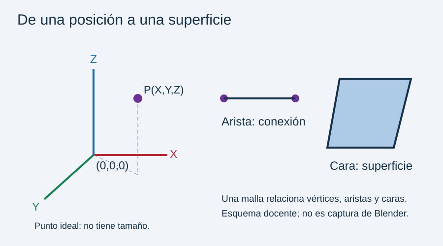
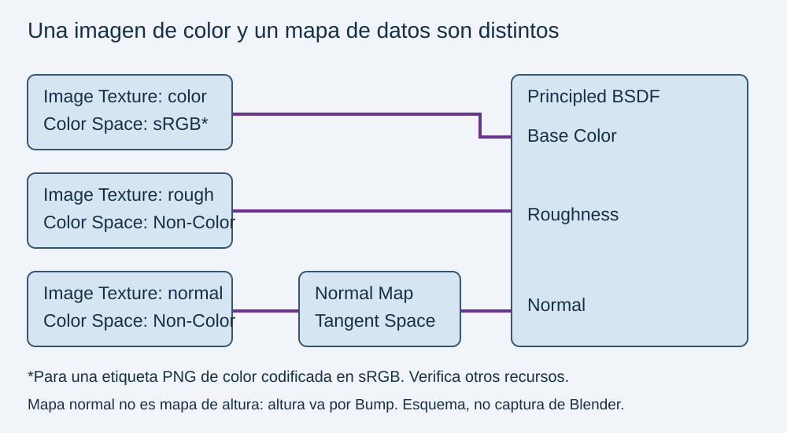
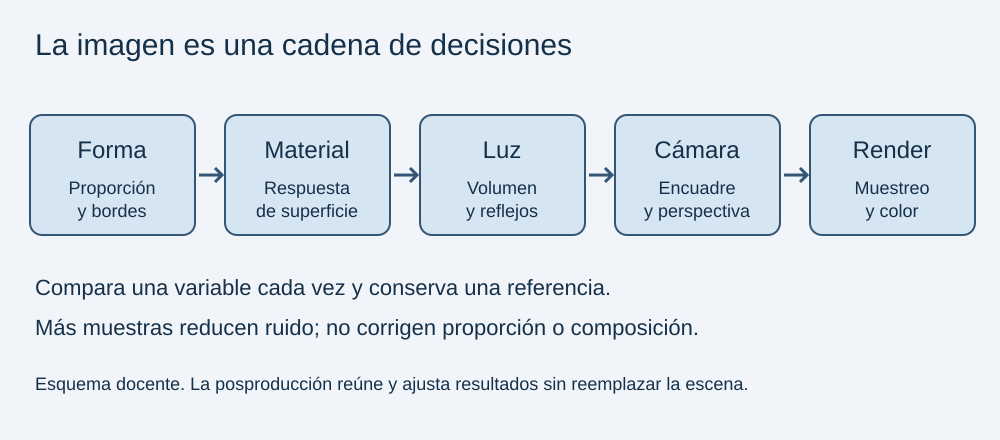
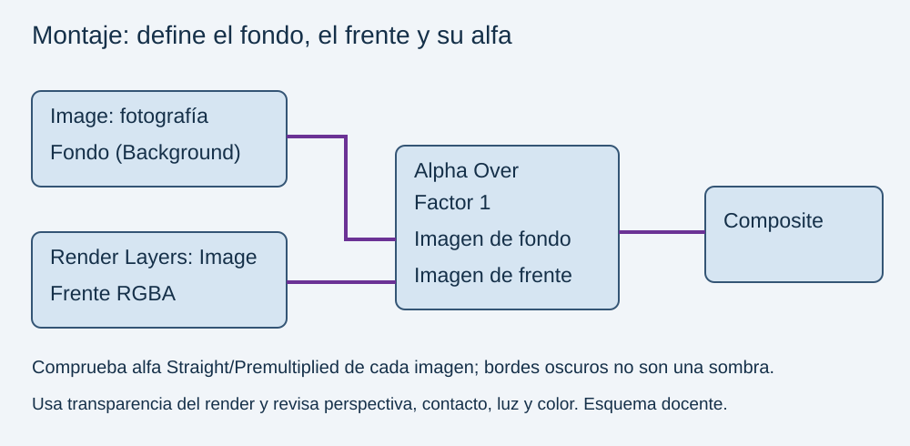

# Diseño 3D: del punto al render hiperrealista

## GUIA ESTUDIANTE

#### Guía del estudiante

Este curso comienza ubicando un punto y termina preparando imágenes de un producto dentro de una escena. Usarás Blender 4.5 LTS como versión de referencia. Otras versiones pueden cambiar la interfaz: busca el nombre de la operación mediante F3 si el menú difiere. No necesitas saber dibujo técnico ni cálculo. Aprenderás coordenadas y números negativos cuando aparezcan; comienza con manejo básico de archivos y paciencia. Los menús del curso conservan nombres en inglés y las explicaciones están en español. Configura la interfaz en English al abrir Blender o en Preferences > Interface > Translation > Language dentro de la sesión de preparación; no necesitas inglés avanzado. Usa el nombre inglés al buscar con F3.

##### Tu compromiso diario

Son 26 semanas, 182 sesiones de 20 minutos: 60 horas y 40 minutos de trabajo activo. Todos los ejercicios, repasos y evaluaciones están dentro de ese tiempo. No se exige terminar un render mientras estás sentado: guarda, inicia el cálculo y revisa el resultado en la siguiente sesión. El tiempo automático depende de tu equipo y se registra aparte.

Días 1 y 4: 6 minutos de explicación, 12 de práctica y 2 de registro. Días 2 y 5: 3 de recuperación, 14 de práctica y 3 de comprobación. Días 3 y 6: 3 de preguntas, 12 de ejercicio y 5 de corrección. Día 7: 3 de recuperación, 10 de evaluación, 5 de corrección y 2 de registro. En el primer día, el diagnóstico ocupa los primeros 5 minutos dentro del bloque de 6 de explicación. Si una tarea no cabe, guarda su estado: la siguiente sesión de recuperación sustituye su ejercicio previsto. No acumules trabajo fuera del horario.

##### Antes de empezar

La preparación e instalación activa de Blender se distribuyen en las sesiones 1–3 dentro de sus 20 minutos; las descargas automáticas se cuentan aparte. Usa el sitio oficial, comprueba que abre una escena y guarda un archivo de prueba cuando la instalación esté disponible. Un ratón con rueda facilita navegar; puedes usar las preferencias de emulación si tu portátil carece de teclado numérico o botón central. Revisa la ayuda de la versión instalada antes de cambiar atajos. No midas tu progreso por la rapidez del ordenador.

Crea una carpeta `mi_curso_3d` con `blends`, `texturas`, `referencias`, `renders` y `evidencias`. Guarda versiones como `S03_D02_producto_v01.blend`. Conserva el archivo editable junto con la imagen: una imagen sola no demuestra que el modelo puede corregirse. Documenta el origen y la licencia de cada recurso externo.

##### Cómo aprender sin memorizar todos los botones

Primero predice el resultado; después haz una sola operación y explica qué cambió. Distingue objeto de geometría y vista de cámara. Deshacer es parte de explorar. Anota un error, su causa probable y la corrección. Repite herramientas conocidas en un objeto distinto: copiar instrucciones no basta para demostrar comprensión.

Si te atascas, usa este orden: confirma el objeto seleccionado, el modo actual, la orientación, la escala y el modificador activo. Consulta la referencia oficial de la semana. Dedica como máximo 5 minutos de la sesión al bloqueo; luego guarda y vuelve al ejercicio de recuperación. No amplíes el horario como castigo.

##### Evidencia y evaluación

Cada semana entrega la evidencia indicada: archivo `.blend`, captura o comparación controlada. Explica en dos frases qué decidiste y por qué. Una mejora útil puede ser un borde más creíble o una reflexión legible; una escena más recargada no necesariamente es mejor. Usa la rúbrica semanal y corrige el criterio de menor puntuación en el espacio reservado para ello.

En el proyecto final entregarás archivos editables, recursos permitidos, imágenes finales y una explicación del proceso. “Hiperrealismo” es una meta de observación y coherencia visual, no una garantía automática. Escala, luz, cámara, material e imperfecciones deben colaborar. Más muestras no arreglan una composición o un material mal planteados.

##### Recursos del curso

- [Diagnóstico inicial](modulo_0/diagnostico.md): integrado en las sesiones de apertura.
- [Glosario y conceptos previos](modulo_0/glosario.md).
- [Coordenadas y perspectiva](simulaciones/coordenadas-perspectiva.html): exploración sin instalar nada adicional.
- [Luz y rugosidad](simulaciones/luz-rugosidad.html): aproximación didáctica, no un render de Blender.
- [Referencias oficiales](REFERENCIAS.md).

Las simulaciones funcionan sin conexión al abrir los HTML en un navegador. La documentación oficial requiere conexión. Las ilustraciones son esquemas, no capturas de Blender ni ejemplos de renders finales.

## GUIA INSTRUCTOR

#### Guía del instructor

El estudiante dispone de 20 minutos diarios durante 26 semanas: 182 sesiones y 60 h 40 min de actividad. La propuesta sirve para autoestudio con acompañamiento opcional. El objetivo es construir y presentar un producto en una escena mediante Blender, desde coordenadas hasta una imagen final coherente. No se presupone formación previa en 3D.

##### Acompañamiento dentro del presupuesto

Si hay profesor, su revisión sustituye parte del repaso o evaluación programados; no añade una reunión obligatoria. Pida al estudiante explicar una decisión y observar una discrepancia antes de mostrar la solución. En una revisión de 5 minutos puede comprobar selección/modo, un archivo editable y un criterio de la rúbrica. Evite convertir cada sesión en una demostración larga.

La base documental es Blender 4.5 LTS. Compruebe los cambios de interfaz si usa otra versión. Un curso de fundamentos no necesita prometer que su versión es la más reciente. Registre sistema operativo, versión y método de entrada para interpretar dificultades sin atribuirlas automáticamente al estudiante.

##### Diagnóstico y recuperación

El diagnóstico ocupa los primeros 5 minutos del día 1, dentro de su bloque de explicación; no se trata como examen de admisión. Si faltan números negativos, archivos o coordenadas, reemplace el primer ejercicio equivalente por su actividad de nivelación. No agregue minutos. Dificultad de navegación y dificultad conceptual son observaciones diferentes.

El día de recuperación reemplaza la tarea prevista si hay un bloqueo. Reduzca alcance antes de aumentar carga: una pieza sencilla con decisiones explicadas vale más que un modelo complejo inconcluso. El estudiante avanza cuando reproduce una acción sin copiar cada clic y reconoce su consecuencia.

##### Evaluar el proceso

Exija evidencia editable y una comparación antes/después cuando corresponda. Revise geometría, escala, organización, material, cámara y luz según el momento del curso. Las rúbricas específicas están en cada módulo. La calidad de una imagen depende también del equipo: no penalice únicamente resolución o tiempo de cálculo.

Para la evaluación final, valore forma y proporción, coherencia de materiales, luz y reflejos, composición, organización y explicación. Verifique autoría mediante una pequeña modificación en el `.blend`, no mediante sospechas basadas en apariencia. Diferencie defectos del modelo, del sombreado y del muestreo; aumentar muestras solo atiende parte del ruido.

##### Recursos y alcance técnico

Las dos simulaciones HTML permiten predicción y comparación; no sustituyen Blender. La de luz usa sombreado simplificado de una esfera, sin transporte completo de luz, rebotes ni gestión de color física. Los SVG son esquemas docentes. No presente ninguno como render hiperrealista.

Los cálculos automáticos de render se cuentan aparte de los 20 minutos activos. Favorezca previsualizaciones pequeñas y registre resolución, motor y tiempo. La validación editorial de este curso no equivale a ejecutar todos los ejercicios en cada GPU; haga un piloto y compruebe archivos finales en Blender antes de certificar resultados de una cohorte.

El curso enseña representación visual. La visualización de un producto no certifica tolerancias, resistencia ni fabricación. La salida final debe explicar qué se diseñó y qué solo se representó. Use recursos propios o con licencia comprobable; registre atribuciones y evite entregar archivos externos sin permiso.

## REFERENCIAS

#### Referencias y verificación documental

Diseño 3D del punto a la imagen hiperrealista · D3DH-001. Consulta: 2026-10-04 (America/Bogota). Versión didáctica: Blender 4.5 LTS.

##### Alcance y actualidad

26 temas semanales, tres referencias verificadas por tema: 78 vínculos de sustento, con 37 páginas oficiales distintas. Se comprobó acceso HTTP 200 y título de versión; se revisaron porciones pertinentes de materiales, color, montaje y captura de sombras. Esto no equivale a ejecutar cada ejercicio en Blender. Las páginas del manual no declaran fecha editorial individual: se registran como s. f., sin usar copyright o fecha de consulta como publicación.

El workflow solicita diversidad de sitios y 70 % de publicaciones desde 2022. Aquí se conserva el manual oficial de la versión seleccionada para evitar mezclar interfaces y comportamientos. Los tres apoyos de cada tema pertenecen al mismo sitio; la regla de máximo dos no se cumple. Tampoco puede calcularse honestamente el porcentaje temporal de páginas sin fecha. Estas excepciones se documentan; no se inventan autores ni fechas.

##### Sustento por tema

###### Tema 1.1: Puntos y orientación en el espacio

Archivos: modulos/modulo_1/tema_1.1_subtema_1.1.1_contenido.md y segundo subtema de la semana.

- [R1: Window System Introduction](https://docs.blender.org/manual/en/4.5/interface/window_system/introduction.html). Fuente: Blender Foundation, manual 4.5, s. f.
- [R2: Perspective/Orthographic](https://docs.blender.org/manual/en/4.5/editors/3dview/navigate/projections.html). Fuente: Blender Foundation, manual 4.5, s. f.
- [R3: Introduction](https://docs.blender.org/manual/en/4.5/scene_layout/object/editing/transform/introduction.html). Fuente: Blender Foundation, manual 4.5, s. f.

Estado: sustento documental disponible; prueba práctica en Blender pendiente.

###### Tema 2.1: Transformaciones y medidas

Archivos: modulos/modulo_2/tema_2.1_subtema_2.1.1_contenido.md y segundo subtema de la semana.

- [R37: Transform](https://docs.blender.org/manual/en/4.5/scene_layout/object/properties/transforms.html). Fuente: Blender Foundation, manual 4.5, s. f.
- [R32: Transform Orientation](https://docs.blender.org/manual/en/4.5/editors/3dview/controls/orientation.html). Fuente: Blender Foundation, manual 4.5, s. f.
- [R4: Scale](https://docs.blender.org/manual/en/4.5/scene_layout/object/editing/transform/scale.html). Fuente: Blender Foundation, manual 4.5, s. f.

Estado: sustento documental disponible; prueba práctica en Blender pendiente.

###### Tema 3.1: De vértices a volúmenes

Archivos: modulos/modulo_3/tema_3.1_subtema_3.1.1_contenido.md y segundo subtema de la semana.

- [R5: Introduction](https://docs.blender.org/manual/en/4.5/modeling/meshes/introduction.html). Fuente: Blender Foundation, manual 4.5, s. f.
- [R6: Mesh Structure](https://docs.blender.org/manual/en/4.5/modeling/meshes/structure.html). Fuente: Blender Foundation, manual 4.5, s. f.
- [R7: Extrude](https://docs.blender.org/manual/en/4.5/modeling/meshes/editing/mesh/extrude.html). Fuente: Blender Foundation, manual 4.5, s. f.

Estado: sustento documental disponible; prueba práctica en Blender pendiente.

###### Tema 4.1: Referencias y proporción

Archivos: modulos/modulo_4/tema_4.1_subtema_4.1.1_contenido.md y segundo subtema de la semana.

- [R2: Perspective/Orthographic](https://docs.blender.org/manual/en/4.5/editors/3dview/navigate/projections.html). Fuente: Blender Foundation, manual 4.5, s. f.
- [R4: Scale](https://docs.blender.org/manual/en/4.5/scene_layout/object/editing/transform/scale.html). Fuente: Blender Foundation, manual 4.5, s. f.
- [R19: Cameras](https://docs.blender.org/manual/en/4.5/render/cameras.html). Fuente: Blender Foundation, manual 4.5, s. f.

Estado: sustento documental disponible; prueba práctica en Blender pendiente.

###### Tema 5.1: Construcción de piezas

Archivos: modulos/modulo_5/tema_5.1_subtema_5.1.1_contenido.md y segundo subtema de la semana.

- [R7: Extrude](https://docs.blender.org/manual/en/4.5/modeling/meshes/editing/mesh/extrude.html). Fuente: Blender Foundation, manual 4.5, s. f.
- [R33: Inset Faces](https://docs.blender.org/manual/en/4.5/modeling/meshes/editing/face/inset_faces.html). Fuente: Blender Foundation, manual 4.5, s. f.
- [R8: Mirror Modifier](https://docs.blender.org/manual/en/4.5/modeling/modifiers/generate/mirror.html). Fuente: Blender Foundation, manual 4.5, s. f.

Estado: sustento documental disponible; prueba práctica en Blender pendiente.

###### Tema 6.1: Operaciones de modelado

Archivos: modulos/modulo_6/tema_6.1_subtema_6.1.1_contenido.md y segundo subtema de la semana.

- [R34: Boolean Modifier](https://docs.blender.org/manual/en/4.5/modeling/modifiers/generate/booleans.html). Fuente: Blender Foundation, manual 4.5, s. f.
- [R8: Mirror Modifier](https://docs.blender.org/manual/en/4.5/modeling/modifiers/generate/mirror.html). Fuente: Blender Foundation, manual 4.5, s. f.
- [R6: Mesh Structure](https://docs.blender.org/manual/en/4.5/modeling/meshes/structure.html). Fuente: Blender Foundation, manual 4.5, s. f.

Estado: sustento documental disponible; prueba práctica en Blender pendiente.

###### Tema 7.1: Bordes y sombreado

Archivos: modulos/modulo_7/tema_7.1_subtema_7.1.1_contenido.md y segundo subtema de la semana.

- [R9: Bevel Modifier](https://docs.blender.org/manual/en/4.5/modeling/modifiers/generate/bevel.html). Fuente: Blender Foundation, manual 4.5, s. f.
- [R10: Bevel Edges](https://docs.blender.org/manual/en/4.5/modeling/meshes/editing/edge/bevel.html). Fuente: Blender Foundation, manual 4.5, s. f.
- [R13: Subdivision Surface Modifier](https://docs.blender.org/manual/en/4.5/modeling/modifiers/generate/subdivision_surface.html). Fuente: Blender Foundation, manual 4.5, s. f.

Estado: sustento documental disponible; prueba práctica en Blender pendiente.

###### Tema 8.1: Curvas y superficies

Archivos: modulos/modulo_8/tema_8.1_subtema_8.1.1_contenido.md y segundo subtema de la semana.

- [R11: Introduction](https://docs.blender.org/manual/en/4.5/modeling/curves/introduction.html). Fuente: Blender Foundation, manual 4.5, s. f.
- [R12: Geometry](https://docs.blender.org/manual/en/4.5/modeling/curves/properties/geometry.html). Fuente: Blender Foundation, manual 4.5, s. f.
- [R13: Subdivision Surface Modifier](https://docs.blender.org/manual/en/4.5/modeling/modifiers/generate/subdivision_surface.html). Fuente: Blender Foundation, manual 4.5, s. f.

Estado: sustento documental disponible; prueba práctica en Blender pendiente.

###### Tema 9.1: Coordenadas UV

Archivos: modulos/modulo_9/tema_9.1_subtema_9.1.1_contenido.md y segundo subtema de la semana.

- [R31: Introduction](https://docs.blender.org/manual/en/4.5/modeling/meshes/uv/unwrapping/introduction.html). Fuente: Blender Foundation, manual 4.5, s. f.
- [R14: Seams](https://docs.blender.org/manual/en/4.5/modeling/meshes/uv/unwrapping/seams.html). Fuente: Blender Foundation, manual 4.5, s. f.
- [R15: Image Texture Node](https://docs.blender.org/manual/en/4.5/render/shader_nodes/textures/image.html). Fuente: Blender Foundation, manual 4.5, s. f.

Estado: sustento documental disponible; prueba práctica en Blender pendiente.

###### Tema 10.1: Texturas y etiquetas

Archivos: modulos/modulo_10/tema_10.1_subtema_10.1.1_contenido.md y segundo subtema de la semana.

- [R15: Image Texture Node](https://docs.blender.org/manual/en/4.5/render/shader_nodes/textures/image.html). Fuente: Blender Foundation, manual 4.5, s. f.
- [R31: Introduction](https://docs.blender.org/manual/en/4.5/modeling/meshes/uv/unwrapping/introduction.html). Fuente: Blender Foundation, manual 4.5, s. f.
- [R23: Color Management](https://docs.blender.org/manual/en/4.5/render/color_management.html). Fuente: Blender Foundation, manual 4.5, s. f.

Estado: sustento documental disponible; prueba práctica en Blender pendiente.

###### Tema 11.1: Materiales PBR

Archivos: modulos/modulo_11/tema_11.1_subtema_11.1.1_contenido.md y segundo subtema de la semana.

- [R16: Principled BSDF](https://docs.blender.org/manual/en/4.5/render/shader_nodes/shader/principled.html). Fuente: Blender Foundation, manual 4.5, s. f.
- [R15: Image Texture Node](https://docs.blender.org/manual/en/4.5/render/shader_nodes/textures/image.html). Fuente: Blender Foundation, manual 4.5, s. f.
- [R18: Normal Map Node](https://docs.blender.org/manual/en/4.5/render/shader_nodes/vector/normal_map.html). Fuente: Blender Foundation, manual 4.5, s. f.

Estado: sustento documental disponible; prueba práctica en Blender pendiente.

###### Tema 12.1: Imperfecciones y realismo

Archivos: modulos/modulo_12/tema_12.1_subtema_12.1.1_contenido.md y segundo subtema de la semana.

- [R16: Principled BSDF](https://docs.blender.org/manual/en/4.5/render/shader_nodes/shader/principled.html). Fuente: Blender Foundation, manual 4.5, s. f.
- [R17: Bump Node](https://docs.blender.org/manual/en/4.5/render/shader_nodes/vector/bump.html). Fuente: Blender Foundation, manual 4.5, s. f.
- [R18: Normal Map Node](https://docs.blender.org/manual/en/4.5/render/shader_nodes/vector/normal_map.html). Fuente: Blender Foundation, manual 4.5, s. f.

Estado: sustento documental disponible; prueba práctica en Blender pendiente.

###### Tema 13.1: Cámara y composición

Archivos: modulos/modulo_13/tema_13.1_subtema_13.1.1_contenido.md y segundo subtema de la semana.

- [R19: Cameras](https://docs.blender.org/manual/en/4.5/render/cameras.html). Fuente: Blender Foundation, manual 4.5, s. f.
- [R2: Perspective/Orthographic](https://docs.blender.org/manual/en/4.5/editors/3dview/navigate/projections.html). Fuente: Blender Foundation, manual 4.5, s. f.
- [R23: Color Management](https://docs.blender.org/manual/en/4.5/render/color_management.html). Fuente: Blender Foundation, manual 4.5, s. f.

Estado: sustento documental disponible; prueba práctica en Blender pendiente.

###### Tema 14.1: Luz y sombras

Archivos: modulos/modulo_14/tema_14.1_subtema_14.1.1_contenido.md y segundo subtema de la semana.

- [R20: Light Objects](https://docs.blender.org/manual/en/4.5/render/lights/light_object.html). Fuente: Blender Foundation, manual 4.5, s. f.
- [R22: Light Paths](https://docs.blender.org/manual/en/4.5/render/cycles/render_settings/light_paths.html). Fuente: Blender Foundation, manual 4.5, s. f.
- [R30: Introduction](https://docs.blender.org/manual/en/4.5/render/cycles/introduction.html). Fuente: Blender Foundation, manual 4.5, s. f.

Estado: sustento documental disponible; prueba práctica en Blender pendiente.

###### Tema 15.1: Estudio de producto

Archivos: modulos/modulo_15/tema_15.1_subtema_15.1.1_contenido.md y segundo subtema de la semana.

- [R20: Light Objects](https://docs.blender.org/manual/en/4.5/render/lights/light_object.html). Fuente: Blender Foundation, manual 4.5, s. f.
- [R19: Cameras](https://docs.blender.org/manual/en/4.5/render/cameras.html). Fuente: Blender Foundation, manual 4.5, s. f.
- [R16: Principled BSDF](https://docs.blender.org/manual/en/4.5/render/shader_nodes/shader/principled.html). Fuente: Blender Foundation, manual 4.5, s. f.

Estado: sustento documental disponible; prueba práctica en Blender pendiente.

###### Tema 16.1: Render y presupuesto de calidad

Archivos: modulos/modulo_16/tema_16.1_subtema_16.1.1_contenido.md y segundo subtema de la semana.

- [R21: Sampling](https://docs.blender.org/manual/en/4.5/render/cycles/render_settings/sampling.html). Fuente: Blender Foundation, manual 4.5, s. f.
- [R22: Light Paths](https://docs.blender.org/manual/en/4.5/render/cycles/render_settings/light_paths.html). Fuente: Blender Foundation, manual 4.5, s. f.
- [R28: Output](https://docs.blender.org/manual/en/4.5/render/output/properties/output.html). Fuente: Blender Foundation, manual 4.5, s. f.

Estado: sustento documental disponible; prueba práctica en Blender pendiente.

###### Tema 17.1: Color y exposición

Archivos: modulos/modulo_17/tema_17.1_subtema_17.1.1_contenido.md y segundo subtema de la semana.

- [R23: Color Management](https://docs.blender.org/manual/en/4.5/render/color_management.html). Fuente: Blender Foundation, manual 4.5, s. f.
- [R15: Image Texture Node](https://docs.blender.org/manual/en/4.5/render/shader_nodes/textures/image.html). Fuente: Blender Foundation, manual 4.5, s. f.
- [R28: Output](https://docs.blender.org/manual/en/4.5/render/output/properties/output.html). Fuente: Blender Foundation, manual 4.5, s. f.

Estado: sustento documental disponible; prueba práctica en Blender pendiente.

###### Tema 18.1: Composición y capas

Archivos: modulos/modulo_18/tema_18.1_subtema_18.1.1_contenido.md y segundo subtema de la semana.

- [R24: Introduction](https://docs.blender.org/manual/en/4.5/compositing/introduction.html). Fuente: Blender Foundation, manual 4.5, s. f.
- [R25: Alpha Over Node](https://docs.blender.org/manual/en/4.5/compositing/types/color/mix/alpha_over.html). Fuente: Blender Foundation, manual 4.5, s. f.
- [R35: Alpha Convert Node](https://docs.blender.org/manual/en/4.5/compositing/types/color/alpha_convert.html). Fuente: Blender Foundation, manual 4.5, s. f.

Estado: sustento documental disponible; prueba práctica en Blender pendiente.

###### Tema 19.1: Perspectiva del montaje fotográfico

Archivos: modulos/modulo_19/tema_19.1_subtema_19.1.1_contenido.md y segundo subtema de la semana.

- [R19: Cameras](https://docs.blender.org/manual/en/4.5/render/cameras.html). Fuente: Blender Foundation, manual 4.5, s. f.
- [R2: Perspective/Orthographic](https://docs.blender.org/manual/en/4.5/editors/3dview/navigate/projections.html). Fuente: Blender Foundation, manual 4.5, s. f.
- [R25: Alpha Over Node](https://docs.blender.org/manual/en/4.5/compositing/types/color/mix/alpha_over.html). Fuente: Blender Foundation, manual 4.5, s. f.

Estado: sustento documental disponible; prueba práctica en Blender pendiente.

###### Tema 20.1: Sombras y oclusión del montaje

Archivos: modulos/modulo_20/tema_20.1_subtema_20.1.1_contenido.md y segundo subtema de la semana.

- [R27: Object](https://docs.blender.org/manual/en/4.5/render/cycles/object_settings/object_data.html). Fuente: Blender Foundation, manual 4.5, s. f.
- [R36: Editing Masks](https://docs.blender.org/manual/en/4.5/movie_clip/masking/editing.html). Fuente: Blender Foundation, manual 4.5, s. f.
- [R25: Alpha Over Node](https://docs.blender.org/manual/en/4.5/compositing/types/color/mix/alpha_over.html). Fuente: Blender Foundation, manual 4.5, s. f.

Estado: sustento documental disponible; prueba práctica en Blender pendiente.

###### Tema 21.1: Continuidad del montaje

Archivos: modulos/modulo_21/tema_21.1_subtema_21.1.1_contenido.md y segundo subtema de la semana.

- [R23: Color Management](https://docs.blender.org/manual/en/4.5/render/color_management.html). Fuente: Blender Foundation, manual 4.5, s. f.
- [R19: Cameras](https://docs.blender.org/manual/en/4.5/render/cameras.html). Fuente: Blender Foundation, manual 4.5, s. f.
- [R24: Introduction](https://docs.blender.org/manual/en/4.5/compositing/introduction.html). Fuente: Blender Foundation, manual 4.5, s. f.

Estado: sustento documental disponible; prueba práctica en Blender pendiente.

###### Tema 22.1: Proyecto: alcance y referencias

Archivos: modulos/modulo_22/tema_22.1_subtema_22.1.1_contenido.md y segundo subtema de la semana.

- [R19: Cameras](https://docs.blender.org/manual/en/4.5/render/cameras.html). Fuente: Blender Foundation, manual 4.5, s. f.
- [R16: Principled BSDF](https://docs.blender.org/manual/en/4.5/render/shader_nodes/shader/principled.html). Fuente: Blender Foundation, manual 4.5, s. f.
- [R28: Output](https://docs.blender.org/manual/en/4.5/render/output/properties/output.html). Fuente: Blender Foundation, manual 4.5, s. f.

Estado: sustento documental disponible; prueba práctica en Blender pendiente.

###### Tema 23.1: Proyecto: modelo definitivo

Archivos: modulos/modulo_23/tema_23.1_subtema_23.1.1_contenido.md y segundo subtema de la semana.

- [R6: Mesh Structure](https://docs.blender.org/manual/en/4.5/modeling/meshes/structure.html). Fuente: Blender Foundation, manual 4.5, s. f.
- [R9: Bevel Modifier](https://docs.blender.org/manual/en/4.5/modeling/modifiers/generate/bevel.html). Fuente: Blender Foundation, manual 4.5, s. f.
- [R13: Subdivision Surface Modifier](https://docs.blender.org/manual/en/4.5/modeling/modifiers/generate/subdivision_surface.html). Fuente: Blender Foundation, manual 4.5, s. f.

Estado: sustento documental disponible; prueba práctica en Blender pendiente.

###### Tema 24.1: Proyecto: materiales y cámara

Archivos: modulos/modulo_24/tema_24.1_subtema_24.1.1_contenido.md y segundo subtema de la semana.

- [R16: Principled BSDF](https://docs.blender.org/manual/en/4.5/render/shader_nodes/shader/principled.html). Fuente: Blender Foundation, manual 4.5, s. f.
- [R15: Image Texture Node](https://docs.blender.org/manual/en/4.5/render/shader_nodes/textures/image.html). Fuente: Blender Foundation, manual 4.5, s. f.
- [R19: Cameras](https://docs.blender.org/manual/en/4.5/render/cameras.html). Fuente: Blender Foundation, manual 4.5, s. f.

Estado: sustento documental disponible; prueba práctica en Blender pendiente.

###### Tema 25.1: Proyecto: imagen de estudio

Archivos: modulos/modulo_25/tema_25.1_subtema_25.1.1_contenido.md y segundo subtema de la semana.

- [R20: Light Objects](https://docs.blender.org/manual/en/4.5/render/lights/light_object.html). Fuente: Blender Foundation, manual 4.5, s. f.
- [R21: Sampling](https://docs.blender.org/manual/en/4.5/render/cycles/render_settings/sampling.html). Fuente: Blender Foundation, manual 4.5, s. f.
- [R23: Color Management](https://docs.blender.org/manual/en/4.5/render/color_management.html). Fuente: Blender Foundation, manual 4.5, s. f.

Estado: sustento documental disponible; prueba práctica en Blender pendiente.

###### Tema 26.1: Proyecto: imagen contextual y entrega

Archivos: modulos/modulo_26/tema_26.1_subtema_26.1.1_contenido.md y segundo subtema de la semana.

- [R25: Alpha Over Node](https://docs.blender.org/manual/en/4.5/compositing/types/color/mix/alpha_over.html). Fuente: Blender Foundation, manual 4.5, s. f.
- [R27: Object](https://docs.blender.org/manual/en/4.5/render/cycles/object_settings/object_data.html). Fuente: Blender Foundation, manual 4.5, s. f.
- [R29: Packed Data](https://docs.blender.org/manual/en/4.5/files/blend/packed_data.html). Fuente: Blender Foundation, manual 4.5, s. f.

Estado: sustento documental disponible; prueba práctica en Blender pendiente.

##### Catálogo de fuentes y extractos

Cada extracto se reproduce una sola vez y tiene como máximo diez palabras. Son fragmentos reales recuperados de la página; los encabezados breves son evidencia de interfaz, no definición completa.

###### R1. Window System Introduction - Blender 4.5 LTS Manual

- Autor: Blender Foundation y colaboradores del manual. Tipo: documentación oficial. Año: s. f.
- [Página consultada](https://docs.blender.org/manual/en/4.5/interface/window_system/introduction.html); acceso comprobado HTTP 200 el 2026-10-05.
- Extracto: “After starting Blender and closing the Splash Screen, the Blender”.

###### R2. Perspective/Orthographic - Blender 4.5 LTS Manual

- Autor: Blender Foundation y colaboradores del manual. Tipo: documentación oficial. Año: s. f.
- [Página consultada](https://docs.blender.org/manual/en/4.5/editors/3dview/navigate/projections.html); acceso comprobado HTTP 200 el 2026-10-05.
- Extracto: “All modes”.

###### R3. Introduction - Blender 4.5 LTS Manual

- Autor: Blender Foundation y colaboradores del manual. Tipo: documentación oficial. Año: s. f.
- [Página consultada](https://docs.blender.org/manual/en/4.5/scene_layout/object/editing/transform/introduction.html); acceso comprobado HTTP 200 el 2026-10-05.
- Extracto: “Transformations refer to a number of operations that can be”.

###### R4. Scale - Blender 4.5 LTS Manual

- Autor: Blender Foundation y colaboradores del manual. Tipo: documentación oficial. Año: s. f.
- [Página consultada](https://docs.blender.org/manual/en/4.5/scene_layout/object/editing/transform/scale.html); acceso comprobado HTTP 200 el 2026-10-05.
- Extracto: “Object and Edit Modes”.

###### R5. Introduction - Blender 4.5 LTS Manual

- Autor: Blender Foundation y colaboradores del manual. Tipo: documentación oficial. Año: s. f.
- [Página consultada](https://docs.blender.org/manual/en/4.5/modeling/meshes/introduction.html); acceso comprobado HTTP 200 el 2026-10-05.
- Extracto: “Mesh Modeling typically begins with a Mesh Primitive shape (e.g.”.

###### R6. Mesh Structure - Blender 4.5 LTS Manual

- Autor: Blender Foundation y colaboradores del manual. Tipo: documentación oficial. Año: s. f.
- [Página consultada](https://docs.blender.org/manual/en/4.5/modeling/meshes/structure.html); acceso comprobado HTTP 200 el 2026-10-05.
- Extracto: “With meshes, everything is built from three basic elements: vertices,”.

###### R7. Extrude - Blender 4.5 LTS Manual

- Autor: Blender Foundation y colaboradores del manual. Tipo: documentación oficial. Año: s. f.
- [Página consultada](https://docs.blender.org/manual/en/4.5/modeling/meshes/editing/mesh/extrude.html); acceso comprobado HTTP 200 el 2026-10-05.
- Extracto: “Edit Mode”.

###### R8. Mirror Modifier - Blender 4.5 LTS Manual

- Autor: Blender Foundation y colaboradores del manual. Tipo: documentación oficial. Año: s. f.
- [Página consultada](https://docs.blender.org/manual/en/4.5/modeling/modifiers/generate/mirror.html); acceso comprobado HTTP 200 el 2026-10-05.
- Extracto: “The Mirror modifier mirrors a mesh along its local X,”.

###### R9. Bevel Modifier - Blender 4.5 LTS Manual

- Autor: Blender Foundation y colaboradores del manual. Tipo: documentación oficial. Año: s. f.
- [Página consultada](https://docs.blender.org/manual/en/4.5/modeling/modifiers/generate/bevel.html); acceso comprobado HTTP 200 el 2026-10-05.
- Extracto: “The Bevel modifier.¶”.

###### R10. Bevel Edges - Blender 4.5 LTS Manual

- Autor: Blender Foundation y colaboradores del manual. Tipo: documentación oficial. Año: s. f.
- [Página consultada](https://docs.blender.org/manual/en/4.5/modeling/meshes/editing/edge/bevel.html); acceso comprobado HTTP 200 el 2026-10-05.
- Extracto: “Edit Mode”.

###### R11. Introduction - Blender 4.5 LTS Manual

- Autor: Blender Foundation y colaboradores del manual. Tipo: documentación oficial. Año: s. f.
- [Página consultada](https://docs.blender.org/manual/en/4.5/modeling/curves/introduction.html); acceso comprobado HTTP 200 el 2026-10-05.
- Extracto: “Curves and Surfaces are particular types of Blender objects. They”.

###### R12. Geometry - Blender 4.5 LTS Manual

- Autor: Blender Foundation y colaboradores del manual. Tipo: documentación oficial. Año: s. f.
- [Página consultada](https://docs.blender.org/manual/en/4.5/modeling/curves/properties/geometry.html); acceso comprobado HTTP 200 el 2026-10-05.
- Extracto: “Geometry panel.¶”.

###### R13. Subdivision Surface Modifier - Blender 4.5 LTS Manual

- Autor: Blender Foundation y colaboradores del manual. Tipo: documentación oficial. Año: s. f.
- [Página consultada](https://docs.blender.org/manual/en/4.5/modeling/modifiers/generate/subdivision_surface.html); acceso comprobado HTTP 200 el 2026-10-05.
- Extracto: “The Subdivision Surface modifier (often shortened as slang to “Subdiv””.

###### R14. Seams - Blender 4.5 LTS Manual

- Autor: Blender Foundation y colaboradores del manual. Tipo: documentación oficial. Año: s. f.
- [Página consultada](https://docs.blender.org/manual/en/4.5/modeling/meshes/uv/unwrapping/seams.html); acceso comprobado HTTP 200 el 2026-10-05.
- Extracto: “For many cases, using the Unwrap calculations of Cube, Cylinder,”.

###### R15. Image Texture Node - Blender 4.5 LTS Manual

- Autor: Blender Foundation y colaboradores del manual. Tipo: documentación oficial. Año: s. f.
- [Página consultada](https://docs.blender.org/manual/en/4.5/render/shader_nodes/textures/image.html); acceso comprobado HTTP 200 el 2026-10-05.
- Extracto: “Used for applying an image as a texture.”.

###### R16. Principled BSDF - Blender 4.5 LTS Manual

- Autor: Blender Foundation y colaboradores del manual. Tipo: documentación oficial. Año: s. f.
- [Página consultada](https://docs.blender.org/manual/en/4.5/render/shader_nodes/shader/principled.html); acceso comprobado HTTP 200 el 2026-10-05.
- Extracto: “The Principled BSDF that combines multiple layers into a single”.

###### R17. Bump Node - Blender 4.5 LTS Manual

- Autor: Blender Foundation y colaboradores del manual. Tipo: documentación oficial. Año: s. f.
- [Página consultada](https://docs.blender.org/manual/en/4.5/render/shader_nodes/vector/bump.html); acceso comprobado HTTP 200 el 2026-10-05.
- Extracto: “The Bump node generates a perturbed normal from a height”.

###### R18. Normal Map Node - Blender 4.5 LTS Manual

- Autor: Blender Foundation y colaboradores del manual. Tipo: documentación oficial. Año: s. f.
- [Página consultada](https://docs.blender.org/manual/en/4.5/render/shader_nodes/vector/normal_map.html); acceso comprobado HTTP 200 el 2026-10-05.
- Extracto: “The Normal Map node generates a perturbed normal from an”.

###### R19. Cameras - Blender 4.5 LTS Manual

- Autor: Blender Foundation y colaboradores del manual. Tipo: documentación oficial. Año: s. f.
- [Página consultada](https://docs.blender.org/manual/en/4.5/render/cameras.html); acceso comprobado HTTP 200 el 2026-10-05.
- Extracto: “A camera is an object that provides a means of”.

###### R20. Light Objects - Blender 4.5 LTS Manual

- Autor: Blender Foundation y colaboradores del manual. Tipo: documentación oficial. Año: s. f.
- [Página consultada](https://docs.blender.org/manual/en/4.5/render/lights/light_object.html); acceso comprobado HTTP 200 el 2026-10-05.
- Extracto: “Properties ‣ Object Data and Shader Editor ‣ Sidebar ‣”.

###### R21. Sampling - Blender 4.5 LTS Manual

- Autor: Blender Foundation y colaboradores del manual. Tipo: documentación oficial. Año: s. f.
- [Página consultada](https://docs.blender.org/manual/en/4.5/render/cycles/render_settings/sampling.html); acceso comprobado HTTP 200 el 2026-10-05.
- Extracto: “Render ‣ Sampling”.

###### R22. Light Paths - Blender 4.5 LTS Manual

- Autor: Blender Foundation y colaboradores del manual. Tipo: documentación oficial. Año: s. f.
- [Página consultada](https://docs.blender.org/manual/en/4.5/render/cycles/render_settings/light_paths.html); acceso comprobado HTTP 200 el 2026-10-05.
- Extracto: “Render ‣ Light Paths”.

###### R23. Color Management - Blender 4.5 LTS Manual

- Autor: Blender Foundation y colaboradores del manual. Tipo: documentación oficial. Año: s. f.
- [Página consultada](https://docs.blender.org/manual/en/4.5/render/color_management.html); acceso comprobado HTTP 200 el 2026-10-05.
- Extracto: “Color management is important to create renders and assets that”.

###### R24. Introduction - Blender 4.5 LTS Manual

- Autor: Blender Foundation y colaboradores del manual. Tipo: documentación oficial. Año: s. f.
- [Página consultada](https://docs.blender.org/manual/en/4.5/compositing/introduction.html); acceso comprobado HTTP 200 el 2026-10-05.
- Extracto: “Compositing Nodes allow you to assemble and enhance an image”.

###### R25. Alpha Over Node - Blender 4.5 LTS Manual

- Autor: Blender Foundation y colaboradores del manual. Tipo: documentación oficial. Año: s. f.
- [Página consultada](https://docs.blender.org/manual/en/4.5/compositing/types/color/mix/alpha_over.html); acceso comprobado HTTP 200 el 2026-10-05.
- Extracto: “The Alpha Over node is used to layer an image”.

###### R26. Passes - Blender 4.5 LTS Manual

- Autor: Blender Foundation y colaboradores del manual. Tipo: documentación oficial. Año: s. f.
- [Página consultada](https://docs.blender.org/manual/en/4.5/render/layers/passes.html); acceso comprobado HTTP 200 el 2026-10-05.
- Extracto: “Properties ‣ View Layer ‣ Passes”.

###### R27. Object - Blender 4.5 LTS Manual

- Autor: Blender Foundation y colaboradores del manual. Tipo: documentación oficial. Año: s. f.
- [Página consultada](https://docs.blender.org/manual/en/4.5/render/cycles/object_settings/object_data.html); acceso comprobado HTTP 200 el 2026-10-05.
- Extracto: “Object Properties ‣ Visibility”.

###### R28. Output - Blender 4.5 LTS Manual

- Autor: Blender Foundation y colaboradores del manual. Tipo: documentación oficial. Año: s. f.
- [Página consultada](https://docs.blender.org/manual/en/4.5/render/output/properties/output.html); acceso comprobado HTTP 200 el 2026-10-05.
- Extracto: “Output panel.¶”.

###### R29. Packed Data - Blender 4.5 LTS Manual

- Autor: Blender Foundation y colaboradores del manual. Tipo: documentación oficial. Año: s. f.
- [Página consultada](https://docs.blender.org/manual/en/4.5/files/blend/packed_data.html); acceso comprobado HTTP 200 el 2026-10-05.
- Extracto: “Blender has the ability to encapsulate (incorporate) various kinds of”.

###### R30. Introduction - Blender 4.5 LTS Manual

- Autor: Blender Foundation y colaboradores del manual. Tipo: documentación oficial. Año: s. f.
- [Página consultada](https://docs.blender.org/manual/en/4.5/render/cycles/introduction.html); acceso comprobado HTTP 200 el 2026-10-05.
- Extracto: “Cycles is Blender’s physically-based path tracer for production rendering. It”.

###### R31. Introduction - Blender 4.5 LTS Manual

- Autor: Blender Foundation y colaboradores del manual. Tipo: documentación oficial. Año: s. f.
- [Página consultada](https://docs.blender.org/manual/en/4.5/modeling/meshes/uv/unwrapping/introduction.html); acceso comprobado HTTP 200 el 2026-10-05.
- Extracto: “The first step is to unwrap your mesh. Generally, it”.

###### R32. Transform Orientation - Blender 4.5 LTS Manual

- Autor: Blender Foundation y colaboradores del manual. Tipo: documentación oficial. Año: s. f.
- [Página consultada](https://docs.blender.org/manual/en/4.5/editors/3dview/controls/orientation.html); acceso comprobado HTTP 200 el 2026-10-05.
- Extracto: “The Transform Orientation determines the orientation of the Object Gizmo.”.

###### R33. Inset Faces - Blender 4.5 LTS Manual

- Autor: Blender Foundation y colaboradores del manual. Tipo: documentación oficial. Año: s. f.
- [Página consultada](https://docs.blender.org/manual/en/4.5/modeling/meshes/editing/face/inset_faces.html); acceso comprobado HTTP 200 el 2026-10-05.
- Extracto: “This tool takes the currently selected faces and creates an”.

###### R34. Boolean Modifier - Blender 4.5 LTS Manual

- Autor: Blender Foundation y colaboradores del manual. Tipo: documentación oficial. Año: s. f.
- [Página consultada](https://docs.blender.org/manual/en/4.5/modeling/modifiers/generate/booleans.html); acceso comprobado HTTP 200 el 2026-10-05.
- Extracto: “The Boolean modifier combines multiple meshes using a Boolean operation.”.

###### R35. Alpha Convert Node - Blender 4.5 LTS Manual

- Autor: Blender Foundation y colaboradores del manual. Tipo: documentación oficial. Año: s. f.
- [Página consultada](https://docs.blender.org/manual/en/4.5/compositing/types/color/alpha_convert.html); acceso comprobado HTTP 200 el 2026-10-05.
- Extracto: “The Alpha Convert Node converts the alpha channel format of”.

###### R36. Editing Masks - Blender 4.5 LTS Manual

- Autor: Blender Foundation y colaboradores del manual. Tipo: documentación oficial. Año: s. f.
- [Página consultada](https://docs.blender.org/manual/en/4.5/movie_clip/masking/editing.html); acceso comprobado HTTP 200 el 2026-10-05.
- Extracto: “The tools and panels available to edit masks are the”.

###### R37. Transform - Blender 4.5 LTS Manual

- Autor: Blender Foundation y colaboradores del manual. Tipo: documentación oficial. Año: s. f.
- [Página consultada](https://docs.blender.org/manual/en/4.5/scene_layout/object/properties/transforms.html); acceso comprobado HTTP 200 el 2026-10-05.
- Extracto: “The Transform panel in the Sidebar region allows you to”.

##### Conceptos críticos contrastados

- La coordenada sitúa; una malla necesita conexiones y superficies para representar una forma. La vista ortográfica y la perspectiva son proyecciones distintas (R2, R7).
- Principled reúne respuestas de superficie; un mapa normal necesita interpretación mediante Normal Map y un mapa de altura se trata mediante Bump (véanse los nodos respectivos).
- La etiqueta propia PNG usa sRGB; mapas de datos se interpretan sin transformación de color. No se impone sRGB a todo recurso externo.
- AgX es una transformación de presentación; exposición y material no son intercambiables.
- Alpha Over distingue fondo y frente. El compositor trabaja con alfa premultiplicado por defecto: no activar conversión sin comprobar el estado de la imagen.
- En Cycles, Shadow Catcher y su pase permiten tratar la interacción con el fondo; sin ese pase se utiliza una aproximación. No se supone equivalente soporte en todos los motores.
- El tamaño del render, el ruido y la nitidez de forma son problemas diferentes. El tiempo automático depende del equipo, sin garantía de duración.

##### Metodología y límites

El archivo [registro de URLs](material/referencias_verificadas.json) conserva intentos fallidos además de éxitos; este documento solo enlaza fuentes con título y acceso verificados. El script de búsqueda inicial tiene rutas que se corrigieron durante la revisión, no instrucciones para el estudiante. No hay tres documentos independientes por concepto: se usan tres páginas específicas por tema. Las guías y esquemas son elaboración propia. Las dos simulaciones muestran tendencias y proyección, sin sustituir el motor de Blender. La validación funcional de ejercicios y el pilotaje siguen pendientes.

## cronograma

#### Cronograma: 26 semanas de 20 minutos diarios

182 sesiones × 20 minutos = 3640 minutos = 60 h 40 min. El tiempo de render desatendido se registra aparte. Los días 1–3 trabajan el primer subtema; los días 4–6, el segundo; el día 7 incluye evaluación y corrección. El diagnóstico del módulo 0 ocupa los primeros 5 minutos del día 1, dentro de sus 20 minutos.

##### Semana 1: Puntos y orientación en el espacio

|Sesión absoluta|Día|Actividad|Minutos|
|---:|---:|---|---:|
|1|1|Diagnóstico de 5 min integrado; preparación de Blender e interfaz: demostración y práctica|20|
|2|2|Diagnóstico, preparación de Blender e interfaz: recuperación y práctica|20|
|3|3|Diagnóstico, preparación de Blender e interfaz: ejercicio y corrección|20|
|4|4|Origen, ejes, coordenadas y guardado de archivos: demostración y práctica|20|
|5|5|Origen, ejes, coordenadas y guardado de archivos: recuperación y práctica|20|
|6|6|Origen, ejes, coordenadas y guardado de archivos: ejercicio y corrección|20|
|7|7|Evaluación práctica, corrección y registro|20|

##### Semana 2: Transformaciones y medidas

|Sesión absoluta|Día|Actividad|Minutos|
|---:|---:|---|---:|
|8|1|Traslación y coordenadas globales/locales: demostración y práctica|20|
|9|2|Traslación y coordenadas globales/locales: recuperación y práctica|20|
|10|3|Traslación y coordenadas globales/locales: ejercicio y corrección|20|
|11|4|Rotación, escala y pivote: demostración y práctica|20|
|12|5|Rotación, escala y pivote: recuperación y práctica|20|
|13|6|Rotación, escala y pivote: ejercicio y corrección|20|
|14|7|Evaluación práctica, corrección y registro|20|

##### Semana 3: De vértices a volúmenes

|Sesión absoluta|Día|Actividad|Minutos|
|---:|---:|---|---:|
|15|1|Vértices, aristas, caras y normales: demostración y práctica|20|
|16|2|Vértices, aristas, caras y normales: recuperación y práctica|20|
|17|3|Vértices, aristas, caras y normales: ejercicio y corrección|20|
|18|4|Primitivas, selección y malla cerrada: demostración y práctica|20|
|19|5|Primitivas, selección y malla cerrada: recuperación y práctica|20|
|20|6|Primitivas, selección y malla cerrada: ejercicio y corrección|20|
|21|7|Evaluación práctica, corrección y registro|20|

##### Semana 4: Referencias y proporción

|Sesión absoluta|Día|Actividad|Minutos|
|---:|---:|---|---:|
|22|1|Lectura de fotografías y medidas: demostración y práctica|20|
|23|2|Lectura de fotografías y medidas: recuperación y práctica|20|
|24|3|Lectura de fotografías y medidas: ejercicio y corrección|20|
|25|4|Vistas ortográficas y bloqueo: demostración y práctica|20|
|26|5|Vistas ortográficas y bloqueo: recuperación y práctica|20|
|27|6|Vistas ortográficas y bloqueo: ejercicio y corrección|20|
|28|7|Evaluación práctica, corrección y registro|20|

##### Semana 5: Construcción de piezas

|Sesión absoluta|Día|Actividad|Minutos|
|---:|---:|---|---:|
|29|1|Extrusión, inserción y cortes: demostración y práctica|20|
|30|2|Extrusión, inserción y cortes: recuperación y práctica|20|
|31|3|Extrusión, inserción y cortes: ejercicio y corrección|20|
|32|4|Componentes y organización editable: demostración y práctica|20|
|33|5|Componentes y organización editable: recuperación y práctica|20|
|34|6|Componentes y organización editable: ejercicio y corrección|20|
|35|7|Evaluación práctica, corrección y registro|20|

##### Semana 6: Operaciones de modelado

|Sesión absoluta|Día|Actividad|Minutos|
|---:|---:|---|---:|
|36|1|Simetría y espesor: demostración y práctica|20|
|37|2|Simetría y espesor: recuperación y práctica|20|
|38|3|Simetría y espesor: ejercicio y corrección|20|
|39|4|Booleanas y diagnóstico de artefactos: demostración y práctica|20|
|40|5|Booleanas y diagnóstico de artefactos: recuperación y práctica|20|
|41|6|Booleanas y diagnóstico de artefactos: ejercicio y corrección|20|
|42|7|Evaluación práctica, corrección y registro|20|

##### Semana 7: Bordes y sombreado

|Sesión absoluta|Día|Actividad|Minutos|
|---:|---:|---|---:|
|43|1|Biseles y lectura de bordes: demostración y práctica|20|
|44|2|Biseles y lectura de bordes: recuperación y práctica|20|
|45|3|Biseles y lectura de bordes: ejercicio y corrección|20|
|46|4|Normales y sombreado suave: demostración y práctica|20|
|47|5|Normales y sombreado suave: recuperación y práctica|20|
|48|6|Normales y sombreado suave: ejercicio y corrección|20|
|49|7|Evaluación práctica, corrección y registro|20|

##### Semana 8: Curvas y superficies

|Sesión absoluta|Día|Actividad|Minutos|
|---:|---:|---|---:|
|50|1|Curvas y perfiles de producto: demostración y práctica|20|
|51|2|Curvas y perfiles de producto: recuperación y práctica|20|
|52|3|Curvas y perfiles de producto: ejercicio y corrección|20|
|53|4|Subdivisión y control de forma: demostración y práctica|20|
|54|5|Subdivisión y control de forma: recuperación y práctica|20|
|55|6|Subdivisión y control de forma: ejercicio y corrección|20|
|56|7|Evaluación práctica, corrección y registro|20|

##### Semana 9: Coordenadas UV

|Sesión absoluta|Día|Actividad|Minutos|
|---:|---:|---|---:|
|57|1|Costuras y desplegado: demostración y práctica|20|
|58|2|Costuras y desplegado: recuperación y práctica|20|
|59|3|Costuras y desplegado: ejercicio y corrección|20|
|60|4|Distorsión y densidad de textura: demostración y práctica|20|
|61|5|Distorsión y densidad de textura: recuperación y práctica|20|
|62|6|Distorsión y densidad de textura: ejercicio y corrección|20|
|63|7|Evaluación práctica, corrección y registro|20|

##### Semana 10: Texturas y etiquetas

|Sesión absoluta|Día|Actividad|Minutos|
|---:|---:|---|---:|
|64|1|Escala, orientación y etiqueta: demostración y práctica|20|
|65|2|Escala, orientación y etiqueta: recuperación y práctica|20|
|66|3|Escala, orientación y etiqueta: ejercicio y corrección|20|
|67|4|Mapas y espacios de color: demostración y práctica|20|
|68|5|Mapas y espacios de color: recuperación y práctica|20|
|69|6|Mapas y espacios de color: ejercicio y corrección|20|
|70|7|Evaluación práctica, corrección y registro|20|

##### Semana 11: Materiales PBR

|Sesión absoluta|Día|Actividad|Minutos|
|---:|---:|---|---:|
|71|1|Color base, metal y rugosidad: demostración y práctica|20|
|72|2|Color base, metal y rugosidad: recuperación y práctica|20|
|73|3|Color base, metal y rugosidad: ejercicio y corrección|20|
|74|4|Relieve, normal y respuesta a la luz: demostración y práctica|20|
|75|5|Relieve, normal y respuesta a la luz: recuperación y práctica|20|
|76|6|Relieve, normal y respuesta a la luz: ejercicio y corrección|20|
|77|7|Evaluación práctica, corrección y registro|20|

##### Semana 12: Imperfecciones y realismo

|Sesión absoluta|Día|Actividad|Minutos|
|---:|---:|---|---:|
|78|1|Microtextura a escala: demostración y práctica|20|
|79|2|Microtextura a escala: recuperación y práctica|20|
|80|3|Microtextura a escala: ejercicio y corrección|20|
|81|4|Desgaste e imperfecciones justificadas: demostración y práctica|20|
|82|5|Desgaste e imperfecciones justificadas: recuperación y práctica|20|
|83|6|Desgaste e imperfecciones justificadas: ejercicio y corrección|20|
|84|7|Evaluación práctica, corrección y registro|20|

##### Semana 13: Cámara y composición

|Sesión absoluta|Día|Actividad|Minutos|
|---:|---:|---|---:|
|85|1|Perspectiva, focal y posición: demostración y práctica|20|
|86|2|Perspectiva, focal y posición: recuperación y práctica|20|
|87|3|Perspectiva, focal y posición: ejercicio y corrección|20|
|88|4|Encuadre y profundidad de campo: demostración y práctica|20|
|89|5|Encuadre y profundidad de campo: recuperación y práctica|20|
|90|6|Encuadre y profundidad de campo: ejercicio y corrección|20|
|91|7|Evaluación práctica, corrección y registro|20|

##### Semana 14: Luz y sombras

|Sesión absoluta|Día|Actividad|Minutos|
|---:|---:|---|---:|
|92|1|Dirección, tamaño y dureza: demostración y práctica|20|
|93|2|Dirección, tamaño y dureza: recuperación y práctica|20|
|94|3|Dirección, tamaño y dureza: ejercicio y corrección|20|
|95|4|Luz principal, relleno y contacto: demostración y práctica|20|
|96|5|Luz principal, relleno y contacto: recuperación y práctica|20|
|97|6|Luz principal, relleno y contacto: ejercicio y corrección|20|
|98|7|Evaluación práctica, corrección y registro|20|

##### Semana 15: Estudio de producto

|Sesión absoluta|Día|Actividad|Minutos|
|---:|---:|---|---:|
|99|1|Fondo continuo y separación: demostración y práctica|20|
|100|2|Fondo continuo y separación: recuperación y práctica|20|
|101|3|Fondo continuo y separación: ejercicio y corrección|20|
|102|4|Entorno y control de reflejos: demostración y práctica|20|
|103|5|Entorno y control de reflejos: recuperación y práctica|20|
|104|6|Entorno y control de reflejos: ejercicio y corrección|20|
|105|7|Evaluación práctica, corrección y registro|20|

##### Semana 16: Render y presupuesto de calidad

|Sesión absoluta|Día|Actividad|Minutos|
|---:|---:|---|---:|
|106|1|Muestreo, ruido y reducción de ruido: demostración y práctica|20|
|107|2|Muestreo, ruido y reducción de ruido: recuperación y práctica|20|
|108|3|Muestreo, ruido y reducción de ruido: ejercicio y corrección|20|
|109|4|Resolución, formatos y transparencia: demostración y práctica|20|
|110|5|Resolución, formatos y transparencia: recuperación y práctica|20|
|111|6|Resolución, formatos y transparencia: ejercicio y corrección|20|
|112|7|Evaluación práctica, corrección y registro|20|

##### Semana 17: Color y exposición

|Sesión absoluta|Día|Actividad|Minutos|
|---:|---:|---|---:|
|113|1|Transformación de visualización y exposición: demostración y práctica|20|
|114|2|Transformación de visualización y exposición: recuperación y práctica|20|
|115|3|Transformación de visualización y exposición: ejercicio y corrección|20|
|116|4|Corrección de color y contraste: demostración y práctica|20|
|117|5|Corrección de color y contraste: recuperación y práctica|20|
|118|6|Corrección de color y contraste: ejercicio y corrección|20|
|119|7|Evaluación práctica, corrección y registro|20|

##### Semana 18: Composición y capas

|Sesión absoluta|Día|Actividad|Minutos|
|---:|---:|---|---:|
|120|1|Pases, máscaras y transparencia: demostración y práctica|20|
|121|2|Pases, máscaras y transparencia: recuperación y práctica|20|
|122|3|Pases, máscaras y transparencia: ejercicio y corrección|20|
|123|4|Composición no destructiva y exportación: demostración y práctica|20|
|124|5|Composición no destructiva y exportación: recuperación y práctica|20|
|125|6|Composición no destructiva y exportación: ejercicio y corrección|20|
|126|7|Evaluación práctica, corrección y registro|20|

##### Semana 19: Perspectiva del montaje fotográfico

|Sesión absoluta|Día|Actividad|Minutos|
|---:|---:|---|---:|
|127|1|Elección de fondo, horizonte y fugas: demostración y práctica|20|
|128|2|Elección de fondo, horizonte y fugas: recuperación y práctica|20|
|129|3|Elección de fondo, horizonte y fugas: ejercicio y corrección|20|
|130|4|Coincidencia de cámara, escala y apoyo: demostración y práctica|20|
|131|5|Coincidencia de cámara, escala y apoyo: recuperación y práctica|20|
|132|6|Coincidencia de cámara, escala y apoyo: ejercicio y corrección|20|
|133|7|Evaluación práctica, corrección y registro|20|

##### Semana 20: Sombras y oclusión del montaje

|Sesión absoluta|Día|Actividad|Minutos|
|---:|---:|---|---:|
|134|1|Coincidencia de luz y sombra de contacto: demostración y práctica|20|
|135|2|Coincidencia de luz y sombra de contacto: recuperación y práctica|20|
|136|3|Coincidencia de luz y sombra de contacto: ejercicio y corrección|20|
|137|4|Oclusión y continuidad de bordes: demostración y práctica|20|
|138|5|Oclusión y continuidad de bordes: recuperación y práctica|20|
|139|6|Oclusión y continuidad de bordes: ejercicio y corrección|20|
|140|7|Evaluación práctica, corrección y registro|20|

##### Semana 21: Continuidad del montaje

|Sesión absoluta|Día|Actividad|Minutos|
|---:|---:|---|---:|
|141|1|Reflejos y continuidad tonal: demostración y práctica|20|
|142|2|Reflejos y continuidad tonal: recuperación y práctica|20|
|143|3|Reflejos y continuidad tonal: ejercicio y corrección|20|
|144|4|Nitidez, grano y revisión por zonas: demostración y práctica|20|
|145|5|Nitidez, grano y revisión por zonas: recuperación y práctica|20|
|146|6|Nitidez, grano y revisión por zonas: ejercicio y corrección|20|
|147|7|Evaluación práctica, corrección y registro|20|

##### Semana 22: Proyecto: alcance y referencias

|Sesión absoluta|Día|Actividad|Minutos|
|---:|---:|---|---:|
|148|1|Especificación y referencias propias: demostración y práctica|20|
|149|2|Especificación y referencias propias: recuperación y práctica|20|
|150|3|Especificación y referencias propias: ejercicio y corrección|20|
|151|4|Plan de escena y lista de criterios: demostración y práctica|20|
|152|5|Plan de escena y lista de criterios: recuperación y práctica|20|
|153|6|Plan de escena y lista de criterios: ejercicio y corrección|20|
|154|7|Evaluación práctica, corrección y registro|20|

##### Semana 23: Proyecto: modelo definitivo

|Sesión absoluta|Día|Actividad|Minutos|
|---:|---:|---|---:|
|155|1|Dimensiones, componentes y superficies: demostración y práctica|20|
|156|2|Dimensiones, componentes y superficies: recuperación y práctica|20|
|157|3|Dimensiones, componentes y superficies: ejercicio y corrección|20|
|158|4|UV y control de geometría: demostración y práctica|20|
|159|5|UV y control de geometría: recuperación y práctica|20|
|160|6|UV y control de geometría: ejercicio y corrección|20|
|161|7|Evaluación práctica, corrección y registro|20|

##### Semana 24: Proyecto: materiales y cámara

|Sesión absoluta|Día|Actividad|Minutos|
|---:|---:|---|---:|
|162|1|Materiales finales y etiqueta: demostración y práctica|20|
|163|2|Materiales finales y etiqueta: recuperación y práctica|20|
|164|3|Materiales finales y etiqueta: ejercicio y corrección|20|
|165|4|Cámara, estudio y prueba de iluminación: demostración y práctica|20|
|166|5|Cámara, estudio y prueba de iluminación: recuperación y práctica|20|
|167|6|Cámara, estudio y prueba de iluminación: ejercicio y corrección|20|
|168|7|Evaluación práctica, corrección y registro|20|

##### Semana 25: Proyecto: imagen de estudio

|Sesión absoluta|Día|Actividad|Minutos|
|---:|---:|---|---:|
|169|1|Prueba de calidad y correcciones: demostración y práctica|20|
|170|2|Prueba de calidad y correcciones: recuperación y práctica|20|
|171|3|Prueba de calidad y correcciones: ejercicio y corrección|20|
|172|4|Render de catálogo y exportación: demostración y práctica|20|
|173|5|Render de catálogo y exportación: recuperación y práctica|20|
|174|6|Render de catálogo y exportación: ejercicio y corrección|20|
|175|7|Evaluación práctica, corrección y registro|20|

##### Semana 26: Proyecto: imagen contextual y entrega

|Sesión absoluta|Día|Actividad|Minutos|
|---:|---:|---|---:|
|176|1|Montaje final en fotografía: demostración y práctica|20|
|177|2|Montaje final en fotografía: recuperación y práctica|20|
|178|3|Montaje final en fotografía: ejercicio y corrección|20|
|179|4|Evaluación, corrección y presentación: demostración y práctica|20|
|180|5|Evaluación, corrección y presentación: recuperación y práctica|20|
|181|6|Evaluación, corrección y presentación: ejercicio y corrección|20|
|182|7|Evaluación práctica, corrección y registro|20|

## Nivelación integrada

#### Diagnóstico inicial: 5 minutos integrados

Realízalo en los primeros 5 minutos del día 1 de la semana 1, dentro del bloque de 6 minutos de explicación. No añade sesiones ni minutos. Su finalidad es elegir apoyo, no excluir a nadie.

1. **Archivos, 2 minutos.** Crea y localiza una carpeta de práctica; si Blender está disponible, guarda en ella `prueba_v01.blend`. Si aún se instala, guarda una nota de texto y localízala: guardar la escena se verifica durante los días 1–3. Evidencia: nombre y carpeta identificados. Si no puedes, la práctica del mismo día comienza con creación de carpeta y recuperación del archivo.
2. **Vista, 1 minuto.** Describe qué verías al observar un objeto desde el frente y desde arriba. ¿Cambió el objeto? Respuesta: cambia el punto de vista, no necesariamente su forma. Si confundes ambos, la navegación de los días siguientes parte de una taza real y después la vista de Blender.
3. **Observación, 2 minutos.** Describe de un objeto cotidiano una característica de forma, una de superficie y una de iluminación. Ejemplo: cuerpo cilíndrico, superficie brillante y reflejo lateral. Si las mezclas, el ejercicio inicial sustituye su objeto por uno mate y otro brillante bajo la misma luz.

Marca cada criterio como autónomo, con ayuda o pendiente. No conviertas el total en una calificación definitiva. Los números negativos y coordenadas se enseñan en el módulo 1: no son requisito de ingreso.

Actividad de recuperación posterior, solo si corresponde: coloca un punto en la [simulación](simulaciones/coordenadas-perspectiva.html), cambia únicamente Z y explica el resultado. Después cambia la distancia de cámara sin tocar el punto. Sustituye un ejercicio de coordenadas; no añade tarea fuera de los 20 minutos.

#### Glosario y conceptos previos

Lee cada entrada cuando aparezca por primera vez. Estas lecturas sustituyen parte de la explicación diaria; no forman un bloque adicional. El orden expresa dependencias: manejo básico → espacio → geometría → imagen.

| Concepto | Definición sencilla | Para qué sirve / ejemplo | Importancia |
|---|---|---|---|
| Archivo y versión | Un archivo guarda un estado; una versión conserva una etapa. | Volver a una escena anterior sin reconstruirla. | 10/10 |
| Número negativo | Cantidad situada al otro lado de cero según un sentido elegido. | Moverse hacia X negativo no hace el objeto “menos real”. | 9/10 |
| Unidad | Referencia con la que se mide una longitud. | Especificar metros o centímetros antes de comparar tamaños. | 9/10 |
| Punto | Posición ideal sin tamaño. | Localizar una esquina mediante (X,Y,Z). | 10/10 |
| Eje y origen | Tres direcciones de referencia; el origen es (0,0,0). | Describir dónde está una pieza. | 10/10 |
| Coordenada | Valor de posición en cada eje. | (2,−1,3) son tres valores, no una longitud única. | 10/10 |
| Vector | Desplazamiento con dirección y longitud. | Pasar de A a B; posición y desplazamiento cumplen papeles distintos. | 8/10 |
| Vista / cámara | La vista ayuda a trabajar; la cámara define un encuadre para renderizar. | Orbitar no necesariamente cambia la cámara final. | 10/10 |
| Perspectiva | Proyección en la que lo lejano parece menor. | Mostrar profundidad; ortográfica conserva tamaño frente a distancia. | 8/10 |
| Objeto | Elemento de la escena con transformación y datos asociados. | Una silla puede ser un objeto con una malla. | 10/10 |
| Malla | Geometría formada por vértices, aristas y caras. | Editar una esquina sin mover todo el objeto. | 10/10 |
| Vértice / arista / cara | Punto geométrico / conexión / superficie delimitada. | Construir forma; un vértice aislado no produce una superficie visible en un render normal. | 10/10 |
| Transformación | Cambiar posición, rotación o escala. | Mover una caja y luego girarla son decisiones distintas. | 10/10 |
| Normal | Dirección perpendicular a una superficie local. | Interpretar sombreado y orientación de caras. | 8/10 |
| Topología | Organización y conexión de la geometría. | Un contorno correcto puede tener conexiones problemáticas. | 8/10 |
| Modificador | Operación configurada sobre un objeto que puede conservarse editable. | Ajustar bisel sin rehacer cada arista. | 8/10 |
| UV | Coordenadas 2D usadas para colocar una textura en una superficie. | Ubicar una etiqueta sin deformarla. | 8/10 |
| Material / textura | Reglas de respuesta visual / información que modula esas reglas. | Rugosidad y color son propiedades diferentes. | 10/10 |
| Rugosidad | Parámetro relacionado con la distribución microscópica de orientaciones. | Cambiar la nitidez del reflejo; no equivale a suciedad. | 9/10 |
| Luz / exposición | Iluminación de la escena / ajuste de presentación de la imagen. | Una imagen clara no prueba que la luz esté bien colocada. | 9/10 |
| Render | Cálculo de una imagen a partir de escena, cámara y configuración. | Separar trabajo activo del tiempo automático. | 10/10 |
| Muestra / ruido | Una contribución estimada / variación visible de una estimación incompleta. | Evaluar muestreo; más muestras no corrigen geometría equivocada. | 8/10 |
| Composición / compositing | Organización visual / tratamiento y combinación de imágenes o pases. | Elegir encuadre y después integrar una fotografía son etapas diferentes. | 8/10 |

##### Lección de nivelación

Pon una taza sobre una mesa. Imagina el centro de la mesa como origen y tres ejes perpendiculares. Describe dónde está la taza, mueve solo su altura y observa desde el lado opuesto: cambiar posición y cambiar punto de vista son operaciones distintas. Después describe su forma, su material y la luz. En Blender trabajarás esas capas por separado y las reunirás al renderizar.

Actividad de recuperación: coloca un punto en la [simulación](simulaciones/coordenadas-perspectiva.html), cambia únicamente Z y explica el resultado. Luego cambia la distancia de cámara sin tocar el punto. Esta actividad sustituye un ejercicio inicial si el diagnóstico señaló dificultad espacial.

## Semana 1: Puntos y orientación en el espacio

### 1.1.1 — Diagnóstico, preparación de Blender e interfaz

#### Preconceptos — Diagnóstico, preparación de Blender e interfaz

**Dependencia:** Manejo básico de archivos y ratón; coordenadas se enseñan aquí. Repasa dentro de los minutos de recuperación; no añade trabajo fuera de sesión.

| Orden | Concepto y comprobación | Por qué se necesita | Importancia |
|---|---|---|---|
| 1 | Archivo recuperable: abrir la última versión y verificar su nombre. | Permite comparar y deshacer experimentos sin perder la evidencia anterior. | 10/10 |
| 2 | Contexto de interfaz: editor bajo el puntero y Object/Edit Mode. | Determina qué datos modifican las operaciones de esta lección. | 10/10 |
| 3 | Reabrir semana01_v02.blend y encontrar Ensayo. | Es la condición específica que se construye y verifica en este bloque. | 9/10 |

##### Puente de conocimiento

Un archivo .blend guarda la escena: objetos, geometría, materiales y muchas configuraciones. Una imagen final es otra salida y no permite recuperar automáticamente el modelo editable. La interfaz distribuye tareas entre editores. El área grande central es el 3D Viewport; Outliner muestra nombres y jerarquías; Properties contiene ajustes. El puntero determina qué editor recibe un atajo. Esta relación explica por qué una misma tecla puede actuar de manera diferente cuando el ratón está sobre otro panel. Hoy importa poder abrir, seleccionar, guardar y recuperar un proyecto, antes de dibujar formas complejas.

**Prueba breve:** responde oralmente: ¿Un .png sustituye al .blend para continuar modelando? Revisa la explicación en la lección sólo después de intentarlo. Si aún no puedes responder, dedica los minutos de recuperación del siguiente día a repetir el primer paso; conserva la misma carga de 20 minutos.

#### 1.1.1 — Diagnóstico, preparación de Blender e interfaz

**Presupuesto:** tres sesiones de 20 minutos, incluidos lectura selectiva, práctica, elección de un ejercicio y comprobación. Blender 4.5 LTS, mapa Blender e interfaz English.

##### Lectura breve de la primera sesión

Un archivo .blend guarda la escena: objetos, geometría, materiales y muchas configuraciones. Una imagen final es otra salida y no permite recuperar automáticamente el modelo editable. La interfaz distribuye tareas entre editores. El área grande central es el 3D Viewport; Outliner muestra nombres y jerarquías; Properties contiene ajustes. El puntero determina qué editor recibe un atajo. Esta relación explica por qué una misma tecla puede actuar de manera diferente cuando el ratón está sobre otro panel. Hoy importa poder abrir, seleccionar, guardar y recuperar un proyecto, antes de dibujar formas complejas.

Lee este párrafo y el procedimiento de hoy. Las demás secciones son una referencia para los siguientes días; no leas toda la lección antes de abrir Blender.

##### Sesión 1 — Construcción guiada

Si aún no está instalado, usa el instalador de Blender 4.5 LTS obtenido del sitio oficial. La descarga y las esperas pueden continuar fuera del estudio; los clics de instalación y primera apertura ocupan el bloque práctico de hoy. No cambies asociaciones ni preferencias que no comprendas. Si la instalación consume ese bloque, guarda una nota y realiza la primera apertura en la sesión 2, sustituyendo la duplicación de práctica. Selecciona el mapa de teclas Blender, no Industry Compatible. Identifica Viewport, Outliner y Properties. En la escena inicial, pulsa sobre Cube y comprueba el contorno naranja. Escribe qué objeto seleccionaste y qué panel lo confirma. En Edit > Preferences > Interface > Translation selecciona Language English para encontrar los menús con los nombres enseñados; el curso explica su significado en español. No necesitas dominar inglés para usar esos nombres de interfaz.

##### Sesión 2 — Comparación controlada

Crea una carpeta D3DH con subcarpetas proyectos, referencias y entregas usando el explorador del sistema. En Blender usa File > Save As; guarda proyectos/semana01_v01.blend. Haz una modificación pequeña: selecciona Cube y cambia su nombre mediante F2 a Ensayo. Guarda con Ctrl+S. Usa File > Open para volver a abrir ese mismo archivo y confirma el nombre Ensayo. En el Outliner prueba seleccionar Camera y después Light sin borrarlos. Regresa al cubo. No confíes en que el último archivo del menú reciente sea la versión correcta: verifica carpeta y nombre antes de trabajar.

##### Sesión 3 — Transferencia y comprobación

Abre el archivo guardado y navega sin modificar el cubo. Mantén el botón central para orbitar, Shift más botón central para desplazar la vista y rueda para acercarte. Si tu ratón carece de botón central, usa los controles del gizmo de navegación en la esquina del Viewport; sus iconos de mano y lupa permiten desplazar y acercar. View > Frame Selected centra el objeto seleccionado. Usa File > Save As y crea semana01_v02.blend. Cierra y abre v02. Registra en una línea la diferencia entre v01 y v02; ambas deben continuar disponibles.

##### Ejemplo razonado

Ejemplo resuelto: Ana cambia Cube a Ensayo y guarda v01. Después se acerca con la rueda y cree haber agrandado el objeto. Consulta sus dimensiones en N > Item y comprueba que siguen siendo las mismas: navegó por la escena. Guardar v02 permite conservar la nueva vista sin reemplazar el primer ensayo. La evidencia útil es el archivo reabierto y el nombre del objeto, no una captura de pantalla aislada. Si Blender se cierra inesperadamente, File > Recover ofrece opciones de recuperación; una recuperación es una ayuda adicional, no una razón para omitir el guardado regular.

##### Errores y recuperación

Si el atajo no responde, coloca el puntero sobre el Viewport y repite una sola vez. Si desaparece el cubo al alejarte, selecciónalo en Outliner y usa Frame Selected. Si no puedes guardar en una carpeta protegida, elige una carpeta personal con permiso de escritura. Si el nombre termina .blend.blend, revisa la extensión antes de crear otra copia. Una escena vacía no significa necesariamente pérdida: comprueba qué colección está visible.

##### Decisiones y conexión con el siguiente paso

Trabajarás con versiones deliberadas, no con nombres como final_final. La fecha o número de versión debe permitir decidir cuál continuar. Conserva los archivos de recursos externos dentro del proyecto; en semanas posteriores una imagen enlazada puede desaparecer al mover carpetas. Por ahora no descargues modelos ni instales complementos. Mantener una escena simple permite distinguir un problema de navegación de un problema del contenido. La próxima lección utiliza esta misma recuperación para experimentar con coordenadas sin miedo a perder el punto de partida.

##### Evidencia verificable

- Reabrir semana01_v02.blend y encontrar Ensayo
- Identificar Viewport, Outliner y Properties sin leer los nombres
- Explicar por qué acercar la vista no cambia Dimensions

Durante el tercer día elige una sola variante del archivo de ejercicios. El resultado se conserva en el archivo editable y se contrasta con estos criterios; una captura propia es apoyo, no sustituto de la escena.

##### Referencia técnica

[Manual Blender 4.5 LTS: Diagnóstico, preparación de Blender e interfaz](https://docs.blender.org/manual/en/4.5/interface/window_system/introduction.html). Las explicaciones y ejemplos del curso son propios. Los procedimientos fueron revisados documentalmente, pero no ejecutados en una instalación de Blender durante esta producción; corresponde comprobar interfaz y resultado al realizar la práctica.

#### Ejercicios alternativos — Diagnóstico, preparación de Blender e interfaz

**Tiempo:** los minutos de práctica de la tercera sesión. Elige una sola ruta, no las tres. Todas comprueban el mismo objetivo; el apoyo cambia y no se agregan horas.

##### EJ-1.1.1-1 — Ruta Básica

**Reto:** Guardar, renombrar y reabrir Ensayo en v02.

**Punto de partida:** archivo guardado al final de la segunda sesión; conserva una copia antes de experimentar. Usa las herramientas explicadas en este subtema.

**Procedimiento y solución razonada:** File > Save As; F2; Ctrl+S; File > Open. Se recupera el nombre Ensayo.

**Resultado esperado:** Reabrir semana01_v02.blend y encontrar Ensayo. Conserva datos numéricos o conexión de nodos según corresponda, además de una comparación visual propia.

**Criterios:** 4 puntos por ejecutar la variante sin modificar piezas ajenas; 4 por mostrar su comprobación específica; 2 por explicar la decisión. Se acepta una solución distinta si produce el mismo resultado y puede verificarse.

**Diagnóstico si falla:** Si el atajo no responde, coloca el puntero sobre el Viewport y repite una sola vez. Si desaparece el cubo al alejarte, selecciónalo en Outliner y usa Frame Selected. Si no puedes guardar en una carpeta protegida, elige una carpeta personal con permiso de escritura. Si el nombre termina .blend.blend, revisa la extensión antes de crear otra copia. Una escena vacía no significa necesariamente pérdida: comprueba qué colección está visible.

##### EJ-1.1.1-2 — Ruta Intermedia

**Reto:** Comparar v01 y v02 anotando qué cambió y qué se conservó.

**Punto de partida:** archivo guardado al final de la segunda sesión; conserva una copia antes de experimentar. Usa las herramientas explicadas en este subtema.

**Procedimiento y solución razonada:** Abrir cada versión por su ruta; comparar nombre y dimensiones. La navegación no modifica la geometría.

**Resultado esperado:** Identificar Viewport, Outliner y Properties sin leer los nombres. Conserva datos numéricos o conexión de nodos según corresponda, además de una comparación visual propia.

**Criterios:** 4 puntos por ejecutar la variante sin modificar piezas ajenas; 4 por mostrar su comprobación específica; 2 por explicar la decisión. Se acepta una solución distinta si produce el mismo resultado y puede verificarse.

**Diagnóstico si falla:** Si el atajo no responde, coloca el puntero sobre el Viewport y repite una sola vez. Si desaparece el cubo al alejarte, selecciónalo en Outliner y usa Frame Selected. Si no puedes guardar en una carpeta protegida, elige una carpeta personal con permiso de escritura. Si el nombre termina .blend.blend, revisa la extensión antes de crear otra copia. Una escena vacía no significa necesariamente pérdida: comprueba qué colección está visible.

##### EJ-1.1.1-3 — Ruta Avanzada

**Reto:** Diagnosticar un objeto fuera de vista y recuperar una versión sin borrar datos.

**Punto de partida:** archivo guardado al final de la segunda sesión; conserva una copia antes de experimentar. Usa las herramientas explicadas en este subtema.

**Procedimiento y solución razonada:** Elegir Cube en Outliner, Frame Selected; abrir v01 desde proyectos y conservar v02.

**Resultado esperado:** Explicar por qué acercar la vista no cambia Dimensions. Conserva datos numéricos o conexión de nodos según corresponda, además de una comparación visual propia.

**Criterios:** 4 puntos por ejecutar la variante sin modificar piezas ajenas; 4 por mostrar su comprobación específica; 2 por explicar la decisión. Se acepta una solución distinta si produce el mismo resultado y puede verificarse.

**Diagnóstico si falla:** Si el atajo no responde, coloca el puntero sobre el Viewport y repite una sola vez. Si desaparece el cubo al alejarte, selecciónalo en Outliner y usa Frame Selected. Si no puedes guardar en una carpeta protegida, elige una carpeta personal con permiso de escritura. Si el nombre termina .blend.blend, revisa la extensión antes de crear otra copia. Una escena vacía no significa necesariamente pérdida: comprueba qué colección está visible.

#### Evaluación formativa — Diagnóstico, preparación de Blender e interfaz

Se hace durante los minutos de comprobación de las tres sesiones, no como examen adicional.

**Pregunta de comprensión:** ¿Un .png sustituye al .blend para continuar modelando?

**Respuesta razonada:** No. El PNG conserva píxeles; .blend conserva la escena editable. Una captura ayuda a revisar, pero no sustituye el archivo de trabajo.

**Prueba práctica:** abre tu archivo y demuestra reabrir semana01_v02.blend y encontrar ensayo. Explica también explicar por qué acercar la vista no cambia dimensions.

| Criterio observable | Puntos |
|---|---:|
| Reabrir semana01_v02.blend y encontrar Ensayo | 4 |
| Identificar Viewport, Outliner y Properties sin leer los nombres | 3 |
| Explicar por qué acercar la vista no cambia Dimensions | 3 |

**Umbral:** 7/10, conservando un archivo que abre. Un archivo perdido no se compensa con una captura; utiliza los minutos de corrección para recuperar o reconstruir sólo el paso fallido.

**Retroalimentación:** Si el atajo no responde, coloca el puntero sobre el Viewport y repite una sola vez. Si desaparece el cubo al alejarte, selecciónalo en Outliner y usa Frame Selected. Si no puedes guardar en una carpeta protegida, elige una carpeta personal con permiso de escritura. Si el nombre termina .blend.blend, revisa la extensión antes de crear otra copia. Una escena vacía no significa necesariamente pérdida: comprueba qué colección está visible.

**Transferencia:** explica cuándo elegirías la herramienta o parámetro practicado frente a la alternativa que comparaste en esta lección. Registra una frase en tu bitácora.

### 1.1.2 — Origen, ejes, coordenadas y guardado de archivos

#### Preconceptos — Origen, ejes, coordenadas y guardado de archivos

**Dependencia:** 1.1.1. Repasa dentro de los minutos de recuperación; no añade trabajo fuera de sesión.

| Orden | Concepto y comprobación | Por qué se necesita | Importancia |
|---|---|---|---|
| 1 | Archivo recuperable: abrir la última versión y verificar su nombre. | Permite comparar y deshacer experimentos sin perder la evidencia anterior. | 10/10 |
| 2 | Contexto de interfaz: editor bajo el puntero y Object/Edit Mode. | Determina qué datos modifican las operaciones de esta lección. | 10/10 |
| 3 | Un solo vértice seleccionado muestra la terna solicitada. | Es la condición específica que se construye y verifica en este bloque. | 9/10 |

##### Puente de conocimiento

Una posición se escribe (X, Y, Z): tres distancias con signo respecto al origen global (0,0,0). X se muestra rojo, Y verde y Z azul en el gizmo. Un punto matemático no tiene volumen. Un vértice es un punto de una malla; por sí solo no produce una superficie renderizable. El Cursor 3D es un marcador para insertar objetos y definir operaciones, no una pieza del modelo. El origen del objeto es su referencia para transformaciones. Puede estar separado de sus vértices. Distinguir estos tres elementos evita creer que mover el cursor desplazó realmente la geometría.

**Prueba breve:** responde oralmente: ¿Mover el Cursor 3D a Z=2 mueve el vértice existente? Revisa la explicación en la lección sólo después de intentarlo. Si aún no puedes responder, dedica los minutos de recuperación del siguiente día a repetir el primer paso; conserva la misma carga de 20 minutos.

#### 1.1.2 — Origen, ejes, coordenadas y guardado de archivos

**Presupuesto:** tres sesiones de 20 minutos, incluidos lectura selectiva, práctica, elección de un ejercicio y comprobación. Blender 4.5 LTS, mapa Blender e interfaz English.

##### Lectura breve de la primera sesión

Una posición se escribe (X, Y, Z): tres distancias con signo respecto al origen global (0,0,0). X se muestra rojo, Y verde y Z azul en el gizmo. Un punto matemático no tiene volumen. Un vértice es un punto de una malla; por sí solo no produce una superficie renderizable. El Cursor 3D es un marcador para insertar objetos y definir operaciones, no una pieza del modelo. El origen del objeto es su referencia para transformaciones. Puede estar separado de sus vértices. Distinguir estos tres elementos evita creer que mover el cursor desplazó realmente la geometría.

Lee este párrafo y el procedimiento de hoy. Las demás secciones son una referencia para los siguientes días; no leas toda la lección antes de abrir Blender.

##### Sesión 4 — Construcción guiada

Guarda una copia de tu escena. En Object Mode selecciona solamente Cube y elimínalo con X > Delete; conserva cámara y luz. Shift+S > Cursor to World Origin coloca el Cursor 3D en cero. Shift+A > Mesh > Plane añade un plano. Tab entra en Edit Mode; A selecciona sus cuatro vértices y M > At Center los fusiona en uno. Renombra el objeto Punto al volver a Object Mode y entra otra vez en Edit Mode. Activa selección de vértices con el botón correspondiente del encabezado. En N > Item escribe X=1, Y=2, Z=0 para el único vértice seleccionado. No cambies la Location del objeto.

##### Sesión 5 — Comparación controlada

Con Punto sin rotación y con escala uno, sus coordenadas locales coinciden con las globales. Lee (1,2,0) en el panel del vértice. Duplica ese vértice con Shift+D; pulsa botón derecho para cancelar solamente el desplazamiento y escribe en N > Item X=-1, Y=2, Z=1. Son dos puntos sin aristas. Vuelve a seleccionar el primero para leer sus valores. Observa que mover el Cursor 3D mediante N > View > 3D Cursor no cambia ninguno de ellos. Restablece el cursor a cero. Una marca en la vista puede estar escondida detrás de otra desde un ángulo particular: cambia de vista antes de concluir que falta un punto.

##### Sesión 6 — Transferencia y comprobación

Usa View > Viewpoint > Front, Right y Top; los equivalentes con teclado numérico son 1,3,7. Front muestra X y Z; Right muestra Y y Z; Top muestra X y Y. En cada vista identifica qué coordenada queda como profundidad y anótala. Duplica vértices hasta construir cinco posiciones: (0,0,0),(1,0,0),(1,1,0),(1,1,1),(-1,1,1). Ajusta N > Item para cada uno recién duplicado. No uses el ratón para estimar los números. Guarda semana01_puntos.blend y comprueba dos posiciones por sus campos numéricos.

##### Ejemplo razonado

Ejemplo: los puntos A=(1,2,0) y B=(1,2,1) coinciden visualmente en Top, porque comparten X e Y; en Front están a distintas alturas. Ninguno está perdido. En Front, A y C=(1,-2,0) coinciden porque la profundidad Y no se distingue. Ver solamente una vista no prueba la igualdad de dos posiciones en el espacio. Para localizar un producto sobre una mesa después, necesitarás la altura Z y también sus distancias X e Y. En este ejercicio las unidades son todavía coordenadas abstractas; las unidades métricas se fijarán antes de modelar objetos medidos.

##### Errores y recuperación

Si ves una cara, no fusionaste los cuatro vértices: A y M > At Center de nuevo. Si N muestra Location, estás en Object Mode, no leyendo el vértice. Si la coordenada global parece distinta, revisa que el objeto tenga Location cero, Rotation cero y Scale uno. Si el punto no aparece en un render, es el comportamiento esperado: falta superficie. No lo arregles aumentando luces. Si el cursor se movió accidentalmente, Shift+S > Cursor to World Origin lo recupera.

##### Decisiones y conexión con el siguiente paso

La entrada numérica da precisión; la navegación da comprensión espacial. Usa ambas. El panel de un único vértice informa una posición; con varios seleccionados puede informar su centro, por eso selecciona uno para comprobar. Leer signos importa tanto como leer magnitudes: X=-1 y X=1 están a lados opuestos del origen. No mezcles el cero de la escena con el centro de un objeto arbitrario. En el siguiente módulo moverás objetos completos y verás por qué un eje local rotado deja de coincidir con el global.

##### Evidencia verificable

- Un solo vértice seleccionado muestra la terna solicitada
- Cursor 3D vuelve a (0,0,0) sin mover Punto
- Explicar coincidencia de A y B en Top

Durante el tercer día elige una sola variante del archivo de ejercicios. El resultado se conserva en el archivo editable y se contrasta con estos criterios; una captura propia es apoyo, no sustituto de la escena.

[Explorar coordenadas y perspectiva](simulaciones/coordenadas-perspectiva.html). La simulación enseña proyecciones matemáticas; no sustituye Blender.

##### Referencia técnica

[Manual Blender 4.5 LTS: Origen, ejes, coordenadas y guardado de archivos](https://docs.blender.org/manual/en/4.5/editors/3dview/3d_cursor.html). Las explicaciones y ejemplos del curso son propios. Los procedimientos fueron revisados documentalmente, pero no ejecutados en una instalación de Blender durante esta producción; corresponde comprobar interfaz y resultado al realizar la práctica.

#### Ejercicios alternativos — Origen, ejes, coordenadas y guardado de archivos

**Tiempo:** los minutos de práctica de la tercera sesión. Elige una sola ruta, no las tres. Todas comprueban el mismo objetivo; el apoyo cambia y no se agregan horas.

##### EJ-1.1.2-1 — Ruta Básica

**Reto:** Crear A=(1,2,0) y B=(1,2,1), verificarlos desde Top y Front.

**Punto de partida:** archivo guardado al final de la segunda sesión; conserva una copia antes de experimentar. Usa las herramientas explicadas en este subtema.

**Procedimiento y solución razonada:** Duplicar el vértice, editar N > Item; Top superpone A/B, Front muestra alturas distintas.

**Resultado esperado:** Un solo vértice seleccionado muestra la terna solicitada. Conserva datos numéricos o conexión de nodos según corresponda, además de una comparación visual propia.

**Criterios:** 4 puntos por ejecutar la variante sin modificar piezas ajenas; 4 por mostrar su comprobación específica; 2 por explicar la decisión. Se acepta una solución distinta si produce el mismo resultado y puede verificarse.

**Diagnóstico si falla:** Si ves una cara, no fusionaste los cuatro vértices: A y M > At Center de nuevo. Si N muestra Location, estás en Object Mode, no leyendo el vértice. Si la coordenada global parece distinta, revisa que el objeto tenga Location cero, Rotation cero y Scale uno. Si el punto no aparece en un render, es el comportamiento esperado: falta superficie. No lo arregles aumentando luces. Si el cursor se movió accidentalmente, Shift+S > Cursor to World Origin lo recupera.

##### EJ-1.1.2-2 — Ruta Intermedia

**Reto:** Crear cinco puntos dados y registrar su profundidad oculta en cada vista.

**Punto de partida:** archivo guardado al final de la segunda sesión; conserva una copia antes de experimentar. Usa las herramientas explicadas en este subtema.

**Procedimiento y solución razonada:** Usar coordenadas exactas; Top oculta Z, Front oculta Y, Right oculta X.

**Resultado esperado:** Cursor 3D vuelve a (0,0,0) sin mover Punto. Conserva datos numéricos o conexión de nodos según corresponda, además de una comparación visual propia.

**Criterios:** 4 puntos por ejecutar la variante sin modificar piezas ajenas; 4 por mostrar su comprobación específica; 2 por explicar la decisión. Se acepta una solución distinta si produce el mismo resultado y puede verificarse.

**Diagnóstico si falla:** Si ves una cara, no fusionaste los cuatro vértices: A y M > At Center de nuevo. Si N muestra Location, estás en Object Mode, no leyendo el vértice. Si la coordenada global parece distinta, revisa que el objeto tenga Location cero, Rotation cero y Scale uno. Si el punto no aparece en un render, es el comportamiento esperado: falta superficie. No lo arregles aumentando luces. Si el cursor se movió accidentalmente, Shift+S > Cursor to World Origin lo recupera.

##### EJ-1.1.2-3 — Ruta Avanzada

**Reto:** Predecir qué pares coinciden antes de abrir cada vista y justificar dos coincidencias.

**Punto de partida:** archivo guardado al final de la segunda sesión; conserva una copia antes de experimentar. Usa las herramientas explicadas en este subtema.

**Procedimiento y solución razonada:** Comparar las dos coordenadas visibles; coincidencia en una proyección no prueba posición idéntica.

**Resultado esperado:** Explicar coincidencia de A y B en Top. Conserva datos numéricos o conexión de nodos según corresponda, además de una comparación visual propia.

**Criterios:** 4 puntos por ejecutar la variante sin modificar piezas ajenas; 4 por mostrar su comprobación específica; 2 por explicar la decisión. Se acepta una solución distinta si produce el mismo resultado y puede verificarse.

**Diagnóstico si falla:** Si ves una cara, no fusionaste los cuatro vértices: A y M > At Center de nuevo. Si N muestra Location, estás en Object Mode, no leyendo el vértice. Si la coordenada global parece distinta, revisa que el objeto tenga Location cero, Rotation cero y Scale uno. Si el punto no aparece en un render, es el comportamiento esperado: falta superficie. No lo arregles aumentando luces. Si el cursor se movió accidentalmente, Shift+S > Cursor to World Origin lo recupera.

#### Evaluación formativa — Origen, ejes, coordenadas y guardado de archivos

Se hace durante los minutos de comprobación de las tres sesiones, no como examen adicional.

**Pregunta de comprensión:** ¿Mover el Cursor 3D a Z=2 mueve el vértice existente?

**Respuesta razonada:** No. Cambia el marcador; el vértice conserva sus coordenadas. Para cambiar geometría debe seleccionarse y transformarse.

**Prueba práctica:** abre tu archivo y demuestra un solo vértice seleccionado muestra la terna solicitada. Explica también explicar coincidencia de a y b en top.

| Criterio observable | Puntos |
|---|---:|
| Un solo vértice seleccionado muestra la terna solicitada | 4 |
| Cursor 3D vuelve a (0,0,0) sin mover Punto | 3 |
| Explicar coincidencia de A y B en Top | 3 |

**Umbral:** 7/10, conservando un archivo que abre. Un archivo perdido no se compensa con una captura; utiliza los minutos de corrección para recuperar o reconstruir sólo el paso fallido.

**Retroalimentación:** Si ves una cara, no fusionaste los cuatro vértices: A y M > At Center de nuevo. Si N muestra Location, estás en Object Mode, no leyendo el vértice. Si la coordenada global parece distinta, revisa que el objeto tenga Location cero, Rotation cero y Scale uno. Si el punto no aparece en un render, es el comportamiento esperado: falta superficie. No lo arregles aumentando luces. Si el cursor se movió accidentalmente, Shift+S > Cursor to World Origin lo recupera.

**Transferencia:** explica cuándo elegirías la herramienta o parámetro practicado frente a la alternativa que comparaste en esta lección. Registra una frase en tu bitácora.

### Cuestionario semanal

#### Cuestionario — Semana 1: Puntos y orientación en el espacio

**Día 7:** 3 minutos para recuperar y responder, 10 para demostrar, 5 para corregir y 2 para guardar el registro. Sin consultar el solucionario hasta responder.

###### Pregunta 1 — Comprender

¿Un .png sustituye al .blend para continuar modelando?

###### Pregunta 2 — Aplicar

¿Mover el Cursor 3D a Z=2 mueve el vértice existente?

###### Pregunta 3 — Analizar

En tu escena, demuestra reabrir semana01_v02.blend y encontrar ensayo y un solo vértice seleccionado muestra la terna solicitada. Explica un error posible y su recuperación.

###### Evidencia semanal

Recorrido de puntos y carpeta organizada. El archivo debe abrir y permitir comprobar los parámetros practicados. Una captura propia puede acompañar la evidencia. No se exige producir una imagen final antes de haber estudiado render.

**Puntuación:** pregunta 1: 2 puntos, pregunta 2: 2 puntos, demostración 3: 6 puntos (3 por cada subtema). Umbral: 7/10. Si falla, corrige sólo el criterio pendiente dentro de los 5 minutos de corrección; si requiere más, sustituye una práctica de repaso futura sin exceder 20 minutos diarios.

### Solucionario semanal

#### Solucionario — Semana 1: Puntos y orientación en el espacio

##### Pregunta 1

No. El PNG conserva píxeles; .blend conserva la escena editable. Una captura ayuda a revisar, pero no sustituye el archivo de trabajo.

**Por qué falla la confusión habitual:** Si el atajo no responde, coloca el puntero sobre el Viewport y repite una sola vez. Si desaparece el cubo al alejarte, selecciónalo en Outliner y usa Frame Selected. Si no puedes guardar en una carpeta protegida, elige una carpeta personal con permiso de escritura. Si el nombre termina .blend.blend, revisa la extensión antes de crear otra copia. Una escena vacía no significa necesariamente pérdida: comprueba qué colección está visible.

##### Pregunta 2

No. Cambia el marcador; el vértice conserva sus coordenadas. Para cambiar geometría debe seleccionarse y transformarse.

**Por qué falla la confusión habitual:** Si ves una cara, no fusionaste los cuatro vértices: A y M > At Center de nuevo. Si N muestra Location, estás en Object Mode, no leyendo el vértice. Si la coordenada global parece distinta, revisa que el objeto tenga Location cero, Rotation cero y Scale uno. Si el punto no aparece en un render, es el comportamiento esperado: falta superficie. No lo arregles aumentando luces. Si el cursor se movió accidentalmente, Shift+S > Cursor to World Origin lo recupera.

##### Pregunta 3 — Demostración

**Subtema 1:** Reabrir semana01_v02.blend y encontrar Ensayo; Identificar Viewport, Outliner y Properties sin leer los nombres; Explicar por qué acercar la vista no cambia Dimensions. Recuperación: Si el atajo no responde, coloca el puntero sobre el Viewport y repite una sola vez. Si desaparece el cubo al alejarte, selecciónalo en Outliner y usa Frame Selected. Si no puedes guardar en una carpeta protegida, elige una carpeta personal con permiso de escritura. Si el nombre termina .blend.blend, revisa la extensión antes de crear otra copia. Una escena vacía no significa necesariamente pérdida: comprueba qué colección está visible.

**Subtema 2:** Un solo vértice seleccionado muestra la terna solicitada; Cursor 3D vuelve a (0,0,0) sin mover Punto; Explicar coincidencia de A y B en Top. Recuperación: Si ves una cara, no fusionaste los cuatro vértices: A y M > At Center de nuevo. Si N muestra Location, estás en Object Mode, no leyendo el vértice. Si la coordenada global parece distinta, revisa que el objeto tenga Location cero, Rotation cero y Scale uno. Si el punto no aparece en un render, es el comportamiento esperado: falta superficie. No lo arregles aumentando luces. Si el cursor se movió accidentalmente, Shift+S > Cursor to World Origin lo recupera.

**Comprobar:** el archivo abre, los valores/conexiones corresponden a la variante escogida y la explicación distingue operación y resultado. No se valora el número de herramientas usadas. Consulta los apartados “Ejemplo razonado” y “Errores y recuperación” de cada lección para corregir la causa.

### Sesiones de la semana

#### Diario — Semana 1: Puntos y orientación en el espacio

Cada sesión dura exactamente 20 minutos. Las esperas de descarga y render se registran aparte; las acciones de preparación están dentro del bloque. Si una espera interrumpe la tarea, guarda y retoma sustituyendo práctica.

##### Día 1 — 1.1.1: construir

- 6 min lectura selectiva y demostración
- 12 min práctica
- 2 min registrar y guardar

El diagnóstico ocupa los primeros 5 minutos del bloque de 6; quedan 1 minuto de orientación y 12 de preparación/práctica.

**Acción concreta:** Si aún no está instalado, usa el instalador de Blender 4.5 LTS obtenido del sitio oficial. La descarga y las esperas pueden continuar fuera del estudio; los clics de instalación y primera apertura ocupan el bloque práctico de hoy. No cambies asociaciones ni preferencias que no comprendas. Si la instalación consume ese bloque, guarda una nota y realiza la primera apertura en la sesión 2, sustituyendo la duplicación de práctica. Selecciona el mapa de teclas Blender, no Industry Compatible. Identifica Viewport, Outliner y Properties. En la escena inicial, pulsa sobre Cube y comprueba el contorno naranja. Escribe qué objeto seleccionaste y qué panel lo confirma. En Edit > Preferences > Interface > Translation selecciona Language English para encontrar los menús con los nombres enseñados; el curso explica su significado en español. No necesitas dominar inglés para usar esos nombres de interfaz.

**Salida:** Diagnóstico registrado y avance de instalación o apertura guardado en una nota.

**Si falla:** corrige una causa y guarda el estado. Si requiere más tiempo, sustituye la práctica de recuperación siguiente.

##### Día 2 — 1.1.1: comparar

- 3 min recuperar
- 14 min práctica y comparación
- 3 min comprobar y guardar

**Acción concreta:** Crea una carpeta D3DH con subcarpetas proyectos, referencias y entregas usando el explorador del sistema. En Blender usa File > Save As; guarda proyectos/semana01_v01.blend. Haz una modificación pequeña: selecciona Cube y cambia su nombre mediante F2 a Ensayo. Guarda con Ctrl+S. Usa File > Open para volver a abrir ese mismo archivo y confirma el nombre Ensayo. En el Outliner prueba seleccionar Camera y después Light sin borrarlos. Regresa al cubo. No confíes en que el último archivo del menú reciente sea la versión correcta: verifica carpeta y nombre antes de trabajar.

**Salida:** Archivo v01 guardado y recuperado; nombre Ensayo comprobado.

**Si falla:** corrige una causa y guarda el estado. Si requiere más tiempo, sustituye la práctica de recuperación siguiente.

##### Día 3 — 1.1.1: transferir

- 3 min preguntas de control
- 12 min variante elegida
- 5 min comprobar, corregir y guardar

**Acción concreta:** Abre el archivo guardado y navega sin modificar el cubo. Mantén el botón central para orbitar, Shift más botón central para desplazar la vista y rueda para acercarte. Si tu ratón carece de botón central, usa los controles del gizmo de navegación en la esquina del Viewport; sus iconos de mano y lupa permiten desplazar y acercar. View > Frame Selected centra el objeto seleccionado. Usa File > Save As y crea semana01_v02.blend. Cierra y abre v02. Registra en una línea la diferencia entre v01 y v02; ambas deben continuar disponibles.

**Salida:** Archivo v02 reabierto con vista y nombre conservados.

**Si falla:** corrige una causa y guarda el estado. Si requiere más tiempo, sustituye la práctica de recuperación siguiente.

##### Día 4 — 1.1.2: construir

- 6 min lectura selectiva y demostración
- 12 min práctica
- 2 min registrar y guardar

**Acción concreta:** Guarda una copia de tu escena. En Object Mode selecciona solamente Cube y elimínalo con X > Delete; conserva cámara y luz. Shift+S > Cursor to World Origin coloca el Cursor 3D en cero. Shift+A > Mesh > Plane añade un plano. Tab entra en Edit Mode; A selecciona sus cuatro vértices y M > At Center los fusiona en uno. Renombra el objeto Punto al volver a Object Mode y entra otra vez en Edit Mode. Activa selección de vértices con el botón correspondiente del encabezado. En N > Item escribe X=1, Y=2, Z=0 para el único vértice seleccionado. No cambies la Location del objeto.

**Salida:** Avance guardado de la acción de hoy; al cerrar el subtema se comprueba: Un solo vértice seleccionado muestra la terna solicitada; Cursor 3D vuelve a (0,0,0) sin mover Punto; Explicar coincidencia de A y B en Top.

**Si falla:** corrige una causa y guarda el estado. Si requiere más tiempo, sustituye la práctica de recuperación siguiente.

##### Día 5 — 1.1.2: comparar

- 3 min recuperar
- 14 min práctica y comparación
- 3 min comprobar y guardar

**Acción concreta:** Con Punto sin rotación y con escala uno, sus coordenadas locales coinciden con las globales. Lee (1,2,0) en el panel del vértice. Duplica ese vértice con Shift+D; pulsa botón derecho para cancelar solamente el desplazamiento y escribe en N > Item X=-1, Y=2, Z=1. Son dos puntos sin aristas. Vuelve a seleccionar el primero para leer sus valores. Observa que mover el Cursor 3D mediante N > View > 3D Cursor no cambia ninguno de ellos. Restablece el cursor a cero. Una marca en la vista puede estar escondida detrás de otra desde un ángulo particular: cambia de vista antes de concluir que falta un punto.

**Salida:** Avance guardado de la acción de hoy; al cerrar el subtema se comprueba: Un solo vértice seleccionado muestra la terna solicitada; Cursor 3D vuelve a (0,0,0) sin mover Punto; Explicar coincidencia de A y B en Top.

**Si falla:** corrige una causa y guarda el estado. Si requiere más tiempo, sustituye la práctica de recuperación siguiente.

##### Día 6 — 1.1.2: transferir

- 3 min preguntas de control
- 12 min variante elegida
- 5 min comprobar, corregir y guardar

**Acción concreta:** Usa View > Viewpoint > Front, Right y Top; los equivalentes con teclado numérico son 1,3,7. Front muestra X y Z; Right muestra Y y Z; Top muestra X y Y. En cada vista identifica qué coordenada queda como profundidad y anótala. Duplica vértices hasta construir cinco posiciones: (0,0,0),(1,0,0),(1,1,0),(1,1,1),(-1,1,1). Ajusta N > Item para cada uno recién duplicado. No uses el ratón para estimar los números. Guarda semana01_puntos.blend y comprueba dos posiciones por sus campos numéricos.

**Salida:** Avance guardado de la acción de hoy; al cerrar el subtema se comprueba: Un solo vértice seleccionado muestra la terna solicitada; Cursor 3D vuelve a (0,0,0) sin mover Punto; Explicar coincidencia de A y B en Top.

**Si falla:** corrige una causa y guarda el estado. Si requiere más tiempo, sustituye la práctica de recuperación siguiente.

##### Día 7 — Evaluar y corregir

- 3 min recuperar los conceptos y responder las preguntas breves.
- 10 min abrir el archivo y demostrar ambos resultados.
- 5 min revisar el solucionario y corregir un fallo.
- 2 min registrar y guardar la versión.

**Salida:** Recorrido de puntos y carpeta organizada, con anotación de un logro y una corrección.

**Presupuesto semanal:** explicación 12 min, recuperación/preguntas 15 min, práctica/evaluación 86 min, comprobación/corrección/registro 27 min = 140 min. La rúbrica se usa dentro de estos minutos.

## Semana 2: Transformaciones y medidas

### 2.1.1 — Traslación y coordenadas globales/locales

#### Preconceptos — Traslación y coordenadas globales/locales

**Dependencia:** 1.1.2. Repasa dentro de los minutos de recuperación; no añade trabajo fuera de sesión.

| Orden | Concepto y comprobación | Por qué se necesita | Importancia |
|---|---|---|---|
| 1 | Archivo recuperable: abrir la última versión y verificar su nombre. | Permite comparar y deshacer experimentos sin perder la evidencia anterior. | 10/10 |
| 2 | Contexto de interfaz: editor bajo el puntero y Object/Edit Mode. | Determina qué datos modifican las operaciones de esta lección. | 10/10 |
| 3 | Centro, Este y Norte conservan sus tres posiciones. | Es la condición específica que se construye y verifica en este bloque. | 9/10 |

##### Puente de conocimiento

Trasladar es sumar un desplazamiento a una posición. Si un objeto pasa de (0,0,0) a (2,0,0), se ha desplazado dos unidades en X. Las coordenadas globales usan los ejes de toda la escena; los ejes locales acompañan la orientación del objeto. Un objeto girado puede tener su X local apuntando en otra dirección que X global. En Object Mode G mueve el objeto entero. En Edit Mode G mueve la selección de geometría dentro del objeto. Estos niveles sirven para tareas distintas y deben comprobarse antes de introducir una distancia.

**Prueba breve:** responde oralmente: Con Rotation Z=90°, ¿X local sigue siendo X global? Revisa la explicación en la lección sólo después de intentarlo. Si aún no puedes responder, dedica los minutos de recuperación del siguiente día a repetir el primer paso; conserva la misma carga de 20 minutos.

#### 2.1.1 — Traslación y coordenadas globales/locales

**Presupuesto:** tres sesiones de 20 minutos, incluidos lectura selectiva, práctica, elección de un ejercicio y comprobación. Blender 4.5 LTS, mapa Blender e interfaz English.

##### Lectura breve de la primera sesión

Trasladar es sumar un desplazamiento a una posición. Si un objeto pasa de (0,0,0) a (2,0,0), se ha desplazado dos unidades en X. Las coordenadas globales usan los ejes de toda la escena; los ejes locales acompañan la orientación del objeto. Un objeto girado puede tener su X local apuntando en otra dirección que X global. En Object Mode G mueve el objeto entero. En Edit Mode G mueve la selección de geometría dentro del objeto. Estos niveles sirven para tareas distintas y deben comprobarse antes de introducir una distancia.

Lee este párrafo y el procedimiento de hoy. Las demás secciones son una referencia para los siguientes días; no leas toda la lección antes de abrir Blender.

##### Sesión 1 — Construcción guiada

Crea una escena nueva General y guarda semana02_v01.blend. Selecciona Cube y activa Object Mode. En N > Item fija Location X=0, Y=0, Z=0 y Rotation en cero. Pulsa G, X,2, Enter; comprueba Location X=2. Pulsa G, Y,-1, Enter y comprueba (2,-1,0). Un número tecleado después de G es un desplazamiento relativo, mientras que escribir Location=2 fija una posición absoluta. Usa Ctrl+Z una vez y observa qué operación deshace. Vuelve a realizarla y guarda. Mantén la orientación Global del desplegable superior para que el primer ensayo no tenga otra variable escondida.

##### Sesión 2 — Comparación controlada

Duplica el cubo con Shift+D, botón derecho, y cambia el nombre a Girado. Fija su Location=(0,0,0) y Rotation Z=90 grados en N > Item. Cambia Transform Orientation a Local. Usa la herramienta Move de la barra para mirar los ejes del gizmo: X local giró con el objeto. Con orientación Local seleccionada, G, X,1, Enter restringe al X local con el mapa Blender; compara la Location global resultante. Deshaz. Elige Global y usa G, X,1, Enter. Los desplazamientos producen direcciones diferentes. Registra cuál aumentó Y global y cuál aumentó X global; no deduzcas la dirección por el color sin consultar la orientación seleccionada.

##### Sesión 3 — Transferencia y comprobación

Construye tres bloques con Location (0,0,0),(3,0,0),(0,3,0), usando duplicación y campos numéricos. Renómbralos Centro, Este y Norte. Selecciona Centro y entra en Edit Mode; A y G, Z,1, Enter desplazan su malla, mientras la Location del objeto no cambia. Deshaz inmediatamente, vuelve a Object Mode y haz G, Z,1, Enter. Ahora la Location sí cambia. Esta comparación no forma parte del producto final: sirve para comprender dónde quedó registrado el movimiento. Devuelve Centro a cero, guarda y verifica las tres ternas en Object Mode.

##### Ejemplo razonado

Ejemplo resuelto: una pieza apunta hacia Y global después de girar 90° alrededor de Z. Deslizarla por su longitud requiere X local, si antes esa longitud estaba en X. Moverla por X global la desplaza lateralmente respecto a sí misma. Para ordenar un conjunto de envases en la mesa suele convenir Global; para mover una tapa en la dirección de una carcasa inclinada puede convenir Local. No hay una orientación siempre correcta. La pregunta útil es si la dirección está definida por la escena o por la pieza. El origen se traslada con el objeto en Object Mode; al editar vértices puede quedarse quieto.

##### Errores y recuperación

Si G desplaza la vista y no el objeto, confirma puntero y mapa de teclas. Si el eje parece incorrecto, vuelve a Global y revisa Rotation. Si has movido sólo una esquina, estabas en Edit Mode con una selección parcial; deshaz y usa Object Mode. Si una duplicación quedó superpuesta, lee los nombres en Outliner y fija Location antes de duplicar otra vez. No borres elementos sin verificar cuál es el activo.

##### Decisiones y conexión con el siguiente paso

Una disposición reproducible debe poder reconstruirse a partir de sus valores. Guardar la terna de cada pieza es más útil que escribir “un poco a la derecha”. Comprueba también la unidad del desplazamiento, todavía abstracta aquí. Los movimientos encadenados se suman, pero escribir Location reemplaza el valor anterior de ese componente. Mantener pocos objetos y nombres claros hace visible ese efecto. La siguiente lección añade dimensiones métricas y rotación; las coordenadas anteriores seguirán describiendo posiciones, no tamaños.

##### Evidencia verificable

- Centro, Este y Norte conservan sus tres posiciones
- Diferenciar desplazamiento relativo G y posición absoluta Location
- Demostrar dos direcciones distintas para X global y X local rotado

Durante el tercer día elige una sola variante del archivo de ejercicios. El resultado se conserva en el archivo editable y se contrasta con estos criterios; una captura propia es apoyo, no sustituto de la escena.

##### Referencia técnica

[Manual Blender 4.5 LTS: Traslación y coordenadas globales/locales](https://docs.blender.org/manual/en/4.5/scene_layout/object/editing/transform/move.html). Las explicaciones y ejemplos del curso son propios. Los procedimientos fueron revisados documentalmente, pero no ejecutados en una instalación de Blender durante esta producción; corresponde comprobar interfaz y resultado al realizar la práctica.

#### Ejercicios alternativos — Traslación y coordenadas globales/locales

**Tiempo:** los minutos de práctica de la tercera sesión. Elige una sola ruta, no las tres. Todas comprueban el mismo objetivo; el apoyo cambia y no se agregan horas.

##### EJ-2.1.1-1 — Ruta Básica

**Reto:** Colocar tres cubos en las ternas dadas sin arrastrar a ojo.

**Punto de partida:** archivo guardado al final de la segunda sesión; conserva una copia antes de experimentar. Usa las herramientas explicadas en este subtema.

**Procedimiento y solución razonada:** N > Item > Location para cada objeto; comprobar X, Y, Z.

**Resultado esperado:** Centro, Este y Norte conservan sus tres posiciones. Conserva datos numéricos o conexión de nodos según corresponda, además de una comparación visual propia.

**Criterios:** 4 puntos por ejecutar la variante sin modificar piezas ajenas; 4 por mostrar su comprobación específica; 2 por explicar la decisión. Se acepta una solución distinta si produce el mismo resultado y puede verificarse.

**Diagnóstico si falla:** Si G desplaza la vista y no el objeto, confirma puntero y mapa de teclas. Si el eje parece incorrecto, vuelve a Global y revisa Rotation. Si has movido sólo una esquina, estabas en Edit Mode con una selección parcial; deshaz y usa Object Mode. Si una duplicación quedó superpuesta, lee los nombres en Outliner y fija Location antes de duplicar otra vez. No borres elementos sin verificar cuál es el activo.

##### EJ-2.1.1-2 — Ruta Intermedia

**Reto:** Mover Girado una unidad en X local y justificar su nueva Location.

**Punto de partida:** archivo guardado al final de la segunda sesión; conserva una copia antes de experimentar. Usa las herramientas explicadas en este subtema.

**Procedimiento y solución razonada:** Con Rotation Z=90°, X local coincide con Y global positivo; desplazamiento desde cero a (0,1,0).

**Resultado esperado:** Diferenciar desplazamiento relativo G y posición absoluta Location. Conserva datos numéricos o conexión de nodos según corresponda, además de una comparación visual propia.

**Criterios:** 4 puntos por ejecutar la variante sin modificar piezas ajenas; 4 por mostrar su comprobación específica; 2 por explicar la decisión. Se acepta una solución distinta si produce el mismo resultado y puede verificarse.

**Diagnóstico si falla:** Si G desplaza la vista y no el objeto, confirma puntero y mapa de teclas. Si el eje parece incorrecto, vuelve a Global y revisa Rotation. Si has movido sólo una esquina, estabas en Edit Mode con una selección parcial; deshaz y usa Object Mode. Si una duplicación quedó superpuesta, lee los nombres en Outliner y fija Location antes de duplicar otra vez. No borres elementos sin verificar cuál es el activo.

##### EJ-2.1.1-3 — Ruta Avanzada

**Reto:** Detectar malla desplazada con Location cero y restaurar ambas referencias.

**Punto de partida:** archivo guardado al final de la segunda sesión; conserva una copia antes de experimentar. Usa las herramientas explicadas en este subtema.

**Procedimiento y solución razonada:** Editar el objeto, inspeccionar geometría; deshacer el movimiento de vértices o ajustar de manera deliberada, sin cambiar arbitrariamente Location.

**Resultado esperado:** Demostrar dos direcciones distintas para X global y X local rotado. Conserva datos numéricos o conexión de nodos según corresponda, además de una comparación visual propia.

**Criterios:** 4 puntos por ejecutar la variante sin modificar piezas ajenas; 4 por mostrar su comprobación específica; 2 por explicar la decisión. Se acepta una solución distinta si produce el mismo resultado y puede verificarse.

**Diagnóstico si falla:** Si G desplaza la vista y no el objeto, confirma puntero y mapa de teclas. Si el eje parece incorrecto, vuelve a Global y revisa Rotation. Si has movido sólo una esquina, estabas en Edit Mode con una selección parcial; deshaz y usa Object Mode. Si una duplicación quedó superpuesta, lee los nombres en Outliner y fija Location antes de duplicar otra vez. No borres elementos sin verificar cuál es el activo.

#### Evaluación formativa — Traslación y coordenadas globales/locales

Se hace durante los minutos de comprobación de las tres sesiones, no como examen adicional.

**Pregunta de comprensión:** Con Rotation Z=90°, ¿X local sigue siendo X global?

**Respuesta razonada:** No. La orientación local gira con la pieza. En este caso X local apunta hacia Y global positivo.

**Prueba práctica:** abre tu archivo y demuestra centro, este y norte conservan sus tres posiciones. Explica también demostrar dos direcciones distintas para x global y x local rotado.

| Criterio observable | Puntos |
|---|---:|
| Centro, Este y Norte conservan sus tres posiciones | 4 |
| Diferenciar desplazamiento relativo G y posición absoluta Location | 3 |
| Demostrar dos direcciones distintas para X global y X local rotado | 3 |

**Umbral:** 7/10, conservando un archivo que abre. Un archivo perdido no se compensa con una captura; utiliza los minutos de corrección para recuperar o reconstruir sólo el paso fallido.

**Retroalimentación:** Si G desplaza la vista y no el objeto, confirma puntero y mapa de teclas. Si el eje parece incorrecto, vuelve a Global y revisa Rotation. Si has movido sólo una esquina, estabas en Edit Mode con una selección parcial; deshaz y usa Object Mode. Si una duplicación quedó superpuesta, lee los nombres en Outliner y fija Location antes de duplicar otra vez. No borres elementos sin verificar cuál es el activo.

**Transferencia:** explica cuándo elegirías la herramienta o parámetro practicado frente a la alternativa que comparaste en esta lección. Registra una frase en tu bitácora.

### 2.1.2 — Rotación, escala y pivote

#### Preconceptos — Rotación, escala y pivote

**Dependencia:** 2.1.1. Repasa dentro de los minutos de recuperación; no añade trabajo fuera de sesión.

| Orden | Concepto y comprobación | Por qué se necesita | Importancia |
|---|---|---|---|
| 1 | Archivo recuperable: abrir la última versión y verificar su nombre. | Permite comparar y deshacer experimentos sin perder la evidencia anterior. | 10/10 |
| 2 | Contexto de interfaz: editor bajo el puntero y Object/Edit Mode. | Determina qué datos modifican las operaciones de esta lección. | 10/10 |
| 3 | Scene Metric con Unit Scale 1. | Es la condición específica que se construye y verifica en este bloque. | 9/10 |

##### Puente de conocimiento

Rotar cambia orientación; escalar multiplica tamaño. El pivote es el punto alrededor del cual opera una rotación o escala, y no tiene por qué coincidir con el centro visual. Dimensions informa la extensión de la caja delimitadora; Scale informa factores de transformación. Es posible tener Dimensions 0.20 m y Scale 0.10 en una pieza derivada de un cubo de 2 m. Apply Scale convierte ese tamaño en la referencia de la malla y devuelve Scale a uno sin cambiar su apariencia. Antes de biseles, espesores y texturas esta diferencia será decisiva.

**Prueba breve:** responde oralmente: ¿Cambiar Scene Units a Metric arregla por sí solo un cubo modelado 100 veces demasiado grande? Revisa la explicación en la lección sólo después de intentarlo. Si aún no puedes responder, dedica los minutos de recuperación del siguiente día a repetir el primer paso; conserva la misma carga de 20 minutos.

#### 2.1.2 — Rotación, escala y pivote

**Presupuesto:** tres sesiones de 20 minutos, incluidos lectura selectiva, práctica, elección de un ejercicio y comprobación. Blender 4.5 LTS, mapa Blender e interfaz English.

##### Lectura breve de la primera sesión

Rotar cambia orientación; escalar multiplica tamaño. El pivote es el punto alrededor del cual opera una rotación o escala, y no tiene por qué coincidir con el centro visual. Dimensions informa la extensión de la caja delimitadora; Scale informa factores de transformación. Es posible tener Dimensions 0.20 m y Scale 0.10 en una pieza derivada de un cubo de 2 m. Apply Scale convierte ese tamaño en la referencia de la malla y devuelve Scale a uno sin cambiar su apariencia. Antes de biseles, espesores y texturas esta diferencia será decisiva.

Lee este párrafo y el procedimiento de hoy. Las demás secciones son una referencia para los siguientes días; no leas toda la lección antes de abrir Blender.

##### Sesión 4 — Construcción guiada

Abre una escena nueva. Properties > Scene > Units: Unit System Metric, Unit Scale 1 y Length Meters. Esta elección cambia cómo se presentan cantidades; no corrige automáticamente objetos que ya estaban modelados a otro tamaño. Selecciona Cube y en N > Item > Dimensions introduce X=0.20 m, Y=0.10 m, Z=0.04 m. Renombra Base. Fija Location Z=0.02 m para que su base quede en Z=0 si el origen está en su centro. Usa Object > Apply > Scale, o Ctrl+A > Scale. Comprueba Scale=(1,1,1) y Dimensions sin cambios. Guarda semana02_medidas.blend.

##### Sesión 5 — Comparación controlada

Duplica Base como Base Giratoria y sitúala en X=0.30 m. En el desplegable Pivot Point elige Median Point; usa R, Z,30, Enter. Observa que sus extremos giran alrededor del origen de la pieza. Deshaz. Abre N > View > 3D Cursor y fija su Location X=0.20 m, Y=0, Z=0.02 m. Elige Pivot Point > 3D Cursor y repite R, Z,30, Enter. La misma rotación ahora cambia también la posición de la pieza porque gira alrededor de otro punto. Deshaz y devuelve Pivot a Median Point. No dejes un pivote experimental activo para las siguientes tareas.

##### Sesión 6 — Transferencia y comprobación

Construye Tapa con Dimensions (0.20,0.10,0.01) m, Rotation cero y Scale aplicada; sitúala en Z=0.045 m para apoyar su cara inferior en la cara superior de Base, que está en 0.04 m. En una vista frontal comprueba la unión. Añade un bloque auxiliar con dimensiones (0.02,0.02,0.02) m y centro Z=0.01 m. Lee las medidas en N > Item. Si necesitas mover todo el conjunto, selecciona sus tres objetos y usa G con un eje. Dimensions usa una caja delimitadora alineada con los ejes locales del objeto; su rotación en Object Mode no transforma esas medidas en una envolvente global. No deduzcas tamaño real de la apariencia en perspectiva.

##### Ejemplo razonado

Ejemplo: Base mide 200×100×40 mm. Sus semialturas son 20 mm. Con centro Z=20 mm, toca la mesa en Z=0 y llega a Z=40 mm. La tapa de 10 mm tiene semialtura 5 mm: su centro debe estar en 45 mm para tocar la base. Escribir Z=40 mm colocaría el centro de la tapa dentro de la base. El error porcentual se calcula como |medida-observado|/medida×100. Para 200 mm, un error de 2 % permite 4 mm; las instrucciones numéricas deberían alcanzar mucho más precisión que ese margen pedagógico.

##### Errores y recuperación

Si el bisel futuro sale desigual, revisa Scale no aplicada. Si la pieza cambia de sitio al rotarla, el pivote puede estar en 3D Cursor. Si escribes 20 pensando en centímetros con escena en metros, obtendrás 20 m: usa 0.20 m o escribe 20 cm explícitamente. Si aplicar Scale modifica un conjunto de dependencias complejo, trabaja primero sobre una copia; aquí los objetos aún son simples. Si Location Z es igual al alto total, la pieza puede estar flotando.

##### Decisiones y conexión con el siguiente paso

La escala aplicada no convierte una visualización en un plano técnico certificado. Sí permite comparar dimensiones y construir operaciones con magnitudes coherentes. Conserva un registro en metros y milímetros para no perder el vínculo con objetos reales. Para modificar tamaño, cambia Dimensions y vuelve a aplicar Scale antes de añadir operaciones dependientes del ancho. No apliques todas las transformaciones por rutina: aplicar Location modifica referencias que podrían necesitarse. Aquí se aplica únicamente Scale y se mantiene el origen donde ayuda al ensamblaje.

##### Evidencia verificable

- Scene Metric con Unit Scale 1
- Base 0.20×0.10×0.04 m y Scale uno
- Tapa apoyada: centro Z=0.045 m

Durante el tercer día elige una sola variante del archivo de ejercicios. El resultado se conserva en el archivo editable y se contrasta con estos criterios; una captura propia es apoyo, no sustituto de la escena.

##### Referencia técnica

[Manual Blender 4.5 LTS: Rotación, escala y pivote](https://docs.blender.org/manual/en/4.5/scene_layout/object/editing/apply.html). Las explicaciones y ejemplos del curso son propios. Los procedimientos fueron revisados documentalmente, pero no ejecutados en una instalación de Blender durante esta producción; corresponde comprobar interfaz y resultado al realizar la práctica.

#### Ejercicios alternativos — Rotación, escala y pivote

**Tiempo:** los minutos de práctica de la tercera sesión. Elige una sola ruta, no las tres. Todas comprueban el mismo objetivo; el apoyo cambia y no se agregan horas.

##### EJ-2.1.2-1 — Ruta Básica

**Reto:** Construir Base y Tapa con las dimensiones dadas.

**Punto de partida:** archivo guardado al final de la segunda sesión; conserva una copia antes de experimentar. Usa las herramientas explicadas en este subtema.

**Procedimiento y solución razonada:** Dimensions exactas, Apply Scale, centros Z=0.02 y 0.045 m.

**Resultado esperado:** Scene Metric con Unit Scale 1. Conserva datos numéricos o conexión de nodos según corresponda, además de una comparación visual propia.

**Criterios:** 4 puntos por ejecutar la variante sin modificar piezas ajenas; 4 por mostrar su comprobación específica; 2 por explicar la decisión. Se acepta una solución distinta si produce el mismo resultado y puede verificarse.

**Diagnóstico si falla:** Si el bisel futuro sale desigual, revisa Scale no aplicada. Si la pieza cambia de sitio al rotarla, el pivote puede estar en 3D Cursor. Si escribes 20 pensando en centímetros con escena en metros, obtendrás 20 m: usa 0.20 m o escribe 20 cm explícitamente. Si aplicar Scale modifica un conjunto de dependencias complejo, trabaja primero sobre una copia; aquí los objetos aún son simples. Si Location Z es igual al alto total, la pieza puede estar flotando.

##### EJ-2.1.2-2 — Ruta Intermedia

**Reto:** Añadir un bloque auxiliar apoyado y calcular su centro.

**Punto de partida:** archivo guardado al final de la segunda sesión; conserva una copia antes de experimentar. Usa las herramientas explicadas en este subtema.

**Procedimiento y solución razonada:** Cubo de altura 0.02 m, centro Z=0.01 m; el apoyo corresponde a media altura.

**Resultado esperado:** Base 0.20×0.10×0.04 m y Scale uno. Conserva datos numéricos o conexión de nodos según corresponda, además de una comparación visual propia.

**Criterios:** 4 puntos por ejecutar la variante sin modificar piezas ajenas; 4 por mostrar su comprobación específica; 2 por explicar la decisión. Se acepta una solución distinta si produce el mismo resultado y puede verificarse.

**Diagnóstico si falla:** Si el bisel futuro sale desigual, revisa Scale no aplicada. Si la pieza cambia de sitio al rotarla, el pivote puede estar en 3D Cursor. Si escribes 20 pensando en centímetros con escena en metros, obtendrás 20 m: usa 0.20 m o escribe 20 cm explícitamente. Si aplicar Scale modifica un conjunto de dependencias complejo, trabaja primero sobre una copia; aquí los objetos aún son simples. Si Location Z es igual al alto total, la pieza puede estar flotando.

##### EJ-2.1.2-3 — Ruta Avanzada

**Reto:** Comparar dos pivotes con una rotación de 30° y restaurar estado.

**Punto de partida:** archivo guardado al final de la segunda sesión; conserva una copia antes de experimentar. Usa las herramientas explicadas en este subtema.

**Procedimiento y solución razonada:** Guardar valores antes/después; 3D Cursor provoca órbita si no coincide con origen; deshacer y devolver Median Point.

**Resultado esperado:** Tapa apoyada: centro Z=0.045 m. Conserva datos numéricos o conexión de nodos según corresponda, además de una comparación visual propia.

**Criterios:** 4 puntos por ejecutar la variante sin modificar piezas ajenas; 4 por mostrar su comprobación específica; 2 por explicar la decisión. Se acepta una solución distinta si produce el mismo resultado y puede verificarse.

**Diagnóstico si falla:** Si el bisel futuro sale desigual, revisa Scale no aplicada. Si la pieza cambia de sitio al rotarla, el pivote puede estar en 3D Cursor. Si escribes 20 pensando en centímetros con escena en metros, obtendrás 20 m: usa 0.20 m o escribe 20 cm explícitamente. Si aplicar Scale modifica un conjunto de dependencias complejo, trabaja primero sobre una copia; aquí los objetos aún son simples. Si Location Z es igual al alto total, la pieza puede estar flotando.

#### Evaluación formativa — Rotación, escala y pivote

Se hace durante los minutos de comprobación de las tres sesiones, no como examen adicional.

**Pregunta de comprensión:** ¿Cambiar Scene Units a Metric arregla por sí solo un cubo modelado 100 veces demasiado grande?

**Respuesta razonada:** No. Las unidades afectan la representación de medidas; hay que redimensionar la geometría deliberadamente y comprobar Dimensions.

**Prueba práctica:** abre tu archivo y demuestra scene metric con unit scale 1. Explica también tapa apoyada: centro z=0.045 m.

| Criterio observable | Puntos |
|---|---:|
| Scene Metric con Unit Scale 1 | 4 |
| Base 0.20×0.10×0.04 m y Scale uno | 3 |
| Tapa apoyada: centro Z=0.045 m | 3 |

**Umbral:** 7/10, conservando un archivo que abre. Un archivo perdido no se compensa con una captura; utiliza los minutos de corrección para recuperar o reconstruir sólo el paso fallido.

**Retroalimentación:** Si el bisel futuro sale desigual, revisa Scale no aplicada. Si la pieza cambia de sitio al rotarla, el pivote puede estar en 3D Cursor. Si escribes 20 pensando en centímetros con escena en metros, obtendrás 20 m: usa 0.20 m o escribe 20 cm explícitamente. Si aplicar Scale modifica un conjunto de dependencias complejo, trabaja primero sobre una copia; aquí los objetos aún son simples. Si Location Z es igual al alto total, la pieza puede estar flotando.

**Transferencia:** explica cuándo elegirías la herramienta o parámetro practicado frente a la alternativa que comparaste en esta lección. Registra una frase en tu bitácora.

### Cuestionario semanal

#### Cuestionario — Semana 2: Transformaciones y medidas

**Día 7:** 3 minutos para recuperar y responder, 10 para demostrar, 5 para corregir y 2 para guardar el registro. Sin consultar el solucionario hasta responder.

###### Pregunta 1 — Comprender

Con Rotation Z=90°, ¿X local sigue siendo X global?

###### Pregunta 2 — Aplicar

¿Cambiar Scene Units a Metric arregla por sí solo un cubo modelado 100 veces demasiado grande?

###### Pregunta 3 — Analizar

En tu escena, demuestra centro, este y norte conservan sus tres posiciones y scene metric con unit scale 1. Explica un error posible y su recuperación.

###### Evidencia semanal

Composición de tres volúmenes medidos. El archivo debe abrir y permitir comprobar los parámetros practicados. Una captura propia puede acompañar la evidencia. No se exige producir una imagen final antes de haber estudiado render.

**Puntuación:** pregunta 1: 2 puntos, pregunta 2: 2 puntos, demostración 3: 6 puntos (3 por cada subtema). Umbral: 7/10. Si falla, corrige sólo el criterio pendiente dentro de los 5 minutos de corrección; si requiere más, sustituye una práctica de repaso futura sin exceder 20 minutos diarios.

### Solucionario semanal

#### Solucionario — Semana 2: Transformaciones y medidas

##### Pregunta 1

No. La orientación local gira con la pieza. En este caso X local apunta hacia Y global positivo.

**Por qué falla la confusión habitual:** Si G desplaza la vista y no el objeto, confirma puntero y mapa de teclas. Si el eje parece incorrecto, vuelve a Global y revisa Rotation. Si has movido sólo una esquina, estabas en Edit Mode con una selección parcial; deshaz y usa Object Mode. Si una duplicación quedó superpuesta, lee los nombres en Outliner y fija Location antes de duplicar otra vez. No borres elementos sin verificar cuál es el activo.

##### Pregunta 2

No. Las unidades afectan la representación de medidas; hay que redimensionar la geometría deliberadamente y comprobar Dimensions.

**Por qué falla la confusión habitual:** Si el bisel futuro sale desigual, revisa Scale no aplicada. Si la pieza cambia de sitio al rotarla, el pivote puede estar en 3D Cursor. Si escribes 20 pensando en centímetros con escena en metros, obtendrás 20 m: usa 0.20 m o escribe 20 cm explícitamente. Si aplicar Scale modifica un conjunto de dependencias complejo, trabaja primero sobre una copia; aquí los objetos aún son simples. Si Location Z es igual al alto total, la pieza puede estar flotando.

##### Pregunta 3 — Demostración

**Subtema 1:** Centro, Este y Norte conservan sus tres posiciones; Diferenciar desplazamiento relativo G y posición absoluta Location; Demostrar dos direcciones distintas para X global y X local rotado. Recuperación: Si G desplaza la vista y no el objeto, confirma puntero y mapa de teclas. Si el eje parece incorrecto, vuelve a Global y revisa Rotation. Si has movido sólo una esquina, estabas en Edit Mode con una selección parcial; deshaz y usa Object Mode. Si una duplicación quedó superpuesta, lee los nombres en Outliner y fija Location antes de duplicar otra vez. No borres elementos sin verificar cuál es el activo.

**Subtema 2:** Scene Metric con Unit Scale 1; Base 0.20×0.10×0.04 m y Scale uno; Tapa apoyada: centro Z=0.045 m. Recuperación: Si el bisel futuro sale desigual, revisa Scale no aplicada. Si la pieza cambia de sitio al rotarla, el pivote puede estar en 3D Cursor. Si escribes 20 pensando en centímetros con escena en metros, obtendrás 20 m: usa 0.20 m o escribe 20 cm explícitamente. Si aplicar Scale modifica un conjunto de dependencias complejo, trabaja primero sobre una copia; aquí los objetos aún son simples. Si Location Z es igual al alto total, la pieza puede estar flotando.

**Comprobar:** el archivo abre, los valores/conexiones corresponden a la variante escogida y la explicación distingue operación y resultado. No se valora el número de herramientas usadas. Consulta los apartados “Ejemplo razonado” y “Errores y recuperación” de cada lección para corregir la causa.

### Sesiones de la semana

#### Diario — Semana 2: Transformaciones y medidas

Cada sesión dura exactamente 20 minutos. Las esperas de descarga y render se registran aparte; las acciones de preparación están dentro del bloque. Si una espera interrumpe la tarea, guarda y retoma sustituyendo práctica.

##### Día 1 — 2.1.1: construir

- 6 min lectura selectiva y demostración
- 12 min práctica
- 2 min registrar y guardar

**Acción concreta:** Crea una escena nueva General y guarda semana02_v01.blend. Selecciona Cube y activa Object Mode. En N > Item fija Location X=0, Y=0, Z=0 y Rotation en cero. Pulsa G, X,2, Enter; comprueba Location X=2. Pulsa G, Y,-1, Enter y comprueba (2,-1,0). Un número tecleado después de G es un desplazamiento relativo, mientras que escribir Location=2 fija una posición absoluta. Usa Ctrl+Z una vez y observa qué operación deshace. Vuelve a realizarla y guarda. Mantén la orientación Global del desplegable superior para que el primer ensayo no tenga otra variable escondida.

**Salida:** Avance guardado de la acción de hoy; al cerrar el subtema se comprueba: Centro, Este y Norte conservan sus tres posiciones; Diferenciar desplazamiento relativo G y posición absoluta Location; Demostrar dos direcciones distintas para X global y X local rotado.

**Si falla:** corrige una causa y guarda el estado. Si requiere más tiempo, sustituye la práctica de recuperación siguiente.

##### Día 2 — 2.1.1: comparar

- 3 min recuperar
- 14 min práctica y comparación
- 3 min comprobar y guardar

**Acción concreta:** Duplica el cubo con Shift+D, botón derecho, y cambia el nombre a Girado. Fija su Location=(0,0,0) y Rotation Z=90 grados en N > Item. Cambia Transform Orientation a Local. Usa la herramienta Move de la barra para mirar los ejes del gizmo: X local giró con el objeto. Con orientación Local seleccionada, G, X,1, Enter restringe al X local con el mapa Blender; compara la Location global resultante. Deshaz. Elige Global y usa G, X,1, Enter. Los desplazamientos producen direcciones diferentes. Registra cuál aumentó Y global y cuál aumentó X global; no deduzcas la dirección por el color sin consultar la orientación seleccionada.

**Salida:** Avance guardado de la acción de hoy; al cerrar el subtema se comprueba: Centro, Este y Norte conservan sus tres posiciones; Diferenciar desplazamiento relativo G y posición absoluta Location; Demostrar dos direcciones distintas para X global y X local rotado.

**Si falla:** corrige una causa y guarda el estado. Si requiere más tiempo, sustituye la práctica de recuperación siguiente.

##### Día 3 — 2.1.1: transferir

- 3 min preguntas de control
- 12 min variante elegida
- 5 min comprobar, corregir y guardar

**Acción concreta:** Construye tres bloques con Location (0,0,0),(3,0,0),(0,3,0), usando duplicación y campos numéricos. Renómbralos Centro, Este y Norte. Selecciona Centro y entra en Edit Mode; A y G, Z,1, Enter desplazan su malla, mientras la Location del objeto no cambia. Deshaz inmediatamente, vuelve a Object Mode y haz G, Z,1, Enter. Ahora la Location sí cambia. Esta comparación no forma parte del producto final: sirve para comprender dónde quedó registrado el movimiento. Devuelve Centro a cero, guarda y verifica las tres ternas en Object Mode.

**Salida:** Avance guardado de la acción de hoy; al cerrar el subtema se comprueba: Centro, Este y Norte conservan sus tres posiciones; Diferenciar desplazamiento relativo G y posición absoluta Location; Demostrar dos direcciones distintas para X global y X local rotado.

**Si falla:** corrige una causa y guarda el estado. Si requiere más tiempo, sustituye la práctica de recuperación siguiente.

##### Día 4 — 2.1.2: construir

- 6 min lectura selectiva y demostración
- 12 min práctica
- 2 min registrar y guardar

**Acción concreta:** Abre una escena nueva. Properties > Scene > Units: Unit System Metric, Unit Scale 1 y Length Meters. Esta elección cambia cómo se presentan cantidades; no corrige automáticamente objetos que ya estaban modelados a otro tamaño. Selecciona Cube y en N > Item > Dimensions introduce X=0.20 m, Y=0.10 m, Z=0.04 m. Renombra Base. Fija Location Z=0.02 m para que su base quede en Z=0 si el origen está en su centro. Usa Object > Apply > Scale, o Ctrl+A > Scale. Comprueba Scale=(1,1,1) y Dimensions sin cambios. Guarda semana02_medidas.blend.

**Salida:** Avance guardado de la acción de hoy; al cerrar el subtema se comprueba: Scene Metric con Unit Scale 1; Base 0.20×0.10×0.04 m y Scale uno; Tapa apoyada: centro Z=0.045 m.

**Si falla:** corrige una causa y guarda el estado. Si requiere más tiempo, sustituye la práctica de recuperación siguiente.

##### Día 5 — 2.1.2: comparar

- 3 min recuperar
- 14 min práctica y comparación
- 3 min comprobar y guardar

**Acción concreta:** Duplica Base como Base Giratoria y sitúala en X=0.30 m. En el desplegable Pivot Point elige Median Point; usa R, Z,30, Enter. Observa que sus extremos giran alrededor del origen de la pieza. Deshaz. Abre N > View > 3D Cursor y fija su Location X=0.20 m, Y=0, Z=0.02 m. Elige Pivot Point > 3D Cursor y repite R, Z,30, Enter. La misma rotación ahora cambia también la posición de la pieza porque gira alrededor de otro punto. Deshaz y devuelve Pivot a Median Point. No dejes un pivote experimental activo para las siguientes tareas.

**Salida:** Avance guardado de la acción de hoy; al cerrar el subtema se comprueba: Scene Metric con Unit Scale 1; Base 0.20×0.10×0.04 m y Scale uno; Tapa apoyada: centro Z=0.045 m.

**Si falla:** corrige una causa y guarda el estado. Si requiere más tiempo, sustituye la práctica de recuperación siguiente.

##### Día 6 — 2.1.2: transferir

- 3 min preguntas de control
- 12 min variante elegida
- 5 min comprobar, corregir y guardar

**Acción concreta:** Construye Tapa con Dimensions (0.20,0.10,0.01) m, Rotation cero y Scale aplicada; sitúala en Z=0.045 m para apoyar su cara inferior en la cara superior de Base, que está en 0.04 m. En una vista frontal comprueba la unión. Añade un bloque auxiliar con dimensiones (0.02,0.02,0.02) m y centro Z=0.01 m. Lee las medidas en N > Item. Si necesitas mover todo el conjunto, selecciona sus tres objetos y usa G con un eje. Dimensions usa una caja delimitadora alineada con los ejes locales del objeto; su rotación en Object Mode no transforma esas medidas en una envolvente global. No deduzcas tamaño real de la apariencia en perspectiva.

**Salida:** Avance guardado de la acción de hoy; al cerrar el subtema se comprueba: Scene Metric con Unit Scale 1; Base 0.20×0.10×0.04 m y Scale uno; Tapa apoyada: centro Z=0.045 m.

**Si falla:** corrige una causa y guarda el estado. Si requiere más tiempo, sustituye la práctica de recuperación siguiente.

##### Día 7 — Evaluar y corregir

- 3 min recuperar los conceptos y responder las preguntas breves.
- 10 min abrir el archivo y demostrar ambos resultados.
- 5 min revisar el solucionario y corregir un fallo.
- 2 min registrar y guardar la versión.

**Salida:** Composición de tres volúmenes medidos, con anotación de un logro y una corrección.

**Presupuesto semanal:** explicación 12 min, recuperación/preguntas 15 min, práctica/evaluación 86 min, comprobación/corrección/registro 27 min = 140 min. La rúbrica se usa dentro de estos minutos.

## Semana 3: De vértices a volúmenes

### 3.1.1 — Vértices, aristas, caras y normales

#### Preconceptos — Vértices, aristas, caras y normales

**Dependencia:** 2.1.2. Repasa dentro de los minutos de recuperación; no añade trabajo fuera de sesión.

| Orden | Concepto y comprobación | Por qué se necesita | Importancia |
|---|---|---|---|
| 1 | Archivo recuperable: abrir la última versión y verificar su nombre. | Permite comparar y deshacer experimentos sin perder la evidencia anterior. | 10/10 |
| 2 | Contexto de interfaz: editor bajo el puntero y Object/Edit Mode. | Determina qué datos modifican las operaciones de esta lección. | 10/10 |
| 3 | Identificar vértice, arista y cara en un cubo. | Es la condición específica que se construye y verifica en este bloque. | 9/10 |

##### Puente de conocimiento

Una malla conecta vértices mediante aristas y forma superficies con caras. Tres puntos no colineales pueden definir una cara triangular; cuatro puntos coplanares pueden definir un cuadrilátero. Una cara tiene una dirección normal, perpendicular a su superficie, que distingue exterior e interior. Las normales participan en el sombreado y en operaciones como dar espesor. Una forma que parece sólida puede tener una cara invertida o faltar por detrás. Inspeccionar conectividad y orientación permite descubrir defectos que una vista agradable oculta.

**Prueba breve:** responde oralmente: ¿Recalculate Outside vuelve a crear una tapa borrada? Revisa la explicación en la lección sólo después de intentarlo. Si aún no puedes responder, dedica los minutos de recuperación del siguiente día a repetir el primer paso; conserva la misma carga de 20 minutos.

#### 3.1.1 — Vértices, aristas, caras y normales

**Presupuesto:** tres sesiones de 20 minutos, incluidos lectura selectiva, práctica, elección de un ejercicio y comprobación. Blender 4.5 LTS, mapa Blender e interfaz English.

##### Lectura breve de la primera sesión

Una malla conecta vértices mediante aristas y forma superficies con caras. Tres puntos no colineales pueden definir una cara triangular; cuatro puntos coplanares pueden definir un cuadrilátero. Una cara tiene una dirección normal, perpendicular a su superficie, que distingue exterior e interior. Las normales participan en el sombreado y en operaciones como dar espesor. Una forma que parece sólida puede tener una cara invertida o faltar por detrás. Inspeccionar conectividad y orientación permite descubrir defectos que una vista agradable oculta.

Lee este párrafo y el procedimiento de hoy. Las demás secciones son una referencia para los siguientes días; no leas toda la lección antes de abrir Blender.

##### Sesión 1 — Construcción guiada

Añade un plano en el origen. Tab > Edit Mode; alterna los tres botones de selección del encabezado: Vertex, Edge y Face. Selecciona una esquina, luego una arista y luego la cara. Con Vertex seleccionado usa A y observa los cuatro puntos. Vuelve a Face y selecciona la cara. N > Item muestra información de la selección, no una lista de todos los vértices. Activa Viewport Overlays > Face Orientation. En la configuración predeterminada, el exterior se muestra azul y el reverso rojo; confirma que el overlay está visible y mira el plano desde ambos lados. Un plano abierto tiene reverso accesible.

##### Sesión 2 — Comparación controlada

Con la cara seleccionada usa E, Z,0.05, Enter para crear una caja abierta por debajo a partir del plano desplazado, o usa un cubo nuevo para el ensayo cerrado. En el cubo, entra en Edit Mode, selecciona una sola cara y utiliza Mesh > Normals > Flip. La cara ahora aparece orientada al revés respecto a las restantes. Selecciona todo y Mesh > Normals > Recalculate Outside, equivalente Shift+N. Comprueba el resultado desde fuera del cubo. Este procedimiento tiene sentido con una superficie cerrada simple; en una lámina abierta “fuera” puede no representar la dirección que tú necesitas.

##### Sesión 3 — Transferencia y comprobación

Vuelve a Vertex en una copia del cubo. Selecciona un vértice y muévelo con G, Z,0.02, Enter. Observa cómo las caras incidentes cambian juntas: la malla está conectada. Deshaz. Selecciona una cara y bórrala con X > Only Faces. Ahora hay un hueco, pero las aristas pueden seguir visibles. En Edge selecciona las cuatro aristas del borde del hueco, sin otras selecciones, y pulsa F para crear la cara. Selecciona todo, Shift+N y revisa Face Orientation. Guarda caja_inspeccionada.blend; registra qué reparación añadió geometría y cuál cambió sólo orientación.

##### Ejemplo razonado

Ejemplo: en una caja de seis caras, borrar la cara superior produce un recipiente sin tapa pero sin espesor físico. Las paredes siguen siendo superficies de grosor cero. Recalculate Outside puede corregir la orientación, pero no reconstruye esa tapa ni añade espesor. Pulsar F sobre el contorno seleccionado sí crea una superficie. Más adelante Solidify añadirá espesor a una superficie abierta adecuada. Estas tres acciones resuelven problemas distintos. Evaluar una malla exige preguntar qué geometría existe, cómo se conecta y hacia dónde miran sus caras, en lugar de atribuir todos los defectos a una luz incorrecta.

##### Errores y recuperación

Si F crea una cara cruzada o extraña, has seleccionado puntos de otro contorno; deshaz y aísla el borde. Si Shift+N no arregla una superficie abierta, determina qué lado debe considerarse exterior y usa Flip de forma deliberada. Si una cara no admite selección, puede estar tapada por otra; gira la vista o usa X-Ray temporalmente. Si aparecen puntos superpuestos, Merge by Distance con una distancia pequeña puede unirlos, pero una distancia grande destruirá detalles.

##### Decisiones y conexión con el siguiente paso

No confundas normal geométrica y material. Cambiar color no repara caras orientadas al revés, y suavizar no cierra huecos. Una inspección de Face Orientation debe hacerse desde fuera y dentro cuando proceda. Mantén herramientas experimentales en una copia para preservar el modelo de trabajo. Un vértice aislado de la primera semana era una posición; ahora los mismos puntos se convierten en superficie porque has añadido conectividad. Esa transición hace posible renderizar una pieza y controlar sus bordes con técnicas posteriores.

##### Evidencia verificable

- Identificar vértice, arista y cara en un cubo
- Invertir y restaurar una cara observando Face Orientation
- Cerrar un hueco con F y recalcular orientación

Durante el tercer día elige una sola variante del archivo de ejercicios. El resultado se conserva en el archivo editable y se contrasta con estos criterios; una captura propia es apoyo, no sustituto de la escena.

##### Referencia técnica

[Manual Blender 4.5 LTS: Vértices, aristas, caras y normales](https://docs.blender.org/manual/en/4.5/modeling/meshes/editing/mesh/normals.html). Las explicaciones y ejemplos del curso son propios. Los procedimientos fueron revisados documentalmente, pero no ejecutados en una instalación de Blender durante esta producción; corresponde comprobar interfaz y resultado al realizar la práctica.

#### Ejercicios alternativos — Vértices, aristas, caras y normales

**Tiempo:** los minutos de práctica de la tercera sesión. Elige una sola ruta, no las tres. Todas comprueban el mismo objetivo; el apoyo cambia y no se agregan horas.

##### EJ-3.1.1-1 — Ruta Básica

**Reto:** Invertir una cara de un cubo y repararla.

**Punto de partida:** archivo guardado al final de la segunda sesión; conserva una copia antes de experimentar. Usa las herramientas explicadas en este subtema.

**Procedimiento y solución razonada:** Edit Mode Face; Flip; A; Shift+N. El exterior queda orientado coherentemente.

**Resultado esperado:** Identificar vértice, arista y cara en un cubo. Conserva datos numéricos o conexión de nodos según corresponda, además de una comparación visual propia.

**Criterios:** 4 puntos por ejecutar la variante sin modificar piezas ajenas; 4 por mostrar su comprobación específica; 2 por explicar la decisión. Se acepta una solución distinta si produce el mismo resultado y puede verificarse.

**Diagnóstico si falla:** Si F crea una cara cruzada o extraña, has seleccionado puntos de otro contorno; deshaz y aísla el borde. Si Shift+N no arregla una superficie abierta, determina qué lado debe considerarse exterior y usa Flip de forma deliberada. Si una cara no admite selección, puede estar tapada por otra; gira la vista o usa X-Ray temporalmente. Si aparecen puntos superpuestos, Merge by Distance con una distancia pequeña puede unirlos, pero una distancia grande destruirá detalles.

##### EJ-3.1.1-2 — Ruta Intermedia

**Reto:** Borrar una cara, reconstruirla y explicar qué cambió.

**Punto de partida:** archivo guardado al final de la segunda sesión; conserva una copia antes de experimentar. Usa las herramientas explicadas en este subtema.

**Procedimiento y solución razonada:** Only Faces; seleccionar cuatro bordes; F; Shift+N. F añade geometría, recalcular sólo orientación.

**Resultado esperado:** Invertir y restaurar una cara observando Face Orientation. Conserva datos numéricos o conexión de nodos según corresponda, además de una comparación visual propia.

**Criterios:** 4 puntos por ejecutar la variante sin modificar piezas ajenas; 4 por mostrar su comprobación específica; 2 por explicar la decisión. Se acepta una solución distinta si produce el mismo resultado y puede verificarse.

**Diagnóstico si falla:** Si F crea una cara cruzada o extraña, has seleccionado puntos de otro contorno; deshaz y aísla el borde. Si Shift+N no arregla una superficie abierta, determina qué lado debe considerarse exterior y usa Flip de forma deliberada. Si una cara no admite selección, puede estar tapada por otra; gira la vista o usa X-Ray temporalmente. Si aparecen puntos superpuestos, Merge by Distance con una distancia pequeña puede unirlos, pero una distancia grande destruirá detalles.

##### EJ-3.1.1-3 — Ruta Avanzada

**Reto:** Comparar una lámina abierta y una caja cerrada con normales.

**Punto de partida:** archivo guardado al final de la segunda sesión; conserva una copia antes de experimentar. Usa las herramientas explicadas en este subtema.

**Procedimiento y solución razonada:** La lámina ofrece anverso/reverso, la caja define interior/exterior; no afirmar espesor donde no existe.

**Resultado esperado:** Cerrar un hueco con F y recalcular orientación. Conserva datos numéricos o conexión de nodos según corresponda, además de una comparación visual propia.

**Criterios:** 4 puntos por ejecutar la variante sin modificar piezas ajenas; 4 por mostrar su comprobación específica; 2 por explicar la decisión. Se acepta una solución distinta si produce el mismo resultado y puede verificarse.

**Diagnóstico si falla:** Si F crea una cara cruzada o extraña, has seleccionado puntos de otro contorno; deshaz y aísla el borde. Si Shift+N no arregla una superficie abierta, determina qué lado debe considerarse exterior y usa Flip de forma deliberada. Si una cara no admite selección, puede estar tapada por otra; gira la vista o usa X-Ray temporalmente. Si aparecen puntos superpuestos, Merge by Distance con una distancia pequeña puede unirlos, pero una distancia grande destruirá detalles.

#### Evaluación formativa — Vértices, aristas, caras y normales

Se hace durante los minutos de comprobación de las tres sesiones, no como examen adicional.

**Pregunta de comprensión:** ¿Recalculate Outside vuelve a crear una tapa borrada?

**Respuesta razonada:** No. Reorienta normales de las caras existentes; la tapa exige nueva geometría, por ejemplo F sobre el contorno.

**Prueba práctica:** abre tu archivo y demuestra identificar vértice, arista y cara en un cubo. Explica también cerrar un hueco con f y recalcular orientación.

| Criterio observable | Puntos |
|---|---:|
| Identificar vértice, arista y cara en un cubo | 4 |
| Invertir y restaurar una cara observando Face Orientation | 3 |
| Cerrar un hueco con F y recalcular orientación | 3 |

**Umbral:** 7/10, conservando un archivo que abre. Un archivo perdido no se compensa con una captura; utiliza los minutos de corrección para recuperar o reconstruir sólo el paso fallido.

**Retroalimentación:** Si F crea una cara cruzada o extraña, has seleccionado puntos de otro contorno; deshaz y aísla el borde. Si Shift+N no arregla una superficie abierta, determina qué lado debe considerarse exterior y usa Flip de forma deliberada. Si una cara no admite selección, puede estar tapada por otra; gira la vista o usa X-Ray temporalmente. Si aparecen puntos superpuestos, Merge by Distance con una distancia pequeña puede unirlos, pero una distancia grande destruirá detalles.

**Transferencia:** explica cuándo elegirías la herramienta o parámetro practicado frente a la alternativa que comparaste en esta lección. Registra una frase en tu bitácora.

### 3.1.2 — Primitivas, selección y malla cerrada

#### Preconceptos — Primitivas, selección y malla cerrada

**Dependencia:** 3.1.1. Repasa dentro de los minutos de recuperación; no añade trabajo fuera de sesión.

| Orden | Concepto y comprobación | Por qué se necesita | Importancia |
|---|---|---|---|
| 1 | Archivo recuperable: abrir la última versión y verificar su nombre. | Permite comparar y deshacer experimentos sin perder la evidencia anterior. | 10/10 |
| 2 | Contexto de interfaz: editor bajo el puntero y Object/Edit Mode. | Determina qué datos modifican las operaciones de esta lección. | 10/10 |
| 3 | Caja reparada sin bordes abiertos seleccionados. | Es la condición específica que se construye y verifica en este bloque. | 9/10 |

##### Puente de conocimiento

Las primitivas son formas iniciales: cubo, cilindro, esfera y plano. Ahorran construir sus vértices uno por uno, pero no garantizan que cualquier edición posterior conserve una malla cerrada. Seleccionar controla qué cambia; una selección incompleta es una causa frecuente de deformaciones. Una malla cerrada simple tiene cada arista compartida por dos caras y carece de agujeros. Esto describe conectividad, no tolerancias de fabricación. Una pieza visualmente aceptable todavía puede autointersectarse o necesitar revisión especializada para impresión 3D.

**Prueba breve:** responde oralmente: ¿Una tapa N-Gon implica automáticamente que la pieza tiene un hueco? Revisa la explicación en la lección sólo después de intentarlo. Si aún no puedes responder, dedica los minutos de recuperación del siguiente día a repetir el primer paso; conserva la misma carga de 20 minutos.

#### 3.1.2 — Primitivas, selección y malla cerrada

**Presupuesto:** tres sesiones de 20 minutos, incluidos lectura selectiva, práctica, elección de un ejercicio y comprobación. Blender 4.5 LTS, mapa Blender e interfaz English.

##### Lectura breve de la primera sesión

Las primitivas son formas iniciales: cubo, cilindro, esfera y plano. Ahorran construir sus vértices uno por uno, pero no garantizan que cualquier edición posterior conserve una malla cerrada. Seleccionar controla qué cambia; una selección incompleta es una causa frecuente de deformaciones. Una malla cerrada simple tiene cada arista compartida por dos caras y carece de agujeros. Esto describe conectividad, no tolerancias de fabricación. Una pieza visualmente aceptable todavía puede autointersectarse o necesitar revisión especializada para impresión 3D.

Lee este párrafo y el procedimiento de hoy. Las demás secciones son una referencia para los siguientes días; no leas toda la lección antes de abrir Blender.

##### Sesión 4 — Construcción guiada

En escena métrica añade Mesh > Cube. Dimensions (0.12,0.08,0.06) m; Apply Scale. Guarda caja_base.blend. Tab entra en Edit Mode, elige Face y deselecciona con Alt+A. Selecciona sólo la cara superior desde arriba. Usa X > Only Faces. Orbita para confirmar el hueco y cambia temporalmente a Wireframe con Z > Wireframe si necesitas ver el contorno. El cubo ya no está cerrado aunque todavía conserve su silueta desde abajo. No borres vértices del borde: necesitarás ese perímetro para reconstruir la tapa.

##### Sesión 5 — Comparación controlada

Activa Edge y deselecciona todo. Selecciona una arista del hueco y después las otras tres con Shift. Pulsa F. Cambia a Solid, selecciona todo y Shift+N. Para revisar límites usa Select > Select All by Trait > Non-Manifold en modo de selección de vértices o aristas; antes deselecciona todo. En un cubo cerrado sencillo no deberían seleccionarse aristas de borde. Si aparece selección, examina dónde está y no concluyas que el modelo está listo sólo porque el menú no muestra advertencias. Guarda caja_reparada.blend separada de la versión con hueco.

##### Sesión 6 — Transferencia y comprobación

Añade un cilindro independiente. En Adjust Last Operation configura 16 vértices y tapas N-Gon, si el panel aún está disponible; si no, deshaz y vuelve a añadirlo. Ajusta Dimensions a (0.04,0.04,0.06) m y Apply Scale. Nómbralo Poste. El cubo y el cilindro son dos objetos aunque sus superficies puedan interpenetrarse. Selecciónalos en Outliner uno por uno. Compara el borde de la tapa del cilindro con una arista lateral: la tapa puede ser una cara de muchos lados. Conserva esa geometría simple; no subdividas por rutina para hacerla parecer más avanzada.

##### Ejemplo razonado

Ejemplo: una caja reparada tiene ocho vértices, doce aristas y seis caras si no se han añadido cortes. El cilindro de 16 lados tiene dos tapas de 16 lados y 16 caras laterales cuando se genera con tapas N-Gon. No es un error por sí mismo que sus tapas no sean cuadriláteros. Los cortes y la subdivisión posteriores exigirán decidir si esa distribución es adecuada. Para el producto inicial una geometría mínima y comprensible permite editar medidas sin perderse. El recuento sirve para detectar duplicados o operaciones inesperadas, no como indicador universal de calidad.

##### Errores y recuperación

Si Non-Manifold selecciona el borde superior, aún falta tapa o sus vértices no están unidos. Si selecciona una arista con más de dos caras, revisa caras internas o duplicadas. Si al mover una cara se separa del resto, puede haber vértices duplicados sin conexión; deshaz y considera Merge by Distance con umbral prudente. Si X-Ray dejó de mostrar un sólido claro, apágalo después de seleccionar. Si borraste toda la caja, deshaz antes de añadir otra.

##### Decisiones y conexión con el siguiente paso

No necesitas una topología perfecta para practicar selección, pero debes conocer el estado de tu pieza. Una caja abierta para un organizador puede ser deliberada; una caja que se afirma cerrada debe demostrarlo. Mantén el nombre del archivo vinculado a su estado para no entregar la versión con hueco por accidente. Las primitivas se ajustan a las proporciones reales en la siguiente semana. Verificar su cierre ahora evita construir materiales, etiquetas y luces sobre una base que luego tendrás que rehacer.

##### Evidencia verificable

- Caja reparada sin bordes abiertos seleccionados
- Poste independiente con dimensiones correctas
- Distinguir cara N-Gon de hueco

Durante el tercer día elige una sola variante del archivo de ejercicios. El resultado se conserva en el archivo editable y se contrasta con estos criterios; una captura propia es apoyo, no sustituto de la escena.

##### Referencia técnica

[Manual Blender 4.5 LTS: Primitivas, selección y malla cerrada](https://docs.blender.org/manual/en/4.5/modeling/meshes/selecting/introduction.html). Las explicaciones y ejemplos del curso son propios. Los procedimientos fueron revisados documentalmente, pero no ejecutados en una instalación de Blender durante esta producción; corresponde comprobar interfaz y resultado al realizar la práctica.

#### Ejercicios alternativos — Primitivas, selección y malla cerrada

**Tiempo:** los minutos de práctica de la tercera sesión. Elige una sola ruta, no las tres. Todas comprueban el mismo objetivo; el apoyo cambia y no se agregan horas.

##### EJ-3.1.2-1 — Ruta Básica

**Reto:** Abrir y cerrar la tapa de un cubo conservando sus bordes.

**Punto de partida:** archivo guardado al final de la segunda sesión; conserva una copia antes de experimentar. Usa las herramientas explicadas en este subtema.

**Procedimiento y solución razonada:** Only Faces; cuatro aristas; F; Shift+N; inspección Non-Manifold.

**Resultado esperado:** Caja reparada sin bordes abiertos seleccionados. Conserva datos numéricos o conexión de nodos según corresponda, además de una comparación visual propia.

**Criterios:** 4 puntos por ejecutar la variante sin modificar piezas ajenas; 4 por mostrar su comprobación específica; 2 por explicar la decisión. Se acepta una solución distinta si produce el mismo resultado y puede verificarse.

**Diagnóstico si falla:** Si Non-Manifold selecciona el borde superior, aún falta tapa o sus vértices no están unidos. Si selecciona una arista con más de dos caras, revisa caras internas o duplicadas. Si al mover una cara se separa del resto, puede haber vértices duplicados sin conexión; deshaz y considera Merge by Distance con umbral prudente. Si X-Ray dejó de mostrar un sólido claro, apágalo después de seleccionar. Si borraste toda la caja, deshaz antes de añadir otra.

##### EJ-3.1.2-2 — Ruta Intermedia

**Reto:** Comparar una caja cerrada y un cilindro tapado de 16 lados.

**Punto de partida:** archivo guardado al final de la segunda sesión; conserva una copia antes de experimentar. Usa las herramientas explicadas en este subtema.

**Procedimiento y solución razonada:** Ambos pueden estar cerrados; el cilindro usa N-Gon en tapas.

**Resultado esperado:** Poste independiente con dimensiones correctas. Conserva datos numéricos o conexión de nodos según corresponda, además de una comparación visual propia.

**Criterios:** 4 puntos por ejecutar la variante sin modificar piezas ajenas; 4 por mostrar su comprobación específica; 2 por explicar la decisión. Se acepta una solución distinta si produce el mismo resultado y puede verificarse.

**Diagnóstico si falla:** Si Non-Manifold selecciona el borde superior, aún falta tapa o sus vértices no están unidos. Si selecciona una arista con más de dos caras, revisa caras internas o duplicadas. Si al mover una cara se separa del resto, puede haber vértices duplicados sin conexión; deshaz y considera Merge by Distance con umbral prudente. Si X-Ray dejó de mostrar un sólido claro, apágalo después de seleccionar. Si borraste toda la caja, deshaz antes de añadir otra.

##### EJ-3.1.2-3 — Ruta Avanzada

**Reto:** Dejar intencionalmente un hueco y diagnosticarlo sin rellenar otros bordes.

**Punto de partida:** archivo guardado al final de la segunda sesión; conserva una copia antes de experimentar. Usa las herramientas explicadas en este subtema.

**Procedimiento y solución razonada:** Deselect; Non-Manifold; confirmar el perímetro seleccionado y rellenar solamente ese bucle.

**Resultado esperado:** Distinguir cara N-Gon de hueco. Conserva datos numéricos o conexión de nodos según corresponda, además de una comparación visual propia.

**Criterios:** 4 puntos por ejecutar la variante sin modificar piezas ajenas; 4 por mostrar su comprobación específica; 2 por explicar la decisión. Se acepta una solución distinta si produce el mismo resultado y puede verificarse.

**Diagnóstico si falla:** Si Non-Manifold selecciona el borde superior, aún falta tapa o sus vértices no están unidos. Si selecciona una arista con más de dos caras, revisa caras internas o duplicadas. Si al mover una cara se separa del resto, puede haber vértices duplicados sin conexión; deshaz y considera Merge by Distance con umbral prudente. Si X-Ray dejó de mostrar un sólido claro, apágalo después de seleccionar. Si borraste toda la caja, deshaz antes de añadir otra.

#### Evaluación formativa — Primitivas, selección y malla cerrada

Se hace durante los minutos de comprobación de las tres sesiones, no como examen adicional.

**Pregunta de comprensión:** ¿Una tapa N-Gon implica automáticamente que la pieza tiene un hueco?

**Respuesta razonada:** No. N-Gon es una cara con más de cuatro lados. El cierre depende de la conexión entre las caras, no de que todas sean cuadriláteros.

**Prueba práctica:** abre tu archivo y demuestra caja reparada sin bordes abiertos seleccionados. Explica también distinguir cara n-gon de hueco.

| Criterio observable | Puntos |
|---|---:|
| Caja reparada sin bordes abiertos seleccionados | 4 |
| Poste independiente con dimensiones correctas | 3 |
| Distinguir cara N-Gon de hueco | 3 |

**Umbral:** 7/10, conservando un archivo que abre. Un archivo perdido no se compensa con una captura; utiliza los minutos de corrección para recuperar o reconstruir sólo el paso fallido.

**Retroalimentación:** Si Non-Manifold selecciona el borde superior, aún falta tapa o sus vértices no están unidos. Si selecciona una arista con más de dos caras, revisa caras internas o duplicadas. Si al mover una cara se separa del resto, puede haber vértices duplicados sin conexión; deshaz y considera Merge by Distance con umbral prudente. Si X-Ray dejó de mostrar un sólido claro, apágalo después de seleccionar. Si borraste toda la caja, deshaz antes de añadir otra.

**Transferencia:** explica cuándo elegirías la herramienta o parámetro practicado frente a la alternativa que comparaste en esta lección. Registra una frase en tu bitácora.

### Cuestionario semanal

#### Cuestionario — Semana 3: De vértices a volúmenes

**Día 7:** 3 minutos para recuperar y responder, 10 para demostrar, 5 para corregir y 2 para guardar el registro. Sin consultar el solucionario hasta responder.

###### Pregunta 1 — Comprender

¿Recalculate Outside vuelve a crear una tapa borrada?

###### Pregunta 2 — Aplicar

¿Una tapa N-Gon implica automáticamente que la pieza tiene un hueco?

###### Pregunta 3 — Analizar

En tu escena, demuestra identificar vértice, arista y cara en un cubo y caja reparada sin bordes abiertos seleccionados. Explica un error posible y su recuperación.

###### Evidencia semanal

Caja cerrada e inspección de normales. El archivo debe abrir y permitir comprobar los parámetros practicados. Una captura propia puede acompañar la evidencia. No se exige producir una imagen final antes de haber estudiado render.

**Puntuación:** pregunta 1: 2 puntos, pregunta 2: 2 puntos, demostración 3: 6 puntos (3 por cada subtema). Umbral: 7/10. Si falla, corrige sólo el criterio pendiente dentro de los 5 minutos de corrección; si requiere más, sustituye una práctica de repaso futura sin exceder 20 minutos diarios.

### Solucionario semanal

#### Solucionario — Semana 3: De vértices a volúmenes

##### Pregunta 1

No. Reorienta normales de las caras existentes; la tapa exige nueva geometría, por ejemplo F sobre el contorno.

**Por qué falla la confusión habitual:** Si F crea una cara cruzada o extraña, has seleccionado puntos de otro contorno; deshaz y aísla el borde. Si Shift+N no arregla una superficie abierta, determina qué lado debe considerarse exterior y usa Flip de forma deliberada. Si una cara no admite selección, puede estar tapada por otra; gira la vista o usa X-Ray temporalmente. Si aparecen puntos superpuestos, Merge by Distance con una distancia pequeña puede unirlos, pero una distancia grande destruirá detalles.

##### Pregunta 2

No. N-Gon es una cara con más de cuatro lados. El cierre depende de la conexión entre las caras, no de que todas sean cuadriláteros.

**Por qué falla la confusión habitual:** Si Non-Manifold selecciona el borde superior, aún falta tapa o sus vértices no están unidos. Si selecciona una arista con más de dos caras, revisa caras internas o duplicadas. Si al mover una cara se separa del resto, puede haber vértices duplicados sin conexión; deshaz y considera Merge by Distance con umbral prudente. Si X-Ray dejó de mostrar un sólido claro, apágalo después de seleccionar. Si borraste toda la caja, deshaz antes de añadir otra.

##### Pregunta 3 — Demostración

**Subtema 1:** Identificar vértice, arista y cara en un cubo; Invertir y restaurar una cara observando Face Orientation; Cerrar un hueco con F y recalcular orientación. Recuperación: Si F crea una cara cruzada o extraña, has seleccionado puntos de otro contorno; deshaz y aísla el borde. Si Shift+N no arregla una superficie abierta, determina qué lado debe considerarse exterior y usa Flip de forma deliberada. Si una cara no admite selección, puede estar tapada por otra; gira la vista o usa X-Ray temporalmente. Si aparecen puntos superpuestos, Merge by Distance con una distancia pequeña puede unirlos, pero una distancia grande destruirá detalles.

**Subtema 2:** Caja reparada sin bordes abiertos seleccionados; Poste independiente con dimensiones correctas; Distinguir cara N-Gon de hueco. Recuperación: Si Non-Manifold selecciona el borde superior, aún falta tapa o sus vértices no están unidos. Si selecciona una arista con más de dos caras, revisa caras internas o duplicadas. Si al mover una cara se separa del resto, puede haber vértices duplicados sin conexión; deshaz y considera Merge by Distance con umbral prudente. Si X-Ray dejó de mostrar un sólido claro, apágalo después de seleccionar. Si borraste toda la caja, deshaz antes de añadir otra.

**Comprobar:** el archivo abre, los valores/conexiones corresponden a la variante escogida y la explicación distingue operación y resultado. No se valora el número de herramientas usadas. Consulta los apartados “Ejemplo razonado” y “Errores y recuperación” de cada lección para corregir la causa.

### Sesiones de la semana

#### Diario — Semana 3: De vértices a volúmenes

Cada sesión dura exactamente 20 minutos. Las esperas de descarga y render se registran aparte; las acciones de preparación están dentro del bloque. Si una espera interrumpe la tarea, guarda y retoma sustituyendo práctica.

##### Día 1 — 3.1.1: construir

- 6 min lectura selectiva y demostración
- 12 min práctica
- 2 min registrar y guardar

**Acción concreta:** Añade un plano en el origen. Tab > Edit Mode; alterna los tres botones de selección del encabezado: Vertex, Edge y Face. Selecciona una esquina, luego una arista y luego la cara. Con Vertex seleccionado usa A y observa los cuatro puntos. Vuelve a Face y selecciona la cara. N > Item muestra información de la selección, no una lista de todos los vértices. Activa Viewport Overlays > Face Orientation. En la configuración predeterminada, el exterior se muestra azul y el reverso rojo; confirma que el overlay está visible y mira el plano desde ambos lados. Un plano abierto tiene reverso accesible.

**Salida:** Avance guardado de la acción de hoy; al cerrar el subtema se comprueba: Identificar vértice, arista y cara en un cubo; Invertir y restaurar una cara observando Face Orientation; Cerrar un hueco con F y recalcular orientación.

**Si falla:** corrige una causa y guarda el estado. Si requiere más tiempo, sustituye la práctica de recuperación siguiente.

##### Día 2 — 3.1.1: comparar

- 3 min recuperar
- 14 min práctica y comparación
- 3 min comprobar y guardar

**Acción concreta:** Con la cara seleccionada usa E, Z,0.05, Enter para crear una caja abierta por debajo a partir del plano desplazado, o usa un cubo nuevo para el ensayo cerrado. En el cubo, entra en Edit Mode, selecciona una sola cara y utiliza Mesh > Normals > Flip. La cara ahora aparece orientada al revés respecto a las restantes. Selecciona todo y Mesh > Normals > Recalculate Outside, equivalente Shift+N. Comprueba el resultado desde fuera del cubo. Este procedimiento tiene sentido con una superficie cerrada simple; en una lámina abierta “fuera” puede no representar la dirección que tú necesitas.

**Salida:** Avance guardado de la acción de hoy; al cerrar el subtema se comprueba: Identificar vértice, arista y cara en un cubo; Invertir y restaurar una cara observando Face Orientation; Cerrar un hueco con F y recalcular orientación.

**Si falla:** corrige una causa y guarda el estado. Si requiere más tiempo, sustituye la práctica de recuperación siguiente.

##### Día 3 — 3.1.1: transferir

- 3 min preguntas de control
- 12 min variante elegida
- 5 min comprobar, corregir y guardar

**Acción concreta:** Vuelve a Vertex en una copia del cubo. Selecciona un vértice y muévelo con G, Z,0.02, Enter. Observa cómo las caras incidentes cambian juntas: la malla está conectada. Deshaz. Selecciona una cara y bórrala con X > Only Faces. Ahora hay un hueco, pero las aristas pueden seguir visibles. En Edge selecciona las cuatro aristas del borde del hueco, sin otras selecciones, y pulsa F para crear la cara. Selecciona todo, Shift+N y revisa Face Orientation. Guarda caja_inspeccionada.blend; registra qué reparación añadió geometría y cuál cambió sólo orientación.

**Salida:** Avance guardado de la acción de hoy; al cerrar el subtema se comprueba: Identificar vértice, arista y cara en un cubo; Invertir y restaurar una cara observando Face Orientation; Cerrar un hueco con F y recalcular orientación.

**Si falla:** corrige una causa y guarda el estado. Si requiere más tiempo, sustituye la práctica de recuperación siguiente.

##### Día 4 — 3.1.2: construir

- 6 min lectura selectiva y demostración
- 12 min práctica
- 2 min registrar y guardar

**Acción concreta:** En escena métrica añade Mesh > Cube. Dimensions (0.12,0.08,0.06) m; Apply Scale. Guarda caja_base.blend. Tab entra en Edit Mode, elige Face y deselecciona con Alt+A. Selecciona sólo la cara superior desde arriba. Usa X > Only Faces. Orbita para confirmar el hueco y cambia temporalmente a Wireframe con Z > Wireframe si necesitas ver el contorno. El cubo ya no está cerrado aunque todavía conserve su silueta desde abajo. No borres vértices del borde: necesitarás ese perímetro para reconstruir la tapa.

**Salida:** Avance guardado de la acción de hoy; al cerrar el subtema se comprueba: Caja reparada sin bordes abiertos seleccionados; Poste independiente con dimensiones correctas; Distinguir cara N-Gon de hueco.

**Si falla:** corrige una causa y guarda el estado. Si requiere más tiempo, sustituye la práctica de recuperación siguiente.

##### Día 5 — 3.1.2: comparar

- 3 min recuperar
- 14 min práctica y comparación
- 3 min comprobar y guardar

**Acción concreta:** Activa Edge y deselecciona todo. Selecciona una arista del hueco y después las otras tres con Shift. Pulsa F. Cambia a Solid, selecciona todo y Shift+N. Para revisar límites usa Select > Select All by Trait > Non-Manifold en modo de selección de vértices o aristas; antes deselecciona todo. En un cubo cerrado sencillo no deberían seleccionarse aristas de borde. Si aparece selección, examina dónde está y no concluyas que el modelo está listo sólo porque el menú no muestra advertencias. Guarda caja_reparada.blend separada de la versión con hueco.

**Salida:** Avance guardado de la acción de hoy; al cerrar el subtema se comprueba: Caja reparada sin bordes abiertos seleccionados; Poste independiente con dimensiones correctas; Distinguir cara N-Gon de hueco.

**Si falla:** corrige una causa y guarda el estado. Si requiere más tiempo, sustituye la práctica de recuperación siguiente.

##### Día 6 — 3.1.2: transferir

- 3 min preguntas de control
- 12 min variante elegida
- 5 min comprobar, corregir y guardar

**Acción concreta:** Añade un cilindro independiente. En Adjust Last Operation configura 16 vértices y tapas N-Gon, si el panel aún está disponible; si no, deshaz y vuelve a añadirlo. Ajusta Dimensions a (0.04,0.04,0.06) m y Apply Scale. Nómbralo Poste. El cubo y el cilindro son dos objetos aunque sus superficies puedan interpenetrarse. Selecciónalos en Outliner uno por uno. Compara el borde de la tapa del cilindro con una arista lateral: la tapa puede ser una cara de muchos lados. Conserva esa geometría simple; no subdividas por rutina para hacerla parecer más avanzada.

**Salida:** Avance guardado de la acción de hoy; al cerrar el subtema se comprueba: Caja reparada sin bordes abiertos seleccionados; Poste independiente con dimensiones correctas; Distinguir cara N-Gon de hueco.

**Si falla:** corrige una causa y guarda el estado. Si requiere más tiempo, sustituye la práctica de recuperación siguiente.

##### Día 7 — Evaluar y corregir

- 3 min recuperar los conceptos y responder las preguntas breves.
- 10 min abrir el archivo y demostrar ambos resultados.
- 5 min revisar el solucionario y corregir un fallo.
- 2 min registrar y guardar la versión.

**Salida:** Caja cerrada e inspección de normales, con anotación de un logro y una corrección.

**Presupuesto semanal:** explicación 12 min, recuperación/preguntas 15 min, práctica/evaluación 86 min, comprobación/corrección/registro 27 min = 140 min. La rúbrica se usa dentro de estos minutos.

## Semana 4: Referencias y proporción

### 4.1.1 — Lectura de fotografías y medidas

#### Preconceptos — Lectura de fotografías y medidas

**Dependencia:** 3.1.2. Repasa dentro de los minutos de recuperación; no añade trabajo fuera de sesión.

| Orden | Concepto y comprobación | Por qué se necesita | Importancia |
|---|---|---|---|
| 1 | Archivo recuperable: abrir la última versión y verificar su nombre. | Permite comparar y deshacer experimentos sin perder la evidencia anterior. | 10/10 |
| 2 | Contexto de interfaz: editor bajo el puntero y Object/Edit Mode. | Determina qué datos modifican las operaciones de esta lección. | 10/10 |
| 3 | Ficha con tres dimensiones y origen de cada dato. | Es la condición específica que se construye y verifica en este bloque. | 9/10 |

##### Puente de conocimiento

Una fotografía combina forma, iluminación y perspectiva. No permite leer directamente todas las medidas reales: el lado más cercano puede parecer mayor. Una sombra no es una arista y un reflejo no demuestra un hueco. Una referencia útil separa observaciones verificadas de hipótesis. Para trabajar sin depender de un modelo comprado, usa un organizador sencillo disponible en casa o el objeto didáctico de este curso: caja exterior de 120×80×60 mm. El objetivo es traducir medidas y proporciones en decisiones explícitas, no copiar cada píxel de una fotografía.

**Prueba breve:** responde oralmente: ¿Una línea brillante en la foto demuestra una arista geométrica? Revisa la explicación en la lección sólo después de intentarlo. Si aún no puedes responder, dedica los minutos de recuperación del siguiente día a repetir el primer paso; conserva la misma carga de 20 minutos.

#### 4.1.1 — Lectura de fotografías y medidas

**Presupuesto:** tres sesiones de 20 minutos, incluidos lectura selectiva, práctica, elección de un ejercicio y comprobación. Blender 4.5 LTS, mapa Blender e interfaz English.

##### Lectura breve de la primera sesión

Una fotografía combina forma, iluminación y perspectiva. No permite leer directamente todas las medidas reales: el lado más cercano puede parecer mayor. Una sombra no es una arista y un reflejo no demuestra un hueco. Una referencia útil separa observaciones verificadas de hipótesis. Para trabajar sin depender de un modelo comprado, usa un organizador sencillo disponible en casa o el objeto didáctico de este curso: caja exterior de 120×80×60 mm. El objetivo es traducir medidas y proporciones en decisiones explícitas, no copiar cada píxel de una fotografía.

Lee este párrafo y el procedimiento de hoy. Las demás secciones son una referencia para los siguientes días; no leas toda la lección antes de abrir Blender.

##### Sesión 1 — Construcción guiada

Elige un recipiente rectangular sin información personal visible, mídelo con regla y anota ancho X, profundidad Y y alto Z. Si no tienes objeto o regla, adopta la ficha didáctica 120×80×60 mm y declárala como dimensiones de diseño, no medidas observadas. Toma o selecciona una fotografía frontal y otra lateral con permiso de uso; usa una distancia suficiente para reducir exageración de perspectiva. No publiques fotografías de terceros sin comprobar su licencia. Escribe una tabla de tres filas: valor, origen del dato y confianza. Guarda referencias y ficha en la carpeta del proyecto.

##### Sesión 2 — Comparación controlada

Observa la foto principal: marca mentalmente contorno exterior, línea de apoyo y posibles bordes interiores. En un editor de imágenes común o en una hoja dibuja un rectángulo envolvente. Compara ancho/alto:120/60=2 en la ficha didáctica. Si la foto muestra otra proporción, no cambies inmediatamente las medidas: comprueba si la cámara está inclinada o si parte del objeto está oculta. Escribe dos observaciones seguras y dos hipótesis. Por ejemplo, “la tapa sobresale” es una observación de silueta; “la pared mide 2 mm” sería hipótesis sin una vista de corte o medición.

##### Sesión 3 — Transferencia y comprobación

En Blender crea un cubo con Dimensions (0.12,0.08,0.06)m, aplica Scale y sitúa su centro en Z=0.03 m. Renombra Bloque Referencia. Compara la proporción en View > Viewpoint > Front y Right con la ficha, no con una foto oblicua. En la bitácora calcula ancho/alto=2 y profundidad/alto=1.333. Guarda semana04_referencia.blend. Mantén el cubo sin detalles; todavía no necesitas tapa ni material. Una buena referencia delimita lo que puedes modelar con confianza y lo que requiere decidir o medir después.

##### Ejemplo razonado

Caso resuelto: la foto de un envase muestra un ancho de 400 píxeles y alto 250 píxeles, proporción 1.6. La regla indica 120 mm y 60 mm, proporción 2. La discrepancia puede deberse al ángulo, al encuadre o a que mediste otra parte; no se resuelve multiplicando los píxeles por un factor arbitrario. Prioriza medidas verificadas y busca otra vista. Si únicamente existe la foto, el producto será una interpretación proporcional y debe declararse así. Para comparar modelos conviene usar una tabla de dimensiones y vistas coherentes, porque una perspectiva atractiva puede disimular un error de profundidad.

##### Errores y recuperación

Si confundes sombra con un corte, cambia de referencia o busca continuidad del contorno. Si la foto contiene mucha perspectiva, evita medir longitudes profundas a partir de píxeles. Si X e Y se intercambian, fija la orientación del producto por escrito. Si no conoces una dimensión, escribe “diseño adoptado” con su valor y razón, no inventes que la mediste. Si dos fotos discrepan, comprueba si corresponden al mismo modelo y tamaño.

##### Decisiones y conexión con el siguiente paso

No todas las referencias sirven para la misma pregunta. La frontal ayuda a ancho/alto, la lateral a profundidad/alto y una oblicua a comprender volumen. Un detalle cercano ayuda al material, pero puede ser inútil para tamaño global. La evidencia de esta semana se limita al bloqueo y sus tres medidas. Buscar veinte imágenes consume el tiempo disponible sin necesariamente mejorar la base; dos vistas pertinentes y una ficha clara bastan para iniciar. Los veinte minutos diarios incluyen observar y registrar, por lo que no se añade una tarea de fotografía fuera de la semana.

##### Evidencia verificable

- Ficha con tres dimensiones y origen de cada dato
- Dos observaciones separadas de dos hipótesis
- Bloque métrico con Scale uno y proporciones justificadas

Durante el tercer día elige una sola variante del archivo de ejercicios. El resultado se conserva en el archivo editable y se contrasta con estos criterios; una captura propia es apoyo, no sustituto de la escena.

##### Referencia técnica

[Manual Blender 4.5 LTS: Lectura de fotografías y medidas](https://docs.blender.org/manual/en/4.5/editors/3dview/navigate/viewpoint.html). Las explicaciones y ejemplos del curso son propios. Los procedimientos fueron revisados documentalmente, pero no ejecutados en una instalación de Blender durante esta producción; corresponde comprobar interfaz y resultado al realizar la práctica.

#### Ejercicios alternativos — Lectura de fotografías y medidas

**Tiempo:** los minutos de práctica de la tercera sesión. Elige una sola ruta, no las tres. Todas comprueban el mismo objetivo; el apoyo cambia y no se agregan horas.

##### EJ-4.1.1-1 — Ruta Básica

**Reto:** Usar ficha 120×80×60 mm y registrar razones 2 y 1.333.

**Punto de partida:** archivo guardado al final de la segunda sesión; conserva una copia antes de experimentar. Usa las herramientas explicadas en este subtema.

**Procedimiento y solución razonada:** Introducir Dimensions 0.12,0.08,0.06 m; dividir ancho y profundidad entre alto.

**Resultado esperado:** Ficha con tres dimensiones y origen de cada dato. Conserva datos numéricos o conexión de nodos según corresponda, además de una comparación visual propia.

**Criterios:** 4 puntos por ejecutar la variante sin modificar piezas ajenas; 4 por mostrar su comprobación específica; 2 por explicar la decisión. Se acepta una solución distinta si produce el mismo resultado y puede verificarse.

**Diagnóstico si falla:** Si confundes sombra con un corte, cambia de referencia o busca continuidad del contorno. Si la foto contiene mucha perspectiva, evita medir longitudes profundas a partir de píxeles. Si X e Y se intercambian, fija la orientación del producto por escrito. Si no conoces una dimensión, escribe “diseño adoptado” con su valor y razón, no inventes que la mediste. Si dos fotos discrepan, comprueba si corresponden al mismo modelo y tamaño.

##### EJ-4.1.1-2 — Ruta Intermedia

**Reto:** Medir un recipiente propio y comparar sus tres proporciones.

**Punto de partida:** archivo guardado al final de la segunda sesión; conserva una copia antes de experimentar. Usa las herramientas explicadas en este subtema.

**Procedimiento y solución razonada:** Usar regla, anotar unidad y orientación; construir bloqueo con valores observados.

**Resultado esperado:** Dos observaciones separadas de dos hipótesis. Conserva datos numéricos o conexión de nodos según corresponda, además de una comparación visual propia.

**Criterios:** 4 puntos por ejecutar la variante sin modificar piezas ajenas; 4 por mostrar su comprobación específica; 2 por explicar la decisión. Se acepta una solución distinta si produce el mismo resultado y puede verificarse.

**Diagnóstico si falla:** Si confundes sombra con un corte, cambia de referencia o busca continuidad del contorno. Si la foto contiene mucha perspectiva, evita medir longitudes profundas a partir de píxeles. Si X e Y se intercambian, fija la orientación del producto por escrito. Si no conoces una dimensión, escribe “diseño adoptado” con su valor y razón, no inventes que la mediste. Si dos fotos discrepan, comprueba si corresponden al mismo modelo y tamaño.

##### EJ-4.1.1-3 — Ruta Avanzada

**Reto:** Resolver una discrepancia entre foto oblicua y medida sin falsificar datos.

**Punto de partida:** archivo guardado al final de la segunda sesión; conserva una copia antes de experimentar. Usa las herramientas explicadas en este subtema.

**Procedimiento y solución razonada:** Dar prioridad a medición, contrastar otra vista y documentar la parte no conocida.

**Resultado esperado:** Bloque métrico con Scale uno y proporciones justificadas. Conserva datos numéricos o conexión de nodos según corresponda, además de una comparación visual propia.

**Criterios:** 4 puntos por ejecutar la variante sin modificar piezas ajenas; 4 por mostrar su comprobación específica; 2 por explicar la decisión. Se acepta una solución distinta si produce el mismo resultado y puede verificarse.

**Diagnóstico si falla:** Si confundes sombra con un corte, cambia de referencia o busca continuidad del contorno. Si la foto contiene mucha perspectiva, evita medir longitudes profundas a partir de píxeles. Si X e Y se intercambian, fija la orientación del producto por escrito. Si no conoces una dimensión, escribe “diseño adoptado” con su valor y razón, no inventes que la mediste. Si dos fotos discrepan, comprueba si corresponden al mismo modelo y tamaño.

#### Evaluación formativa — Lectura de fotografías y medidas

Se hace durante los minutos de comprobación de las tres sesiones, no como examen adicional.

**Pregunta de comprensión:** ¿Una línea brillante en la foto demuestra una arista geométrica?

**Respuesta razonada:** No. Puede ser un reflejo. Contrasta silueta y otras vistas antes de crear geometría.

**Prueba práctica:** abre tu archivo y demuestra ficha con tres dimensiones y origen de cada dato. Explica también bloque métrico con scale uno y proporciones justificadas.

| Criterio observable | Puntos |
|---|---:|
| Ficha con tres dimensiones y origen de cada dato | 4 |
| Dos observaciones separadas de dos hipótesis | 3 |
| Bloque métrico con Scale uno y proporciones justificadas | 3 |

**Umbral:** 7/10, conservando un archivo que abre. Un archivo perdido no se compensa con una captura; utiliza los minutos de corrección para recuperar o reconstruir sólo el paso fallido.

**Retroalimentación:** Si confundes sombra con un corte, cambia de referencia o busca continuidad del contorno. Si la foto contiene mucha perspectiva, evita medir longitudes profundas a partir de píxeles. Si X e Y se intercambian, fija la orientación del producto por escrito. Si no conoces una dimensión, escribe “diseño adoptado” con su valor y razón, no inventes que la mediste. Si dos fotos discrepan, comprueba si corresponden al mismo modelo y tamaño.

**Transferencia:** explica cuándo elegirías la herramienta o parámetro practicado frente a la alternativa que comparaste en esta lección. Registra una frase en tu bitácora.

### 4.1.2 — Vistas ortográficas y bloqueo

#### Preconceptos — Vistas ortográficas y bloqueo

**Dependencia:** 4.1.1. Repasa dentro de los minutos de recuperación; no añade trabajo fuera de sesión.

| Orden | Concepto y comprobación | Por qué se necesita | Importancia |
|---|---|---|---|
| 1 | Archivo recuperable: abrir la última versión y verificar su nombre. | Permite comparar y deshacer experimentos sin perder la evidencia anterior. | 10/10 |
| 2 | Contexto de interfaz: editor bajo el puntero y Object/Edit Mode. | Determina qué datos modifican las operaciones de esta lección. | 10/10 |
| 3 | Tres vistas ortográficas verificadas. | Es la condición específica que se construye y verifica en este bloque. | 9/10 |

##### Puente de conocimiento

Una vista ortográfica elimina la reducción aparente por distancia: objetos iguales mantienen el mismo tamaño proyectado aunque estén a distintas profundidades. Es útil para verificar proporciones; una cámara perspectiva será necesaria después para imágenes naturales. El bloqueo reúne volúmenes grandes sin detalles. Construir primero caja, tapa y apoyo permite descubrir pronto relaciones equivocadas. Modelar tornillos antes de comprobar el ancho global hace más costoso corregir la forma. Aquí las medidas mandan y las fotografías orientan la interpretación.

**Prueba breve:** responde oralmente: ¿Por qué Top puede revelar un error que Front oculta? Revisa la explicación en la lección sólo después de intentarlo. Si aún no puedes responder, dedica los minutos de recuperación del siguiente día a repetir el primer paso; conserva la misma carga de 20 minutos.

#### 4.1.2 — Vistas ortográficas y bloqueo

**Presupuesto:** tres sesiones de 20 minutos, incluidos lectura selectiva, práctica, elección de un ejercicio y comprobación. Blender 4.5 LTS, mapa Blender e interfaz English.

##### Lectura breve de la primera sesión

Una vista ortográfica elimina la reducción aparente por distancia: objetos iguales mantienen el mismo tamaño proyectado aunque estén a distintas profundidades. Es útil para verificar proporciones; una cámara perspectiva será necesaria después para imágenes naturales. El bloqueo reúne volúmenes grandes sin detalles. Construir primero caja, tapa y apoyo permite descubrir pronto relaciones equivocadas. Modelar tornillos antes de comprobar el ancho global hace más costoso corregir la forma. Aquí las medidas mandan y las fotografías orientan la interpretación.

Lee este párrafo y el procedimiento de hoy. Las demás secciones son una referencia para los siguientes días; no leas toda la lección antes de abrir Blender.

##### Sesión 4 — Construcción guiada

Abre Bloque Referencia de la sesión anterior o crea uno con las medidas de ficha. Usa View > Viewpoint > Front y confirma Orthographic en la etiqueta de la vista. Si está en Perspective, View > Perspective/Orthographic o Numpad 5 alterna la proyección. En vista Front comprueba ancho 120 mm y alto 60 mm mediante N > Item, con objeto sin rotación. Right debe mostrar profundidad 80 mm y alto 60 mm; Top,120×80 mm. No agrandes el cubo para llenar la ventana: usa zoom de navegación, que no altera las dimensiones.

##### Sesión 5 — Comparación controlada

Duplica el bloque y convierte la copia en Tapa Bloque mediante Dimensions (0.124,0.084,0.008)m. Aplica Scale. Sitúa Location=(0,0,0.064)m: la cara inferior toca la parte superior del bloque original a Z=0.06 m. Añade un cubo Base Bloque con Dimensions (0.13,0.09,0.01)m y centro Z=-0.005 m, de modo que su cara superior quede a Z=0. La base queda bajo el cuerpo. Asigna nombres en Outliner y deja materiales predeterminados. Anota el sobresaliente por lado: tapa 2 mm y base 5 mm en X e Y.

##### Sesión 6 — Transferencia y comprobación

Inspecciona Front, Right y Top sin cambiar las piezas. Calcula error relativo para cada medida principal comparando Dimensions contra la ficha. Debe ser menor o igual 5%; con entradas exactas será aproximadamente cero. Toma una captura propia de dos vistas o guarda un breve registro numérico si prefieres no hacer capturas. Guarda semana04_bloqueo.blend. Si necesitas probar otra proporción, Save As una variante: no destruyas el bloqueo verificado. Observa si la tapa y base se distinguen por su silueta antes de añadir biseles o sombreado.

##### Ejemplo razonado

Ejemplo: un bloqueo de cuerpo 118×80×60 mm tiene error de ancho|118-120|/120×100=1.67%, dentro del límite 5%. Una profundidad 90 mm frente a 80 mm tiene error 12.5% y exige corrección. Que la perspectiva parezca agradable no lo excusa. La tapa 124 mm sobre cuerpo 120 mm sobresale 2 mm por cada lado cuando están centrados. Si está desplazada X=3 mm, un lado sobresaldrá 5 mm y el otro entrará 1 mm respecto al cuerpo. Revisar Top revela esa asimetría de inmediato. Esta es una razón práctica para inspeccionar proyecciones distintas y no entregar solamente una vista oblicua.

##### Errores y recuperación

Si la tapa flota, comprueba su centro y media altura. Si la base atraviesa el cuerpo, vuelve a Z=-0.005 m. Si el texto dice Perspective, cambia la proyección antes de comparar razones. Si una pieza parece mayor después de girarla, distingue apariencia proyectada de Dimensions, que mide su caja local. Si los contornos coinciden y no distingues piezas, revisa sus diferencias numéricas: el contraste de material todavía no forma parte de este ejercicio.

##### Decisiones y conexión con el siguiente paso

El bloqueo no es un producto terminado. Su función es confirmar el presupuesto de tamaños y la relación de piezas. Mantenerlo simple deja capacidad de revisar decisiones en 20 minutos. En el siguiente módulo abrirás la caja mediante extrusión e inserción y separarás componentes. Guarda la versión actual porque servirá como referencia de dimensiones después de editar. Las imágenes de referencia son recursos de trabajo; si se añaden a Blender como Reference, no aparecen automáticamente en el render final ni sustituyen la geometría del producto.

##### Evidencia verificable

- Tres vistas ortográficas verificadas
- Cuerpo 120×80×60 mm y tapa 124×84×8 mm
- Errores calculados y menores 5%

Durante el tercer día elige una sola variante del archivo de ejercicios. El resultado se conserva en el archivo editable y se contrasta con estos criterios; una captura propia es apoyo, no sustituto de la escena.

##### Referencia técnica

[Manual Blender 4.5 LTS: Vistas ortográficas y bloqueo](https://docs.blender.org/manual/en/4.5/editors/3dview/navigate/projections.html). Las explicaciones y ejemplos del curso son propios. Los procedimientos fueron revisados documentalmente, pero no ejecutados en una instalación de Blender durante esta producción; corresponde comprobar interfaz y resultado al realizar la práctica.

#### Ejercicios alternativos — Vistas ortográficas y bloqueo

**Tiempo:** los minutos de práctica de la tercera sesión. Elige una sola ruta, no las tres. Todas comprueban el mismo objetivo; el apoyo cambia y no se agregan horas.

##### EJ-4.1.2-1 — Ruta Básica

**Reto:** Construir cuerpo y tapa centrados usando la ficha.

**Punto de partida:** archivo guardado al final de la segunda sesión; conserva una copia antes de experimentar. Usa las herramientas explicadas en este subtema.

**Procedimiento y solución razonada:** Centros Z0.03 y 0.064 m; dimensiones dadas; Apply Scale.

**Resultado esperado:** Tres vistas ortográficas verificadas. Conserva datos numéricos o conexión de nodos según corresponda, además de una comparación visual propia.

**Criterios:** 4 puntos por ejecutar la variante sin modificar piezas ajenas; 4 por mostrar su comprobación específica; 2 por explicar la decisión. Se acepta una solución distinta si produce el mismo resultado y puede verificarse.

**Diagnóstico si falla:** Si la tapa flota, comprueba su centro y media altura. Si la base atraviesa el cuerpo, vuelve a Z=-0.005 m. Si el texto dice Perspective, cambia la proyección antes de comparar razones. Si una pieza parece mayor después de girarla, distingue apariencia proyectada de Dimensions, que mide su caja local. Si los contornos coinciden y no distingues piezas, revisa sus diferencias numéricas: el contraste de material todavía no forma parte de este ejercicio.

##### EJ-4.1.2-2 — Ruta Intermedia

**Reto:** Añadir base y calcular sobresaliente simétrico.

**Punto de partida:** archivo guardado al final de la segunda sesión; conserva una copia antes de experimentar. Usa las herramientas explicadas en este subtema.

**Procedimiento y solución razonada:** Base 130×90×10 mm, centro Z-0.005 m; sobresale 5 mm por lado.

**Resultado esperado:** Cuerpo 120×80×60 mm y tapa 124×84×8 mm. Conserva datos numéricos o conexión de nodos según corresponda, además de una comparación visual propia.

**Criterios:** 4 puntos por ejecutar la variante sin modificar piezas ajenas; 4 por mostrar su comprobación específica; 2 por explicar la decisión. Se acepta una solución distinta si produce el mismo resultado y puede verificarse.

**Diagnóstico si falla:** Si la tapa flota, comprueba su centro y media altura. Si la base atraviesa el cuerpo, vuelve a Z=-0.005 m. Si el texto dice Perspective, cambia la proyección antes de comparar razones. Si una pieza parece mayor después de girarla, distingue apariencia proyectada de Dimensions, que mide su caja local. Si los contornos coinciden y no distingues piezas, revisa sus diferencias numéricas: el contraste de material todavía no forma parte de este ejercicio.

##### EJ-4.1.2-3 — Ruta Avanzada

**Reto:** Diagnosticar tapa desplazada 3 mm y corregir mediante Top.

**Punto de partida:** archivo guardado al final de la segunda sesión; conserva una copia antes de experimentar. Usa las herramientas explicadas en este subtema.

**Procedimiento y solución razonada:** Location X vuelve a 0; ambos lados recuperan 2 mm de sobresaliente.

**Resultado esperado:** Errores calculados y menores 5%. Conserva datos numéricos o conexión de nodos según corresponda, además de una comparación visual propia.

**Criterios:** 4 puntos por ejecutar la variante sin modificar piezas ajenas; 4 por mostrar su comprobación específica; 2 por explicar la decisión. Se acepta una solución distinta si produce el mismo resultado y puede verificarse.

**Diagnóstico si falla:** Si la tapa flota, comprueba su centro y media altura. Si la base atraviesa el cuerpo, vuelve a Z=-0.005 m. Si el texto dice Perspective, cambia la proyección antes de comparar razones. Si una pieza parece mayor después de girarla, distingue apariencia proyectada de Dimensions, que mide su caja local. Si los contornos coinciden y no distingues piezas, revisa sus diferencias numéricas: el contraste de material todavía no forma parte de este ejercicio.

#### Evaluación formativa — Vistas ortográficas y bloqueo

Se hace durante los minutos de comprobación de las tres sesiones, no como examen adicional.

**Pregunta de comprensión:** ¿Por qué Top puede revelar un error que Front oculta?

**Respuesta razonada:** Porque Top muestra X e Y; Front muestra X y Z y oculta desplazamientos en profundidad Y.

**Prueba práctica:** abre tu archivo y demuestra tres vistas ortográficas verificadas. Explica también errores calculados y menores 5%.

| Criterio observable | Puntos |
|---|---:|
| Tres vistas ortográficas verificadas | 4 |
| Cuerpo 120×80×60 mm y tapa 124×84×8 mm | 3 |
| Errores calculados y menores 5% | 3 |

**Umbral:** 7/10, conservando un archivo que abre. Un archivo perdido no se compensa con una captura; utiliza los minutos de corrección para recuperar o reconstruir sólo el paso fallido.

**Retroalimentación:** Si la tapa flota, comprueba su centro y media altura. Si la base atraviesa el cuerpo, vuelve a Z=-0.005 m. Si el texto dice Perspective, cambia la proyección antes de comparar razones. Si una pieza parece mayor después de girarla, distingue apariencia proyectada de Dimensions, que mide su caja local. Si los contornos coinciden y no distingues piezas, revisa sus diferencias numéricas: el contraste de material todavía no forma parte de este ejercicio.

**Transferencia:** explica cuándo elegirías la herramienta o parámetro practicado frente a la alternativa que comparaste en esta lección. Registra una frase en tu bitácora.

### Cuestionario semanal

#### Cuestionario — Semana 4: Referencias y proporción

**Día 7:** 3 minutos para recuperar y responder, 10 para demostrar, 5 para corregir y 2 para guardar el registro. Sin consultar el solucionario hasta responder.

###### Pregunta 1 — Comprender

¿Una línea brillante en la foto demuestra una arista geométrica?

###### Pregunta 2 — Aplicar

¿Por qué Top puede revelar un error que Front oculta?

###### Pregunta 3 — Analizar

En tu escena, demuestra ficha con tres dimensiones y origen de cada dato y tres vistas ortográficas verificadas. Explica un error posible y su recuperación.

###### Evidencia semanal

Bloqueo de producto con ficha de medidas. El archivo debe abrir y permitir comprobar los parámetros practicados. Una captura propia puede acompañar la evidencia. No se exige producir una imagen final antes de haber estudiado render.

**Puntuación:** pregunta 1: 2 puntos, pregunta 2: 2 puntos, demostración 3: 6 puntos (3 por cada subtema). Umbral: 7/10. Si falla, corrige sólo el criterio pendiente dentro de los 5 minutos de corrección; si requiere más, sustituye una práctica de repaso futura sin exceder 20 minutos diarios.

### Solucionario semanal

#### Solucionario — Semana 4: Referencias y proporción

##### Pregunta 1

No. Puede ser un reflejo. Contrasta silueta y otras vistas antes de crear geometría.

**Por qué falla la confusión habitual:** Si confundes sombra con un corte, cambia de referencia o busca continuidad del contorno. Si la foto contiene mucha perspectiva, evita medir longitudes profundas a partir de píxeles. Si X e Y se intercambian, fija la orientación del producto por escrito. Si no conoces una dimensión, escribe “diseño adoptado” con su valor y razón, no inventes que la mediste. Si dos fotos discrepan, comprueba si corresponden al mismo modelo y tamaño.

##### Pregunta 2

Porque Top muestra X e Y; Front muestra X y Z y oculta desplazamientos en profundidad Y.

**Por qué falla la confusión habitual:** Si la tapa flota, comprueba su centro y media altura. Si la base atraviesa el cuerpo, vuelve a Z=-0.005 m. Si el texto dice Perspective, cambia la proyección antes de comparar razones. Si una pieza parece mayor después de girarla, distingue apariencia proyectada de Dimensions, que mide su caja local. Si los contornos coinciden y no distingues piezas, revisa sus diferencias numéricas: el contraste de material todavía no forma parte de este ejercicio.

##### Pregunta 3 — Demostración

**Subtema 1:** Ficha con tres dimensiones y origen de cada dato; Dos observaciones separadas de dos hipótesis; Bloque métrico con Scale uno y proporciones justificadas. Recuperación: Si confundes sombra con un corte, cambia de referencia o busca continuidad del contorno. Si la foto contiene mucha perspectiva, evita medir longitudes profundas a partir de píxeles. Si X e Y se intercambian, fija la orientación del producto por escrito. Si no conoces una dimensión, escribe “diseño adoptado” con su valor y razón, no inventes que la mediste. Si dos fotos discrepan, comprueba si corresponden al mismo modelo y tamaño.

**Subtema 2:** Tres vistas ortográficas verificadas; Cuerpo 120×80×60 mm y tapa 124×84×8 mm; Errores calculados y menores 5%. Recuperación: Si la tapa flota, comprueba su centro y media altura. Si la base atraviesa el cuerpo, vuelve a Z=-0.005 m. Si el texto dice Perspective, cambia la proyección antes de comparar razones. Si una pieza parece mayor después de girarla, distingue apariencia proyectada de Dimensions, que mide su caja local. Si los contornos coinciden y no distingues piezas, revisa sus diferencias numéricas: el contraste de material todavía no forma parte de este ejercicio.

**Comprobar:** el archivo abre, los valores/conexiones corresponden a la variante escogida y la explicación distingue operación y resultado. No se valora el número de herramientas usadas. Consulta los apartados “Ejemplo razonado” y “Errores y recuperación” de cada lección para corregir la causa.

### Sesiones de la semana

#### Diario — Semana 4: Referencias y proporción

Cada sesión dura exactamente 20 minutos. Las esperas de descarga y render se registran aparte; las acciones de preparación están dentro del bloque. Si una espera interrumpe la tarea, guarda y retoma sustituyendo práctica.

##### Día 1 — 4.1.1: construir

- 6 min lectura selectiva y demostración
- 12 min práctica
- 2 min registrar y guardar

**Acción concreta:** Elige un recipiente rectangular sin información personal visible, mídelo con regla y anota ancho X, profundidad Y y alto Z. Si no tienes objeto o regla, adopta la ficha didáctica 120×80×60 mm y declárala como dimensiones de diseño, no medidas observadas. Toma o selecciona una fotografía frontal y otra lateral con permiso de uso; usa una distancia suficiente para reducir exageración de perspectiva. No publiques fotografías de terceros sin comprobar su licencia. Escribe una tabla de tres filas: valor, origen del dato y confianza. Guarda referencias y ficha en la carpeta del proyecto.

**Salida:** Avance guardado de la acción de hoy; al cerrar el subtema se comprueba: Ficha con tres dimensiones y origen de cada dato; Dos observaciones separadas de dos hipótesis; Bloque métrico con Scale uno y proporciones justificadas.

**Si falla:** corrige una causa y guarda el estado. Si requiere más tiempo, sustituye la práctica de recuperación siguiente.

##### Día 2 — 4.1.1: comparar

- 3 min recuperar
- 14 min práctica y comparación
- 3 min comprobar y guardar

**Acción concreta:** Observa la foto principal: marca mentalmente contorno exterior, línea de apoyo y posibles bordes interiores. En un editor de imágenes común o en una hoja dibuja un rectángulo envolvente. Compara ancho/alto:120/60=2 en la ficha didáctica. Si la foto muestra otra proporción, no cambies inmediatamente las medidas: comprueba si la cámara está inclinada o si parte del objeto está oculta. Escribe dos observaciones seguras y dos hipótesis. Por ejemplo, “la tapa sobresale” es una observación de silueta; “la pared mide 2 mm” sería hipótesis sin una vista de corte o medición.

**Salida:** Avance guardado de la acción de hoy; al cerrar el subtema se comprueba: Ficha con tres dimensiones y origen de cada dato; Dos observaciones separadas de dos hipótesis; Bloque métrico con Scale uno y proporciones justificadas.

**Si falla:** corrige una causa y guarda el estado. Si requiere más tiempo, sustituye la práctica de recuperación siguiente.

##### Día 3 — 4.1.1: transferir

- 3 min preguntas de control
- 12 min variante elegida
- 5 min comprobar, corregir y guardar

**Acción concreta:** En Blender crea un cubo con Dimensions (0.12,0.08,0.06)m, aplica Scale y sitúa su centro en Z=0.03 m. Renombra Bloque Referencia. Compara la proporción en View > Viewpoint > Front y Right con la ficha, no con una foto oblicua. En la bitácora calcula ancho/alto=2 y profundidad/alto=1.333. Guarda semana04_referencia.blend. Mantén el cubo sin detalles; todavía no necesitas tapa ni material. Una buena referencia delimita lo que puedes modelar con confianza y lo que requiere decidir o medir después.

**Salida:** Avance guardado de la acción de hoy; al cerrar el subtema se comprueba: Ficha con tres dimensiones y origen de cada dato; Dos observaciones separadas de dos hipótesis; Bloque métrico con Scale uno y proporciones justificadas.

**Si falla:** corrige una causa y guarda el estado. Si requiere más tiempo, sustituye la práctica de recuperación siguiente.

##### Día 4 — 4.1.2: construir

- 6 min lectura selectiva y demostración
- 12 min práctica
- 2 min registrar y guardar

**Acción concreta:** Abre Bloque Referencia de la sesión anterior o crea uno con las medidas de ficha. Usa View > Viewpoint > Front y confirma Orthographic en la etiqueta de la vista. Si está en Perspective, View > Perspective/Orthographic o Numpad 5 alterna la proyección. En vista Front comprueba ancho 120 mm y alto 60 mm mediante N > Item, con objeto sin rotación. Right debe mostrar profundidad 80 mm y alto 60 mm; Top,120×80 mm. No agrandes el cubo para llenar la ventana: usa zoom de navegación, que no altera las dimensiones.

**Salida:** Avance guardado de la acción de hoy; al cerrar el subtema se comprueba: Tres vistas ortográficas verificadas; Cuerpo 120×80×60 mm y tapa 124×84×8 mm; Errores calculados y menores 5%.

**Si falla:** corrige una causa y guarda el estado. Si requiere más tiempo, sustituye la práctica de recuperación siguiente.

##### Día 5 — 4.1.2: comparar

- 3 min recuperar
- 14 min práctica y comparación
- 3 min comprobar y guardar

**Acción concreta:** Duplica el bloque y convierte la copia en Tapa Bloque mediante Dimensions (0.124,0.084,0.008)m. Aplica Scale. Sitúa Location=(0,0,0.064)m: la cara inferior toca la parte superior del bloque original a Z=0.06 m. Añade un cubo Base Bloque con Dimensions (0.13,0.09,0.01)m y centro Z=-0.005 m, de modo que su cara superior quede a Z=0. La base queda bajo el cuerpo. Asigna nombres en Outliner y deja materiales predeterminados. Anota el sobresaliente por lado: tapa 2 mm y base 5 mm en X e Y.

**Salida:** Avance guardado de la acción de hoy; al cerrar el subtema se comprueba: Tres vistas ortográficas verificadas; Cuerpo 120×80×60 mm y tapa 124×84×8 mm; Errores calculados y menores 5%.

**Si falla:** corrige una causa y guarda el estado. Si requiere más tiempo, sustituye la práctica de recuperación siguiente.

##### Día 6 — 4.1.2: transferir

- 3 min preguntas de control
- 12 min variante elegida
- 5 min comprobar, corregir y guardar

**Acción concreta:** Inspecciona Front, Right y Top sin cambiar las piezas. Calcula error relativo para cada medida principal comparando Dimensions contra la ficha. Debe ser menor o igual 5%; con entradas exactas será aproximadamente cero. Toma una captura propia de dos vistas o guarda un breve registro numérico si prefieres no hacer capturas. Guarda semana04_bloqueo.blend. Si necesitas probar otra proporción, Save As una variante: no destruyas el bloqueo verificado. Observa si la tapa y base se distinguen por su silueta antes de añadir biseles o sombreado.

**Salida:** Avance guardado de la acción de hoy; al cerrar el subtema se comprueba: Tres vistas ortográficas verificadas; Cuerpo 120×80×60 mm y tapa 124×84×8 mm; Errores calculados y menores 5%.

**Si falla:** corrige una causa y guarda el estado. Si requiere más tiempo, sustituye la práctica de recuperación siguiente.

##### Día 7 — Evaluar y corregir

- 3 min recuperar los conceptos y responder las preguntas breves.
- 10 min abrir el archivo y demostrar ambos resultados.
- 5 min revisar el solucionario y corregir un fallo.
- 2 min registrar y guardar la versión.

**Salida:** Bloqueo de producto con ficha de medidas, con anotación de un logro y una corrección.

**Presupuesto semanal:** explicación 12 min, recuperación/preguntas 15 min, práctica/evaluación 86 min, comprobación/corrección/registro 27 min = 140 min. La rúbrica se usa dentro de estos minutos.

## Semana 5: Construcción de piezas

### 5.1.1 — Extrusión, inserción y cortes

#### Preconceptos — Extrusión, inserción y cortes

**Dependencia:** 4.1.2. Repasa dentro de los minutos de recuperación; no añade trabajo fuera de sesión.

| Orden | Concepto y comprobación | Por qué se necesita | Importancia |
|---|---|---|---|
| 1 | Archivo recuperable: abrir la última versión y verificar su nombre. | Permite comparar y deshacer experimentos sin perder la evidencia anterior. | 10/10 |
| 2 | Contexto de interfaz: editor bajo el puntero y Object/Edit Mode. | Determina qué datos modifican las operaciones de esta lección. | 10/10 |
| 3 | Exterior 120×80×60 mm conservado. | Es la condición específica que se construye y verifica en este bloque. | 9/10 |

##### Puente de conocimiento

Extrude crea geometría conectada a una selección. Inset Faces crea un contorno interior dentro de una cara; no abre por sí solo un hueco. Loop Cut añade un bucle de aristas para controlar distribución o forma. Estas operaciones no son intercambiables: una cambia extensión, otra genera un borde interior y otra divide una superficie. Usaremos un cubo medido para producir una caja de pared 2 mm sin multiplicar herramientas. Trabajar con una sola cara seleccionada permite predecir dónde se generarán nuevas caras.

**Prueba breve:** responde oralmente: ¿Inset abre automáticamente una caja? Revisa la explicación en la lección sólo después de intentarlo. Si aún no puedes responder, dedica los minutos de recuperación del siguiente día a repetir el primer paso; conserva la misma carga de 20 minutos.

#### 5.1.1 — Extrusión, inserción y cortes

**Presupuesto:** tres sesiones de 20 minutos, incluidos lectura selectiva, práctica, elección de un ejercicio y comprobación. Blender 4.5 LTS, mapa Blender e interfaz English.

##### Lectura breve de la primera sesión

Extrude crea geometría conectada a una selección. Inset Faces crea un contorno interior dentro de una cara; no abre por sí solo un hueco. Loop Cut añade un bucle de aristas para controlar distribución o forma. Estas operaciones no son intercambiables: una cambia extensión, otra genera un borde interior y otra divide una superficie. Usaremos un cubo medido para producir una caja de pared 2 mm sin multiplicar herramientas. Trabajar con una sola cara seleccionada permite predecir dónde se generarán nuevas caras.

Lee este párrafo y el procedimiento de hoy. Las demás secciones son una referencia para los siguientes días; no leas toda la lección antes de abrir Blender.

##### Sesión 1 — Construcción guiada

Haz Save As del bloqueo y renombra su cuerpo a Caja Trabajo, sin duplicarlo; oculta temporalmente la tapa y base en Outliner mediante el ojo. Selecciona sólo Caja Trabajo, Apply Scale si no está en uno. En Edit Mode activa selección Face, deselecciona todo y elige su cara superior desde Top. Pulsa I,0.002, Enter para insertar un contorno a 2 mm del borde. Verifica en Top que el nuevo rectángulo interno corresponde aproximadamente 116×76 mm. La cara interna sigue tapando el objeto: aún no tienes un recipiente. Guarda una versión antes de extruir.

##### Sesión 2 — Comparación controlada

Con la cara interna seleccionada usa E, Z,-0.058, Enter para bajar el fondo 58 mm desde Z=60 mm a Z=2 mm. Se crean paredes interiores y un fondo que deja 2 mm de base. No vuelvas a extruir si el resultado ya existe. En Front con Wireframe comprueba el nivel del fondo y después vuelve a Solid. La dimensión exterior se conserva 120×80×60 mm. Selecciona todo y Shift+N. Inspecciona desde arriba: deben verse borde, interior y fondo. Esta construcción representa una caja abierta con volumen de paredes, no una superficie sin espesor.

##### Sesión 3 — Transferencia y comprobación

En una copia de prueba añade un Loop Cut con Ctrl+R sobre una pared adecuada, rueda para dejar un corte y botón derecho después del primer clic para centrarlo. Este ensayo no es obligatorio conservarlo en la caja: muestra cómo un bucle atraviesa una tira de cuadriláteros y dónde se detiene. Si no aparece, el recorrido puede encontrar un N-Gon. Deshaz el corte de ensayo y conserva la caja limpia. Guarda semana05_caja.blend. Elige una variante del ejercicio en el último bloque; la revisión de profundidad y pared sustituye una nueva operación.

##### Ejemplo razonado

Caso resuelto: la cara superior está en Z=0.060 m y el fondo interior deseado en Z=0.002 m. El desplazamiento de extrusión es 0.002-0.060=-0.058 m. Es incorrecto teclear-0.002 si se quiere fondo profundo: sólo produciría una hendidura 2 mm. Una pared de 2 mm exige un ancho interior 116 mm frente a 120 mm exterior porque hay dos paredes opuestas. La base no tiene dos descuentos verticales: la caja está abierta arriba. Medir cada dirección ayuda a distinguir ancho interior, altura útil y altura exterior. El procedimiento usa medidas reales para prevenir resultados que sólo parecen razonables.

##### Errores y recuperación

Si E y Escape dejan caras duplicadas en el mismo sitio, deshaz la extrusión completa con Ctrl+Z antes de intentar otra; cancelar movimiento no siempre elimina la nueva geometría. Si Inset afecta todas las caras, deshaz y selecciona sólo la superior. Si el fondo atraviesa la base, revisa el desplazamiento relativo y unidades. Si el bucle de corte no recorre todo, analiza la topología en lugar de forzarlo con más cortes.

##### Decisiones y conexión con el siguiente paso

La construcción debe seguir siendo editable. No añadas subdivisión para suavizar una caja que todavía requiere medidas: puede redondearla y ocultar errores. Puedes inspeccionar la apertura con vista superior y el espesor mediante Wireframe sin desmontar la pieza. Elegir extrusión frente a Solidify depende de cómo quieras definir paredes y fondo; aquí quedan controlados por una inserción y un desplazamiento. La próxima lección separa tapa y base para que sus medidas cambien independientemente.

##### Evidencia verificable

- Exterior 120×80×60 mm conservado
- Borde 2 mm y fondo interior Z=2 mm
- No extrusiones duplicadas superpuestas

Durante el tercer día elige una sola variante del archivo de ejercicios. El resultado se conserva en el archivo editable y se contrasta con estos criterios; una captura propia es apoyo, no sustituto de la escena.

##### Referencia técnica

[Manual Blender 4.5 LTS: Extrusión, inserción y cortes](https://docs.blender.org/manual/en/4.5/modeling/meshes/editing/face/inset_faces.html). Las explicaciones y ejemplos del curso son propios. Los procedimientos fueron revisados documentalmente, pero no ejecutados en una instalación de Blender durante esta producción; corresponde comprobar interfaz y resultado al realizar la práctica.

#### Ejercicios alternativos — Extrusión, inserción y cortes

**Tiempo:** los minutos de práctica de la tercera sesión. Elige una sola ruta, no las tres. Todas comprueban el mismo objetivo; el apoyo cambia y no se agregan horas.

##### EJ-5.1.1-1 — Ruta Básica

**Reto:** Crear caja abierta con pared y fondo 2 mm.

**Punto de partida:** archivo guardado al final de la segunda sesión; conserva una copia antes de experimentar. Usa las herramientas explicadas en este subtema.

**Procedimiento y solución razonada:** Inset 0.002 m y Extrude Z-0.058 m; recalcular normales.

**Resultado esperado:** Exterior 120×80×60 mm conservado. Conserva datos numéricos o conexión de nodos según corresponda, además de una comparación visual propia.

**Criterios:** 4 puntos por ejecutar la variante sin modificar piezas ajenas; 4 por mostrar su comprobación específica; 2 por explicar la decisión. Se acepta una solución distinta si produce el mismo resultado y puede verificarse.

**Diagnóstico si falla:** Si E y Escape dejan caras duplicadas en el mismo sitio, deshaz la extrusión completa con Ctrl+Z antes de intentar otra; cancelar movimiento no siempre elimina la nueva geometría. Si Inset afecta todas las caras, deshaz y selecciona sólo la superior. Si el fondo atraviesa la base, revisa el desplazamiento relativo y unidades. Si el bucle de corte no recorre todo, analiza la topología en lugar de forzarlo con más cortes.

##### EJ-5.1.1-2 — Ruta Intermedia

**Reto:** Construir pared 3 mm y fondo 4 mm sin cambiar exterior.

**Punto de partida:** archivo guardado al final de la segunda sesión; conserva una copia antes de experimentar. Usa las herramientas explicadas en este subtema.

**Procedimiento y solución razonada:** Inset 0.003 m; extrusión Z-0.056 m desde cara superior 60 mm.

**Resultado esperado:** Borde 2 mm y fondo interior Z=2 mm. Conserva datos numéricos o conexión de nodos según corresponda, además de una comparación visual propia.

**Criterios:** 4 puntos por ejecutar la variante sin modificar piezas ajenas; 4 por mostrar su comprobación específica; 2 por explicar la decisión. Se acepta una solución distinta si produce el mismo resultado y puede verificarse.

**Diagnóstico si falla:** Si E y Escape dejan caras duplicadas en el mismo sitio, deshaz la extrusión completa con Ctrl+Z antes de intentar otra; cancelar movimiento no siempre elimina la nueva geometría. Si Inset afecta todas las caras, deshaz y selecciona sólo la superior. Si el fondo atraviesa la base, revisa el desplazamiento relativo y unidades. Si el bucle de corte no recorre todo, analiza la topología en lugar de forzarlo con más cortes.

##### EJ-5.1.1-3 — Ruta Avanzada

**Reto:** Reparar un ensayo de extrusión cancelada y comprobar conectividad.

**Punto de partida:** archivo guardado al final de la segunda sesión; conserva una copia antes de experimentar. Usa las herramientas explicadas en este subtema.

**Procedimiento y solución razonada:** Deshacer operación duplicada; reconstruir una extrusión válida; inspeccionar Wireframe y normales.

**Resultado esperado:** No extrusiones duplicadas superpuestas. Conserva datos numéricos o conexión de nodos según corresponda, además de una comparación visual propia.

**Criterios:** 4 puntos por ejecutar la variante sin modificar piezas ajenas; 4 por mostrar su comprobación específica; 2 por explicar la decisión. Se acepta una solución distinta si produce el mismo resultado y puede verificarse.

**Diagnóstico si falla:** Si E y Escape dejan caras duplicadas en el mismo sitio, deshaz la extrusión completa con Ctrl+Z antes de intentar otra; cancelar movimiento no siempre elimina la nueva geometría. Si Inset afecta todas las caras, deshaz y selecciona sólo la superior. Si el fondo atraviesa la base, revisa el desplazamiento relativo y unidades. Si el bucle de corte no recorre todo, analiza la topología en lugar de forzarlo con más cortes.

#### Evaluación formativa — Extrusión, inserción y cortes

Se hace durante los minutos de comprobación de las tres sesiones, no como examen adicional.

**Pregunta de comprensión:** ¿Inset abre automáticamente una caja?

**Respuesta razonada:** No. Crea un contorno dentro de la cara. Después hay que extruir, borrar o construir según el diseño.

**Prueba práctica:** abre tu archivo y demuestra exterior 120×80×60 mm conservado. Explica también no extrusiones duplicadas superpuestas.

| Criterio observable | Puntos |
|---|---:|
| Exterior 120×80×60 mm conservado | 4 |
| Borde 2 mm y fondo interior Z=2 mm | 3 |
| No extrusiones duplicadas superpuestas | 3 |

**Umbral:** 7/10, conservando un archivo que abre. Un archivo perdido no se compensa con una captura; utiliza los minutos de corrección para recuperar o reconstruir sólo el paso fallido.

**Retroalimentación:** Si E y Escape dejan caras duplicadas en el mismo sitio, deshaz la extrusión completa con Ctrl+Z antes de intentar otra; cancelar movimiento no siempre elimina la nueva geometría. Si Inset afecta todas las caras, deshaz y selecciona sólo la superior. Si el fondo atraviesa la base, revisa el desplazamiento relativo y unidades. Si el bucle de corte no recorre todo, analiza la topología en lugar de forzarlo con más cortes.

**Transferencia:** explica cuándo elegirías la herramienta o parámetro practicado frente a la alternativa que comparaste en esta lección. Registra una frase en tu bitácora.

### 5.1.2 — Componentes y organización editable

#### Preconceptos — Componentes y organización editable

**Dependencia:** 5.1.1. Repasa dentro de los minutos de recuperación; no añade trabajo fuera de sesión.

| Orden | Concepto y comprobación | Por qué se necesita | Importancia |
|---|---|---|---|
| 1 | Archivo recuperable: abrir la última versión y verificar su nombre. | Permite comparar y deshacer experimentos sin perder la evidencia anterior. | 10/10 |
| 2 | Contexto de interfaz: editor bajo el puntero y Object/Edit Mode. | Determina qué datos modifican las operaciones de esta lección. | 10/10 |
| 3 | Colección Producto con Cuerpo, Tapa, Base. | Es la condición específica que se construye y verifica en este bloque. | 9/10 |

##### Puente de conocimiento

Un objeto puede contener varias islas de geometría, y una colección puede contener varios objetos. Unir con Ctrl+J no equivale a soldar vértices. Separar con P crea objetos desde una selección de malla. Para un producto de caja, tapa y base, componentes independientes permiten cambiar cada pieza sin rehacer la escena. Los nombres y la organización son parte del modelado: un objeto llamado Cube.007 no comunica su función ni ayuda a encontrar qué medir.

**Prueba breve:** responde oralmente: ¿Ctrl+J convierte automáticamente caja y tapa en una única malla soldada? Revisa la explicación en la lección sólo después de intentarlo. Si aún no puedes responder, dedica los minutos de recuperación del siguiente día a repetir el primer paso; conserva la misma carga de 20 minutos.

#### 5.1.2 — Componentes y organización editable

**Presupuesto:** tres sesiones de 20 minutos, incluidos lectura selectiva, práctica, elección de un ejercicio y comprobación. Blender 4.5 LTS, mapa Blender e interfaz English.

##### Lectura breve de la primera sesión

Un objeto puede contener varias islas de geometría, y una colección puede contener varios objetos. Unir con Ctrl+J no equivale a soldar vértices. Separar con P crea objetos desde una selección de malla. Para un producto de caja, tapa y base, componentes independientes permiten cambiar cada pieza sin rehacer la escena. Los nombres y la organización son parte del modelado: un objeto llamado Cube.007 no comunica su función ni ayuda a encontrar qué medir.

Lee este párrafo y el procedimiento de hoy. Las demás secciones son una referencia para los siguientes días; no leas toda la lección antes de abrir Blender.

##### Sesión 4 — Construcción guiada

Abre semana05_caja.blend y vuelve a mostrar Tapa Bloque y Base Bloque. Renómbralos Tapa y Base; Caja Trabajo pasa a Cuerpo. Selecciona los tres en Outliner y M > New Collection, nombre Producto. Comprueba que Camera y Light no se hayan incluido por accidente. Selecciona Tapa y ajusta Dimensions Z=0.006 m. Aplica Scale y recalcula su centro Z=0.063 m para apoyar sobre Cuerpo a Z=0.060 m. Guarda antes de experimentar. Una tapa centrada y un cuerpo abierto permanecen componentes distintos aunque se toquen.

##### Sesión 5 — Comparación controlada

En una copia de escena selecciona Tapa y Cuerpo con Shift y pulsa Ctrl+J en Object Mode. En Outliner aparece un objeto, pero las mallas mantienen sus islas. Tab, deselecciona todo y coloca el puntero sobre la tapa; pulsa L para seleccionar geometría vinculada bajo el puntero. Si selecciona también paredes, la geometría no es la separación que esperabas: revisa la copia usada. P > Selection crea un objeto para la tapa elegida. Vuelve a Object Mode y renombra ambos. Esta prueba demuestra que “un objeto” no prueba continuidad entre sus componentes.

##### Sesión 6 — Transferencia y comprobación

Regresa al archivo original o conserva la copia separada si sus medidas están verificadas. Modifica solamente Tapa a Dimensions X=0.126 m, Y=0.086 m, Z=0.006 m y Apply Scale. El cuerpo sigue 120×80×60 mm. Calcula sobresaliente 3 mm por lado. Selecciona Producto en Outliner y organiza su visibilidad sin borrar piezas. Guarda semana05_componentes.blend. Entrega una tabla con nombre, dimensiones y centro Z de cada componente. No añadas biseles todavía: la evidencia importante es cambiar la tapa sin reconstruir el recipiente.

##### Ejemplo razonado

Ejemplo: el cliente pide una tapa 2 mm más ancha en cada dimensión total. Si antes era 124×84 mm, ahora 126×86 mm. Como el cuerpo mide 120×80 mm, el sobresaliente aumenta de 2 a 3 mm por cada lado. No se suma 2 mm por lado si la especificación habla de ancho total. La base y el cuerpo permanecen iguales. Esta corrección toma pocos pasos porque cada pieza está separada. Si se hubiera soldado todo sin distinguir grupos, seleccionar solamente la tapa sería más costoso. Una organización clara permite justificar el cambio con números y una vista superior.

##### Errores y recuperación

Si Ctrl+J parece no actuar, confirma que los objetos sean compatibles y estés en Object Mode. Si P separa casi todo, deshaz y verifica la selección. Si L selecciona una pieza equivocada, acerca la vista y coloca el puntero sobre la isla deseada. Si una tapa cambia al editar otra, podrían compartir datos por Duplicate Linked; usa una copia independiente cuando se requiera un cambio aislado. Si pierdes un objeto, revisa colecciones ocultas antes de añadir duplicados.

##### Decisiones y conexión con el siguiente paso

Agrupar no certifica un ensamblaje físico. Las intersecciones y apoyos deberán comprobarse por separado. Para esta fase basta que cada pieza pueda identificarse, medirse y modificarse. El archivo también sirve como respaldo previo a las operaciones de simetría y booleanas. Conserva una versión con geometría simple; una operación irreversible puede complicar cambios de tamaño posteriores. Dedicar un minuto a nombrar no es una tarea administrativa adicional: forma parte de los veinte minutos y reduce errores en el siguiente bloque.

##### Evidencia verificable

- Colección Producto con Cuerpo, Tapa, Base
- Tapa 126×86×6 mm y cuerpo sin cambios
- Explicar diferencia entre Join y soldar

Durante el tercer día elige una sola variante del archivo de ejercicios. El resultado se conserva en el archivo editable y se contrasta con estos criterios; una captura propia es apoyo, no sustituto de la escena.

##### Referencia técnica

[Manual Blender 4.5 LTS: Componentes y organización editable](https://docs.blender.org/manual/en/4.5/modeling/meshes/editing/mesh/separate.html). Las explicaciones y ejemplos del curso son propios. Los procedimientos fueron revisados documentalmente, pero no ejecutados en una instalación de Blender durante esta producción; corresponde comprobar interfaz y resultado al realizar la práctica.

#### Ejercicios alternativos — Componentes y organización editable

**Tiempo:** los minutos de práctica de la tercera sesión. Elige una sola ruta, no las tres. Todas comprueban el mismo objetivo; el apoyo cambia y no se agregan horas.

##### EJ-5.1.2-1 — Ruta Básica

**Reto:** Modificar espesor de tapa sin cambiar cuerpo.

**Punto de partida:** archivo guardado al final de la segunda sesión; conserva una copia antes de experimentar. Usa las herramientas explicadas en este subtema.

**Procedimiento y solución razonada:** Dimensions Z0.006 m; Apply Scale; Location Z0.063 m.

**Resultado esperado:** Colección Producto con Cuerpo, Tapa, Base. Conserva datos numéricos o conexión de nodos según corresponda, además de una comparación visual propia.

**Criterios:** 4 puntos por ejecutar la variante sin modificar piezas ajenas; 4 por mostrar su comprobación específica; 2 por explicar la decisión. Se acepta una solución distinta si produce el mismo resultado y puede verificarse.

**Diagnóstico si falla:** Si Ctrl+J parece no actuar, confirma que los objetos sean compatibles y estés en Object Mode. Si P separa casi todo, deshaz y verifica la selección. Si L selecciona una pieza equivocada, acerca la vista y coloca el puntero sobre la isla deseada. Si una tapa cambia al editar otra, podrían compartir datos por Duplicate Linked; usa una copia independiente cuando se requiera un cambio aislado. Si pierdes un objeto, revisa colecciones ocultas antes de añadir duplicados.

##### EJ-5.1.2-2 — Ruta Intermedia

**Reto:** Aumentar tapa a 126×86 mm y calcular sobresaliente.

**Punto de partida:** archivo guardado al final de la segunda sesión; conserva una copia antes de experimentar. Usa las herramientas explicadas en este subtema.

**Procedimiento y solución razonada:** (126-120)/2=3 mm y(86-80)/2=3 mm.

**Resultado esperado:** Tapa 126×86×6 mm y cuerpo sin cambios. Conserva datos numéricos o conexión de nodos según corresponda, además de una comparación visual propia.

**Criterios:** 4 puntos por ejecutar la variante sin modificar piezas ajenas; 4 por mostrar su comprobación específica; 2 por explicar la decisión. Se acepta una solución distinta si produce el mismo resultado y puede verificarse.

**Diagnóstico si falla:** Si Ctrl+J parece no actuar, confirma que los objetos sean compatibles y estés en Object Mode. Si P separa casi todo, deshaz y verifica la selección. Si L selecciona una pieza equivocada, acerca la vista y coloca el puntero sobre la isla deseada. Si una tapa cambia al editar otra, podrían compartir datos por Duplicate Linked; usa una copia independiente cuando se requiera un cambio aislado. Si pierdes un objeto, revisa colecciones ocultas antes de añadir duplicados.

##### EJ-5.1.2-3 — Ruta Avanzada

**Reto:** Unir dos objetos de prueba y volver a separar una isla.

**Punto de partida:** archivo guardado al final de la segunda sesión; conserva una copia antes de experimentar. Usa las herramientas explicadas en este subtema.

**Procedimiento y solución razonada:** Ctrl+J; Edit Mode; L sobre tapa; P Selection; verificar objetos independientes.

**Resultado esperado:** Explicar diferencia entre Join y soldar. Conserva datos numéricos o conexión de nodos según corresponda, además de una comparación visual propia.

**Criterios:** 4 puntos por ejecutar la variante sin modificar piezas ajenas; 4 por mostrar su comprobación específica; 2 por explicar la decisión. Se acepta una solución distinta si produce el mismo resultado y puede verificarse.

**Diagnóstico si falla:** Si Ctrl+J parece no actuar, confirma que los objetos sean compatibles y estés en Object Mode. Si P separa casi todo, deshaz y verifica la selección. Si L selecciona una pieza equivocada, acerca la vista y coloca el puntero sobre la isla deseada. Si una tapa cambia al editar otra, podrían compartir datos por Duplicate Linked; usa una copia independiente cuando se requiera un cambio aislado. Si pierdes un objeto, revisa colecciones ocultas antes de añadir duplicados.

#### Evaluación formativa — Componentes y organización editable

Se hace durante los minutos de comprobación de las tres sesiones, no como examen adicional.

**Pregunta de comprensión:** ¿Ctrl+J convierte automáticamente caja y tapa en una única malla soldada?

**Respuesta razonada:** No. Une los objetos en un contenedor, pero puede conservar islas de geometría sin vértices compartidos.

**Prueba práctica:** abre tu archivo y demuestra colección producto con cuerpo, tapa, base. Explica también explicar diferencia entre join y soldar.

| Criterio observable | Puntos |
|---|---:|
| Colección Producto con Cuerpo, Tapa, Base | 4 |
| Tapa 126×86×6 mm y cuerpo sin cambios | 3 |
| Explicar diferencia entre Join y soldar | 3 |

**Umbral:** 7/10, conservando un archivo que abre. Un archivo perdido no se compensa con una captura; utiliza los minutos de corrección para recuperar o reconstruir sólo el paso fallido.

**Retroalimentación:** Si Ctrl+J parece no actuar, confirma que los objetos sean compatibles y estés en Object Mode. Si P separa casi todo, deshaz y verifica la selección. Si L selecciona una pieza equivocada, acerca la vista y coloca el puntero sobre la isla deseada. Si una tapa cambia al editar otra, podrían compartir datos por Duplicate Linked; usa una copia independiente cuando se requiera un cambio aislado. Si pierdes un objeto, revisa colecciones ocultas antes de añadir duplicados.

**Transferencia:** explica cuándo elegirías la herramienta o parámetro practicado frente a la alternativa que comparaste en esta lección. Registra una frase en tu bitácora.

### Cuestionario semanal

#### Cuestionario — Semana 5: Construcción de piezas

**Día 7:** 3 minutos para recuperar y responder, 10 para demostrar, 5 para corregir y 2 para guardar el registro. Sin consultar el solucionario hasta responder.

###### Pregunta 1 — Comprender

¿Inset abre automáticamente una caja?

###### Pregunta 2 — Aplicar

¿Ctrl+J convierte automáticamente caja y tapa en una única malla soldada?

###### Pregunta 3 — Analizar

En tu escena, demuestra exterior 120×80×60 mm conservado y colección producto con cuerpo, tapa, base. Explica un error posible y su recuperación.

###### Evidencia semanal

Producto con base y tapa. El archivo debe abrir y permitir comprobar los parámetros practicados. Una captura propia puede acompañar la evidencia. No se exige producir una imagen final antes de haber estudiado render.

**Puntuación:** pregunta 1: 2 puntos, pregunta 2: 2 puntos, demostración 3: 6 puntos (3 por cada subtema). Umbral: 7/10. Si falla, corrige sólo el criterio pendiente dentro de los 5 minutos de corrección; si requiere más, sustituye una práctica de repaso futura sin exceder 20 minutos diarios.

### Solucionario semanal

#### Solucionario — Semana 5: Construcción de piezas

##### Pregunta 1

No. Crea un contorno dentro de la cara. Después hay que extruir, borrar o construir según el diseño.

**Por qué falla la confusión habitual:** Si E y Escape dejan caras duplicadas en el mismo sitio, deshaz la extrusión completa con Ctrl+Z antes de intentar otra; cancelar movimiento no siempre elimina la nueva geometría. Si Inset afecta todas las caras, deshaz y selecciona sólo la superior. Si el fondo atraviesa la base, revisa el desplazamiento relativo y unidades. Si el bucle de corte no recorre todo, analiza la topología en lugar de forzarlo con más cortes.

##### Pregunta 2

No. Une los objetos en un contenedor, pero puede conservar islas de geometría sin vértices compartidos.

**Por qué falla la confusión habitual:** Si Ctrl+J parece no actuar, confirma que los objetos sean compatibles y estés en Object Mode. Si P separa casi todo, deshaz y verifica la selección. Si L selecciona una pieza equivocada, acerca la vista y coloca el puntero sobre la isla deseada. Si una tapa cambia al editar otra, podrían compartir datos por Duplicate Linked; usa una copia independiente cuando se requiera un cambio aislado. Si pierdes un objeto, revisa colecciones ocultas antes de añadir duplicados.

##### Pregunta 3 — Demostración

**Subtema 1:** Exterior 120×80×60 mm conservado; Borde 2 mm y fondo interior Z=2 mm; No extrusiones duplicadas superpuestas. Recuperación: Si E y Escape dejan caras duplicadas en el mismo sitio, deshaz la extrusión completa con Ctrl+Z antes de intentar otra; cancelar movimiento no siempre elimina la nueva geometría. Si Inset afecta todas las caras, deshaz y selecciona sólo la superior. Si el fondo atraviesa la base, revisa el desplazamiento relativo y unidades. Si el bucle de corte no recorre todo, analiza la topología en lugar de forzarlo con más cortes.

**Subtema 2:** Colección Producto con Cuerpo, Tapa, Base; Tapa 126×86×6 mm y cuerpo sin cambios; Explicar diferencia entre Join y soldar. Recuperación: Si Ctrl+J parece no actuar, confirma que los objetos sean compatibles y estés en Object Mode. Si P separa casi todo, deshaz y verifica la selección. Si L selecciona una pieza equivocada, acerca la vista y coloca el puntero sobre la isla deseada. Si una tapa cambia al editar otra, podrían compartir datos por Duplicate Linked; usa una copia independiente cuando se requiera un cambio aislado. Si pierdes un objeto, revisa colecciones ocultas antes de añadir duplicados.

**Comprobar:** el archivo abre, los valores/conexiones corresponden a la variante escogida y la explicación distingue operación y resultado. No se valora el número de herramientas usadas. Consulta los apartados “Ejemplo razonado” y “Errores y recuperación” de cada lección para corregir la causa.

### Sesiones de la semana

#### Diario — Semana 5: Construcción de piezas

Cada sesión dura exactamente 20 minutos. Las esperas de descarga y render se registran aparte; las acciones de preparación están dentro del bloque. Si una espera interrumpe la tarea, guarda y retoma sustituyendo práctica.

##### Día 1 — 5.1.1: construir

- 6 min lectura selectiva y demostración
- 12 min práctica
- 2 min registrar y guardar

**Acción concreta:** Haz Save As del bloqueo y renombra su cuerpo a Caja Trabajo, sin duplicarlo; oculta temporalmente la tapa y base en Outliner mediante el ojo. Selecciona sólo Caja Trabajo, Apply Scale si no está en uno. En Edit Mode activa selección Face, deselecciona todo y elige su cara superior desde Top. Pulsa I,0.002, Enter para insertar un contorno a 2 mm del borde. Verifica en Top que el nuevo rectángulo interno corresponde aproximadamente 116×76 mm. La cara interna sigue tapando el objeto: aún no tienes un recipiente. Guarda una versión antes de extruir.

**Salida:** Avance guardado de la acción de hoy; al cerrar el subtema se comprueba: Exterior 120×80×60 mm conservado; Borde 2 mm y fondo interior Z=2 mm; No extrusiones duplicadas superpuestas.

**Si falla:** corrige una causa y guarda el estado. Si requiere más tiempo, sustituye la práctica de recuperación siguiente.

##### Día 2 — 5.1.1: comparar

- 3 min recuperar
- 14 min práctica y comparación
- 3 min comprobar y guardar

**Acción concreta:** Con la cara interna seleccionada usa E, Z,-0.058, Enter para bajar el fondo 58 mm desde Z=60 mm a Z=2 mm. Se crean paredes interiores y un fondo que deja 2 mm de base. No vuelvas a extruir si el resultado ya existe. En Front con Wireframe comprueba el nivel del fondo y después vuelve a Solid. La dimensión exterior se conserva 120×80×60 mm. Selecciona todo y Shift+N. Inspecciona desde arriba: deben verse borde, interior y fondo. Esta construcción representa una caja abierta con volumen de paredes, no una superficie sin espesor.

**Salida:** Avance guardado de la acción de hoy; al cerrar el subtema se comprueba: Exterior 120×80×60 mm conservado; Borde 2 mm y fondo interior Z=2 mm; No extrusiones duplicadas superpuestas.

**Si falla:** corrige una causa y guarda el estado. Si requiere más tiempo, sustituye la práctica de recuperación siguiente.

##### Día 3 — 5.1.1: transferir

- 3 min preguntas de control
- 12 min variante elegida
- 5 min comprobar, corregir y guardar

**Acción concreta:** En una copia de prueba añade un Loop Cut con Ctrl+R sobre una pared adecuada, rueda para dejar un corte y botón derecho después del primer clic para centrarlo. Este ensayo no es obligatorio conservarlo en la caja: muestra cómo un bucle atraviesa una tira de cuadriláteros y dónde se detiene. Si no aparece, el recorrido puede encontrar un N-Gon. Deshaz el corte de ensayo y conserva la caja limpia. Guarda semana05_caja.blend. Elige una variante del ejercicio en el último bloque; la revisión de profundidad y pared sustituye una nueva operación.

**Salida:** Avance guardado de la acción de hoy; al cerrar el subtema se comprueba: Exterior 120×80×60 mm conservado; Borde 2 mm y fondo interior Z=2 mm; No extrusiones duplicadas superpuestas.

**Si falla:** corrige una causa y guarda el estado. Si requiere más tiempo, sustituye la práctica de recuperación siguiente.

##### Día 4 — 5.1.2: construir

- 6 min lectura selectiva y demostración
- 12 min práctica
- 2 min registrar y guardar

**Acción concreta:** Abre semana05_caja.blend y vuelve a mostrar Tapa Bloque y Base Bloque. Renómbralos Tapa y Base; Caja Trabajo pasa a Cuerpo. Selecciona los tres en Outliner y M > New Collection, nombre Producto. Comprueba que Camera y Light no se hayan incluido por accidente. Selecciona Tapa y ajusta Dimensions Z=0.006 m. Aplica Scale y recalcula su centro Z=0.063 m para apoyar sobre Cuerpo a Z=0.060 m. Guarda antes de experimentar. Una tapa centrada y un cuerpo abierto permanecen componentes distintos aunque se toquen.

**Salida:** Avance guardado de la acción de hoy; al cerrar el subtema se comprueba: Colección Producto con Cuerpo, Tapa, Base; Tapa 126×86×6 mm y cuerpo sin cambios; Explicar diferencia entre Join y soldar.

**Si falla:** corrige una causa y guarda el estado. Si requiere más tiempo, sustituye la práctica de recuperación siguiente.

##### Día 5 — 5.1.2: comparar

- 3 min recuperar
- 14 min práctica y comparación
- 3 min comprobar y guardar

**Acción concreta:** En una copia de escena selecciona Tapa y Cuerpo con Shift y pulsa Ctrl+J en Object Mode. En Outliner aparece un objeto, pero las mallas mantienen sus islas. Tab, deselecciona todo y coloca el puntero sobre la tapa; pulsa L para seleccionar geometría vinculada bajo el puntero. Si selecciona también paredes, la geometría no es la separación que esperabas: revisa la copia usada. P > Selection crea un objeto para la tapa elegida. Vuelve a Object Mode y renombra ambos. Esta prueba demuestra que “un objeto” no prueba continuidad entre sus componentes.

**Salida:** Avance guardado de la acción de hoy; al cerrar el subtema se comprueba: Colección Producto con Cuerpo, Tapa, Base; Tapa 126×86×6 mm y cuerpo sin cambios; Explicar diferencia entre Join y soldar.

**Si falla:** corrige una causa y guarda el estado. Si requiere más tiempo, sustituye la práctica de recuperación siguiente.

##### Día 6 — 5.1.2: transferir

- 3 min preguntas de control
- 12 min variante elegida
- 5 min comprobar, corregir y guardar

**Acción concreta:** Regresa al archivo original o conserva la copia separada si sus medidas están verificadas. Modifica solamente Tapa a Dimensions X=0.126 m, Y=0.086 m, Z=0.006 m y Apply Scale. El cuerpo sigue 120×80×60 mm. Calcula sobresaliente 3 mm por lado. Selecciona Producto en Outliner y organiza su visibilidad sin borrar piezas. Guarda semana05_componentes.blend. Entrega una tabla con nombre, dimensiones y centro Z de cada componente. No añadas biseles todavía: la evidencia importante es cambiar la tapa sin reconstruir el recipiente.

**Salida:** Avance guardado de la acción de hoy; al cerrar el subtema se comprueba: Colección Producto con Cuerpo, Tapa, Base; Tapa 126×86×6 mm y cuerpo sin cambios; Explicar diferencia entre Join y soldar.

**Si falla:** corrige una causa y guarda el estado. Si requiere más tiempo, sustituye la práctica de recuperación siguiente.

##### Día 7 — Evaluar y corregir

- 3 min recuperar los conceptos y responder las preguntas breves.
- 10 min abrir el archivo y demostrar ambos resultados.
- 5 min revisar el solucionario y corregir un fallo.
- 2 min registrar y guardar la versión.

**Salida:** Producto con base y tapa, con anotación de un logro y una corrección.

**Presupuesto semanal:** explicación 12 min, recuperación/preguntas 15 min, práctica/evaluación 86 min, comprobación/corrección/registro 27 min = 140 min. La rúbrica se usa dentro de estos minutos.

## Semana 6: Operaciones de modelado

### 6.1.1 — Simetría y espesor

#### Preconceptos — Simetría y espesor

**Dependencia:** 5.1.2. Repasa dentro de los minutos de recuperación; no añade trabajo fuera de sesión.

| Orden | Concepto y comprobación | Por qué se necesita | Importancia |
|---|---|---|---|
| 1 | Archivo recuperable: abrir la última versión y verificar su nombre. | Permite comparar y deshacer experimentos sin perder la evidencia anterior. | 10/10 |
| 2 | Contexto de interfaz: editor bajo el puntero y Object/Edit Mode. | Determina qué datos modifican las operaciones de esta lección. | 10/10 |
| 3 | Mirror respecto al origen verificado. | Es la condición específica que se construye y verifica en este bloque. | 9/10 |

##### Puente de conocimiento

Mirror refleja una malla respecto a los ejes locales de su origen o de otro objeto elegido. Solidify añade espesor a una superficie. Son modificadores: operaciones editables calculadas sobre la geometría base. Su orden puede cambiar el resultado. Una superficie reflejada y después engrosada no siempre equivale a engrosar y después reflejar. Empezaremos con dos ensayos pequeños separados del producto para comprender ejes y grosor sin deteriorar la caja ya construida.

**Prueba breve:** responde oralmente: ¿Activar Merge cierra un hueco de 20 mm entre mitades? Revisa la explicación en la lección sólo después de intentarlo. Si aún no puedes responder, dedica los minutos de recuperación del siguiente día a repetir el primer paso; conserva la misma carga de 20 minutos.

#### 6.1.1 — Simetría y espesor

**Presupuesto:** tres sesiones de 20 minutos, incluidos lectura selectiva, práctica, elección de un ejercicio y comprobación. Blender 4.5 LTS, mapa Blender e interfaz English.

##### Lectura breve de la primera sesión

Mirror refleja una malla respecto a los ejes locales de su origen o de otro objeto elegido. Solidify añade espesor a una superficie. Son modificadores: operaciones editables calculadas sobre la geometría base. Su orden puede cambiar el resultado. Una superficie reflejada y después engrosada no siempre equivale a engrosar y después reflejar. Empezaremos con dos ensayos pequeños separados del producto para comprender ejes y grosor sin deteriorar la caja ya construida.

Lee este párrafo y el procedimiento de hoy. Las demás secciones son una referencia para los siguientes días; no leas toda la lección antes de abrir Blender.

##### Sesión 1 — Construcción guiada

En una escena métrica nueva deja Cursor 3D en cero y añade Plane. Tab; A; S,0.05, Enter para un plano 100×100 mm. En Edit Mode mueve toda su geometría G, X,0.06, Enter; el origen del objeto sigue en cero. Object Mode > Properties > Modifiers > Add Modifier > Mirror. Activa sólo X. Verás otra lámina al lado opuesto del origen. Si desplazas el objeto en Object Mode, ambas se desplazan juntas; el centro de simetría viaja con el origen. Deshaz el desplazamiento de prueba. Renombra Panel Simetrico y guarda.

##### Sesión 2 — Comparación controlada

En el mismo objeto añade Solidify después de Mirror. Thickness 0.002 m, Offset 0 para repartir espesor alrededor de la lámina, y Rim activado para cerrar los bordes. Comprueba Scale=(1,1,1); si no, aplica Scale antes de comparar espesores. En Right y Wireframe observa el grosor. Las normales deben ser coherentes; si el espesor se orienta inesperadamente, vuelve a Edit Mode, A y Shift+N, y determina el lado deseado. La distancia de separación entre paneles es 20 mm porque sus bordes internos están X=±10 mm. No afirmes que se han unido.

##### Sesión 3 — Transferencia y comprobación

Duplica el ensayo en otro archivo o variante y reduce el desplazamiento original a 50 mm para que una arista del panel quede en X=0. Activa Merge y Clipping en Mirror; verifica que los vértices de borde realmente estén en el plano de simetría. Clipping evita atravesar ese plano al editar, pero no mueve automáticamente vértices distantes al centro. Conserva los modificadores sin Apply. Cambia Thickness a 3 mm y vuelve a 2 mm para demostrar editabilidad. Guarda semana06_simetria_espesor.blend y anota el orden Mirror > Solidify.

##### Ejemplo razonado

Ejemplo: un panel base ocupa X de 10 a 110 mm, con origen en X=0. Mirror genera el panel de-110 a-10 mm. Son dos piezas separadas aunque Merge esté activo, porque ningún vértice se encuentra cerca del centro. Si el panel original ocupa 0 a 100 mm, el borde puede coincidir con su reflejo y Merge resulta pertinente. Solidify de 2 mm con Offset 0 produce aproximadamente 1 mm hacia cada lado de la superficie plana. Con Offset=-1 se orienta hacia un solo lado. Para superficies curvas o esquinas el espesor requiere inspección; el valor nominal por sí solo no demuestra todas las distancias locales.

##### Errores y recuperación

Si Mirror superpone el modelo entero, la geometría ya puede estar a ambos lados del origen: usa una mitad o un diseño deliberado con Bisect, no dupliques sin revisar. Si las piezas no se unen, comprueba X=0 y Merge. Si el grosor es desigual, revisa Scale y normales. Si pierdes la edición, quizá aplicaste el modificador; usa la versión anterior. Si añades Solidify a una caja que ya tiene paredes, puedes crear una segunda pared innecesaria.

##### Decisiones y conexión con el siguiente paso

Los modificadores no eliminan la necesidad de medir. Su ventaja es conservar una forma base y una lista de parámetros que puedes revisar. No añadas todos al producto por obligación: la caja ya tiene espesor de la extrusión y no necesita otra capa. Usar ensayos permite aprender sin sobrecargar el archivo final. Antes de un Apply guarda copia y decide si necesitas editar todavía el grosor o la simetría. En el próximo subtema una booleana restará volumen mediante otra pieza, también como operación editable.

##### Evidencia verificable

- Mirror respecto al origen verificado
- Solidify 2 mm con Scale uno y Rim
- Merge sólo une vértices próximos al plano

Durante el tercer día elige una sola variante del archivo de ejercicios. El resultado se conserva en el archivo editable y se contrasta con estos criterios; una captura propia es apoyo, no sustituto de la escena.

##### Referencia técnica

[Manual Blender 4.5 LTS: Simetría y espesor](https://docs.blender.org/manual/en/4.5/modeling/modifiers/generate/mirror.html). Las explicaciones y ejemplos del curso son propios. Los procedimientos fueron revisados documentalmente, pero no ejecutados en una instalación de Blender durante esta producción; corresponde comprobar interfaz y resultado al realizar la práctica.

#### Ejercicios alternativos — Simetría y espesor

**Tiempo:** los minutos de práctica de la tercera sesión. Elige una sola ruta, no las tres. Todas comprueban el mismo objetivo; el apoyo cambia y no se agregan horas.

##### EJ-6.1.1-1 — Ruta Básica

**Reto:** Dos paneles reflejados y espesor 2 mm.

**Punto de partida:** archivo guardado al final de la segunda sesión; conserva una copia antes de experimentar. Usa las herramientas explicadas en este subtema.

**Procedimiento y solución razonada:** Plano desplazado en Edit Mode; Mirror X; Solidify 0.002 m Offset 0.

**Resultado esperado:** Mirror respecto al origen verificado. Conserva datos numéricos o conexión de nodos según corresponda, además de una comparación visual propia.

**Criterios:** 4 puntos por ejecutar la variante sin modificar piezas ajenas; 4 por mostrar su comprobación específica; 2 por explicar la decisión. Se acepta una solución distinta si produce el mismo resultado y puede verificarse.

**Diagnóstico si falla:** Si Mirror superpone el modelo entero, la geometría ya puede estar a ambos lados del origen: usa una mitad o un diseño deliberado con Bisect, no dupliques sin revisar. Si las piezas no se unen, comprueba X=0 y Merge. Si el grosor es desigual, revisa Scale y normales. Si pierdes la edición, quizá aplicaste el modificador; usa la versión anterior. Si añades Solidify a una caja que ya tiene paredes, puedes crear una segunda pared innecesaria.

##### EJ-6.1.1-2 — Ruta Intermedia

**Reto:** Hacer coincidir borde en X=0 y activar Merge/Clipping.

**Punto de partida:** archivo guardado al final de la segunda sesión; conserva una copia antes de experimentar. Usa las herramientas explicadas en este subtema.

**Procedimiento y solución razonada:** Editar vértices al plano; revisar unión sin separación visible.

**Resultado esperado:** Solidify 2 mm con Scale uno y Rim. Conserva datos numéricos o conexión de nodos según corresponda, además de una comparación visual propia.

**Criterios:** 4 puntos por ejecutar la variante sin modificar piezas ajenas; 4 por mostrar su comprobación específica; 2 por explicar la decisión. Se acepta una solución distinta si produce el mismo resultado y puede verificarse.

**Diagnóstico si falla:** Si Mirror superpone el modelo entero, la geometría ya puede estar a ambos lados del origen: usa una mitad o un diseño deliberado con Bisect, no dupliques sin revisar. Si las piezas no se unen, comprueba X=0 y Merge. Si el grosor es desigual, revisa Scale y normales. Si pierdes la edición, quizá aplicaste el modificador; usa la versión anterior. Si añades Solidify a una caja que ya tiene paredes, puedes crear una segunda pared innecesaria.

##### EJ-6.1.1-3 — Ruta Avanzada

**Reto:** Comparar Offset 0 y-1 sin confundir tamaño exterior y espesor.

**Punto de partida:** archivo guardado al final de la segunda sesión; conserva una copia antes de experimentar. Usa las herramientas explicadas en este subtema.

**Procedimiento y solución razonada:** Guardar dos variantes; medir desplazamiento de las caras y justificar la elección.

**Resultado esperado:** Merge sólo une vértices próximos al plano. Conserva datos numéricos o conexión de nodos según corresponda, además de una comparación visual propia.

**Criterios:** 4 puntos por ejecutar la variante sin modificar piezas ajenas; 4 por mostrar su comprobación específica; 2 por explicar la decisión. Se acepta una solución distinta si produce el mismo resultado y puede verificarse.

**Diagnóstico si falla:** Si Mirror superpone el modelo entero, la geometría ya puede estar a ambos lados del origen: usa una mitad o un diseño deliberado con Bisect, no dupliques sin revisar. Si las piezas no se unen, comprueba X=0 y Merge. Si el grosor es desigual, revisa Scale y normales. Si pierdes la edición, quizá aplicaste el modificador; usa la versión anterior. Si añades Solidify a una caja que ya tiene paredes, puedes crear una segunda pared innecesaria.

#### Evaluación formativa — Simetría y espesor

Se hace durante los minutos de comprobación de las tres sesiones, no como examen adicional.

**Pregunta de comprensión:** ¿Activar Merge cierra un hueco de 20 mm entre mitades?

**Respuesta razonada:** No. Merge actúa sobre vértices cercanos al plano según su umbral. Hay que ubicar el borde en el plano de simetría.

**Prueba práctica:** abre tu archivo y demuestra mirror respecto al origen verificado. Explica también merge sólo une vértices próximos al plano.

| Criterio observable | Puntos |
|---|---:|
| Mirror respecto al origen verificado | 4 |
| Solidify 2 mm con Scale uno y Rim | 3 |
| Merge sólo une vértices próximos al plano | 3 |

**Umbral:** 7/10, conservando un archivo que abre. Un archivo perdido no se compensa con una captura; utiliza los minutos de corrección para recuperar o reconstruir sólo el paso fallido.

**Retroalimentación:** Si Mirror superpone el modelo entero, la geometría ya puede estar a ambos lados del origen: usa una mitad o un diseño deliberado con Bisect, no dupliques sin revisar. Si las piezas no se unen, comprueba X=0 y Merge. Si el grosor es desigual, revisa Scale y normales. Si pierdes la edición, quizá aplicaste el modificador; usa la versión anterior. Si añades Solidify a una caja que ya tiene paredes, puedes crear una segunda pared innecesaria.

**Transferencia:** explica cuándo elegirías la herramienta o parámetro practicado frente a la alternativa que comparaste en esta lección. Registra una frase en tu bitácora.

### 6.1.2 — Booleanas y diagnóstico de artefactos

#### Preconceptos — Booleanas y diagnóstico de artefactos

**Dependencia:** 6.1.1. Repasa dentro de los minutos de recuperación; no añade trabajo fuera de sesión.

| Orden | Concepto y comprobación | Por qué se necesita | Importancia |
|---|---|---|---|
| 1 | Archivo recuperable: abrir la última versión y verificar su nombre. | Permite comparar y deshacer experimentos sin perder la evidencia anterior. | 10/10 |
| 2 | Contexto de interfaz: editor bajo el puntero y Object/Edit Mode. | Determina qué datos modifican las operaciones de esta lección. | 10/10 |
| 3 | Placa con agujero 20 mm y cortador atravesante. | Es la condición específica que se construye y verifica en este bloque. | 9/10 |

##### Puente de conocimiento

Una booleana combina volúmenes: Difference resta el cortador, Union suma e Intersect conserva la parte común. Para ensayos previsibles se usan mallas cerradas y una intersección real, evitando caras apenas coincidentes. El modificador permite mantener el cortador para ajustar el hueco. Ocultarlo visualmente no siempre equivale a excluirlo del render; la gestión del cortador debe comprobarse. La operación puede producir caras alargadas o sombreado problemático, por lo que un hueco visible no demuestra automáticamente una malla preparada para subdivisión.

**Prueba breve:** responde oralmente: ¿Puedes borrar el cortador antes de aplicar una booleana y conservar su edición paramétrica? Revisa la explicación en la lección sólo después de intentarlo. Si aún no puedes responder, dedica los minutos de recuperación del siguiente día a repetir el primer paso; conserva la misma carga de 20 minutos.

#### 6.1.2 — Booleanas y diagnóstico de artefactos

**Presupuesto:** tres sesiones de 20 minutos, incluidos lectura selectiva, práctica, elección de un ejercicio y comprobación. Blender 4.5 LTS, mapa Blender e interfaz English.

##### Lectura breve de la primera sesión

Una booleana combina volúmenes: Difference resta el cortador, Union suma e Intersect conserva la parte común. Para ensayos previsibles se usan mallas cerradas y una intersección real, evitando caras apenas coincidentes. El modificador permite mantener el cortador para ajustar el hueco. Ocultarlo visualmente no siempre equivale a excluirlo del render; la gestión del cortador debe comprobarse. La operación puede producir caras alargadas o sombreado problemático, por lo que un hueco visible no demuestra automáticamente una malla preparada para subdivisión.

Lee este párrafo y el procedimiento de hoy. Las demás secciones son una referencia para los siguientes días; no leas toda la lección antes de abrir Blender.

##### Sesión 4 — Construcción guiada

Crea un cubo Placa de Dimensions(0.12,0.08,0.01)m, centro Z=0.005 m y Scale aplicada. Añade Cylinder Cortador con 32 vértices, Dimensions(0.02,0.02,0.03)m, centro Z=0.005 m y Apply Scale. El cortador atraviesa completamente la placa por arriba y abajo. Selecciona Placa y añade Boolean; Operation Difference, Solver Exact y Object Cortador. Inspecciona desde Top. Todavía ves el cilindro que llena el hueco; selecciona Cortador y en Object Properties > Viewport Display > Display As elige Wire para observar el resultado de la placa.

##### Sesión 5 — Comparación controlada

Sin aplicar la booleana, mueve Cortador X=0.02 m. El hueco cambia de posición. Cambia diámetro a 0.03 m, aplica Scale al cortador y observa el diámetro aproximado 30 mm. Devuelve a 0.02 m para la variante base. Crea una colección Cortadores y mueve allí el objeto. Si vas a renderizar el ensayo, muestra la columna de restricción de render en Outliner desde su filtro y desactiva el icono cámara del cortador. Verifica también su estado en el Viewport. No borres el cortador mientras siga siendo la entrada de un modificador no aplicado.

##### Sesión 6 — Transferencia y comprobación

Haz Save As una copia para probar Apply de la booleana desde su menú en Object Mode. Después de aplicar, el hueco se vuelve geometría permanente y puedes eliminar el cortador de esa copia. En Edit Mode inspecciona aristas alrededor del agujero, recalcula normales y revisa caras internas o finas. Conserva también la versión editable. Guarda semana06_boolean_editable.blend y semana06_boolean_aplicada.blend. No apliques Subdivision Surface para corregir el agujero: podría deformar el resultado si la distribución de caras no es adecuada.

##### Ejemplo razonado

Ejemplo: una placa de 10 mm necesita un cortador más alto que 10 mm para atravesarla por completo. Un cilindro de 30 mm centrado igual deja 10 mm sobresalientes arriba y abajo. Si sólo toca la cara superior, no define una resta volumétrica robusta. Al mover su centro X=20 mm, el agujero se desplaza 20 mm sin editar vértices de la placa. Después de Apply esa relación deja de existir. Conservar la versión editable es útil si el cliente cambia diámetro; conservar una copia aplicada ayuda a examinar la topología resultante. Las dos versiones responden a necesidades distintas.

##### Errores y recuperación

Si no aparece el agujero, el cortador puede no atravesar o aún estar tapándolo. Si falla con caras coplanares, alarga el cortador y evita contacto tangencial. Si el render muestra el cilindro, desactiva su cámara. Si aparece sombreado irregular, inspecciona geometría y normales antes de aumentar muestras de render. Si el modificador perdió Object, revisa si borraste o renombraste de modo incompatible la entrada; volver a seleccionarla suele recuperar la relación.

##### Decisiones y conexión con el siguiente paso

Difference es adecuada para un agujero simple, pero no sustituye todas las técnicas de modelado. Una superficie destinada a subdividirse suele requerir distribución controlada de aristas. En un producto de visualización puedes conservar la booleana y evaluar la silueta bajo iluminación; para fabricación hay controles adicionales. Esta semana tu evidencia es operación editable, un cambio de posición y una revisión básica. El siguiente módulo trata el borde del hueco y el sombreado para que no parezca una intersección matemática perfectamente afilada.

##### Evidencia verificable

- Placa con agujero 20 mm y cortador atravesante
- Cortador invisible en render previsto
- Versiones editable y aplicada conservadas

Durante el tercer día elige una sola variante del archivo de ejercicios. El resultado se conserva en el archivo editable y se contrasta con estos criterios; una captura propia es apoyo, no sustituto de la escena.

##### Referencia técnica

[Manual Blender 4.5 LTS: Booleanas y diagnóstico de artefactos](https://docs.blender.org/manual/en/4.5/modeling/modifiers/generate/booleans.html). Las explicaciones y ejemplos del curso son propios. Los procedimientos fueron revisados documentalmente, pero no ejecutados en una instalación de Blender durante esta producción; corresponde comprobar interfaz y resultado al realizar la práctica.

#### Ejercicios alternativos — Booleanas y diagnóstico de artefactos

**Tiempo:** los minutos de práctica de la tercera sesión. Elige una sola ruta, no las tres. Todas comprueban el mismo objetivo; el apoyo cambia y no se agregan horas.

##### EJ-6.1.2-1 — Ruta Básica

**Reto:** Restar agujero central de 20 mm a placa 10 mm.

**Punto de partida:** archivo guardado al final de la segunda sesión; conserva una copia antes de experimentar. Usa las herramientas explicadas en este subtema.

**Procedimiento y solución razonada:** Boolean Difference Exact con cilindro 30 mm alto; inspección Wire.

**Resultado esperado:** Placa con agujero 20 mm y cortador atravesante. Conserva datos numéricos o conexión de nodos según corresponda, además de una comparación visual propia.

**Criterios:** 4 puntos por ejecutar la variante sin modificar piezas ajenas; 4 por mostrar su comprobación específica; 2 por explicar la decisión. Se acepta una solución distinta si produce el mismo resultado y puede verificarse.

**Diagnóstico si falla:** Si no aparece el agujero, el cortador puede no atravesar o aún estar tapándolo. Si falla con caras coplanares, alarga el cortador y evita contacto tangencial. Si el render muestra el cilindro, desactiva su cámara. Si aparece sombreado irregular, inspecciona geometría y normales antes de aumentar muestras de render. Si el modificador perdió Object, revisa si borraste o renombraste de modo incompatible la entrada; volver a seleccionarla suele recuperar la relación.

##### EJ-6.1.2-2 — Ruta Intermedia

**Reto:** Desplazar agujero 20 mm sin editar placa.

**Punto de partida:** archivo guardado al final de la segunda sesión; conserva una copia antes de experimentar. Usa las herramientas explicadas en este subtema.

**Procedimiento y solución razonada:** Mover Cortador Location X0.02 m; modificador conserva relación.

**Resultado esperado:** Cortador invisible en render previsto. Conserva datos numéricos o conexión de nodos según corresponda, además de una comparación visual propia.

**Criterios:** 4 puntos por ejecutar la variante sin modificar piezas ajenas; 4 por mostrar su comprobación específica; 2 por explicar la decisión. Se acepta una solución distinta si produce el mismo resultado y puede verificarse.

**Diagnóstico si falla:** Si no aparece el agujero, el cortador puede no atravesar o aún estar tapándolo. Si falla con caras coplanares, alarga el cortador y evita contacto tangencial. Si el render muestra el cilindro, desactiva su cámara. Si aparece sombreado irregular, inspecciona geometría y normales antes de aumentar muestras de render. Si el modificador perdió Object, revisa si borraste o renombraste de modo incompatible la entrada; volver a seleccionarla suele recuperar la relación.

##### EJ-6.1.2-3 — Ruta Avanzada

**Reto:** Diagnosticar contacto coplanar y comparar antes/después.

**Punto de partida:** archivo guardado al final de la segunda sesión; conserva una copia antes de experimentar. Usa las herramientas explicadas en este subtema.

**Procedimiento y solución razonada:** Alargar cortador; verificar intersección; conservar copia antes de Apply.

**Resultado esperado:** Versiones editable y aplicada conservadas. Conserva datos numéricos o conexión de nodos según corresponda, además de una comparación visual propia.

**Criterios:** 4 puntos por ejecutar la variante sin modificar piezas ajenas; 4 por mostrar su comprobación específica; 2 por explicar la decisión. Se acepta una solución distinta si produce el mismo resultado y puede verificarse.

**Diagnóstico si falla:** Si no aparece el agujero, el cortador puede no atravesar o aún estar tapándolo. Si falla con caras coplanares, alarga el cortador y evita contacto tangencial. Si el render muestra el cilindro, desactiva su cámara. Si aparece sombreado irregular, inspecciona geometría y normales antes de aumentar muestras de render. Si el modificador perdió Object, revisa si borraste o renombraste de modo incompatible la entrada; volver a seleccionarla suele recuperar la relación.

#### Evaluación formativa — Booleanas y diagnóstico de artefactos

Se hace durante los minutos de comprobación de las tres sesiones, no como examen adicional.

**Pregunta de comprensión:** ¿Puedes borrar el cortador antes de aplicar una booleana y conservar su edición paramétrica?

**Respuesta razonada:** No. El modificador necesita el objeto de entrada. Conserva el cortador oculto o aplica primero sobre una copia.

**Prueba práctica:** abre tu archivo y demuestra placa con agujero 20 mm y cortador atravesante. Explica también versiones editable y aplicada conservadas.

| Criterio observable | Puntos |
|---|---:|
| Placa con agujero 20 mm y cortador atravesante | 4 |
| Cortador invisible en render previsto | 3 |
| Versiones editable y aplicada conservadas | 3 |

**Umbral:** 7/10, conservando un archivo que abre. Un archivo perdido no se compensa con una captura; utiliza los minutos de corrección para recuperar o reconstruir sólo el paso fallido.

**Retroalimentación:** Si no aparece el agujero, el cortador puede no atravesar o aún estar tapándolo. Si falla con caras coplanares, alarga el cortador y evita contacto tangencial. Si el render muestra el cilindro, desactiva su cámara. Si aparece sombreado irregular, inspecciona geometría y normales antes de aumentar muestras de render. Si el modificador perdió Object, revisa si borraste o renombraste de modo incompatible la entrada; volver a seleccionarla suele recuperar la relación.

**Transferencia:** explica cuándo elegirías la herramienta o parámetro practicado frente a la alternativa que comparaste en esta lección. Registra una frase en tu bitácora.

### Cuestionario semanal

#### Cuestionario — Semana 6: Operaciones de modelado

**Día 7:** 3 minutos para recuperar y responder, 10 para demostrar, 5 para corregir y 2 para guardar el registro. Sin consultar el solucionario hasta responder.

###### Pregunta 1 — Comprender

¿Activar Merge cierra un hueco de 20 mm entre mitades?

###### Pregunta 2 — Aplicar

¿Puedes borrar el cortador antes de aplicar una booleana y conservar su edición paramétrica?

###### Pregunta 3 — Analizar

En tu escena, demuestra mirror respecto al origen verificado y placa con agujero 20 mm y cortador atravesante. Explica un error posible y su recuperación.

###### Evidencia semanal

Pieza simétrica con abertura. El archivo debe abrir y permitir comprobar los parámetros practicados. Una captura propia puede acompañar la evidencia. No se exige producir una imagen final antes de haber estudiado render.

**Puntuación:** pregunta 1: 2 puntos, pregunta 2: 2 puntos, demostración 3: 6 puntos (3 por cada subtema). Umbral: 7/10. Si falla, corrige sólo el criterio pendiente dentro de los 5 minutos de corrección; si requiere más, sustituye una práctica de repaso futura sin exceder 20 minutos diarios.

### Solucionario semanal

#### Solucionario — Semana 6: Operaciones de modelado

##### Pregunta 1

No. Merge actúa sobre vértices cercanos al plano según su umbral. Hay que ubicar el borde en el plano de simetría.

**Por qué falla la confusión habitual:** Si Mirror superpone el modelo entero, la geometría ya puede estar a ambos lados del origen: usa una mitad o un diseño deliberado con Bisect, no dupliques sin revisar. Si las piezas no se unen, comprueba X=0 y Merge. Si el grosor es desigual, revisa Scale y normales. Si pierdes la edición, quizá aplicaste el modificador; usa la versión anterior. Si añades Solidify a una caja que ya tiene paredes, puedes crear una segunda pared innecesaria.

##### Pregunta 2

No. El modificador necesita el objeto de entrada. Conserva el cortador oculto o aplica primero sobre una copia.

**Por qué falla la confusión habitual:** Si no aparece el agujero, el cortador puede no atravesar o aún estar tapándolo. Si falla con caras coplanares, alarga el cortador y evita contacto tangencial. Si el render muestra el cilindro, desactiva su cámara. Si aparece sombreado irregular, inspecciona geometría y normales antes de aumentar muestras de render. Si el modificador perdió Object, revisa si borraste o renombraste de modo incompatible la entrada; volver a seleccionarla suele recuperar la relación.

##### Pregunta 3 — Demostración

**Subtema 1:** Mirror respecto al origen verificado; Solidify 2 mm con Scale uno y Rim; Merge sólo une vértices próximos al plano. Recuperación: Si Mirror superpone el modelo entero, la geometría ya puede estar a ambos lados del origen: usa una mitad o un diseño deliberado con Bisect, no dupliques sin revisar. Si las piezas no se unen, comprueba X=0 y Merge. Si el grosor es desigual, revisa Scale y normales. Si pierdes la edición, quizá aplicaste el modificador; usa la versión anterior. Si añades Solidify a una caja que ya tiene paredes, puedes crear una segunda pared innecesaria.

**Subtema 2:** Placa con agujero 20 mm y cortador atravesante; Cortador invisible en render previsto; Versiones editable y aplicada conservadas. Recuperación: Si no aparece el agujero, el cortador puede no atravesar o aún estar tapándolo. Si falla con caras coplanares, alarga el cortador y evita contacto tangencial. Si el render muestra el cilindro, desactiva su cámara. Si aparece sombreado irregular, inspecciona geometría y normales antes de aumentar muestras de render. Si el modificador perdió Object, revisa si borraste o renombraste de modo incompatible la entrada; volver a seleccionarla suele recuperar la relación.

**Comprobar:** el archivo abre, los valores/conexiones corresponden a la variante escogida y la explicación distingue operación y resultado. No se valora el número de herramientas usadas. Consulta los apartados “Ejemplo razonado” y “Errores y recuperación” de cada lección para corregir la causa.

### Sesiones de la semana

#### Diario — Semana 6: Operaciones de modelado

Cada sesión dura exactamente 20 minutos. Las esperas de descarga y render se registran aparte; las acciones de preparación están dentro del bloque. Si una espera interrumpe la tarea, guarda y retoma sustituyendo práctica.

##### Día 1 — 6.1.1: construir

- 6 min lectura selectiva y demostración
- 12 min práctica
- 2 min registrar y guardar

**Acción concreta:** En una escena métrica nueva deja Cursor 3D en cero y añade Plane. Tab; A; S,0.05, Enter para un plano 100×100 mm. En Edit Mode mueve toda su geometría G, X,0.06, Enter; el origen del objeto sigue en cero. Object Mode > Properties > Modifiers > Add Modifier > Mirror. Activa sólo X. Verás otra lámina al lado opuesto del origen. Si desplazas el objeto en Object Mode, ambas se desplazan juntas; el centro de simetría viaja con el origen. Deshaz el desplazamiento de prueba. Renombra Panel Simetrico y guarda.

**Salida:** Avance guardado de la acción de hoy; al cerrar el subtema se comprueba: Mirror respecto al origen verificado; Solidify 2 mm con Scale uno y Rim; Merge sólo une vértices próximos al plano.

**Si falla:** corrige una causa y guarda el estado. Si requiere más tiempo, sustituye la práctica de recuperación siguiente.

##### Día 2 — 6.1.1: comparar

- 3 min recuperar
- 14 min práctica y comparación
- 3 min comprobar y guardar

**Acción concreta:** En el mismo objeto añade Solidify después de Mirror. Thickness 0.002 m, Offset 0 para repartir espesor alrededor de la lámina, y Rim activado para cerrar los bordes. Comprueba Scale=(1,1,1); si no, aplica Scale antes de comparar espesores. En Right y Wireframe observa el grosor. Las normales deben ser coherentes; si el espesor se orienta inesperadamente, vuelve a Edit Mode, A y Shift+N, y determina el lado deseado. La distancia de separación entre paneles es 20 mm porque sus bordes internos están X=±10 mm. No afirmes que se han unido.

**Salida:** Avance guardado de la acción de hoy; al cerrar el subtema se comprueba: Mirror respecto al origen verificado; Solidify 2 mm con Scale uno y Rim; Merge sólo une vértices próximos al plano.

**Si falla:** corrige una causa y guarda el estado. Si requiere más tiempo, sustituye la práctica de recuperación siguiente.

##### Día 3 — 6.1.1: transferir

- 3 min preguntas de control
- 12 min variante elegida
- 5 min comprobar, corregir y guardar

**Acción concreta:** Duplica el ensayo en otro archivo o variante y reduce el desplazamiento original a 50 mm para que una arista del panel quede en X=0. Activa Merge y Clipping en Mirror; verifica que los vértices de borde realmente estén en el plano de simetría. Clipping evita atravesar ese plano al editar, pero no mueve automáticamente vértices distantes al centro. Conserva los modificadores sin Apply. Cambia Thickness a 3 mm y vuelve a 2 mm para demostrar editabilidad. Guarda semana06_simetria_espesor.blend y anota el orden Mirror > Solidify.

**Salida:** Avance guardado de la acción de hoy; al cerrar el subtema se comprueba: Mirror respecto al origen verificado; Solidify 2 mm con Scale uno y Rim; Merge sólo une vértices próximos al plano.

**Si falla:** corrige una causa y guarda el estado. Si requiere más tiempo, sustituye la práctica de recuperación siguiente.

##### Día 4 — 6.1.2: construir

- 6 min lectura selectiva y demostración
- 12 min práctica
- 2 min registrar y guardar

**Acción concreta:** Crea un cubo Placa de Dimensions(0.12,0.08,0.01)m, centro Z=0.005 m y Scale aplicada. Añade Cylinder Cortador con 32 vértices, Dimensions(0.02,0.02,0.03)m, centro Z=0.005 m y Apply Scale. El cortador atraviesa completamente la placa por arriba y abajo. Selecciona Placa y añade Boolean; Operation Difference, Solver Exact y Object Cortador. Inspecciona desde Top. Todavía ves el cilindro que llena el hueco; selecciona Cortador y en Object Properties > Viewport Display > Display As elige Wire para observar el resultado de la placa.

**Salida:** Avance guardado de la acción de hoy; al cerrar el subtema se comprueba: Placa con agujero 20 mm y cortador atravesante; Cortador invisible en render previsto; Versiones editable y aplicada conservadas.

**Si falla:** corrige una causa y guarda el estado. Si requiere más tiempo, sustituye la práctica de recuperación siguiente.

##### Día 5 — 6.1.2: comparar

- 3 min recuperar
- 14 min práctica y comparación
- 3 min comprobar y guardar

**Acción concreta:** Sin aplicar la booleana, mueve Cortador X=0.02 m. El hueco cambia de posición. Cambia diámetro a 0.03 m, aplica Scale al cortador y observa el diámetro aproximado 30 mm. Devuelve a 0.02 m para la variante base. Crea una colección Cortadores y mueve allí el objeto. Si vas a renderizar el ensayo, muestra la columna de restricción de render en Outliner desde su filtro y desactiva el icono cámara del cortador. Verifica también su estado en el Viewport. No borres el cortador mientras siga siendo la entrada de un modificador no aplicado.

**Salida:** Avance guardado de la acción de hoy; al cerrar el subtema se comprueba: Placa con agujero 20 mm y cortador atravesante; Cortador invisible en render previsto; Versiones editable y aplicada conservadas.

**Si falla:** corrige una causa y guarda el estado. Si requiere más tiempo, sustituye la práctica de recuperación siguiente.

##### Día 6 — 6.1.2: transferir

- 3 min preguntas de control
- 12 min variante elegida
- 5 min comprobar, corregir y guardar

**Acción concreta:** Haz Save As una copia para probar Apply de la booleana desde su menú en Object Mode. Después de aplicar, el hueco se vuelve geometría permanente y puedes eliminar el cortador de esa copia. En Edit Mode inspecciona aristas alrededor del agujero, recalcula normales y revisa caras internas o finas. Conserva también la versión editable. Guarda semana06_boolean_editable.blend y semana06_boolean_aplicada.blend. No apliques Subdivision Surface para corregir el agujero: podría deformar el resultado si la distribución de caras no es adecuada.

**Salida:** Avance guardado de la acción de hoy; al cerrar el subtema se comprueba: Placa con agujero 20 mm y cortador atravesante; Cortador invisible en render previsto; Versiones editable y aplicada conservadas.

**Si falla:** corrige una causa y guarda el estado. Si requiere más tiempo, sustituye la práctica de recuperación siguiente.

##### Día 7 — Evaluar y corregir

- 3 min recuperar los conceptos y responder las preguntas breves.
- 10 min abrir el archivo y demostrar ambos resultados.
- 5 min revisar el solucionario y corregir un fallo.
- 2 min registrar y guardar la versión.

**Salida:** Pieza simétrica con abertura, con anotación de un logro y una corrección.

**Presupuesto semanal:** explicación 12 min, recuperación/preguntas 15 min, práctica/evaluación 86 min, comprobación/corrección/registro 27 min = 140 min. La rúbrica se usa dentro de estos minutos.

## Semana 7: Bordes y sombreado

### 7.1.1 — Biseles y lectura de bordes

#### Preconceptos — Biseles y lectura de bordes

**Dependencia:** 6.1.2. Repasa dentro de los minutos de recuperación; no añade trabajo fuera de sesión.

| Orden | Concepto y comprobación | Por qué se necesita | Importancia |
|---|---|---|---|
| 1 | Archivo recuperable: abrir la última versión y verificar su nombre. | Permite comparar y deshacer experimentos sin perder la evidencia anterior. | 10/10 |
| 2 | Contexto de interfaz: editor bajo el puntero y Object/Edit Mode. | Determina qué datos modifican las operaciones de esta lección. | 10/10 |
| 3 | Scale uno antes del bisel. | Es la condición específica que se construye y verifica en este bloque. | 9/10 |

##### Puente de conocimiento

Un borde real suele tener una pequeña transición redondeada o achaflanada. Bevel sustituye una arista ideal por una banda de caras. Esa banda recoge reflejos y hace legible el contorno. Width define el ancho del bisel según su modo; Segments controla la cantidad de caras de la transición. Un bisel grande puede cambiar la identidad de un producto. Se empieza por una medida pequeña coherente con el tamaño de la pieza y se observa la silueta, sin depender de que el material sea brillante.

**Prueba breve:** responde oralmente: ¿El orden Boolean > Bevel y Bevel > Boolean puede cambiar el borde del agujero? Revisa la explicación en la lección sólo después de intentarlo. Si aún no puedes responder, dedica los minutos de recuperación del siguiente día a repetir el primer paso; conserva la misma carga de 20 minutos.

#### 7.1.1 — Biseles y lectura de bordes

**Presupuesto:** tres sesiones de 20 minutos, incluidos lectura selectiva, práctica, elección de un ejercicio y comprobación. Blender 4.5 LTS, mapa Blender e interfaz English.

##### Lectura breve de la primera sesión

Un borde real suele tener una pequeña transición redondeada o achaflanada. Bevel sustituye una arista ideal por una banda de caras. Esa banda recoge reflejos y hace legible el contorno. Width define el ancho del bisel según su modo; Segments controla la cantidad de caras de la transición. Un bisel grande puede cambiar la identidad de un producto. Se empieza por una medida pequeña coherente con el tamaño de la pieza y se observa la silueta, sin depender de que el material sea brillante.

Lee este párrafo y el procedimiento de hoy. Las demás secciones son una referencia para los siguientes días; no leas toda la lección antes de abrir Blender.

##### Sesión 1 — Construcción guiada

Abre una copia de la placa o del cuerpo del producto. Confirma Scene Metric y Scale=(1,1,1); aplica Scale si procede antes del bisel. Añade Bevel en Modifiers con Amount 0.0005 m, Segments 3 y Limit Method Angle. Esta limitación aplica a aristas según su ángulo; no significa que todas las aristas reciban el mismo tratamiento en cualquier geometría. En una caja sencilla observa esquinas externas y borde superior. Guarda semana07_bisel_v01.blend. Para la placa booleana conserva el orden Boolean antes de Bevel si quieres biselar también el nuevo agujero.

##### Sesión 2 — Comparación controlada

Duplica un cubo de prueba 120×80×60 mm para comparar dos anchos:0.0005 m y 0.003 m. Aplica Scale a cada uno. Mantén la misma vista y Solid con Studio Light para observar sus reflejos sin configurar un render. El ancho 3 mm cambia más la silueta y puede consumir bordes estrechos. Activa Clamp Overlap para limitar solapamientos si hace falta, pero no lo uses como prueba de que el bisel cumple exactamente el valor nominal en toda la pieza. Lee las zonas donde se reduce. Restablece el producto a 0.5 mm.

##### Sesión 3 — Transferencia y comprobación

En el producto revisa a distancia normal y acercado, sobre todo tapa, esquinas y agujero si existe. Aumenta Segments de 1 a 3 y compara:1 produce un chaflán,3 una transición facetada más suave; no es necesario usar 20 segmentos en cada borde. Conserva el modificador editable y registra Amount, Segments y orden. Guarda semana07_bisel.blend. Si una zona no admite el ancho elegido, reduce Amount o revisa la topología allí antes de aceptar un resultado irregular. El siguiente subtema cambia cómo se interpreta la luz entre esas caras.

##### Ejemplo razonado

Ejemplo: una pared de 2 mm no admite un redondeo arbitrario de 5 mm sin alterar profundamente su geometría. Un bisel de 0.5 mm sirve como ensayo inicial, no como norma universal para todo producto. El borde pequeño puede producir una franja luminosa que separa una superficie del fondo. Si no hay esa transición geométrica, un material metálico no la inventa. En la placa con agujero, Boolean > Bevel permite que el bisel vea las nuevas aristas del hueco. Bevel > Boolean puede dejar el agujero recién creado con borde afilado. La pila se calcula de arriba abajo.

##### Errores y recuperación

Si el ancho varía entre ejes, revisa Scale. Si la esquina colapsa, reduce Amount y examina aristas cercanas. Si el hueco no se bisela, revisa orden y Limit Method. Si el modelo se vuelve lento, baja Segments y elimina modificadores de ensayo que no aportan. Si una franja negra aparece, no la atribuyas al material inmediatamente: busca solapamientos, normales incorrectas o caras internas. Guarda antes de aplicar cambios irreversibles.

##### Decisiones y conexión con el siguiente paso

Controlar bordes significa elegir qué comunica la forma. Un envase plástico puede requerir radios mayores que una chapa; una tapa cortada puede tener chaflán en lugar de radio. Observa una referencia cercana y registra la decisión, pero no afirmes un radio físico que no has medido. Mantener Amount en unidades reales permite transferir la lógica a una pieza de otro tamaño. Tu evidencia combina una medida, una comparación de silueta y un archivo editable. Una imagen bonita por sí sola no demuestra que la escala esté aplicada ni que el ancho pueda revisarse.

##### Evidencia verificable

- Scale uno antes del bisel
- Bevel 0.5 mm y 3 segments editable
- Comparar orden Boolean/Bevel si hay agujero

Durante el tercer día elige una sola variante del archivo de ejercicios. El resultado se conserva en el archivo editable y se contrasta con estos criterios; una captura propia es apoyo, no sustituto de la escena.

##### Referencia técnica

[Manual Blender 4.5 LTS: Biseles y lectura de bordes](https://docs.blender.org/manual/en/4.5/modeling/modifiers/generate/bevel.html). Las explicaciones y ejemplos del curso son propios. Los procedimientos fueron revisados documentalmente, pero no ejecutados en una instalación de Blender durante esta producción; corresponde comprobar interfaz y resultado al realizar la práctica.

#### Ejercicios alternativos — Biseles y lectura de bordes

**Tiempo:** los minutos de práctica de la tercera sesión. Elige una sola ruta, no las tres. Todas comprueban el mismo objetivo; el apoyo cambia y no se agregan horas.

##### EJ-7.1.1-1 — Ruta Básica

**Reto:** Biselar cubo medido con 0.5 mm y 3 segmentos.

**Punto de partida:** archivo guardado al final de la segunda sesión; conserva una copia antes de experimentar. Usa las herramientas explicadas en este subtema.

**Procedimiento y solución razonada:** Apply Scale; Bevel Amount 0.0005 m Segments 3 Angle.

**Resultado esperado:** Scale uno antes del bisel. Conserva datos numéricos o conexión de nodos según corresponda, además de una comparación visual propia.

**Criterios:** 4 puntos por ejecutar la variante sin modificar piezas ajenas; 4 por mostrar su comprobación específica; 2 por explicar la decisión. Se acepta una solución distinta si produce el mismo resultado y puede verificarse.

**Diagnóstico si falla:** Si el ancho varía entre ejes, revisa Scale. Si la esquina colapsa, reduce Amount y examina aristas cercanas. Si el hueco no se bisela, revisa orden y Limit Method. Si el modelo se vuelve lento, baja Segments y elimina modificadores de ensayo que no aportan. Si una franja negra aparece, no la atribuyas al material inmediatamente: busca solapamientos, normales incorrectas o caras internas. Guarda antes de aplicar cambios irreversibles.

##### EJ-7.1.1-2 — Ruta Intermedia

**Reto:** Comparar 0.5 mm y 3 mm con misma vista.

**Punto de partida:** archivo guardado al final de la segunda sesión; conserva una copia antes de experimentar. Usa las herramientas explicadas en este subtema.

**Procedimiento y solución razonada:** Crear dos copias; observar reflejo y cambio de silueta; conservar pequeña enproducto.

**Resultado esperado:** Bevel 0.5 mm y 3 segments editable. Conserva datos numéricos o conexión de nodos según corresponda, además de una comparación visual propia.

**Criterios:** 4 puntos por ejecutar la variante sin modificar piezas ajenas; 4 por mostrar su comprobación específica; 2 por explicar la decisión. Se acepta una solución distinta si produce el mismo resultado y puede verificarse.

**Diagnóstico si falla:** Si el ancho varía entre ejes, revisa Scale. Si la esquina colapsa, reduce Amount y examina aristas cercanas. Si el hueco no se bisela, revisa orden y Limit Method. Si el modelo se vuelve lento, baja Segments y elimina modificadores de ensayo que no aportan. Si una franja negra aparece, no la atribuyas al material inmediatamente: busca solapamientos, normales incorrectas o caras internas. Guarda antes de aplicar cambios irreversibles.

##### EJ-7.1.1-3 — Ruta Avanzada

**Reto:** Corregir ancho reducido por Clamp Overlap en una zona estrecha.

**Punto de partida:** archivo guardado al final de la segunda sesión; conserva una copia antes de experimentar. Usa las herramientas explicadas en este subtema.

**Procedimiento y solución razonada:** Inspeccionar límite local, reducir ancho o modificar geometría; justificar sin declarar valor falso.

**Resultado esperado:** Comparar orden Boolean/Bevel si hay agujero. Conserva datos numéricos o conexión de nodos según corresponda, además de una comparación visual propia.

**Criterios:** 4 puntos por ejecutar la variante sin modificar piezas ajenas; 4 por mostrar su comprobación específica; 2 por explicar la decisión. Se acepta una solución distinta si produce el mismo resultado y puede verificarse.

**Diagnóstico si falla:** Si el ancho varía entre ejes, revisa Scale. Si la esquina colapsa, reduce Amount y examina aristas cercanas. Si el hueco no se bisela, revisa orden y Limit Method. Si el modelo se vuelve lento, baja Segments y elimina modificadores de ensayo que no aportan. Si una franja negra aparece, no la atribuyas al material inmediatamente: busca solapamientos, normales incorrectas o caras internas. Guarda antes de aplicar cambios irreversibles.

#### Evaluación formativa — Biseles y lectura de bordes

Se hace durante los minutos de comprobación de las tres sesiones, no como examen adicional.

**Pregunta de comprensión:** ¿El orden Boolean > Bevel y Bevel > Boolean puede cambiar el borde del agujero?

**Respuesta razonada:** Sí. La pila se calcula de arriba abajo; Bevel posterior puede actuar sobre aristas creadas por la booleana.

**Prueba práctica:** abre tu archivo y demuestra scale uno antes del bisel. Explica también comparar orden boolean/bevel si hay agujero.

| Criterio observable | Puntos |
|---|---:|
| Scale uno antes del bisel | 4 |
| Bevel 0.5 mm y 3 segments editable | 3 |
| Comparar orden Boolean/Bevel si hay agujero | 3 |

**Umbral:** 7/10, conservando un archivo que abre. Un archivo perdido no se compensa con una captura; utiliza los minutos de corrección para recuperar o reconstruir sólo el paso fallido.

**Retroalimentación:** Si el ancho varía entre ejes, revisa Scale. Si la esquina colapsa, reduce Amount y examina aristas cercanas. Si el hueco no se bisela, revisa orden y Limit Method. Si el modelo se vuelve lento, baja Segments y elimina modificadores de ensayo que no aportan. Si una franja negra aparece, no la atribuyas al material inmediatamente: busca solapamientos, normales incorrectas o caras internas. Guarda antes de aplicar cambios irreversibles.

**Transferencia:** explica cuándo elegirías la herramienta o parámetro practicado frente a la alternativa que comparaste en esta lección. Registra una frase en tu bitácora.

### 7.1.2 — Normales y sombreado suave

#### Preconceptos — Normales y sombreado suave

**Dependencia:** 7.1.1. Repasa dentro de los minutos de recuperación; no añade trabajo fuera de sesión.

| Orden | Concepto y comprobación | Por qué se necesita | Importancia |
|---|---|---|---|
| 1 | Archivo recuperable: abrir la última versión y verificar su nombre. | Permite comparar y deshacer experimentos sin perder la evidencia anterior. | 10/10 |
| 2 | Contexto de interfaz: editor bajo el puntero y Object/Edit Mode. | Determina qué datos modifican las operaciones de esta lección. | 10/10 |
| 3 | Comparación Shade Flat/Smooth conservada. | Es la condición específica que se construye y verifica en este bloque. | 9/10 |

##### Puente de conocimiento

Shade Smooth interpola cómo se orienta el sombreado entre caras; no añade vértices ni redondea una silueta. Shade Flat muestra la orientación de cada cara. Un cilindro puede parecer suave por su iluminación y seguir mostrando un contorno poligonal. Las normales geométricas definen lados de las caras; las normales usadas para sombrear pueden suavizar la transición visual. Cambiar sombreado no repara huecos, intersecciones o escala. Este subtema separa defectos de iluminación aparente de defectos reales de la malla.

**Prueba breve:** responde oralmente: ¿Shade Smooth añade geometría para redondear la silueta? Revisa la explicación en la lección sólo después de intentarlo. Si aún no puedes responder, dedica los minutos de recuperación del siguiente día a repetir el primer paso; conserva la misma carga de 20 minutos.

#### 7.1.2 — Normales y sombreado suave

**Presupuesto:** tres sesiones de 20 minutos, incluidos lectura selectiva, práctica, elección de un ejercicio y comprobación. Blender 4.5 LTS, mapa Blender e interfaz English.

##### Lectura breve de la primera sesión

Shade Smooth interpola cómo se orienta el sombreado entre caras; no añade vértices ni redondea una silueta. Shade Flat muestra la orientación de cada cara. Un cilindro puede parecer suave por su iluminación y seguir mostrando un contorno poligonal. Las normales geométricas definen lados de las caras; las normales usadas para sombrear pueden suavizar la transición visual. Cambiar sombreado no repara huecos, intersecciones o escala. Este subtema separa defectos de iluminación aparente de defectos reales de la malla.

Lee este párrafo y el procedimiento de hoy. Las demás secciones son una referencia para los siguientes días; no leas toda la lección antes de abrir Blender.

##### Sesión 4 — Construcción guiada

Añade un Cylinder de 16 vértices con tapas N-Gon, diámetro 40 mm y alto 60 mm; Apply Scale. Renómbralo Cilindro 16. En Object Mode clic derecho > Shade Flat y observa bandas laterales. Clicderecho > Shade Smooth y observa la continuidad de iluminación. Mira Top y compara la silueta: sigue teniendo 16 lados. Duplica o añade otro Cylinder de 32 vértices con mismas medidas para comparar el contorno. No aumentes subdivisión todavía. Guarda semana07_sombreado.blend y registra qué cambió geométricamente y qué cambió sólo en la interpretación de la luz.

##### Sesión 5 — Comparación controlada

En el cilindro de 32 lados prueba Object > Shade Auto Smooth si aparece en el mapa Blender 4.5; la operación puede crear un modificador de geometría Smooth by Angle. Una alternativa explícita es usar Shade Smooth y en Edit Mode seleccionar los bordes circulares de las tapas, Edge > Mark Sharp, y añadir el recurso Smooth by Angle desde los modificadores disponibles si lo necesitas. No dependas de instrucciones antiguas que buscan una casilla Auto Smooth en Object Data. Conserva un ángulo de 30° como prueba: la tapa debe mantener la separación respecto a la pared mientras el lateral continuo se suaviza.

##### Sesión 6 — Transferencia y comprobación

Vuelve al cuerpo con Bevel. Inspecciona grandes caras planas y transiciones redondeadas en Solid Studio Light. Si aparecen ondas sobre una cara plana, compara Shade Flat con Smooth; revisa aristas y normales antes de añadir soluciones automáticas. A y Shift+N en Edit Mode corrigen orientación en una malla cerrada simple, pero no arreglan caras no coplanares. Conserva Shade Smooth by Angle cuando ayude a mantener caras planas y transiciones; documenta la operación elegida y la versión 4.5. Guarda una captura propia o descripción verificable del cilindro desde Top y oblicua.

##### Ejemplo razonado

Caso resuelto: un cilindro de 16 lados con Shade Smooth parece redondo desde lejos. En Top se observan segmentos rectos. Cambiar a 32 lados mejora la silueta; Shade Smooth mejora la iluminación entre sus caras. Son dos variables independientes. En una caja, suavizar indiscriminadamente puede hacer que una cara plana parezca abombada porque la interpolación mezcla orientaciones de paredes vecinas. Un límite angular o una separación de normales preserva el cambio brusco entre tapa y lateral. El criterio es que el sombreado represente la forma pretendida, no que siempre parezca suave.

##### Errores y recuperación

Si una tapa parece inflada, evita suavizarla con la pared sin un límite apropiado. Si Shift+N no elimina una onda, revisa geometría y coplanaridad. Si tutoriales mencionan una casilla ausente, usa operaciones actuales 4.5 y consulta el manual. Si aumentas muestras y las ondas permanecen, no era ruido. Si la silueta es dentada, se necesita geometría adecuada, no sólo una normal de sombreado distinta.

##### Decisiones y conexión con el siguiente paso

El producto debe inspeccionarse con luz lateral porque expone deformaciones que la vista frontal oculta. Las caras planas deben comportarse como planas y los biseles recoger una transición controlada. Guarda una versión antes de nuevos modificadores; la comparación Flat/Smooth permite diagnosticar sin adivinar. En la siguiente semana construirás perfiles curvos y una superficie de subdivisión. Haber separado contorno y sombreado evita añadir miles de vértices cuando lo único incorrecto era la interpolación, o confiar en interpolación cuando sí falta geometría.

##### Evidencia verificable

- Comparación Shade Flat/Smooth conservada
- Silueta 16 vs 32 lados explicada
- Tapa conserva separación visual de lateral

Durante el tercer día elige una sola variante del archivo de ejercicios. El resultado se conserva en el archivo editable y se contrasta con estos criterios; una captura propia es apoyo, no sustituto de la escena.

##### Referencia técnica

[Manual Blender 4.5 LTS: Normales y sombreado suave](https://docs.blender.org/manual/en/4.5/scene_layout/object/editing/shading.html). Las explicaciones y ejemplos del curso son propios. Los procedimientos fueron revisados documentalmente, pero no ejecutados en una instalación de Blender durante esta producción; corresponde comprobar interfaz y resultado al realizar la práctica.

#### Ejercicios alternativos — Normales y sombreado suave

**Tiempo:** los minutos de práctica de la tercera sesión. Elige una sola ruta, no las tres. Todas comprueban el mismo objetivo; el apoyo cambia y no se agregan horas.

##### EJ-7.1.2-1 — Ruta Básica

**Reto:** Comparar Shade Flat y Shade Smooth en Cylinder 16.

**Punto de partida:** archivo guardado al final de la segunda sesión; conserva una copia antes de experimentar. Usa las herramientas explicadas en este subtema.

**Procedimiento y solución razonada:** La iluminación cambia; silueta mantiene 16 lados.

**Resultado esperado:** Comparación Shade Flat/Smooth conservada. Conserva datos numéricos o conexión de nodos según corresponda, además de una comparación visual propia.

**Criterios:** 4 puntos por ejecutar la variante sin modificar piezas ajenas; 4 por mostrar su comprobación específica; 2 por explicar la decisión. Se acepta una solución distinta si produce el mismo resultado y puede verificarse.

**Diagnóstico si falla:** Si una tapa parece inflada, evita suavizarla con la pared sin un límite apropiado. Si Shift+N no elimina una onda, revisa geometría y coplanaridad. Si tutoriales mencionan una casilla ausente, usa operaciones actuales 4.5 y consulta el manual. Si aumentas muestras y las ondas permanecen, no era ruido. Si la silueta es dentada, se necesita geometría adecuada, no sólo una normal de sombreado distinta.

##### EJ-7.1.2-2 — Ruta Intermedia

**Reto:** Comparar cilindros 16 y 32 sin cambiar medidas.

**Punto de partida:** archivo guardado al final de la segunda sesión; conserva una copia antes de experimentar. Usa las herramientas explicadas en este subtema.

**Procedimiento y solución razonada:** Top muestra diferencia geométrica, vista oblicua muestra sombreado.

**Resultado esperado:** Silueta 16 vs 32 lados explicada. Conserva datos numéricos o conexión de nodos según corresponda, además de una comparación visual propia.

**Criterios:** 4 puntos por ejecutar la variante sin modificar piezas ajenas; 4 por mostrar su comprobación específica; 2 por explicar la decisión. Se acepta una solución distinta si produce el mismo resultado y puede verificarse.

**Diagnóstico si falla:** Si una tapa parece inflada, evita suavizarla con la pared sin un límite apropiado. Si Shift+N no elimina una onda, revisa geometría y coplanaridad. Si tutoriales mencionan una casilla ausente, usa operaciones actuales 4.5 y consulta el manual. Si aumentas muestras y las ondas permanecen, no era ruido. Si la silueta es dentada, se necesita geometría adecuada, no sólo una normal de sombreado distinta.

##### EJ-7.1.2-3 — Ruta Avanzada

**Reto:** Diagnosticar una cara plana que parece curva por suavizado.

**Punto de partida:** archivo guardado al final de la segunda sesión; conserva una copia antes de experimentar. Usa las herramientas explicadas en este subtema.

**Procedimiento y solución razonada:** Comparar Flat; separar porángulo o bordes Sharp con flujo 4.5; revisar coplanaridad.

**Resultado esperado:** Tapa conserva separación visual de lateral. Conserva datos numéricos o conexión de nodos según corresponda, además de una comparación visual propia.

**Criterios:** 4 puntos por ejecutar la variante sin modificar piezas ajenas; 4 por mostrar su comprobación específica; 2 por explicar la decisión. Se acepta una solución distinta si produce el mismo resultado y puede verificarse.

**Diagnóstico si falla:** Si una tapa parece inflada, evita suavizarla con la pared sin un límite apropiado. Si Shift+N no elimina una onda, revisa geometría y coplanaridad. Si tutoriales mencionan una casilla ausente, usa operaciones actuales 4.5 y consulta el manual. Si aumentas muestras y las ondas permanecen, no era ruido. Si la silueta es dentada, se necesita geometría adecuada, no sólo una normal de sombreado distinta.

#### Evaluación formativa — Normales y sombreado suave

Se hace durante los minutos de comprobación de las tres sesiones, no como examen adicional.

**Pregunta de comprensión:** ¿Shade Smooth añade geometría para redondear la silueta?

**Respuesta razonada:** No. Interpola sombreado. Mejorar una silueta poligonal requiere una distribución geométrica adecuada.

**Prueba práctica:** abre tu archivo y demuestra comparación shade flat/smooth conservada. Explica también tapa conserva separación visual de lateral.

| Criterio observable | Puntos |
|---|---:|
| Comparación Shade Flat/Smooth conservada | 4 |
| Silueta 16 vs 32 lados explicada | 3 |
| Tapa conserva separación visual de lateral | 3 |

**Umbral:** 7/10, conservando un archivo que abre. Un archivo perdido no se compensa con una captura; utiliza los minutos de corrección para recuperar o reconstruir sólo el paso fallido.

**Retroalimentación:** Si una tapa parece inflada, evita suavizarla con la pared sin un límite apropiado. Si Shift+N no elimina una onda, revisa geometría y coplanaridad. Si tutoriales mencionan una casilla ausente, usa operaciones actuales 4.5 y consulta el manual. Si aumentas muestras y las ondas permanecen, no era ruido. Si la silueta es dentada, se necesita geometría adecuada, no sólo una normal de sombreado distinta.

**Transferencia:** explica cuándo elegirías la herramienta o parámetro practicado frente a la alternativa que comparaste en esta lección. Registra una frase en tu bitácora.

### Cuestionario semanal

#### Cuestionario — Semana 7: Bordes y sombreado

**Día 7:** 3 minutos para recuperar y responder, 10 para demostrar, 5 para corregir y 2 para guardar el registro. Sin consultar el solucionario hasta responder.

###### Pregunta 1 — Comprender

¿El orden Boolean > Bevel y Bevel > Boolean puede cambiar el borde del agujero?

###### Pregunta 2 — Aplicar

¿Shade Smooth añade geometría para redondear la silueta?

###### Pregunta 3 — Analizar

En tu escena, demuestra scale uno antes del bisel y comparación shade flat/smooth conservada. Explica un error posible y su recuperación.

###### Evidencia semanal

Comparación de bordes antes y después. El archivo debe abrir y permitir comprobar los parámetros practicados. Una captura propia puede acompañar la evidencia. No se exige producir una imagen final antes de haber estudiado render.

**Puntuación:** pregunta 1: 2 puntos, pregunta 2: 2 puntos, demostración 3: 6 puntos (3 por cada subtema). Umbral: 7/10. Si falla, corrige sólo el criterio pendiente dentro de los 5 minutos de corrección; si requiere más, sustituye una práctica de repaso futura sin exceder 20 minutos diarios.

### Solucionario semanal

#### Solucionario — Semana 7: Bordes y sombreado

##### Pregunta 1

Sí. La pila se calcula de arriba abajo; Bevel posterior puede actuar sobre aristas creadas por la booleana.

**Por qué falla la confusión habitual:** Si el ancho varía entre ejes, revisa Scale. Si la esquina colapsa, reduce Amount y examina aristas cercanas. Si el hueco no se bisela, revisa orden y Limit Method. Si el modelo se vuelve lento, baja Segments y elimina modificadores de ensayo que no aportan. Si una franja negra aparece, no la atribuyas al material inmediatamente: busca solapamientos, normales incorrectas o caras internas. Guarda antes de aplicar cambios irreversibles.

##### Pregunta 2

No. Interpola sombreado. Mejorar una silueta poligonal requiere una distribución geométrica adecuada.

**Por qué falla la confusión habitual:** Si una tapa parece inflada, evita suavizarla con la pared sin un límite apropiado. Si Shift+N no elimina una onda, revisa geometría y coplanaridad. Si tutoriales mencionan una casilla ausente, usa operaciones actuales 4.5 y consulta el manual. Si aumentas muestras y las ondas permanecen, no era ruido. Si la silueta es dentada, se necesita geometría adecuada, no sólo una normal de sombreado distinta.

##### Pregunta 3 — Demostración

**Subtema 1:** Scale uno antes del bisel; Bevel 0.5 mm y 3 segments editable; Comparar orden Boolean/Bevel si hay agujero. Recuperación: Si el ancho varía entre ejes, revisa Scale. Si la esquina colapsa, reduce Amount y examina aristas cercanas. Si el hueco no se bisela, revisa orden y Limit Method. Si el modelo se vuelve lento, baja Segments y elimina modificadores de ensayo que no aportan. Si una franja negra aparece, no la atribuyas al material inmediatamente: busca solapamientos, normales incorrectas o caras internas. Guarda antes de aplicar cambios irreversibles.

**Subtema 2:** Comparación Shade Flat/Smooth conservada; Silueta 16 vs 32 lados explicada; Tapa conserva separación visual de lateral. Recuperación: Si una tapa parece inflada, evita suavizarla con la pared sin un límite apropiado. Si Shift+N no elimina una onda, revisa geometría y coplanaridad. Si tutoriales mencionan una casilla ausente, usa operaciones actuales 4.5 y consulta el manual. Si aumentas muestras y las ondas permanecen, no era ruido. Si la silueta es dentada, se necesita geometría adecuada, no sólo una normal de sombreado distinta.

**Comprobar:** el archivo abre, los valores/conexiones corresponden a la variante escogida y la explicación distingue operación y resultado. No se valora el número de herramientas usadas. Consulta los apartados “Ejemplo razonado” y “Errores y recuperación” de cada lección para corregir la causa.

### Sesiones de la semana

#### Diario — Semana 7: Bordes y sombreado

Cada sesión dura exactamente 20 minutos. Las esperas de descarga y render se registran aparte; las acciones de preparación están dentro del bloque. Si una espera interrumpe la tarea, guarda y retoma sustituyendo práctica.

##### Día 1 — 7.1.1: construir

- 6 min lectura selectiva y demostración
- 12 min práctica
- 2 min registrar y guardar

**Acción concreta:** Abre una copia de la placa o del cuerpo del producto. Confirma Scene Metric y Scale=(1,1,1); aplica Scale si procede antes del bisel. Añade Bevel en Modifiers con Amount 0.0005 m, Segments 3 y Limit Method Angle. Esta limitación aplica a aristas según su ángulo; no significa que todas las aristas reciban el mismo tratamiento en cualquier geometría. En una caja sencilla observa esquinas externas y borde superior. Guarda semana07_bisel_v01.blend. Para la placa booleana conserva el orden Boolean antes de Bevel si quieres biselar también el nuevo agujero.

**Salida:** Avance guardado de la acción de hoy; al cerrar el subtema se comprueba: Scale uno antes del bisel; Bevel 0.5 mm y 3 segments editable; Comparar orden Boolean/Bevel si hay agujero.

**Si falla:** corrige una causa y guarda el estado. Si requiere más tiempo, sustituye la práctica de recuperación siguiente.

##### Día 2 — 7.1.1: comparar

- 3 min recuperar
- 14 min práctica y comparación
- 3 min comprobar y guardar

**Acción concreta:** Duplica un cubo de prueba 120×80×60 mm para comparar dos anchos:0.0005 m y 0.003 m. Aplica Scale a cada uno. Mantén la misma vista y Solid con Studio Light para observar sus reflejos sin configurar un render. El ancho 3 mm cambia más la silueta y puede consumir bordes estrechos. Activa Clamp Overlap para limitar solapamientos si hace falta, pero no lo uses como prueba de que el bisel cumple exactamente el valor nominal en toda la pieza. Lee las zonas donde se reduce. Restablece el producto a 0.5 mm.

**Salida:** Avance guardado de la acción de hoy; al cerrar el subtema se comprueba: Scale uno antes del bisel; Bevel 0.5 mm y 3 segments editable; Comparar orden Boolean/Bevel si hay agujero.

**Si falla:** corrige una causa y guarda el estado. Si requiere más tiempo, sustituye la práctica de recuperación siguiente.

##### Día 3 — 7.1.1: transferir

- 3 min preguntas de control
- 12 min variante elegida
- 5 min comprobar, corregir y guardar

**Acción concreta:** En el producto revisa a distancia normal y acercado, sobre todo tapa, esquinas y agujero si existe. Aumenta Segments de 1 a 3 y compara:1 produce un chaflán,3 una transición facetada más suave; no es necesario usar 20 segmentos en cada borde. Conserva el modificador editable y registra Amount, Segments y orden. Guarda semana07_bisel.blend. Si una zona no admite el ancho elegido, reduce Amount o revisa la topología allí antes de aceptar un resultado irregular. El siguiente subtema cambia cómo se interpreta la luz entre esas caras.

**Salida:** Avance guardado de la acción de hoy; al cerrar el subtema se comprueba: Scale uno antes del bisel; Bevel 0.5 mm y 3 segments editable; Comparar orden Boolean/Bevel si hay agujero.

**Si falla:** corrige una causa y guarda el estado. Si requiere más tiempo, sustituye la práctica de recuperación siguiente.

##### Día 4 — 7.1.2: construir

- 6 min lectura selectiva y demostración
- 12 min práctica
- 2 min registrar y guardar

**Acción concreta:** Añade un Cylinder de 16 vértices con tapas N-Gon, diámetro 40 mm y alto 60 mm; Apply Scale. Renómbralo Cilindro 16. En Object Mode clic derecho > Shade Flat y observa bandas laterales. Clicderecho > Shade Smooth y observa la continuidad de iluminación. Mira Top y compara la silueta: sigue teniendo 16 lados. Duplica o añade otro Cylinder de 32 vértices con mismas medidas para comparar el contorno. No aumentes subdivisión todavía. Guarda semana07_sombreado.blend y registra qué cambió geométricamente y qué cambió sólo en la interpretación de la luz.

**Salida:** Avance guardado de la acción de hoy; al cerrar el subtema se comprueba: Comparación Shade Flat/Smooth conservada; Silueta 16 vs 32 lados explicada; Tapa conserva separación visual de lateral.

**Si falla:** corrige una causa y guarda el estado. Si requiere más tiempo, sustituye la práctica de recuperación siguiente.

##### Día 5 — 7.1.2: comparar

- 3 min recuperar
- 14 min práctica y comparación
- 3 min comprobar y guardar

**Acción concreta:** En el cilindro de 32 lados prueba Object > Shade Auto Smooth si aparece en el mapa Blender 4.5; la operación puede crear un modificador de geometría Smooth by Angle. Una alternativa explícita es usar Shade Smooth y en Edit Mode seleccionar los bordes circulares de las tapas, Edge > Mark Sharp, y añadir el recurso Smooth by Angle desde los modificadores disponibles si lo necesitas. No dependas de instrucciones antiguas que buscan una casilla Auto Smooth en Object Data. Conserva un ángulo de 30° como prueba: la tapa debe mantener la separación respecto a la pared mientras el lateral continuo se suaviza.

**Salida:** Avance guardado de la acción de hoy; al cerrar el subtema se comprueba: Comparación Shade Flat/Smooth conservada; Silueta 16 vs 32 lados explicada; Tapa conserva separación visual de lateral.

**Si falla:** corrige una causa y guarda el estado. Si requiere más tiempo, sustituye la práctica de recuperación siguiente.

##### Día 6 — 7.1.2: transferir

- 3 min preguntas de control
- 12 min variante elegida
- 5 min comprobar, corregir y guardar

**Acción concreta:** Vuelve al cuerpo con Bevel. Inspecciona grandes caras planas y transiciones redondeadas en Solid Studio Light. Si aparecen ondas sobre una cara plana, compara Shade Flat con Smooth; revisa aristas y normales antes de añadir soluciones automáticas. A y Shift+N en Edit Mode corrigen orientación en una malla cerrada simple, pero no arreglan caras no coplanares. Conserva Shade Smooth by Angle cuando ayude a mantener caras planas y transiciones; documenta la operación elegida y la versión 4.5. Guarda una captura propia o descripción verificable del cilindro desde Top y oblicua.

**Salida:** Avance guardado de la acción de hoy; al cerrar el subtema se comprueba: Comparación Shade Flat/Smooth conservada; Silueta 16 vs 32 lados explicada; Tapa conserva separación visual de lateral.

**Si falla:** corrige una causa y guarda el estado. Si requiere más tiempo, sustituye la práctica de recuperación siguiente.

##### Día 7 — Evaluar y corregir

- 3 min recuperar los conceptos y responder las preguntas breves.
- 10 min abrir el archivo y demostrar ambos resultados.
- 5 min revisar el solucionario y corregir un fallo.
- 2 min registrar y guardar la versión.

**Salida:** Comparación de bordes antes y después, con anotación de un logro y una corrección.

**Presupuesto semanal:** explicación 12 min, recuperación/preguntas 15 min, práctica/evaluación 86 min, comprobación/corrección/registro 27 min = 140 min. La rúbrica se usa dentro de estos minutos.

## Semana 8: Curvas y superficies

### 8.1.1 — Curvas y perfiles de producto

#### Preconceptos — Curvas y perfiles de producto

**Dependencia:** 7.1.2. Repasa dentro de los minutos de recuperación; no añade trabajo fuera de sesión.

| Orden | Concepto y comprobación | Por qué se necesita | Importancia |
|---|---|---|---|
| 1 | Archivo recuperable: abrir la última versión y verificar su nombre. | Permite comparar y deshacer experimentos sin perder la evidencia anterior. | 10/10 |
| 2 | Contexto de interfaz: editor bajo el puntero y Object/Edit Mode. | Determina qué datos modifican las operaciones de esta lección. | 10/10 |
| 3 | Curva 3D con Depth 3 mm y Fill Caps. | Es la condición específica que se construye y verifica en este bloque. | 9/10 |

##### Puente de conocimiento

Una curva Bézier describe un recorrido mediante puntos de control y manejadores. La curva no necesita estar formada inicialmente por muchas caras. Sus propiedades de Geometry pueden darle un perfil circular mediante Bevel Depth, convirtiendo el recorrido en una forma tubular. Un cable o asa sencilla se presta a este enfoque. El perfil determina grosor; el recorrido determina silueta. Cambiar uno sin controlar el otro produce asas gruesas o curvas que ya no caben en la pieza.

**Prueba breve:** responde oralmente: ¿Bevel Depth 3 mm produce normalmente un diámetro 3 mm o 6 mm? Revisa la explicación en la lección sólo después de intentarlo. Si aún no puedes responder, dedica los minutos de recuperación del siguiente día a repetir el primer paso; conserva la misma carga de 20 minutos.

#### 8.1.1 — Curvas y perfiles de producto

**Presupuesto:** tres sesiones de 20 minutos, incluidos lectura selectiva, práctica, elección de un ejercicio y comprobación. Blender 4.5 LTS, mapa Blender e interfaz English.

##### Lectura breve de la primera sesión

Una curva Bézier describe un recorrido mediante puntos de control y manejadores. La curva no necesita estar formada inicialmente por muchas caras. Sus propiedades de Geometry pueden darle un perfil circular mediante Bevel Depth, convirtiendo el recorrido en una forma tubular. Un cable o asa sencilla se presta a este enfoque. El perfil determina grosor; el recorrido determina silueta. Cambiar uno sin controlar el otro produce asas gruesas o curvas que ya no caben en la pieza.

Lee este párrafo y el procedimiento de hoy. Las demás secciones son una referencia para los siguientes días; no leas toda la lección antes de abrir Blender.

##### Sesión 1 — Construcción guiada

Abre una escena métrica de ensayo y Shift+A > Curve > Bézier. En Object Mode ajusta Dimensions del recorrido de manera aproximada a 80 mm de ancho, y aplica Scale. Tab muestra puntos y manejadores; selecciona todo y en Front observa la curva. En Object Data Properties, icono de curva, comprueba Dimensions 3D. En Geometry > Bevel elige Round y Depth 0.003 m; Resolution 3. Activa Fill Caps para tapar extremos cuando proceda. El resultado es un tubo de diámetro aproximado 6 mm en tramos no deformados. Renombra Asa Curva y guarda semana08_curva.blend.

##### Sesión 2 — Comparación controlada

En Edit Mode selecciona un punto de control y usa V > Automatic para manejadores automáticos si quieres transición continua, o Aligned cuando necesites controlar dirección manualmente. Mueve el punto con G y eje, sin arrastrar a ciegas; por ejemplo G, Z,0.02 m eleva 20 mm. Selecciona un extremo y E para extruir otro punto de control; mueve y confirma. No selecciones sólo un manejador por accidente si quieres mover el punto completo. Consulta Top y Front para verificar que la forma quede en el plano previsto. El asa no debe convertirse en un nudo tridimensional accidental.

##### Sesión 3 — Transferencia y comprobación

Duplica la curva como prueba y cambia Depth a 0.002 m para comparar diámetro 4 mm. El recorrido permanece editable. Si necesitas una malla para operaciones futuras, Object > Convert > Mesh en una copia hace la conversión; conserva la curva original antes de convertir. No conviertas por obligación. Guarda la versión con dos variantes y anota qué parámetro cambió grosor. Coloca el asa cerca de la caja en una copia del producto sólo si queda tiempo dentro del bloque: el ensayo de curva ya satisface el objetivo de este subtema.

##### Ejemplo razonado

Ejemplo: un cable de diámetro 6 mm se obtiene con Depth 3 mm porque Depth representa radio para el perfil circular. Escribir 6 mm produciría diámetro aproximado 12 mm. Si Scale no es uniforme, la sección puede deformarse y dejar de ser circular; aplicar Scale antes de ajustar el perfil vuelve más comprensible la medida. El recorrido puede medir 80 mm entre extremos y tener longitud de arco mayor: su ancho no equivale a la cantidad de cable. Para el curso basta controlar la silueta y grosor visibles; no calculamos una longitud física de fabricación sin medir el recorrido de forma adecuada.

##### Errores y recuperación

Si la curva es una línea sin volumen, Bevel Depth sigue en cero. Si el extremo está abierto, comprueba Fill Caps. Si el grosor varía o sección es ovalada, revisa Scale. Si al mover un punto aparecen giros inesperados, inspecciona Top y Front y usa coordenadas. Si Convert elimina la edición de manejadores, era su efecto esperado: vuelve a la versión curva para modificar el diseño, no intentes reconstruir todos los manejadores desde la malla.

##### Decisiones y conexión con el siguiente paso

Las curvas ofrecen un modo compacto de editar recorridos suaves. Una malla aporta control de conectividad para otras operaciones; la elección depende de lo que quieras cambiar después. No uses curvas para evitar medir: guarda ancho, altura y Depth del ensayo. Tampoco subas Resolution indiscriminadamente; busca una silueta suficiente para la distancia de cámara prevista. En el próximo subtema controlarás una forma suave mediante una malla de pocos puntos y Subdivision Surface, para comparar dos maneras diferentes de definir superficies curvas.

##### Evidencia verificable

- Curva 3D con Depth 3 mm y Fill Caps
- Recorrido comprobado en dos vistas
- Curva original conservada antes de Convert

Durante el tercer día elige una sola variante del archivo de ejercicios. El resultado se conserva en el archivo editable y se contrasta con estos criterios; una captura propia es apoyo, no sustituto de la escena.

##### Referencia técnica

[Manual Blender 4.5 LTS: Curvas y perfiles de producto](https://docs.blender.org/manual/en/4.5/modeling/curves/properties/geometry.html). Las explicaciones y ejemplos del curso son propios. Los procedimientos fueron revisados documentalmente, pero no ejecutados en una instalación de Blender durante esta producción; corresponde comprobar interfaz y resultado al realizar la práctica.

#### Ejercicios alternativos — Curvas y perfiles de producto

**Tiempo:** los minutos de práctica de la tercera sesión. Elige una sola ruta, no las tres. Todas comprueban el mismo objetivo; el apoyo cambia y no se agregan horas.

##### EJ-8.1.1-1 — Ruta Básica

**Reto:** Crear tramo tubular de 6 mm desde Bézier.

**Punto de partida:** archivo guardado al final de la segunda sesión; conserva una copia antes de experimentar. Usa las herramientas explicadas en este subtema.

**Procedimiento y solución razonada:** Apply Scale; Geometry Bevel Round Depth 0.003 m; Fill Caps.

**Resultado esperado:** Curva 3D con Depth 3 mm y Fill Caps. Conserva datos numéricos o conexión de nodos según corresponda, además de una comparación visual propia.

**Criterios:** 4 puntos por ejecutar la variante sin modificar piezas ajenas; 4 por mostrar su comprobación específica; 2 por explicar la decisión. Se acepta una solución distinta si produce el mismo resultado y puede verificarse.

**Diagnóstico si falla:** Si la curva es una línea sin volumen, Bevel Depth sigue en cero. Si el extremo está abierto, comprueba Fill Caps. Si el grosor varía o sección es ovalada, revisa Scale. Si al mover un punto aparecen giros inesperados, inspecciona Top y Front y usa coordenadas. Si Convert elimina la edición de manejadores, era su efecto esperado: vuelve a la versión curva para modificar el diseño, no intentes reconstruir todos los manejadores desde la malla.

##### EJ-8.1.1-2 — Ruta Intermedia

**Reto:** Variar grosor a 4 mm sin modificar recorrido.

**Punto de partida:** archivo guardado al final de la segunda sesión; conserva una copia antes de experimentar. Usa las herramientas explicadas en este subtema.

**Procedimiento y solución razonada:** Depth 0.002 m, mantener puntos de control.

**Resultado esperado:** Recorrido comprobado en dos vistas. Conserva datos numéricos o conexión de nodos según corresponda, además de una comparación visual propia.

**Criterios:** 4 puntos por ejecutar la variante sin modificar piezas ajenas; 4 por mostrar su comprobación específica; 2 por explicar la decisión. Se acepta una solución distinta si produce el mismo resultado y puede verificarse.

**Diagnóstico si falla:** Si la curva es una línea sin volumen, Bevel Depth sigue en cero. Si el extremo está abierto, comprueba Fill Caps. Si el grosor varía o sección es ovalada, revisa Scale. Si al mover un punto aparecen giros inesperados, inspecciona Top y Front y usa coordenadas. Si Convert elimina la edición de manejadores, era su efecto esperado: vuelve a la versión curva para modificar el diseño, no intentes reconstruir todos los manejadores desde la malla.

##### EJ-8.1.1-3 — Ruta Avanzada

**Reto:** Comparar curva editable con copia convertida.

**Punto de partida:** archivo guardado al final de la segunda sesión; conserva una copia antes de experimentar. Usa las herramientas explicadas en este subtema.

**Procedimiento y solución razonada:** Convert Mesh sólo copia; original mantiene manejadores y Depth paramétrico.

**Resultado esperado:** Curva original conservada antes de Convert. Conserva datos numéricos o conexión de nodos según corresponda, además de una comparación visual propia.

**Criterios:** 4 puntos por ejecutar la variante sin modificar piezas ajenas; 4 por mostrar su comprobación específica; 2 por explicar la decisión. Se acepta una solución distinta si produce el mismo resultado y puede verificarse.

**Diagnóstico si falla:** Si la curva es una línea sin volumen, Bevel Depth sigue en cero. Si el extremo está abierto, comprueba Fill Caps. Si el grosor varía o sección es ovalada, revisa Scale. Si al mover un punto aparecen giros inesperados, inspecciona Top y Front y usa coordenadas. Si Convert elimina la edición de manejadores, era su efecto esperado: vuelve a la versión curva para modificar el diseño, no intentes reconstruir todos los manejadores desde la malla.

#### Evaluación formativa — Curvas y perfiles de producto

Se hace durante los minutos de comprobación de las tres sesiones, no como examen adicional.

**Pregunta de comprensión:** ¿Bevel Depth 3 mm produce normalmente un diámetro 3 mm o 6 mm?

**Respuesta razonada:** Aproximadamente 6 mm con perfil circular y escala uniforme: Depth funciona como radio.

**Prueba práctica:** abre tu archivo y demuestra curva 3d con depth 3 mm y fill caps. Explica también curva original conservada antes de convert.

| Criterio observable | Puntos |
|---|---:|
| Curva 3D con Depth 3 mm y Fill Caps | 4 |
| Recorrido comprobado en dos vistas | 3 |
| Curva original conservada antes de Convert | 3 |

**Umbral:** 7/10, conservando un archivo que abre. Un archivo perdido no se compensa con una captura; utiliza los minutos de corrección para recuperar o reconstruir sólo el paso fallido.

**Retroalimentación:** Si la curva es una línea sin volumen, Bevel Depth sigue en cero. Si el extremo está abierto, comprueba Fill Caps. Si el grosor varía o sección es ovalada, revisa Scale. Si al mover un punto aparecen giros inesperados, inspecciona Top y Front y usa coordenadas. Si Convert elimina la edición de manejadores, era su efecto esperado: vuelve a la versión curva para modificar el diseño, no intentes reconstruir todos los manejadores desde la malla.

**Transferencia:** explica cuándo elegirías la herramienta o parámetro practicado frente a la alternativa que comparaste en esta lección. Registra una frase en tu bitácora.

### 8.1.2 — Subdivisión y control de forma

#### Preconceptos — Subdivisión y control de forma

**Dependencia:** 8.1.1. Repasa dentro de los minutos de recuperación; no añade trabajo fuera de sesión.

| Orden | Concepto y comprobación | Por qué se necesita | Importancia |
|---|---|---|---|
| 1 | Archivo recuperable: abrir la última versión y verificar su nombre. | Permite comparar y deshacer experimentos sin perder la evidencia anterior. | 10/10 |
| 2 | Contexto de interfaz: editor bajo el puntero y Object/Edit Mode. | Determina qué datos modifican las operaciones de esta lección. | 10/10 |
| 3 | Catmull-Clark comparado contra cubo original. | Es la condición específica que se construye y verifica en este bloque. | 9/10 |

##### Puente de conocimiento

Subdivision Surface genera una superficie más suave a partir de una malla de control. Catmull-Clark subdivide y suaviza; Simple subdivide sin el mismo redondeo. Una caja sin bordes de soporte pierde sus esquinas al suavizarse. Los bucles próximos a un borde o las marcas de crease restringen esa transición. Más niveles no corrigen una mala distribución de caras. La superficie base debe permitir un recorrido claro de aristas, especialmente alrededor de cambios de forma.

**Prueba breve:** responde oralmente: ¿Más niveles de Subdivision eliminan automáticamente un pinzamiento? Revisa la explicación en la lección sólo después de intentarlo. Si aún no puedes responder, dedica los minutos de recuperación del siguiente día a repetir el primer paso; conserva la misma carga de 20 minutos.

#### 8.1.2 — Subdivisión y control de forma

**Presupuesto:** tres sesiones de 20 minutos, incluidos lectura selectiva, práctica, elección de un ejercicio y comprobación. Blender 4.5 LTS, mapa Blender e interfaz English.

##### Lectura breve de la primera sesión

Subdivision Surface genera una superficie más suave a partir de una malla de control. Catmull-Clark subdivide y suaviza; Simple subdivide sin el mismo redondeo. Una caja sin bordes de soporte pierde sus esquinas al suavizarse. Los bucles próximos a un borde o las marcas de crease restringen esa transición. Más niveles no corrigen una mala distribución de caras. La superficie base debe permitir un recorrido claro de aristas, especialmente alrededor de cambios de forma.

Lee este párrafo y el procedimiento de hoy. Las demás secciones son una referencia para los siguientes días; no leas toda la lección antes de abrir Blender.

##### Sesión 4 — Construcción guiada

En una escena de ensayo añade Cube, Dimensions(0.08,0.04,0.02)m y Apply Scale. Añade Subdivision Surface con Catmull-Clark, Viewport Levels 1 y Render Levels 2. Observa cómo se redondea y reduce la silueta. Desactiva temporalmente el icono de monitor del modificador para comparar la malla original, y vuelve a activarlo. Guarda semana08_subdivision.blend. No apliques el modificador ni lo añadas a una pieza booleana compleja del producto para este primer ensayo: un cubo permite atribuir el resultado a la distribución de sus aristas.

##### Sesión 5 — Comparación controlada

En Edit Mode elige Edge, selecciona todas las aristas y usa Shift+E,0.7, Enter para una crease de prueba. La marca indica cuánto resiste una arista la suavización; no es un radio de fabricación en milímetros. Compara con valor 0 y con 1 sobre una copia. Si necesitas comprobar los valores, usa Sidebar > Item de las aristas seleccionadas y busca Mean Crease. Conserva 0.7 para una transición moderada. Usa Shade Smooth para inspeccionar iluminación, recordando que el contorno lo define Subdivision y no el sombreado. Una pequeña malla puede producir una pieza útil para la tapa.

##### Sesión 6 — Transferencia y comprobación

Crea otro cubo de ensayo. En Edit Mode usa Ctrl+R para un bucle central en una dirección y deslízalo hacia un extremo; añade otro hacia el contrario. Repite sólo si cabe en el tiempo para ver cómo los bucles próximos al extremo conservan forma con Subdivision. No se exige modelar una red completa de soportes en 20 minutos. Guarda comparacion_crease_bucle.blend y registra qué método es más fácil de modificar para el caso. Mantén Viewport Levels 1 o 2; niveles altos multiplican caras y pueden sobrecargar el equipo sin mejorar la comprensión.

##### Ejemplo razonado

Caso resuelto: el cubo base 80×40×20 mm queda muy redondeado por Catmull-Clark. Una crease 0.7 preserva más los bordes, pero no demuestra un radio exacto. Si se necesita un radio medido en el producto, Bevel con Amount real puede ser más apropiado. Los bucles de soporte distribuyen geometría cerca de una transición; su separación controla cuánto puede suavizarse esa zona. Una cara N-Gon grande junto a un agujero booleano puede producir pinzamientos al subdividirse. Por eso se aprende sobre un cubo limpio antes de transferir la técnica a una pieza más compleja.

##### Errores y recuperación

Si aparece un pinzamiento, mira la malla base: caras estiradas, polos y N-Gons pueden concentrar la transición. Si el equipo se vuelve lento, baja Levels antes de borrar el objeto. Si crease no actúa, confirma Edge seleccionado y valor de arista, no peso de bisel. Si la caja pierde medidas, recuerda que Subdivision altera la superficie evaluada: compara su contorno con el bloqueo. Si el resultado parece faceteado, inspecciona Shade Smooth después de verificar geometría.

##### Decisiones y conexión con el siguiente paso

La suavidad útil depende de la forma y del destino. Una pieza de catálogo puede necesitar un contorno pulido sin miles de cortes innecesarios. Mantén una versión base legible y aplica modificadores sólo cuando la decisión esté cerrada. Antes de UV conviene decidir la geometría que recibirá la textura; grandes cambios posteriores pueden exigir volver a desplegar. El siguiente módulo abre esa superficie como una envoltura plana para ubicar imágenes y comprobar que los detalles no se estiran.

##### Evidencia verificable

- Catmull-Clark comparado contra cubo original
- Crease 0,0.7 y 1 diferenciadas
- Viewport Levels limitado y base editable

Durante el tercer día elige una sola variante del archivo de ejercicios. El resultado se conserva en el archivo editable y se contrasta con estos criterios; una captura propia es apoyo, no sustituto de la escena.

##### Referencia técnica

[Manual Blender 4.5 LTS: Subdivisión y control de forma](https://docs.blender.org/manual/en/4.5/modeling/modifiers/generate/subdivision_surface.html). Las explicaciones y ejemplos del curso son propios. Los procedimientos fueron revisados documentalmente, pero no ejecutados en una instalación de Blender durante esta producción; corresponde comprobar interfaz y resultado al realizar la práctica.

#### Ejercicios alternativos — Subdivisión y control de forma

**Tiempo:** los minutos de práctica de la tercera sesión. Elige una sola ruta, no las tres. Todas comprueban el mismo objetivo; el apoyo cambia y no se agregan horas.

##### EJ-8.1.2-1 — Ruta Básica

**Reto:** Comparar Subdivision Levels 1 con cubo original.

**Punto de partida:** archivo guardado al final de la segunda sesión; conserva una copia antes de experimentar. Usa las herramientas explicadas en este subtema.

**Procedimiento y solución razonada:** Alternar monitor del modificador y observar contorno.

**Resultado esperado:** Catmull-Clark comparado contra cubo original. Conserva datos numéricos o conexión de nodos según corresponda, además de una comparación visual propia.

**Criterios:** 4 puntos por ejecutar la variante sin modificar piezas ajenas; 4 por mostrar su comprobación específica; 2 por explicar la decisión. Se acepta una solución distinta si produce el mismo resultado y puede verificarse.

**Diagnóstico si falla:** Si aparece un pinzamiento, mira la malla base: caras estiradas, polos y N-Gons pueden concentrar la transición. Si el equipo se vuelve lento, baja Levels antes de borrar el objeto. Si crease no actúa, confirma Edge seleccionado y valor de arista, no peso de bisel. Si la caja pierde medidas, recuerda que Subdivision altera la superficie evaluada: compara su contorno con el bloqueo. Si el resultado parece faceteado, inspecciona Shade Smooth después de verificar geometría.

##### EJ-8.1.2-2 — Ruta Intermedia

**Reto:** Probar crease 0.7 y explicar que no es radio en mm.

**Punto de partida:** archivo guardado al final de la segunda sesión; conserva una copia antes de experimentar. Usa las herramientas explicadas en este subtema.

**Procedimiento y solución razonada:** Edge A; Shift+E, 0.7, Enter; comparar valores 0 y 1.

**Resultado esperado:** Crease 0,0.7 y 1 diferenciadas. Conserva datos numéricos o conexión de nodos según corresponda, además de una comparación visual propia.

**Criterios:** 4 puntos por ejecutar la variante sin modificar piezas ajenas; 4 por mostrar su comprobación específica; 2 por explicar la decisión. Se acepta una solución distinta si produce el mismo resultado y puede verificarse.

**Diagnóstico si falla:** Si aparece un pinzamiento, mira la malla base: caras estiradas, polos y N-Gons pueden concentrar la transición. Si el equipo se vuelve lento, baja Levels antes de borrar el objeto. Si crease no actúa, confirma Edge seleccionado y valor de arista, no peso de bisel. Si la caja pierde medidas, recuerda que Subdivision altera la superficie evaluada: compara su contorno con el bloqueo. Si el resultado parece faceteado, inspecciona Shade Smooth después de verificar geometría.

##### EJ-8.1.2-3 — Ruta Avanzada

**Reto:** Comparar un bucle de soporte con una marca de crease.

**Punto de partida:** archivo guardado al final de la segunda sesión; conserva una copia antes de experimentar. Usa las herramientas explicadas en este subtema.

**Procedimiento y solución razonada:** Crear bucle en copia, desplazarlo y justificar editabilidad sin exigir misma forma exacta.

**Resultado esperado:** Viewport Levels limitado y base editable. Conserva datos numéricos o conexión de nodos según corresponda, además de una comparación visual propia.

**Criterios:** 4 puntos por ejecutar la variante sin modificar piezas ajenas; 4 por mostrar su comprobación específica; 2 por explicar la decisión. Se acepta una solución distinta si produce el mismo resultado y puede verificarse.

**Diagnóstico si falla:** Si aparece un pinzamiento, mira la malla base: caras estiradas, polos y N-Gons pueden concentrar la transición. Si el equipo se vuelve lento, baja Levels antes de borrar el objeto. Si crease no actúa, confirma Edge seleccionado y valor de arista, no peso de bisel. Si la caja pierde medidas, recuerda que Subdivision altera la superficie evaluada: compara su contorno con el bloqueo. Si el resultado parece faceteado, inspecciona Shade Smooth después de verificar geometría.

#### Evaluación formativa — Subdivisión y control de forma

Se hace durante los minutos de comprobación de las tres sesiones, no como examen adicional.

**Pregunta de comprensión:** ¿Más niveles de Subdivision eliminan automáticamente un pinzamiento?

**Respuesta razonada:** No. Generan más geometría desde la misma distribución base; debes revisar la topología y soportes.

**Prueba práctica:** abre tu archivo y demuestra catmull-clark comparado contra cubo original. Explica también viewport levels limitado y base editable.

| Criterio observable | Puntos |
|---|---:|
| Catmull-Clark comparado contra cubo original | 4 |
| Crease 0,0.7 y 1 diferenciadas | 3 |
| Viewport Levels limitado y base editable | 3 |

**Umbral:** 7/10, conservando un archivo que abre. Un archivo perdido no se compensa con una captura; utiliza los minutos de corrección para recuperar o reconstruir sólo el paso fallido.

**Retroalimentación:** Si aparece un pinzamiento, mira la malla base: caras estiradas, polos y N-Gons pueden concentrar la transición. Si el equipo se vuelve lento, baja Levels antes de borrar el objeto. Si crease no actúa, confirma Edge seleccionado y valor de arista, no peso de bisel. Si la caja pierde medidas, recuerda que Subdivision altera la superficie evaluada: compara su contorno con el bloqueo. Si el resultado parece faceteado, inspecciona Shade Smooth después de verificar geometría.

**Transferencia:** explica cuándo elegirías la herramienta o parámetro practicado frente a la alternativa que comparaste en esta lección. Registra una frase en tu bitácora.

### Cuestionario semanal

#### Cuestionario — Semana 8: Curvas y superficies

**Día 7:** 3 minutos para recuperar y responder, 10 para demostrar, 5 para corregir y 2 para guardar el registro. Sin consultar el solucionario hasta responder.

###### Pregunta 1 — Comprender

¿Bevel Depth 3 mm produce normalmente un diámetro 3 mm o 6 mm?

###### Pregunta 2 — Aplicar

¿Más niveles de Subdivision eliminan automáticamente un pinzamiento?

###### Pregunta 3 — Analizar

En tu escena, demuestra curva 3d con depth 3 mm y fill caps y catmull-clark comparado contra cubo original. Explica un error posible y su recuperación.

###### Evidencia semanal

Asa o perfil redondeado. El archivo debe abrir y permitir comprobar los parámetros practicados. Una captura propia puede acompañar la evidencia. No se exige producir una imagen final antes de haber estudiado render.

**Puntuación:** pregunta 1: 2 puntos, pregunta 2: 2 puntos, demostración 3: 6 puntos (3 por cada subtema). Umbral: 7/10. Si falla, corrige sólo el criterio pendiente dentro de los 5 minutos de corrección; si requiere más, sustituye una práctica de repaso futura sin exceder 20 minutos diarios.

### Solucionario semanal

#### Solucionario — Semana 8: Curvas y superficies

##### Pregunta 1

Aproximadamente 6 mm con perfil circular y escala uniforme: Depth funciona como radio.

**Por qué falla la confusión habitual:** Si la curva es una línea sin volumen, Bevel Depth sigue en cero. Si el extremo está abierto, comprueba Fill Caps. Si el grosor varía o sección es ovalada, revisa Scale. Si al mover un punto aparecen giros inesperados, inspecciona Top y Front y usa coordenadas. Si Convert elimina la edición de manejadores, era su efecto esperado: vuelve a la versión curva para modificar el diseño, no intentes reconstruir todos los manejadores desde la malla.

##### Pregunta 2

No. Generan más geometría desde la misma distribución base; debes revisar la topología y soportes.

**Por qué falla la confusión habitual:** Si aparece un pinzamiento, mira la malla base: caras estiradas, polos y N-Gons pueden concentrar la transición. Si el equipo se vuelve lento, baja Levels antes de borrar el objeto. Si crease no actúa, confirma Edge seleccionado y valor de arista, no peso de bisel. Si la caja pierde medidas, recuerda que Subdivision altera la superficie evaluada: compara su contorno con el bloqueo. Si el resultado parece faceteado, inspecciona Shade Smooth después de verificar geometría.

##### Pregunta 3 — Demostración

**Subtema 1:** Curva 3D con Depth 3 mm y Fill Caps; Recorrido comprobado en dos vistas; Curva original conservada antes de Convert. Recuperación: Si la curva es una línea sin volumen, Bevel Depth sigue en cero. Si el extremo está abierto, comprueba Fill Caps. Si el grosor varía o sección es ovalada, revisa Scale. Si al mover un punto aparecen giros inesperados, inspecciona Top y Front y usa coordenadas. Si Convert elimina la edición de manejadores, era su efecto esperado: vuelve a la versión curva para modificar el diseño, no intentes reconstruir todos los manejadores desde la malla.

**Subtema 2:** Catmull-Clark comparado contra cubo original; Crease 0,0.7 y 1 diferenciadas; Viewport Levels limitado y base editable. Recuperación: Si aparece un pinzamiento, mira la malla base: caras estiradas, polos y N-Gons pueden concentrar la transición. Si el equipo se vuelve lento, baja Levels antes de borrar el objeto. Si crease no actúa, confirma Edge seleccionado y valor de arista, no peso de bisel. Si la caja pierde medidas, recuerda que Subdivision altera la superficie evaluada: compara su contorno con el bloqueo. Si el resultado parece faceteado, inspecciona Shade Smooth después de verificar geometría.

**Comprobar:** el archivo abre, los valores/conexiones corresponden a la variante escogida y la explicación distingue operación y resultado. No se valora el número de herramientas usadas. Consulta los apartados “Ejemplo razonado” y “Errores y recuperación” de cada lección para corregir la causa.

### Sesiones de la semana

#### Diario — Semana 8: Curvas y superficies

Cada sesión dura exactamente 20 minutos. Las esperas de descarga y render se registran aparte; las acciones de preparación están dentro del bloque. Si una espera interrumpe la tarea, guarda y retoma sustituyendo práctica.

##### Día 1 — 8.1.1: construir

- 6 min lectura selectiva y demostración
- 12 min práctica
- 2 min registrar y guardar

**Acción concreta:** Abre una escena métrica de ensayo y Shift+A > Curve > Bézier. En Object Mode ajusta Dimensions del recorrido de manera aproximada a 80 mm de ancho, y aplica Scale. Tab muestra puntos y manejadores; selecciona todo y en Front observa la curva. En Object Data Properties, icono de curva, comprueba Dimensions 3D. En Geometry > Bevel elige Round y Depth 0.003 m; Resolution 3. Activa Fill Caps para tapar extremos cuando proceda. El resultado es un tubo de diámetro aproximado 6 mm en tramos no deformados. Renombra Asa Curva y guarda semana08_curva.blend.

**Salida:** Avance guardado de la acción de hoy; al cerrar el subtema se comprueba: Curva 3D con Depth 3 mm y Fill Caps; Recorrido comprobado en dos vistas; Curva original conservada antes de Convert.

**Si falla:** corrige una causa y guarda el estado. Si requiere más tiempo, sustituye la práctica de recuperación siguiente.

##### Día 2 — 8.1.1: comparar

- 3 min recuperar
- 14 min práctica y comparación
- 3 min comprobar y guardar

**Acción concreta:** En Edit Mode selecciona un punto de control y usa V > Automatic para manejadores automáticos si quieres transición continua, o Aligned cuando necesites controlar dirección manualmente. Mueve el punto con G y eje, sin arrastrar a ciegas; por ejemplo G, Z,0.02 m eleva 20 mm. Selecciona un extremo y E para extruir otro punto de control; mueve y confirma. No selecciones sólo un manejador por accidente si quieres mover el punto completo. Consulta Top y Front para verificar que la forma quede en el plano previsto. El asa no debe convertirse en un nudo tridimensional accidental.

**Salida:** Avance guardado de la acción de hoy; al cerrar el subtema se comprueba: Curva 3D con Depth 3 mm y Fill Caps; Recorrido comprobado en dos vistas; Curva original conservada antes de Convert.

**Si falla:** corrige una causa y guarda el estado. Si requiere más tiempo, sustituye la práctica de recuperación siguiente.

##### Día 3 — 8.1.1: transferir

- 3 min preguntas de control
- 12 min variante elegida
- 5 min comprobar, corregir y guardar

**Acción concreta:** Duplica la curva como prueba y cambia Depth a 0.002 m para comparar diámetro 4 mm. El recorrido permanece editable. Si necesitas una malla para operaciones futuras, Object > Convert > Mesh en una copia hace la conversión; conserva la curva original antes de convertir. No conviertas por obligación. Guarda la versión con dos variantes y anota qué parámetro cambió grosor. Coloca el asa cerca de la caja en una copia del producto sólo si queda tiempo dentro del bloque: el ensayo de curva ya satisface el objetivo de este subtema.

**Salida:** Avance guardado de la acción de hoy; al cerrar el subtema se comprueba: Curva 3D con Depth 3 mm y Fill Caps; Recorrido comprobado en dos vistas; Curva original conservada antes de Convert.

**Si falla:** corrige una causa y guarda el estado. Si requiere más tiempo, sustituye la práctica de recuperación siguiente.

##### Día 4 — 8.1.2: construir

- 6 min lectura selectiva y demostración
- 12 min práctica
- 2 min registrar y guardar

**Acción concreta:** En una escena de ensayo añade Cube, Dimensions(0.08,0.04,0.02)m y Apply Scale. Añade Subdivision Surface con Catmull-Clark, Viewport Levels 1 y Render Levels 2. Observa cómo se redondea y reduce la silueta. Desactiva temporalmente el icono de monitor del modificador para comparar la malla original, y vuelve a activarlo. Guarda semana08_subdivision.blend. No apliques el modificador ni lo añadas a una pieza booleana compleja del producto para este primer ensayo: un cubo permite atribuir el resultado a la distribución de sus aristas.

**Salida:** Avance guardado de la acción de hoy; al cerrar el subtema se comprueba: Catmull-Clark comparado contra cubo original; Crease 0,0.7 y 1 diferenciadas; Viewport Levels limitado y base editable.

**Si falla:** corrige una causa y guarda el estado. Si requiere más tiempo, sustituye la práctica de recuperación siguiente.

##### Día 5 — 8.1.2: comparar

- 3 min recuperar
- 14 min práctica y comparación
- 3 min comprobar y guardar

**Acción concreta:** En Edit Mode elige Edge, selecciona todas las aristas y usa Shift+E,0.7, Enter para una crease de prueba. La marca indica cuánto resiste una arista la suavización; no es un radio de fabricación en milímetros. Compara con valor 0 y con 1 sobre una copia. Si necesitas comprobar los valores, usa Sidebar > Item de las aristas seleccionadas y busca Mean Crease. Conserva 0.7 para una transición moderada. Usa Shade Smooth para inspeccionar iluminación, recordando que el contorno lo define Subdivision y no el sombreado. Una pequeña malla puede producir una pieza útil para la tapa.

**Salida:** Avance guardado de la acción de hoy; al cerrar el subtema se comprueba: Catmull-Clark comparado contra cubo original; Crease 0,0.7 y 1 diferenciadas; Viewport Levels limitado y base editable.

**Si falla:** corrige una causa y guarda el estado. Si requiere más tiempo, sustituye la práctica de recuperación siguiente.

##### Día 6 — 8.1.2: transferir

- 3 min preguntas de control
- 12 min variante elegida
- 5 min comprobar, corregir y guardar

**Acción concreta:** Crea otro cubo de ensayo. En Edit Mode usa Ctrl+R para un bucle central en una dirección y deslízalo hacia un extremo; añade otro hacia el contrario. Repite sólo si cabe en el tiempo para ver cómo los bucles próximos al extremo conservan forma con Subdivision. No se exige modelar una red completa de soportes en 20 minutos. Guarda comparacion_crease_bucle.blend y registra qué método es más fácil de modificar para el caso. Mantén Viewport Levels 1 o 2; niveles altos multiplican caras y pueden sobrecargar el equipo sin mejorar la comprensión.

**Salida:** Avance guardado de la acción de hoy; al cerrar el subtema se comprueba: Catmull-Clark comparado contra cubo original; Crease 0,0.7 y 1 diferenciadas; Viewport Levels limitado y base editable.

**Si falla:** corrige una causa y guarda el estado. Si requiere más tiempo, sustituye la práctica de recuperación siguiente.

##### Día 7 — Evaluar y corregir

- 3 min recuperar los conceptos y responder las preguntas breves.
- 10 min abrir el archivo y demostrar ambos resultados.
- 5 min revisar el solucionario y corregir un fallo.
- 2 min registrar y guardar la versión.

**Salida:** Asa o perfil redondeado, con anotación de un logro y una corrección.

**Presupuesto semanal:** explicación 12 min, recuperación/preguntas 15 min, práctica/evaluación 86 min, comprobación/corrección/registro 27 min = 140 min. La rúbrica se usa dentro de estos minutos.

## Semana 9: Coordenadas UV

### 9.1.1 — Costuras y desplegado

#### Preconceptos — Costuras y desplegado

**Dependencia:** 8.1.2. Repasa dentro de los minutos de recuperación; no añade trabajo fuera de sesión.

| Orden | Concepto y comprobación | Por qué se necesita | Importancia |
|---|---|---|---|
| 1 | Archivo recuperable: abrir la última versión y verificar su nombre. | Permite comparar y deshacer experimentos sin perder la evidencia anterior. | 10/10 |
| 2 | Contexto de interfaz: editor bajo el puntero y Object/Edit Mode. | Determina qué datos modifican las operaciones de esta lección. | 10/10 |
| 3 | Costuras marcadas sin abrir geometría. | Es la condición específica que se construye y verifica en este bloque. | 9/10 |

##### Puente de conocimiento

Las coordenadas UV relacionan posiciones de una superficie con posiciones en una imagen plana. U y V son sus dos ejes; no sustituyen X, Y, Z del objeto. Desplegar es cortar mentalmente una envoltura y extenderla. Seams marca aristas donde el algoritmo puede separar islas UV. Una costura UV no abre un hueco geométrico: separa coordenadas de textura. Elegir costuras en zonas poco visibles facilita situar etiquetas y evita deformaciones que después serían difíciles de corregir con un material.

**Prueba breve:** responde oralmente: ¿Mark Seam rompe físicamente la caja? Revisa la explicación en la lección sólo después de intentarlo. Si aún no puedes responder, dedica los minutos de recuperación del siguiente día a repetir el primer paso; conserva la misma carga de 20 minutos.

#### 9.1.1 — Costuras y desplegado

**Presupuesto:** tres sesiones de 20 minutos, incluidos lectura selectiva, práctica, elección de un ejercicio y comprobación. Blender 4.5 LTS, mapa Blender e interfaz English.

##### Lectura breve de la primera sesión

Las coordenadas UV relacionan posiciones de una superficie con posiciones en una imagen plana. U y V son sus dos ejes; no sustituyen X, Y, Z del objeto. Desplegar es cortar mentalmente una envoltura y extenderla. Seams marca aristas donde el algoritmo puede separar islas UV. Una costura UV no abre un hueco geométrico: separa coordenadas de textura. Elegir costuras en zonas poco visibles facilita situar etiquetas y evita deformaciones que después serían difíciles de corregir con un material.

Lee este párrafo y el procedimiento de hoy. Las demás secciones son una referencia para los siguientes días; no leas toda la lección antes de abrir Blender.

##### Sesión 1 — Construcción guiada

Para el primer ensayo usa un cubo sin modificadores, Dimensions(0.12,0.08,0.06)m y Scale aplicada. Cambia al workspace UV Editing. En Edit Mode selecciona todo y usa U > Cube Projection para observar un desplegado inicial. El cubo mantiene su volumen en el Viewport; en UV Editor aparecen coordenadas planas. Selecciona una cara en 3D y localiza su región UV. Esta proyección inicial es una comparación, no la única solución. Guarda semana09_uv_v01.blend. No uses primero el cuerpo hueco complejo: una caja cerrada permite entender claramente seis superficies.

##### Sesión 2 — Comparación controlada

Para practicar costuras, marca las aristas que separan las seis caras: Edit Mode Edge, A y Edge > Mark Seam. Para este primer cubo dividir todas las caras es deliberado; no será la solución más continua pero es verificable. Selecciona todo y U > Unwrap > Angle Based, o U > Unwrap Angle Based según cómo se presente el menú 4.5. Las caras se despliegan como islas. En UV Editor A; UV > Average Islands Scale y UV > Pack Islands. Revisa que no se superpongan salvo que tú busques compartir textura de forma deliberada. Conserva un margen entre islas.

##### Sesión 3 — Transferencia y comprobación

Duplica el cubo en una copia y quita costuras que permitan unir dos caras laterales. Selecciona esas aristas y Edge > Clear Seam; vuelve a Unwrap. Compara el resultado con la división de seis islas. No se exige una red óptima en esta sesión; identifica cómo cambió la continuidad. Guarda semana09_costuras.blend y anota dónde pondrías una etiqueta frontal sin atravesar una costura. Si el producto usará sólo una etiqueta en una cara, esa región debe tener un espacio UV predecible y una orientación legible.

##### Ejemplo razonado

Ejemplo: una caja de cartón cortada por todas sus aristas se divide en seis paneles. Al dejar dos caras conectadas puedes extenderlas como una tira. En UV pasa algo semejante, aunque el modelo 3D conserva sus conexiones geométricas. Dos caras que usan el mismo espacio UV mostrarán el mismo sector de la imagen; esto puede ahorrar píxeles para un material repetitivo, pero es un problema si cada una necesita texto diferente. El curso prioriza una cara frontal sin deformación y separada cuando conviene. La continuidad tiene valor sólo si ayuda al diseño y no aumenta estiramientos innecesarios.

##### Errores y recuperación

Si Unwrap no aparece, confirma Edit Mode y una malla seleccionada. Si UV Editor queda vacío, selecciona caras o activa opciones de sincronización conscientemente. Si costuras abren una grieta en 3D, ejecutaste una operación de separación geométrica, no Mark Seam; deshaz. Si las islas se superponen, Pack Islands ayuda, pero revisa la selección. Si una cara tiene proporción falsa, aplica Scale y vuelve a desplegar antes de estirar UV a ojo.

##### Decisiones y conexión con el siguiente paso

El mapa UV es parte del archivo editable. Nombra UVMap si más adelante existen varios y conserva el despliegue verificado. No confundas una distribución que llena toda la imagen con una distribución fiel: una cara puede ocupar mucho espacio y estar deformada. El siguiente subtema añade una cuadrícula de prueba para observar esa deformación. Mantener geometría sencilla y escala correcta facilita distinguir errores del desplegado de errores del objeto base. Trabaja con una cara principal clara antes de intentar cubrir toda la caja hueca de una vez.

##### Evidencia verificable

- Costuras marcadas sin abrir geometría
- Islas UV visibles y no solapadas involuntariamente
- Cara frontal identificada

Durante el tercer día elige una sola variante del archivo de ejercicios. El resultado se conserva en el archivo editable y se contrasta con estos criterios; una captura propia es apoyo, no sustituto de la escena.

##### Referencia técnica

[Manual Blender 4.5 LTS: Costuras y desplegado](https://docs.blender.org/manual/en/4.5/modeling/meshes/uv/unwrapping/seams.html). Las explicaciones y ejemplos del curso son propios. Los procedimientos fueron revisados documentalmente, pero no ejecutados en una instalación de Blender durante esta producción; corresponde comprobar interfaz y resultado al realizar la práctica.

#### Ejercicios alternativos — Costuras y desplegado

**Tiempo:** los minutos de práctica de la tercera sesión. Elige una sola ruta, no las tres. Todas comprueban el mismo objetivo; el apoyo cambia y no se agregan horas.

##### EJ-9.1.1-1 — Ruta Básica

**Reto:** Desplegar seis caras separadas de un cubo.

**Punto de partida:** archivo guardado al final de la segunda sesión; conserva una copia antes de experimentar. Usa las herramientas explicadas en este subtema.

**Procedimiento y solución razonada:** Mark Seam todas las aristas; Unwrap Angle Based; Pack Islands.

**Resultado esperado:** Costuras marcadas sin abrir geometría. Conserva datos numéricos o conexión de nodos según corresponda, además de una comparación visual propia.

**Criterios:** 4 puntos por ejecutar la variante sin modificar piezas ajenas; 4 por mostrar su comprobación específica; 2 por explicar la decisión. Se acepta una solución distinta si produce el mismo resultado y puede verificarse.

**Diagnóstico si falla:** Si Unwrap no aparece, confirma Edit Mode y una malla seleccionada. Si UV Editor queda vacío, selecciona caras o activa opciones de sincronización conscientemente. Si costuras abren una grieta en 3D, ejecutaste una operación de separación geométrica, no Mark Seam; deshaz. Si las islas se superponen, Pack Islands ayuda, pero revisa la selección. Si una cara tiene proporción falsa, aplica Scale y vuelve a desplegar antes de estirar UV a ojo.

##### EJ-9.1.1-2 — Ruta Intermedia

**Reto:** Dejar dos caras conectadas y comparar el desplegado.

**Punto de partida:** archivo guardado al final de la segunda sesión; conserva una copia antes de experimentar. Usa las herramientas explicadas en este subtema.

**Procedimiento y solución razonada:** Clear Seam en la arista compartida y Unwrap; región continua frente a dos islas.

**Resultado esperado:** Islas UV visibles y no solapadas involuntariamente. Conserva datos numéricos o conexión de nodos según corresponda, además de una comparación visual propia.

**Criterios:** 4 puntos por ejecutar la variante sin modificar piezas ajenas; 4 por mostrar su comprobación específica; 2 por explicar la decisión. Se acepta una solución distinta si produce el mismo resultado y puede verificarse.

**Diagnóstico si falla:** Si Unwrap no aparece, confirma Edit Mode y una malla seleccionada. Si UV Editor queda vacío, selecciona caras o activa opciones de sincronización conscientemente. Si costuras abren una grieta en 3D, ejecutaste una operación de separación geométrica, no Mark Seam; deshaz. Si las islas se superponen, Pack Islands ayuda, pero revisa la selección. Si una cara tiene proporción falsa, aplica Scale y vuelve a desplegar antes de estirar UV a ojo.

##### EJ-9.1.1-3 — Ruta Avanzada

**Reto:** Elegir costuras que preserven frontal y justificar superposiciones.

**Punto de partida:** archivo guardado al final de la segunda sesión; conserva una copia antes de experimentar. Usa las herramientas explicadas en este subtema.

**Procedimiento y solución razonada:** Marcar zonas menos visibles; evitar solapar caras con etiquetas distintas.

**Resultado esperado:** Cara frontal identificada. Conserva datos numéricos o conexión de nodos según corresponda, además de una comparación visual propia.

**Criterios:** 4 puntos por ejecutar la variante sin modificar piezas ajenas; 4 por mostrar su comprobación específica; 2 por explicar la decisión. Se acepta una solución distinta si produce el mismo resultado y puede verificarse.

**Diagnóstico si falla:** Si Unwrap no aparece, confirma Edit Mode y una malla seleccionada. Si UV Editor queda vacío, selecciona caras o activa opciones de sincronización conscientemente. Si costuras abren una grieta en 3D, ejecutaste una operación de separación geométrica, no Mark Seam; deshaz. Si las islas se superponen, Pack Islands ayuda, pero revisa la selección. Si una cara tiene proporción falsa, aplica Scale y vuelve a desplegar antes de estirar UV a ojo.

#### Evaluación formativa — Costuras y desplegado

Se hace durante los minutos de comprobación de las tres sesiones, no como examen adicional.

**Pregunta de comprensión:** ¿Mark Seam rompe físicamente la caja?

**Respuesta razonada:** No. Marca cortes para coordenadas UV. La conectividad geométrica de la caja se conserva.

**Prueba práctica:** abre tu archivo y demuestra costuras marcadas sin abrir geometría. Explica también cara frontal identificada.

| Criterio observable | Puntos |
|---|---:|
| Costuras marcadas sin abrir geometría | 4 |
| Islas UV visibles y no solapadas involuntariamente | 3 |
| Cara frontal identificada | 3 |

**Umbral:** 7/10, conservando un archivo que abre. Un archivo perdido no se compensa con una captura; utiliza los minutos de corrección para recuperar o reconstruir sólo el paso fallido.

**Retroalimentación:** Si Unwrap no aparece, confirma Edit Mode y una malla seleccionada. Si UV Editor queda vacío, selecciona caras o activa opciones de sincronización conscientemente. Si costuras abren una grieta en 3D, ejecutaste una operación de separación geométrica, no Mark Seam; deshaz. Si las islas se superponen, Pack Islands ayuda, pero revisa la selección. Si una cara tiene proporción falsa, aplica Scale y vuelve a desplegar antes de estirar UV a ojo.

**Transferencia:** explica cuándo elegirías la herramienta o parámetro practicado frente a la alternativa que comparaste en esta lección. Registra una frase en tu bitácora.

### 9.1.2 — Distorsión y densidad de textura

#### Preconceptos — Distorsión y densidad de textura

**Dependencia:** 9.1.1. Repasa dentro de los minutos de recuperación; no añade trabajo fuera de sesión.

| Orden | Concepto y comprobación | Por qué se necesita | Importancia |
|---|---|---|---|
| 1 | Archivo recuperable: abrir la última versión y verificar su nombre. | Permite comparar y deshacer experimentos sin perder la evidencia anterior. | 10/10 |
| 2 | Contexto de interfaz: editor bajo el puntero y Object/Edit Mode. | Determina qué datos modifican las operaciones de esta lección. | 10/10 |
| 3 | UV Grid conectada a Base Color y visible. | Es la condición específica que se construye y verifica en este bloque. | 9/10 |

##### Puente de conocimiento

Una cuadrícula de prueba revela distorsión UV. Cuadrados estirados indican que una dirección ocupa más imagen por unidad de superficie que otra. La densidad de textura expresa cuántos píxeles representan una longitud real; no basta con que una imagen tenga muchos píxeles si una cara recibe pocos de ellos. Dos componentes relacionados deberían usar densidades parecidas salvo una razón visual explícita. El control se hace con una cuadrícula y medidas, antes de cargar materiales elaborados.

**Prueba breve:** responde oralmente: ¿Cuadros pequeños siempre significan UVcorrecta? Revisa la explicación en la lección sólo después de intentarlo. Si aún no puedes responder, dedica los minutos de recuperación del siguiente día a repetir el primer paso; conserva la misma carga de 20 minutos.

#### 9.1.2 — Distorsión y densidad de textura

**Presupuesto:** tres sesiones de 20 minutos, incluidos lectura selectiva, práctica, elección de un ejercicio y comprobación. Blender 4.5 LTS, mapa Blender e interfaz English.

##### Lectura breve de la primera sesión

Una cuadrícula de prueba revela distorsión UV. Cuadrados estirados indican que una dirección ocupa más imagen por unidad de superficie que otra. La densidad de textura expresa cuántos píxeles representan una longitud real; no basta con que una imagen tenga muchos píxeles si una cara recibe pocos de ellos. Dos componentes relacionados deberían usar densidades parecidas salvo una razón visual explícita. El control se hace con una cuadrícula y medidas, antes de cargar materiales elaborados.

Lee este párrafo y el procedimiento de hoy. Las demás secciones son una referencia para los siguientes días; no leas toda la lección antes de abrir Blender.

##### Sesión 4 — Construcción guiada

Abre el cubo desplegado en UV Editing. En UV Editor, Image > New crea una imagen de 512×512, Generated Type UV Grid, nombre PruebaUV. Para verla en la superficie necesitas un material: en Shading selecciona el cubo y pulsa New. Añade Image Texture, elige PruebaUV y conecta Color a Base Color de Principled BSDF. El shader ya debe estar conectado a Material Output. Activa Material Preview en el Viewport. Una imagen abierta en UV Editor no se muestra automáticamente sobre la geometría. Guarda semana09_cuadricula.blend. La cuadrícula servirá como prueba, no como material final.

##### Sesión 5 — Comparación controlada

Observa la cara frontal de 120×60 mm: los cuadros deben verse aproximadamente cuadrados. En UV Editor selecciona sólo su isla. S, X,2, Enter produce una deformación deliberada; mira cómo cambia el patrón y deshaz. Con todas las islas seleccionadas usa UV > Average Islands Scale y UV > Pack Islands. Compara otra vez sus tamaños de cuadros. Si ya tienes cuerpo y tapa desplegados, puedes compararlos en edición de varios objetos, pero no es obligatorio hacerlo en esta sesión. Conservar el cubo sencillo permite identificar una variable cada vez y terminar dentro de 20 minutos.

##### Sesión 6 — Transferencia y comprobación

Identifica un borde de 120 mm y estima cuántas celdas ocupa. Registra densidad comparativa, no una medición certificada. Una etiqueta de 300 píxeles sobre 60 mm ofrece 5 píxeles/mm en su ancho si utiliza toda la imagen. Si la isla usa sólo la mitad de ese ancho, recibe menos píxeles. En los overlays del UV Editor activa Display Stretch cuando esté disponible para observar distorsión. Guarda la cuadrícula sin el estiramiento experimental. Comprueba la cara principal, anota qué cambió y conserva una captura propia o el archivo como evidencia.

##### Ejemplo razonado

Dos tapas del mismo tamaño muestran cuadros grandes en una y pequeños en otra. Pueden compartir material, pero sus islas ocupan distintas áreas de la imagen. Hay que unificar densidad o justificar más detalle para una toma cercana. Una imagen 1024×1024 no garantiza nitidez si la isla principal ocupa un sector diminuto. Distorsión y densidad son preguntas independientes: muchos cuadros pueden estar estirados; pocos cuadros pueden conservar proporción. Para evaluar ambos aspectos, compara primero la forma de los cuadros y después cuántos corresponden a una longitud real. No ajustes el render antes de corregir esta relación.

##### Errores y recuperación

Si el objeto está gris, comprueba Material Preview y conexión Image Texture. Si los cuadros se estiran, revisa Scale aplicada y proporción de la isla. Si la imagen se repite, observa UV fuera del rango y Extension Repeat del nodo. Si se mueven varias islas, deshaz y revisa selección. Si Pack cambia la distribución, compara otra vez la región de interés. Una UV deformada no se corrige descargando una imagen de mayor resolución.

##### Decisiones y conexión con el siguiente paso

Revisar ahora evita intentar reparar las texturas durante el render. La evidencia exige una cuadrícula visible y una comparación controlada, además de costuras marcadas. En la siguiente semana colocarás una etiqueta con tamaño físico y usarás mapas de color y datos. Este archivo de prueba permite distinguir si una letra estirada proviene de la imagen, del mapa UV o del ángulo de cámara. Conservar la comparación dentro del proyecto deja una referencia para cambios de geometría posteriores. Si cambias medidas o añades grandes cortes, revisa otra vez el desplegado antes de continuar.

##### Evidencia verificable

- UV Grid conectada a Base Color y visible
- Cuadros aproximadamente cuadrados en la cara frontal
- Deformación experimental deshecha y densidad comparada

Durante el tercer día elige una sola variante del archivo de ejercicios. El resultado se conserva en el archivo editable y se contrasta con estos criterios; una captura propia es apoyo, no sustituto de la escena.

##### Referencia técnica

[Manual Blender 4.5 LTS: Distorsión y densidad de textura](https://docs.blender.org/manual/en/4.5/modeling/meshes/uv/editing.html). Las explicaciones y ejemplos del curso son propios. Los procedimientos fueron revisados documentalmente, pero no ejecutados en una instalación de Blender durante esta producción; corresponde comprobar interfaz y resultado al realizar la práctica.

#### Ejercicios alternativos — Distorsión y densidad de textura

**Tiempo:** los minutos de práctica de la tercera sesión. Elige una sola ruta, no las tres. Todas comprueban el mismo objetivo; el apoyo cambia y no se agregan horas.

##### EJ-9.1.2-1 — Ruta Básica

**Reto:** Mostrar UV Grid y corregir el estiramiento experimental.

**Punto de partida:** archivo guardado al final de la segunda sesión; conserva una copia antes de experimentar. Usa las herramientas explicadas en este subtema.

**Procedimiento y solución razonada:** Image > New > UV Grid; Image Texture a Base Color; deshacer S, X,2 en UV Editor.

**Resultado esperado:** UV Grid conectada a Base Color y visible. Conserva datos numéricos o conexión de nodos según corresponda, además de una comparación visual propia.

**Criterios:** 4 puntos por ejecutar la variante sin modificar piezas ajenas; 4 por mostrar su comprobación específica; 2 por explicar la decisión. Se acepta una solución distinta si produce el mismo resultado y puede verificarse.

**Diagnóstico si falla:** Si el objeto está gris, comprueba Material Preview y conexión Image Texture. Si los cuadros se estiran, revisa Scale aplicada y proporción de la isla. Si la imagen se repite, observa UV fuera del rango y Extension Repeat del nodo. Si se mueven varias islas, deshaz y revisa selección. Si Pack cambia la distribución, compara otra vez la región de interés. Una UV deformada no se corrige descargando una imagen de mayor resolución.

##### EJ-9.1.2-2 — Ruta Intermedia

**Reto:** Comparar densidad entre dos caras mediante Average Islands Scale.

**Punto de partida:** archivo guardado al final de la segunda sesión; conserva una copia antes de experimentar. Usa las herramientas explicadas en este subtema.

**Procedimiento y solución razonada:** Seleccionar islas, Average Islands Scale y Pack Islands; comparar tamaños de celdas.

**Resultado esperado:** Cuadros aproximadamente cuadrados en la cara frontal. Conserva datos numéricos o conexión de nodos según corresponda, además de una comparación visual propia.

**Criterios:** 4 puntos por ejecutar la variante sin modificar piezas ajenas; 4 por mostrar su comprobación específica; 2 por explicar la decisión. Se acepta una solución distinta si produce el mismo resultado y puede verificarse.

**Diagnóstico si falla:** Si el objeto está gris, comprueba Material Preview y conexión Image Texture. Si los cuadros se estiran, revisa Scale aplicada y proporción de la isla. Si la imagen se repite, observa UV fuera del rango y Extension Repeat del nodo. Si se mueven varias islas, deshaz y revisa selección. Si Pack cambia la distribución, compara otra vez la región de interés. Una UV deformada no se corrige descargando una imagen de mayor resolución.

##### EJ-9.1.2-3 — Ruta Avanzada

**Reto:** Explicar por qué 1024 píxeles no garantizan una etiqueta nítida.

**Punto de partida:** archivo guardado al final de la segunda sesión; conserva una copia antes de experimentar. Usa las herramientas explicadas en este subtema.

**Procedimiento y solución razonada:** Calcular 300/60=5 píxeles/mm y comprobar qué área ocupa realmente la isla.

**Resultado esperado:** Deformación experimental deshecha y densidad comparada. Conserva datos numéricos o conexión de nodos según corresponda, además de una comparación visual propia.

**Criterios:** 4 puntos por ejecutar la variante sin modificar piezas ajenas; 4 por mostrar su comprobación específica; 2 por explicar la decisión. Se acepta una solución distinta si produce el mismo resultado y puede verificarse.

**Diagnóstico si falla:** Si el objeto está gris, comprueba Material Preview y conexión Image Texture. Si los cuadros se estiran, revisa Scale aplicada y proporción de la isla. Si la imagen se repite, observa UV fuera del rango y Extension Repeat del nodo. Si se mueven varias islas, deshaz y revisa selección. Si Pack cambia la distribución, compara otra vez la región de interés. Una UV deformada no se corrige descargando una imagen de mayor resolución.

#### Evaluación formativa — Distorsión y densidad de textura

Se hace durante los minutos de comprobación de las tres sesiones, no como examen adicional.

**Pregunta de comprensión:** ¿Cuadros pequeños siempre significan UVcorrecta?

**Respuesta razonada:** No. Pueden tener mucha densidad pero estar estirados. Hay que comprobar proporción y cantidad de cuadros por medida real.

**Prueba práctica:** abre tu archivo y demuestra uv grid conectada a base color y visible. Explica también deformación experimental deshecha y densidad comparada.

| Criterio observable | Puntos |
|---|---:|
| UV Grid conectada a Base Color y visible | 4 |
| Cuadros aproximadamente cuadrados en la cara frontal | 3 |
| Deformación experimental deshecha y densidad comparada | 3 |

**Umbral:** 7/10, conservando un archivo que abre. Un archivo perdido no se compensa con una captura; utiliza los minutos de corrección para recuperar o reconstruir sólo el paso fallido.

**Retroalimentación:** Si el objeto está gris, comprueba Material Preview y conexión Image Texture. Si los cuadros se estiran, revisa Scale aplicada y proporción de la isla. Si la imagen se repite, observa UV fuera del rango y Extension Repeat del nodo. Si se mueven varias islas, deshaz y revisa selección. Si Pack cambia la distribución, compara otra vez la región de interés. Una UV deformada no se corrige descargando una imagen de mayor resolución.

**Transferencia:** explica cuándo elegirías la herramienta o parámetro practicado frente a la alternativa que comparaste en esta lección. Registra una frase en tu bitácora.

### Cuestionario semanal

#### Cuestionario — Semana 9: Coordenadas UV

**Día 7:** 3 minutos para recuperar y responder, 10 para demostrar, 5 para corregir y 2 para guardar el registro. Sin consultar el solucionario hasta responder.

###### Pregunta 1 — Comprender

¿Mark Seam rompe físicamente la caja?

###### Pregunta 2 — Aplicar

¿Cuadros pequeños siempre significan UVcorrecta?

###### Pregunta 3 — Analizar

En tu escena, demuestra costuras marcadas sin abrir geometría y uv grid conectada a base color y visible. Explica un error posible y su recuperación.

###### Evidencia semanal

UV con cuadrícula de comprobación. El archivo debe abrir y permitir comprobar los parámetros practicados. Una captura propia puede acompañar la evidencia. No se exige producir una imagen final antes de haber estudiado render.

**Puntuación:** pregunta 1: 2 puntos, pregunta 2: 2 puntos, demostración 3: 6 puntos (3 por cada subtema). Umbral: 7/10. Si falla, corrige sólo el criterio pendiente dentro de los 5 minutos de corrección; si requiere más, sustituye una práctica de repaso futura sin exceder 20 minutos diarios.

### Solucionario semanal

#### Solucionario — Semana 9: Coordenadas UV

##### Pregunta 1

No. Marca cortes para coordenadas UV. La conectividad geométrica de la caja se conserva.

**Por qué falla la confusión habitual:** Si Unwrap no aparece, confirma Edit Mode y una malla seleccionada. Si UV Editor queda vacío, selecciona caras o activa opciones de sincronización conscientemente. Si costuras abren una grieta en 3D, ejecutaste una operación de separación geométrica, no Mark Seam; deshaz. Si las islas se superponen, Pack Islands ayuda, pero revisa la selección. Si una cara tiene proporción falsa, aplica Scale y vuelve a desplegar antes de estirar UV a ojo.

##### Pregunta 2

No. Pueden tener mucha densidad pero estar estirados. Hay que comprobar proporción y cantidad de cuadros por medida real.

**Por qué falla la confusión habitual:** Si el objeto está gris, comprueba Material Preview y conexión Image Texture. Si los cuadros se estiran, revisa Scale aplicada y proporción de la isla. Si la imagen se repite, observa UV fuera del rango y Extension Repeat del nodo. Si se mueven varias islas, deshaz y revisa selección. Si Pack cambia la distribución, compara otra vez la región de interés. Una UV deformada no se corrige descargando una imagen de mayor resolución.

##### Pregunta 3 — Demostración

**Subtema 1:** Costuras marcadas sin abrir geometría; Islas UV visibles y no solapadas involuntariamente; Cara frontal identificada. Recuperación: Si Unwrap no aparece, confirma Edit Mode y una malla seleccionada. Si UV Editor queda vacío, selecciona caras o activa opciones de sincronización conscientemente. Si costuras abren una grieta en 3D, ejecutaste una operación de separación geométrica, no Mark Seam; deshaz. Si las islas se superponen, Pack Islands ayuda, pero revisa la selección. Si una cara tiene proporción falsa, aplica Scale y vuelve a desplegar antes de estirar UV a ojo.

**Subtema 2:** UV Grid conectada a Base Color y visible; Cuadros aproximadamente cuadrados en la cara frontal; Deformación experimental deshecha y densidad comparada. Recuperación: Si el objeto está gris, comprueba Material Preview y conexión Image Texture. Si los cuadros se estiran, revisa Scale aplicada y proporción de la isla. Si la imagen se repite, observa UV fuera del rango y Extension Repeat del nodo. Si se mueven varias islas, deshaz y revisa selección. Si Pack cambia la distribución, compara otra vez la región de interés. Una UV deformada no se corrige descargando una imagen de mayor resolución.

**Comprobar:** el archivo abre, los valores/conexiones corresponden a la variante escogida y la explicación distingue operación y resultado. No se valora el número de herramientas usadas. Consulta los apartados “Ejemplo razonado” y “Errores y recuperación” de cada lección para corregir la causa.

### Sesiones de la semana

#### Diario — Semana 9: Coordenadas UV

Cada sesión dura exactamente 20 minutos. Las esperas de descarga y render se registran aparte; las acciones de preparación están dentro del bloque. Si una espera interrumpe la tarea, guarda y retoma sustituyendo práctica.

##### Día 1 — 9.1.1: construir

- 6 min lectura selectiva y demostración
- 12 min práctica
- 2 min registrar y guardar

**Acción concreta:** Para el primer ensayo usa un cubo sin modificadores, Dimensions(0.12,0.08,0.06)m y Scale aplicada. Cambia al workspace UV Editing. En Edit Mode selecciona todo y usa U > Cube Projection para observar un desplegado inicial. El cubo mantiene su volumen en el Viewport; en UV Editor aparecen coordenadas planas. Selecciona una cara en 3D y localiza su región UV. Esta proyección inicial es una comparación, no la única solución. Guarda semana09_uv_v01.blend. No uses primero el cuerpo hueco complejo: una caja cerrada permite entender claramente seis superficies.

**Salida:** Avance guardado de la acción de hoy; al cerrar el subtema se comprueba: Costuras marcadas sin abrir geometría; Islas UV visibles y no solapadas involuntariamente; Cara frontal identificada.

**Si falla:** corrige una causa y guarda el estado. Si requiere más tiempo, sustituye la práctica de recuperación siguiente.

##### Día 2 — 9.1.1: comparar

- 3 min recuperar
- 14 min práctica y comparación
- 3 min comprobar y guardar

**Acción concreta:** Para practicar costuras, marca las aristas que separan las seis caras: Edit Mode Edge, A y Edge > Mark Seam. Para este primer cubo dividir todas las caras es deliberado; no será la solución más continua pero es verificable. Selecciona todo y U > Unwrap > Angle Based, o U > Unwrap Angle Based según cómo se presente el menú 4.5. Las caras se despliegan como islas. En UV Editor A; UV > Average Islands Scale y UV > Pack Islands. Revisa que no se superpongan salvo que tú busques compartir textura de forma deliberada. Conserva un margen entre islas.

**Salida:** Avance guardado de la acción de hoy; al cerrar el subtema se comprueba: Costuras marcadas sin abrir geometría; Islas UV visibles y no solapadas involuntariamente; Cara frontal identificada.

**Si falla:** corrige una causa y guarda el estado. Si requiere más tiempo, sustituye la práctica de recuperación siguiente.

##### Día 3 — 9.1.1: transferir

- 3 min preguntas de control
- 12 min variante elegida
- 5 min comprobar, corregir y guardar

**Acción concreta:** Duplica el cubo en una copia y quita costuras que permitan unir dos caras laterales. Selecciona esas aristas y Edge > Clear Seam; vuelve a Unwrap. Compara el resultado con la división de seis islas. No se exige una red óptima en esta sesión; identifica cómo cambió la continuidad. Guarda semana09_costuras.blend y anota dónde pondrías una etiqueta frontal sin atravesar una costura. Si el producto usará sólo una etiqueta en una cara, esa región debe tener un espacio UV predecible y una orientación legible.

**Salida:** Avance guardado de la acción de hoy; al cerrar el subtema se comprueba: Costuras marcadas sin abrir geometría; Islas UV visibles y no solapadas involuntariamente; Cara frontal identificada.

**Si falla:** corrige una causa y guarda el estado. Si requiere más tiempo, sustituye la práctica de recuperación siguiente.

##### Día 4 — 9.1.2: construir

- 6 min lectura selectiva y demostración
- 12 min práctica
- 2 min registrar y guardar

**Acción concreta:** Abre el cubo desplegado en UV Editing. En UV Editor, Image > New crea una imagen de 512×512, Generated Type UV Grid, nombre PruebaUV. Para verla en la superficie necesitas un material: en Shading selecciona el cubo y pulsa New. Añade Image Texture, elige PruebaUV y conecta Color a Base Color de Principled BSDF. El shader ya debe estar conectado a Material Output. Activa Material Preview en el Viewport. Una imagen abierta en UV Editor no se muestra automáticamente sobre la geometría. Guarda semana09_cuadricula.blend. La cuadrícula servirá como prueba, no como material final.

**Salida:** Avance guardado de la acción de hoy; al cerrar el subtema se comprueba: UV Grid conectada a Base Color y visible; Cuadros aproximadamente cuadrados en la cara frontal; Deformación experimental deshecha y densidad comparada.

**Si falla:** corrige una causa y guarda el estado. Si requiere más tiempo, sustituye la práctica de recuperación siguiente.

##### Día 5 — 9.1.2: comparar

- 3 min recuperar
- 14 min práctica y comparación
- 3 min comprobar y guardar

**Acción concreta:** Observa la cara frontal de 120×60 mm: los cuadros deben verse aproximadamente cuadrados. En UV Editor selecciona sólo su isla. S, X,2, Enter produce una deformación deliberada; mira cómo cambia el patrón y deshaz. Con todas las islas seleccionadas usa UV > Average Islands Scale y UV > Pack Islands. Compara otra vez sus tamaños de cuadros. Si ya tienes cuerpo y tapa desplegados, puedes compararlos en edición de varios objetos, pero no es obligatorio hacerlo en esta sesión. Conservar el cubo sencillo permite identificar una variable cada vez y terminar dentro de 20 minutos.

**Salida:** Avance guardado de la acción de hoy; al cerrar el subtema se comprueba: UV Grid conectada a Base Color y visible; Cuadros aproximadamente cuadrados en la cara frontal; Deformación experimental deshecha y densidad comparada.

**Si falla:** corrige una causa y guarda el estado. Si requiere más tiempo, sustituye la práctica de recuperación siguiente.

##### Día 6 — 9.1.2: transferir

- 3 min preguntas de control
- 12 min variante elegida
- 5 min comprobar, corregir y guardar

**Acción concreta:** Identifica un borde de 120 mm y estima cuántas celdas ocupa. Registra densidad comparativa, no una medición certificada. Una etiqueta de 300 píxeles sobre 60 mm ofrece 5 píxeles/mm en su ancho si utiliza toda la imagen. Si la isla usa sólo la mitad de ese ancho, recibe menos píxeles. En los overlays del UV Editor activa Display Stretch cuando esté disponible para observar distorsión. Guarda la cuadrícula sin el estiramiento experimental. Comprueba la cara principal, anota qué cambió y conserva una captura propia o el archivo como evidencia.

**Salida:** Avance guardado de la acción de hoy; al cerrar el subtema se comprueba: UV Grid conectada a Base Color y visible; Cuadros aproximadamente cuadrados en la cara frontal; Deformación experimental deshecha y densidad comparada.

**Si falla:** corrige una causa y guarda el estado. Si requiere más tiempo, sustituye la práctica de recuperación siguiente.

##### Día 7 — Evaluar y corregir

- 3 min recuperar los conceptos y responder las preguntas breves.
- 10 min abrir el archivo y demostrar ambos resultados.
- 5 min revisar el solucionario y corregir un fallo.
- 2 min registrar y guardar la versión.

**Salida:** UV con cuadrícula de comprobación, con anotación de un logro y una corrección.

**Presupuesto semanal:** explicación 12 min, recuperación/preguntas 15 min, práctica/evaluación 86 min, comprobación/corrección/registro 27 min = 140 min. La rúbrica se usa dentro de estos minutos.

## Semana 10: Texturas y etiquetas

### 10.1.1 — Escala, orientación y etiqueta

#### Preconceptos — Escala, orientación y etiqueta

**Dependencia:** 9.1.2. Repasa dentro de los minutos de recuperación; no añade trabajo fuera de sesión.

| Orden | Concepto y comprobación | Por qué se necesita | Importancia |
|---|---|---|---|
| 1 | Archivo recuperable: abrir la última versión y verificar su nombre. | Permite comparar y deshacer experimentos sin perder la evidencia anterior. | 10/10 |
| 2 | Contexto de interfaz: editor bajo el puntero y Object/Edit Mode. | Determina qué datos modifican las operaciones de esta lección. | 10/10 |
| 3 | Plano Etiqueta de 60×30 mm con orientación legible. | Es la condición específica que se construye y verifica en este bloque. | 9/10 |

##### Puente de conocimiento

Una etiqueta tiene posición, orientación y tamaño físico además de píxeles. Colocarla sobre un plano ligeramente separado de la pared ofrece un ejercicio claro sin exigir cubrir todo el producto con un mapa complejo. El plano requiere UV y un material con Image Texture. La imagen propia LAOZ incluida en material mide 300×150 píxeles, proporción 2:1. Un plano 60×30 mm conserva esa proporción. La tipografía permite detectar inversiones, giros y estiramientos con más facilidad que una textura uniforme.

**Prueba breve:** responde oralmente: ¿Unaimagen 2:1 llenando un plano cuadrado conserva letras sin deformación? Revisa la explicación en la lección sólo después de intentarlo. Si aún no puedes responder, dedica los minutos de recuperación del siguiente día a repetir el primer paso; conserva la misma carga de 20 minutos.

#### 10.1.1 — Escala, orientación y etiqueta

**Presupuesto:** tres sesiones de 20 minutos, incluidos lectura selectiva, práctica, elección de un ejercicio y comprobación. Blender 4.5 LTS, mapa Blender e interfaz English.

##### Lectura breve de la primera sesión

Una etiqueta tiene posición, orientación y tamaño físico además de píxeles. Colocarla sobre un plano ligeramente separado de la pared ofrece un ejercicio claro sin exigir cubrir todo el producto con un mapa complejo. El plano requiere UV y un material con Image Texture. La imagen propia LAOZ incluida en material mide 300×150 píxeles, proporción 2:1. Un plano 60×30 mm conserva esa proporción. La tipografía permite detectar inversiones, giros y estiramientos con más facilidad que una textura uniforme.

Lee este párrafo y el procedimiento de hoy. Las demás secciones son una referencia para los siguientes días; no leas toda la lección antes de abrir Blender.

##### Sesión 1 — Construcción guiada

Abre el producto con cuerpo 120×80×60 mm centrado en X/Y. Lleva el Cursor 3D al origen y añade Mesh > Plane. Antes de girarlo, fija Dimensions X=0.06 m, Y=0.03 m y aplica Scale. Después R, X,90, Enter orienta su normal hacia Y negativo. Location=(0,-0.0402,0.03)m lo coloca 0.2 mm delante de la pared frontal Y=-40 mm. Renombra Etiqueta. Mantén el cuerpo en sus medidas originales. El plano es una lámina para visualización: no demuestra por sí mismo espesor de adhesivo ni un procedimiento industrial. Guarda antes de añadir el material.

##### Sesión 2 — Comparación controlada

En Shading selecciona Etiqueta y crea material PapelEtiqueta. Añade Image Texture; Open material/etiqueta-laoz.png. Conecta Color a Base Color de Principled BSDF. Usa Material Preview. El plano recién creado tiene UV básica; si se modificó, Edit Mode, A y U > Reset sobre su única cara restaura una región completa. La etiqueta debe ser legible desde el frente, en Y negativo. Usa View > Viewpoint > Front para comprobar orientación. Si el texto está invertido, inspecciona UV y el lado observado antes de modificar las normales de todo el producto.

##### Sesión 3 — Transferencia y comprobación

En UV Editing selecciona los cuatro vértices UV de la cara. R,90, Enter gira el texto sin girar el plano; observa y deshaz. S, X,2, Enter cambia proporción del mapa; observa y deshaz. Guarda semana10_etiqueta.blend con texto horizontal y dimensiones 60×30 mm. File > External Data > Pack Resources incluye la imagen; guarda otra vez. Conserva también la PNG original en material. Reabre la escena para confirmar que sigue visible. Esta recuperación sustituye una prueba adicional: no se añaden minutos fuera del bloque para repetir todas las variantes.

##### Ejemplo razonado

La imagen 300×150 sobre un plano 60×30 mm usa 5 píxeles/mm en ambas direcciones. Sobre un plano 60×60 mm se estiraría si llena toda la superficie. Corrige proporción de plano o distribución UV según el diseño; no escondas el defecto con una cámara distinta. La separación 0.2 mm evita superficies exactamente coplanares y su parpadeo conocido como z-fighting. Es pequeña respecto al cuerpo de 60 mm, pero una toma de perfil muy cercana podría requerir otra técnica. Este primer ejercicio frontal verifica ubicación, lectura y medida. No afirma que la lámina sea una simulación físicamente completa de papel pegado.

##### Errores y recuperación

Si parpadea, comprueba separación. Si está rosa, corrige la ruta de imagen y empaqueta recursos. Si el texto se deforma, revisa proporción 2:1 y UV. Si el plano cubre la escena, revisa unidades. Si flota, usa una separación pequeña y positiva. Si las letras están invertidas, comprueba el lado observado antes de girar o reflejar UV. La imagen es material didáctico propio y no requiere recursos externos.

##### Decisiones y conexión con el siguiente paso

Usa la misma imagen para las rutas alternativas y compara tamaño y orientación. La siguiente lección distingue una imagen de color de un mapa de datos; la etiqueta pertenece al primer grupo. Guardar recursos dentro del proyecto permite moverlo y recuperar materiales. Una captura no conserva el tamaño físico ni las conexiones del shader. La evidencia es la escena editable con recursos empaquetados, etiqueta legible y datos métricos verificables. Si sólo cambias el encuadre, conserva los parámetros de la lámina para saber que la apariencia procede de cámara y no de una alteración del diseño.

##### Evidencia verificable

- Plano Etiqueta de 60×30 mm con orientación legible
- Image Texture sRGB conectada a Base Color
- PNG empaquetada y separación 0.2 mm

Durante el tercer día elige una sola variante del archivo de ejercicios. El resultado se conserva en el archivo editable y se contrasta con estos criterios; una captura propia es apoyo, no sustituto de la escena.

##### Referencia técnica

[Manual Blender 4.5 LTS: Escala, orientación y etiqueta](https://docs.blender.org/manual/en/4.5/render/shader_nodes/textures/image.html). Las explicaciones y ejemplos del curso son propios. Los procedimientos fueron revisados documentalmente, pero no ejecutados en una instalación de Blender durante esta producción; corresponde comprobar interfaz y resultado al realizar la práctica.

#### Ejercicios alternativos — Escala, orientación y etiqueta

**Tiempo:** los minutos de práctica de la tercera sesión. Elige una sola ruta, no las tres. Todas comprueban el mismo objetivo; el apoyo cambia y no se agregan horas.

##### EJ-10.1.1-1 — Ruta Básica

**Reto:** Colocar LAOZ sobre la pared frontal a 60×30 mm.

**Punto de partida:** archivo guardado al final de la segunda sesión; conserva una copia antes de experimentar. Usa las herramientas explicadas en este subtema.

**Procedimiento y solución razonada:** Dimensionar plano, Apply Scale, R, X, 90, Enter y Location Y=-0.0402; conectar imagen a Base Color.

**Resultado esperado:** Plano Etiqueta de 60×30 mm con orientación legible. Conserva datos numéricos o conexión de nodos según corresponda, además de una comparación visual propia.

**Criterios:** 4 puntos por ejecutar la variante sin modificar piezas ajenas; 4 por mostrar su comprobación específica; 2 por explicar la decisión. Se acepta una solución distinta si produce el mismo resultado y puede verificarse.

**Diagnóstico si falla:** Si parpadea, comprueba separación. Si está rosa, corrige la ruta de imagen y empaqueta recursos. Si el texto se deforma, revisa proporción 2:1 y UV. Si el plano cubre la escena, revisa unidades. Si flota, usa una separación pequeña y positiva. Si las letras están invertidas, comprueba el lado observado antes de girar o reflejar UV. La imagen es material didáctico propio y no requiere recursos externos.

##### EJ-10.1.1-2 — Ruta Intermedia

**Reto:** Comparar un giro UV de 90° y restaurar texto horizontal.

**Punto de partida:** archivo guardado al final de la segunda sesión; conserva una copia antes de experimentar. Usa las herramientas explicadas en este subtema.

**Procedimiento y solución razonada:** Rotar UV, no objeto; deshacer y guardar versión legible.

**Resultado esperado:** Image Texture sRGB conectada a Base Color. Conserva datos numéricos o conexión de nodos según corresponda, además de una comparación visual propia.

**Criterios:** 4 puntos por ejecutar la variante sin modificar piezas ajenas; 4 por mostrar su comprobación específica; 2 por explicar la decisión. Se acepta una solución distinta si produce el mismo resultado y puede verificarse.

**Diagnóstico si falla:** Si parpadea, comprueba separación. Si está rosa, corrige la ruta de imagen y empaqueta recursos. Si el texto se deforma, revisa proporción 2:1 y UV. Si el plano cubre la escena, revisa unidades. Si flota, usa una separación pequeña y positiva. Si las letras están invertidas, comprueba el lado observado antes de girar o reflejar UV. La imagen es material didáctico propio y no requiere recursos externos.

##### EJ-10.1.1-3 — Ruta Avanzada

**Reto:** Diagnosticar parpadeo y texto deformado.

**Punto de partida:** archivo guardado al final de la segunda sesión; conserva una copia antes de experimentar. Usa las herramientas explicadas en este subtema.

**Procedimiento y solución razonada:** Separar 0.2 mm y mantener proporción 2:1; revisar UV antes de modificar cámara.

**Resultado esperado:** PNG empaquetada y separación 0.2 mm. Conserva datos numéricos o conexión de nodos según corresponda, además de una comparación visual propia.

**Criterios:** 4 puntos por ejecutar la variante sin modificar piezas ajenas; 4 por mostrar su comprobación específica; 2 por explicar la decisión. Se acepta una solución distinta si produce el mismo resultado y puede verificarse.

**Diagnóstico si falla:** Si parpadea, comprueba separación. Si está rosa, corrige la ruta de imagen y empaqueta recursos. Si el texto se deforma, revisa proporción 2:1 y UV. Si el plano cubre la escena, revisa unidades. Si flota, usa una separación pequeña y positiva. Si las letras están invertidas, comprueba el lado observado antes de girar o reflejar UV. La imagen es material didáctico propio y no requiere recursos externos.

#### Evaluación formativa — Escala, orientación y etiqueta

Se hace durante los minutos de comprobación de las tres sesiones, no como examen adicional.

**Pregunta de comprensión:** ¿Unaimagen 2:1 llenando un plano cuadrado conserva letras sin deformación?

**Respuesta razonada:** No normalmente. Hay que mantenerproporción delplano o corregirdistribución UV segúnel diseño.

**Prueba práctica:** abre tu archivo y demuestra plano etiqueta de 60×30 mm con orientación legible. Explica también png empaquetada y separación 0.2 mm.

| Criterio observable | Puntos |
|---|---:|
| Plano Etiqueta de 60×30 mm con orientación legible | 4 |
| Image Texture sRGB conectada a Base Color | 3 |
| PNG empaquetada y separación 0.2 mm | 3 |

**Umbral:** 7/10, conservando un archivo que abre. Un archivo perdido no se compensa con una captura; utiliza los minutos de corrección para recuperar o reconstruir sólo el paso fallido.

**Retroalimentación:** Si parpadea, comprueba separación. Si está rosa, corrige la ruta de imagen y empaqueta recursos. Si el texto se deforma, revisa proporción 2:1 y UV. Si el plano cubre la escena, revisa unidades. Si flota, usa una separación pequeña y positiva. Si las letras están invertidas, comprueba el lado observado antes de girar o reflejar UV. La imagen es material didáctico propio y no requiere recursos externos.

**Transferencia:** explica cuándo elegirías la herramienta o parámetro practicado frente a la alternativa que comparaste en esta lección. Registra una frase en tu bitácora.

### 10.1.2 — Mapas y espacios de color

#### Preconceptos — Mapas y espacios de color

**Dependencia:** 10.1.1. Repasa dentro de los minutos de recuperación; no añade trabajo fuera de sesión.

| Orden | Concepto y comprobación | Por qué se necesita | Importancia |
|---|---|---|---|
| 1 | Archivo recuperable: abrir la última versión y verificar su nombre. | Permite comparar y deshacer experimentos sin perder la evidencia anterior. | 10/10 |
| 2 | Contexto de interfaz: editor bajo el puntero y Object/Edit Mode. | Determina qué datos modifican las operaciones de esta lección. | 10/10 |
| 3 | Etiqueta interpretada como sRGB. | Es la condición específica que se construye y verifica en este bloque. | 9/10 |

##### Puente de conocimiento

Los mapas de color representan colores visibles. Los mapas de datos representan números que controlan propiedades del material. Una fotografía o etiqueta habitual se interpreta como sRGB; un mapa de Roughness, Height o Normal utiliza Non-Color. Esta diferencia evita aplicar a números una transformación destinada a color. Un mapa normal requiere un nodo Normal Map; no debe conectarse directamente a Base Color. Configurar el papel de cada archivo importa más que acumular muchas texturas. En esta lección usarás recursos propios incluidos y una comparación con valores conocidos.

**Prueba breve:** responde oralmente: ¿Un mapa Roughness debe usar normalmente sRGB o Non-Color? Revisa la explicación en la lección sólo después de intentarlo. Si aún no puedes responder, dedica los minutos de recuperación del siguiente día a repetir el primer paso; conserva la misma carga de 20 minutos.

#### 10.1.2 — Mapas y espacios de color

**Presupuesto:** tres sesiones de 20 minutos, incluidos lectura selectiva, práctica, elección de un ejercicio y comprobación. Blender 4.5 LTS, mapa Blender e interfaz English.

##### Lectura breve de la primera sesión

Los mapas de color representan colores visibles. Los mapas de datos representan números que controlan propiedades del material. Una fotografía o etiqueta habitual se interpreta como sRGB; un mapa de Roughness, Height o Normal utiliza Non-Color. Esta diferencia evita aplicar a números una transformación destinada a color. Un mapa normal requiere un nodo Normal Map; no debe conectarse directamente a Base Color. Configurar el papel de cada archivo importa más que acumular muchas texturas. En esta lección usarás recursos propios incluidos y una comparación con valores conocidos.

Lee este párrafo y el procedimiento de hoy. Las demás secciones son una referencia para los siguientes días; no leas toda la lección antes de abrir Blender.

##### Sesión 4 — Construcción guiada

Abre Etiqueta en Shading y selecciona Image Texture. Comprueba Color Space=sRGB y conexión a Base Color. Duplica el nodo como ejemplo desconectado: un mapa destinado a Roughness usaría Non-Color. No cambies LAOZ a Non-Color para hacerla más realista; su información es color visible. Localiza Roughness y Normal en Principled BSDF y explica qué tipo de entrada recibe cada una. Guarda semana10_mapas.blend. Mantén una sola variable de comparación y el entorno de Material Preview. No necesitas descargar paquetes PBR para aprender a leer estas conexiones.

##### Sesión 5 — Comparación controlada

Abre el mapa propio del curso material/rugosidad-050.png, de 32×32 píxeles con RGB 128. En Shading añade Image Texture, Open ese archivo, Color Space Non-Color, y conecta Color a Roughness del material de un cubo de ensayo. Un gris uniforme produce un valor uniforme, no relieve. Su valor raw es 128/255=0.50196, aproximadamente 0.502. Compara con Roughness manual 0.502 desconectando el nodo y después con 0.2. Mantén el entorno de Material Preview idéntico para atribuir cambios a la propiedad. No crees esta imagen con un color flotante 0.5 y la guardes sin revisar el flujo: una conversión sRGB al exportar podría cambiar los bytes.

##### Sesión 6 — Transferencia y comprobación

En una copia del material añade Normal Map sin imagen. Identifica entrada Color y salida Normal. Un mapa de tangente verificado usaría Image Texture Non-Color > Normal Map Color > Principled Normal. No uses LAOZ como normal. Un mapa Height usaría Image Texture Non-Color > Bump Height > Principled Normal, que practicarás en semana 11. Empaqueta imágenes usadas y guarda. Registra una tabla: etiqueta/color/sRGB; rugosidad/datos/Non-Color; normal/datos/Non-Color más Normal Map. Un nodo desconectado no cambia el material y no cuenta como efecto ejecutado.

##### Ejemplo razonado

El recurso RGB 128 almacena aproximadamente 0.502 al leerlo como datos sin transformación. Si se interpreta como sRGB, la conversión típica a luz lineal lleva ese valor a cerca de 0.216. Por eso puede producir una rugosidad distinta de la que pretendías. sRGB describe cómo interpretar la imagen; View Transform, por ejemplo AgX, controla cómo presentar la escena iluminada en la salida. Son etapas diferentes. Esta práctica compara el mapa Non-Color con Roughness manual 0.502 y conserva la luz. La equivalencia es aproximada por cuantización de 8 bits, no un ensayo de laboratorio sobre respuesta física del material.

##### Errores y recuperación

Si la superficie se vuelve azul, conectaste un mapa normal a Base Color. Si Roughness difiere de lo esperado, revisa Non-Color y canales. Si el material parece negro, comprueba entorno antes de culpar al mapa. Si falta la imagen, corrige Open y Pack Resources. Añadir Normal Map sin una entrada adecuada no demuestra detalle aplicado. Usa el archivo de rugosidad incluido en lugar de exportar una imagen flotante sin revisar su transformación de color.

##### Decisiones y conexión con el siguiente paso

Una tabla de conexiones permite auditar un material sin adivinar por el color de sus nodos. Cada archivo exige saber función y licencia cuando es externo. Los recursos propios de la práctica evitan descargas. La comparación debe hacerse bajo iluminación constante para atribuir cambios correctamente. En el próximo módulo modificarás propiedades físicas y probarás Height con Bump. Esta distinción entre color y datos será la base para añadir detalles sin teñir accidentalmente una superficie o deformar su respuesta. Guarda el estado simple antes de agregar nuevas capas al material.

##### Evidencia verificable

- Etiqueta interpretada como sRGB
- Mapa propio Non-Color conectado a Roughness
- Tabla de color y datos con rutas correctas

Durante el tercer día elige una sola variante del archivo de ejercicios. El resultado se conserva en el archivo editable y se contrasta con estos criterios; una captura propia es apoyo, no sustituto de la escena.

##### Referencia técnica

[Manual Blender 4.5 LTS: Mapas y espacios de color](https://docs.blender.org/manual/en/4.5/render/color_management.html). Las explicaciones y ejemplos del curso son propios. Los procedimientos fueron revisados documentalmente, pero no ejecutados en una instalación de Blender durante esta producción; corresponde comprobar interfaz y resultado al realizar la práctica.

#### Ejercicios alternativos — Mapas y espacios de color

**Tiempo:** los minutos de práctica de la tercera sesión. Elige una sola ruta, no las tres. Todas comprueban el mismo objetivo; el apoyo cambia y no se agregan horas.

##### EJ-10.1.2-1 — Ruta Básica

**Reto:** Auditar etiqueta y Roughness en un material.

**Punto de partida:** archivo guardado al final de la segunda sesión; conserva una copia antes de experimentar. Usa las herramientas explicadas en este subtema.

**Procedimiento y solución razonada:** Image Texture de color: sRGB a Base Color; datos: Non-Color a Roughness.

**Resultado esperado:** Etiqueta interpretada como sRGB. Conserva datos numéricos o conexión de nodos según corresponda, además de una comparación visual propia.

**Criterios:** 4 puntos por ejecutar la variante sin modificar piezas ajenas; 4 por mostrar su comprobación específica; 2 por explicar la decisión. Se acepta una solución distinta si produce el mismo resultado y puede verificarse.

**Diagnóstico si falla:** Si la superficie se vuelve azul, conectaste un mapa normal a Base Color. Si Roughness difiere de lo esperado, revisa Non-Color y canales. Si el material parece negro, comprueba entorno antes de culpar al mapa. Si falta la imagen, corrige Open y Pack Resources. Añadir Normal Map sin una entrada adecuada no demuestra detalle aplicado. Usa el archivo de rugosidad incluido en lugar de exportar una imagen flotante sin revisar su transformación de color.

##### EJ-10.1.2-2 — Ruta Intermedia

**Reto:** Comparar el gris propio RGB 128 con Roughness manual 0.502.

**Punto de partida:** archivo guardado al final de la segunda sesión; conserva una copia antes de experimentar. Usa las herramientas explicadas en este subtema.

**Procedimiento y solución razonada:** Open material/rugosidad-050.png; Color Space Non-Color; conectar a Roughness y comparar con 128/255=0.50196 bajo la misma iluminación.

**Resultado esperado:** Mapa propio Non-Color conectado a Roughness. Conserva datos numéricos o conexión de nodos según corresponda, además de una comparación visual propia.

**Criterios:** 4 puntos por ejecutar la variante sin modificar piezas ajenas; 4 por mostrar su comprobación específica; 2 por explicar la decisión. Se acepta una solución distinta si produce el mismo resultado y puede verificarse.

**Diagnóstico si falla:** Si la superficie se vuelve azul, conectaste un mapa normal a Base Color. Si Roughness difiere de lo esperado, revisa Non-Color y canales. Si el material parece negro, comprueba entorno antes de culpar al mapa. Si falta la imagen, corrige Open y Pack Resources. Añadir Normal Map sin una entrada adecuada no demuestra detalle aplicado. Usa el archivo de rugosidad incluido en lugar de exportar una imagen flotante sin revisar su transformación de color.

##### EJ-10.1.2-3 — Ruta Avanzada

**Reto:** Diagnosticar mapa normal azul aplicado como Base Color.

**Punto de partida:** archivo guardado al final de la segunda sesión; conserva una copia antes de experimentar. Usa las herramientas explicadas en este subtema.

**Procedimiento y solución razonada:** Usar Non-Color >Normal Map >Normal; conservar Base Color del material.

**Resultado esperado:** Tabla de color y datos con rutas correctas. Conserva datos numéricos o conexión de nodos según corresponda, además de una comparación visual propia.

**Criterios:** 4 puntos por ejecutar la variante sin modificar piezas ajenas; 4 por mostrar su comprobación específica; 2 por explicar la decisión. Se acepta una solución distinta si produce el mismo resultado y puede verificarse.

**Diagnóstico si falla:** Si la superficie se vuelve azul, conectaste un mapa normal a Base Color. Si Roughness difiere de lo esperado, revisa Non-Color y canales. Si el material parece negro, comprueba entorno antes de culpar al mapa. Si falta la imagen, corrige Open y Pack Resources. Añadir Normal Map sin una entrada adecuada no demuestra detalle aplicado. Usa el archivo de rugosidad incluido en lugar de exportar una imagen flotante sin revisar su transformación de color.

#### Evaluación formativa — Mapas y espacios de color

Se hace durante los minutos de comprobación de las tres sesiones, no como examen adicional.

**Pregunta de comprensión:** ¿Un mapa Roughness debe usar normalmente sRGB o Non-Color?

**Respuesta razonada:** Non-Color: representa datos numéricos, no color aparente. La etiqueta sí utiliza sRGB.

**Prueba práctica:** abre tu archivo y demuestra etiqueta interpretada como srgb. Explica también tabla de color y datos con rutas correctas.

| Criterio observable | Puntos |
|---|---:|
| Etiqueta interpretada como sRGB | 4 |
| Mapa propio Non-Color conectado a Roughness | 3 |
| Tabla de color y datos con rutas correctas | 3 |

**Umbral:** 7/10, conservando un archivo que abre. Un archivo perdido no se compensa con una captura; utiliza los minutos de corrección para recuperar o reconstruir sólo el paso fallido.

**Retroalimentación:** Si la superficie se vuelve azul, conectaste un mapa normal a Base Color. Si Roughness difiere de lo esperado, revisa Non-Color y canales. Si el material parece negro, comprueba entorno antes de culpar al mapa. Si falta la imagen, corrige Open y Pack Resources. Añadir Normal Map sin una entrada adecuada no demuestra detalle aplicado. Usa el archivo de rugosidad incluido en lugar de exportar una imagen flotante sin revisar su transformación de color.

**Transferencia:** explica cuándo elegirías la herramienta o parámetro practicado frente a la alternativa que comparaste en esta lección. Registra una frase en tu bitácora.

### Cuestionario semanal

#### Cuestionario — Semana 10: Texturas y etiquetas

**Día 7:** 3 minutos para recuperar y responder, 10 para demostrar, 5 para corregir y 2 para guardar el registro. Sin consultar el solucionario hasta responder.

###### Pregunta 1 — Comprender

¿Unaimagen 2:1 llenando un plano cuadrado conserva letras sin deformación?

###### Pregunta 2 — Aplicar

¿Un mapa Roughness debe usar normalmente sRGB o Non-Color?

###### Pregunta 3 — Analizar

En tu escena, demuestra plano etiqueta de 60×30 mm con orientación legible y etiqueta interpretada como srgb. Explica un error posible y su recuperación.

###### Evidencia semanal

Producto etiquetado con referencias de tamaño. El archivo debe abrir y permitir comprobar los parámetros practicados. Una captura propia puede acompañar la evidencia. No se exige producir una imagen final antes de haber estudiado render.

**Puntuación:** pregunta 1: 2 puntos, pregunta 2: 2 puntos, demostración 3: 6 puntos (3 por cada subtema). Umbral: 7/10. Si falla, corrige sólo el criterio pendiente dentro de los 5 minutos de corrección; si requiere más, sustituye una práctica de repaso futura sin exceder 20 minutos diarios.

### Solucionario semanal

#### Solucionario — Semana 10: Texturas y etiquetas

##### Pregunta 1

No normalmente. Hay que mantenerproporción delplano o corregirdistribución UV segúnel diseño.

**Por qué falla la confusión habitual:** Si parpadea, comprueba separación. Si está rosa, corrige la ruta de imagen y empaqueta recursos. Si el texto se deforma, revisa proporción 2:1 y UV. Si el plano cubre la escena, revisa unidades. Si flota, usa una separación pequeña y positiva. Si las letras están invertidas, comprueba el lado observado antes de girar o reflejar UV. La imagen es material didáctico propio y no requiere recursos externos.

##### Pregunta 2

Non-Color: representa datos numéricos, no color aparente. La etiqueta sí utiliza sRGB.

**Por qué falla la confusión habitual:** Si la superficie se vuelve azul, conectaste un mapa normal a Base Color. Si Roughness difiere de lo esperado, revisa Non-Color y canales. Si el material parece negro, comprueba entorno antes de culpar al mapa. Si falta la imagen, corrige Open y Pack Resources. Añadir Normal Map sin una entrada adecuada no demuestra detalle aplicado. Usa el archivo de rugosidad incluido en lugar de exportar una imagen flotante sin revisar su transformación de color.

##### Pregunta 3 — Demostración

**Subtema 1:** Plano Etiqueta de 60×30 mm con orientación legible; Image Texture sRGB conectada a Base Color; PNG empaquetada y separación 0.2 mm. Recuperación: Si parpadea, comprueba separación. Si está rosa, corrige la ruta de imagen y empaqueta recursos. Si el texto se deforma, revisa proporción 2:1 y UV. Si el plano cubre la escena, revisa unidades. Si flota, usa una separación pequeña y positiva. Si las letras están invertidas, comprueba el lado observado antes de girar o reflejar UV. La imagen es material didáctico propio y no requiere recursos externos.

**Subtema 2:** Etiqueta interpretada como sRGB; Mapa propio Non-Color conectado a Roughness; Tabla de color y datos con rutas correctas. Recuperación: Si la superficie se vuelve azul, conectaste un mapa normal a Base Color. Si Roughness difiere de lo esperado, revisa Non-Color y canales. Si el material parece negro, comprueba entorno antes de culpar al mapa. Si falta la imagen, corrige Open y Pack Resources. Añadir Normal Map sin una entrada adecuada no demuestra detalle aplicado. Usa el archivo de rugosidad incluido en lugar de exportar una imagen flotante sin revisar su transformación de color.

**Comprobar:** el archivo abre, los valores/conexiones corresponden a la variante escogida y la explicación distingue operación y resultado. No se valora el número de herramientas usadas. Consulta los apartados “Ejemplo razonado” y “Errores y recuperación” de cada lección para corregir la causa.

### Sesiones de la semana

#### Diario — Semana 10: Texturas y etiquetas

Cada sesión dura exactamente 20 minutos. Las esperas de descarga y render se registran aparte; las acciones de preparación están dentro del bloque. Si una espera interrumpe la tarea, guarda y retoma sustituyendo práctica.

##### Día 1 — 10.1.1: construir

- 6 min lectura selectiva y demostración
- 12 min práctica
- 2 min registrar y guardar

**Acción concreta:** Abre el producto con cuerpo 120×80×60 mm centrado en X/Y. Lleva el Cursor 3D al origen y añade Mesh > Plane. Antes de girarlo, fija Dimensions X=0.06 m, Y=0.03 m y aplica Scale. Después R, X,90, Enter orienta su normal hacia Y negativo. Location=(0,-0.0402,0.03)m lo coloca 0.2 mm delante de la pared frontal Y=-40 mm. Renombra Etiqueta. Mantén el cuerpo en sus medidas originales. El plano es una lámina para visualización: no demuestra por sí mismo espesor de adhesivo ni un procedimiento industrial. Guarda antes de añadir el material.

**Salida:** Avance guardado de la acción de hoy; al cerrar el subtema se comprueba: Plano Etiqueta de 60×30 mm con orientación legible; Image Texture sRGB conectada a Base Color; PNG empaquetada y separación 0.2 mm.

**Si falla:** corrige una causa y guarda el estado. Si requiere más tiempo, sustituye la práctica de recuperación siguiente.

##### Día 2 — 10.1.1: comparar

- 3 min recuperar
- 14 min práctica y comparación
- 3 min comprobar y guardar

**Acción concreta:** En Shading selecciona Etiqueta y crea material PapelEtiqueta. Añade Image Texture; Open material/etiqueta-laoz.png. Conecta Color a Base Color de Principled BSDF. Usa Material Preview. El plano recién creado tiene UV básica; si se modificó, Edit Mode, A y U > Reset sobre su única cara restaura una región completa. La etiqueta debe ser legible desde el frente, en Y negativo. Usa View > Viewpoint > Front para comprobar orientación. Si el texto está invertido, inspecciona UV y el lado observado antes de modificar las normales de todo el producto.

**Salida:** Avance guardado de la acción de hoy; al cerrar el subtema se comprueba: Plano Etiqueta de 60×30 mm con orientación legible; Image Texture sRGB conectada a Base Color; PNG empaquetada y separación 0.2 mm.

**Si falla:** corrige una causa y guarda el estado. Si requiere más tiempo, sustituye la práctica de recuperación siguiente.

##### Día 3 — 10.1.1: transferir

- 3 min preguntas de control
- 12 min variante elegida
- 5 min comprobar, corregir y guardar

**Acción concreta:** En UV Editing selecciona los cuatro vértices UV de la cara. R,90, Enter gira el texto sin girar el plano; observa y deshaz. S, X,2, Enter cambia proporción del mapa; observa y deshaz. Guarda semana10_etiqueta.blend con texto horizontal y dimensiones 60×30 mm. File > External Data > Pack Resources incluye la imagen; guarda otra vez. Conserva también la PNG original en material. Reabre la escena para confirmar que sigue visible. Esta recuperación sustituye una prueba adicional: no se añaden minutos fuera del bloque para repetir todas las variantes.

**Salida:** Avance guardado de la acción de hoy; al cerrar el subtema se comprueba: Plano Etiqueta de 60×30 mm con orientación legible; Image Texture sRGB conectada a Base Color; PNG empaquetada y separación 0.2 mm.

**Si falla:** corrige una causa y guarda el estado. Si requiere más tiempo, sustituye la práctica de recuperación siguiente.

##### Día 4 — 10.1.2: construir

- 6 min lectura selectiva y demostración
- 12 min práctica
- 2 min registrar y guardar

**Acción concreta:** Abre Etiqueta en Shading y selecciona Image Texture. Comprueba Color Space=sRGB y conexión a Base Color. Duplica el nodo como ejemplo desconectado: un mapa destinado a Roughness usaría Non-Color. No cambies LAOZ a Non-Color para hacerla más realista; su información es color visible. Localiza Roughness y Normal en Principled BSDF y explica qué tipo de entrada recibe cada una. Guarda semana10_mapas.blend. Mantén una sola variable de comparación y el entorno de Material Preview. No necesitas descargar paquetes PBR para aprender a leer estas conexiones.

**Salida:** Avance guardado de la acción de hoy; al cerrar el subtema se comprueba: Etiqueta interpretada como sRGB; Mapa propio Non-Color conectado a Roughness; Tabla de color y datos con rutas correctas.

**Si falla:** corrige una causa y guarda el estado. Si requiere más tiempo, sustituye la práctica de recuperación siguiente.

##### Día 5 — 10.1.2: comparar

- 3 min recuperar
- 14 min práctica y comparación
- 3 min comprobar y guardar

**Acción concreta:** Abre el mapa propio del curso material/rugosidad-050.png, de 32×32 píxeles con RGB 128. En Shading añade Image Texture, Open ese archivo, Color Space Non-Color, y conecta Color a Roughness del material de un cubo de ensayo. Un gris uniforme produce un valor uniforme, no relieve. Su valor raw es 128/255=0.50196, aproximadamente 0.502. Compara con Roughness manual 0.502 desconectando el nodo y después con 0.2. Mantén el entorno de Material Preview idéntico para atribuir cambios a la propiedad. No crees esta imagen con un color flotante 0.5 y la guardes sin revisar el flujo: una conversión sRGB al exportar podría cambiar los bytes.

**Salida:** Avance guardado de la acción de hoy; al cerrar el subtema se comprueba: Etiqueta interpretada como sRGB; Mapa propio Non-Color conectado a Roughness; Tabla de color y datos con rutas correctas.

**Si falla:** corrige una causa y guarda el estado. Si requiere más tiempo, sustituye la práctica de recuperación siguiente.

##### Día 6 — 10.1.2: transferir

- 3 min preguntas de control
- 12 min variante elegida
- 5 min comprobar, corregir y guardar

**Acción concreta:** En una copia del material añade Normal Map sin imagen. Identifica entrada Color y salida Normal. Un mapa de tangente verificado usaría Image Texture Non-Color > Normal Map Color > Principled Normal. No uses LAOZ como normal. Un mapa Height usaría Image Texture Non-Color > Bump Height > Principled Normal, que practicarás en semana 11. Empaqueta imágenes usadas y guarda. Registra una tabla: etiqueta/color/sRGB; rugosidad/datos/Non-Color; normal/datos/Non-Color más Normal Map. Un nodo desconectado no cambia el material y no cuenta como efecto ejecutado.

**Salida:** Avance guardado de la acción de hoy; al cerrar el subtema se comprueba: Etiqueta interpretada como sRGB; Mapa propio Non-Color conectado a Roughness; Tabla de color y datos con rutas correctas.

**Si falla:** corrige una causa y guarda el estado. Si requiere más tiempo, sustituye la práctica de recuperación siguiente.

##### Día 7 — Evaluar y corregir

- 3 min recuperar los conceptos y responder las preguntas breves.
- 10 min abrir el archivo y demostrar ambos resultados.
- 5 min revisar el solucionario y corregir un fallo.
- 2 min registrar y guardar la versión.

**Salida:** Producto etiquetado con referencias de tamaño, con anotación de un logro y una corrección.

**Presupuesto semanal:** explicación 12 min, recuperación/preguntas 15 min, práctica/evaluación 86 min, comprobación/corrección/registro 27 min = 140 min. La rúbrica se usa dentro de estos minutos.

## Semana 11: Materiales PBR

### 11.1.1 — Color base, metal y rugosidad

#### Preconceptos — Color base, metal y rugosidad

**Dependencia:** 10.1.2. Repasa dentro de los minutos de recuperación; no añade trabajo fuera de sesión.

| Orden | Concepto y comprobación | Por qué se necesita | Importancia |
|---|---|---|---|
| 1 | Archivo recuperable: abrir la última versión y verificar su nombre. | Permite comparar y deshacer experimentos sin perder la evidencia anterior. | 10/10 |
| 2 | Contexto de interfaz: editor bajo el puntero y Object/Edit Mode. | Determina qué datos modifican las operaciones de esta lección. | 10/10 |
| 3 | Materiales independientes para plástico y metal. | Es la condición específica que se construye y verifica en este bloque. | 9/10 |

##### Puente de conocimiento

Principled BSDF reúne propiedades de superficie en un shader. Base Color define color; Metallic distingue la respuesta de un conductor frente a un material dieléctrico como plástico. Roughness describe dispersión del reflejo: valores bajos producen reflejos definidos y altos los hacen amplios. Un metal no se demuestra pintando el objeto gris. Necesita un entorno que pueda reflejar. Tampoco el realismo se obtiene poniendo todos los valores al máximo. Una comparación controlada muestra qué propiedad cambia cada aspecto de la imagen.

**Prueba breve:** responde oralmente: ¿Color gris demuestra que una superficie es metálica? Revisa la explicación en la lección sólo después de intentarlo. Si aún no puedes responder, dedica los minutos de recuperación del siguiente día a repetir el primer paso; conserva la misma carga de 20 minutos.

#### 11.1.1 — Color base, metal y rugosidad

**Presupuesto:** tres sesiones de 20 minutos, incluidos lectura selectiva, práctica, elección de un ejercicio y comprobación. Blender 4.5 LTS, mapa Blender e interfaz English.

##### Lectura breve de la primera sesión

Principled BSDF reúne propiedades de superficie en un shader. Base Color define color; Metallic distingue la respuesta de un conductor frente a un material dieléctrico como plástico. Roughness describe dispersión del reflejo: valores bajos producen reflejos definidos y altos los hacen amplios. Un metal no se demuestra pintando el objeto gris. Necesita un entorno que pueda reflejar. Tampoco el realismo se obtiene poniendo todos los valores al máximo. Una comparación controlada muestra qué propiedad cambia cada aspecto de la imagen.

Lee este párrafo y el procedimiento de hoy. Las demás secciones son una referencia para los siguientes días; no leas toda la lección antes de abrir Blender.

##### Sesión 1 — Construcción guiada

En una copia del producto o una escena de ensayo crea dos UV Sphere de diámetro 60 mm, separadas 100 mm entre centros; aplica Scale y Shade Smooth. En Shading crea material Plastico Azul para la primera. Principled BSDF: Base Color azul moderado, Metallic 0, Roughness 0.35. Mantén sus otras propiedades predeterminadas; anota los tres valores. Activa Material Preview con un entorno de estudio y conserva ese entorno durante toda la comparación. Guarda semana11_materiales.blend. La esfera es una prueba de material, no el producto que debes rehacer.

##### Sesión 2 — Comparación controlada

Para la segunda esfera crea un material independiente, no un duplicado enlazado del primero. Material Properties > New o copia el material y cambia su nombre a Metal Neutro. Base Color gris claro sin llegar a blanco puro, Metallic 1, Roughness 0.2. Observa reflejos del entorno. Cambia temporalmente Roughness a 0.6 y compara tamaño y nitidez de reflejos; deshaz o devuelve 0.2. Cambia Metallic a 0 y compara, después vuelve a 1. Cambia una variable cada vez. Una captura propia antes/después o una tabla de observaciones permite atribuir las diferencias.

##### Sesión 3 — Transferencia y comprobación

Asigna un material plástico coherente al cuerpo y uno distinto a una pieza auxiliar si el diseño requiere metal. No hagas metálica toda la caja sólo porque parece más atractiva. Conserva valores razonados y la misma iluminación de prueba. Guarda semana11_producto_material.blend y escribe dos frases: qué parte es conductora y qué detalle visual apoya la elección; qué parte es dieléctrica y cómo cambia su reflejo. No se exige un render final aquí: Material Preview permite revisar la respuesta antes de estudiar iluminación formalmente.

##### Ejemplo razonado

Ejemplo: dos objetos grises pueden representar aluminio y plástico gris. Con Metallic 1, el metal responde principalmente mediante reflejos coloreados por su superficie; con Metallic 0, el plástico mantiene una componente difusa y reflejos dieléctricos. Roughness 0.2 produce reflejos más definidos que 0.6 en ambos casos, aunque no idénticos. Si el entorno es uniforme, el metal puede parecer plano porque carece de formas que reflejar. Cambiar el material a uno brillante no añade bordes geométricos ni arregla normales. La interpretación necesita forma, iluminación y propiedades coherentes.

##### Errores y recuperación

Si ambos materiales cambian juntos, compartían el mismo datablock: crea una copia independiente. Si el metal se ve negro, revisa el entorno antes de elevar Base Color. Si el color no aparece, usa Material Preview y confirma material asignado al objeto correcto. Si la superficie parece de cromo cuando buscas plástico, revisa Metallic. Si cambias entorno entre pruebas, repite con el mismo para obtener una comparación válida.

##### Decisiones y conexión con el siguiente paso

PBR significa construir una respuesta de material con una aproximación físicamente coherente. No exige que cada parámetro sea un valor medido de laboratorio en esta práctica, pero sí distinguir metal y dieléctrico y evitar ajustes contradictorios. Los números propuestos son ensayos didácticos, no recetas universales de aluminio o ABS. Observa una referencia y documenta la decisión. La siguiente lección añade relieve aparente; comparar primero superficies lisas permite atribuir sus cambios a la normal en lugar de confundirlos con rugosidad.

##### Evidencia verificable

- Materiales independientes para plástico y metal
- Metallic 0 frente a 1 comparado con luz constante
- Roughness 0.2 y 0.6 diferenciadas

Durante el tercer día elige una sola variante del archivo de ejercicios. El resultado se conserva en el archivo editable y se contrasta con estos criterios; una captura propia es apoyo, no sustituto de la escena.

[Observar luz y rugosidad en la simulación](simulaciones/luz-rugosidad.html). Su sombreado es empírico, no una simulación física ni una predicción de Cycles.

##### Referencia técnica

[Manual Blender 4.5 LTS: Color base, metal y rugosidad](https://docs.blender.org/manual/en/4.5/render/shader_nodes/shader/principled.html). Las explicaciones y ejemplos del curso son propios. Los procedimientos fueron revisados documentalmente, pero no ejecutados en una instalación de Blender durante esta producción; corresponde comprobar interfaz y resultado al realizar la práctica.

#### Ejercicios alternativos — Color base, metal y rugosidad

**Tiempo:** los minutos de práctica de la tercera sesión. Elige una sola ruta, no las tres. Todas comprueban el mismo objetivo; el apoyo cambia y no se agregan horas.

##### EJ-11.1.1-1 — Ruta Básica

**Reto:** Comparar dos esferas con plástico y metal.

**Punto de partida:** archivo guardado al final de la segunda sesión; conserva una copia antes de experimentar. Usa las herramientas explicadas en este subtema.

**Procedimiento y solución razonada:** Materiales separados; Metallic 0/1; registrar reflejo bajo mismo entorno.

**Resultado esperado:** Materiales independientes para plástico y metal. Conserva datos numéricos o conexión de nodos según corresponda, además de una comparación visual propia.

**Criterios:** 4 puntos por ejecutar la variante sin modificar piezas ajenas; 4 por mostrar su comprobación específica; 2 por explicar la decisión. Se acepta una solución distinta si produce el mismo resultado y puede verificarse.

**Diagnóstico si falla:** Si ambos materiales cambian juntos, compartían el mismo datablock: crea una copia independiente. Si el metal se ve negro, revisa el entorno antes de elevar Base Color. Si el color no aparece, usa Material Preview y confirma material asignado al objeto correcto. Si la superficie parece de cromo cuando buscas plástico, revisa Metallic. Si cambias entorno entre pruebas, repite con el mismo para obtener una comparación válida.

##### EJ-11.1.1-2 — Ruta Intermedia

**Reto:** Cambiar sólo Roughness de 0.2 a 0.6 y explicar resultado.

**Punto de partida:** archivo guardado al final de la segunda sesión; conserva una copia antes de experimentar. Usa las herramientas explicadas en este subtema.

**Procedimiento y solución razonada:** El reflejo se dispersa más; no cambia geometría ni categoría de material.

**Resultado esperado:** Metallic 0 frente a 1 comparado con luz constante. Conserva datos numéricos o conexión de nodos según corresponda, además de una comparación visual propia.

**Criterios:** 4 puntos por ejecutar la variante sin modificar piezas ajenas; 4 por mostrar su comprobación específica; 2 por explicar la decisión. Se acepta una solución distinta si produce el mismo resultado y puede verificarse.

**Diagnóstico si falla:** Si ambos materiales cambian juntos, compartían el mismo datablock: crea una copia independiente. Si el metal se ve negro, revisa el entorno antes de elevar Base Color. Si el color no aparece, usa Material Preview y confirma material asignado al objeto correcto. Si la superficie parece de cromo cuando buscas plástico, revisa Metallic. Si cambias entorno entre pruebas, repite con el mismo para obtener una comparación válida.

##### EJ-11.1.1-3 — Ruta Avanzada

**Reto:** Diagnosticar material metálico negro en entorno uniforme.

**Punto de partida:** archivo guardado al final de la segunda sesión; conserva una copia antes de experimentar. Usa las herramientas explicadas en este subtema.

**Procedimiento y solución razonada:** Añadir información de entorno de estudio y comparar sin falsear Base Color.

**Resultado esperado:** Roughness 0.2 y 0.6 diferenciadas. Conserva datos numéricos o conexión de nodos según corresponda, además de una comparación visual propia.

**Criterios:** 4 puntos por ejecutar la variante sin modificar piezas ajenas; 4 por mostrar su comprobación específica; 2 por explicar la decisión. Se acepta una solución distinta si produce el mismo resultado y puede verificarse.

**Diagnóstico si falla:** Si ambos materiales cambian juntos, compartían el mismo datablock: crea una copia independiente. Si el metal se ve negro, revisa el entorno antes de elevar Base Color. Si el color no aparece, usa Material Preview y confirma material asignado al objeto correcto. Si la superficie parece de cromo cuando buscas plástico, revisa Metallic. Si cambias entorno entre pruebas, repite con el mismo para obtener una comparación válida.

#### Evaluación formativa — Color base, metal y rugosidad

Se hace durante los minutos de comprobación de las tres sesiones, no como examen adicional.

**Pregunta de comprensión:** ¿Color gris demuestra que una superficie es metálica?

**Respuesta razonada:** No. Metallic y la respuesta a iluminación distinguen el material; plástico y metal pueden compartir un color parecido.

**Prueba práctica:** abre tu archivo y demuestra materiales independientes para plástico y metal. Explica también roughness 0.2 y 0.6 diferenciadas.

| Criterio observable | Puntos |
|---|---:|
| Materiales independientes para plástico y metal | 4 |
| Metallic 0 frente a 1 comparado con luz constante | 3 |
| Roughness 0.2 y 0.6 diferenciadas | 3 |

**Umbral:** 7/10, conservando un archivo que abre. Un archivo perdido no se compensa con una captura; utiliza los minutos de corrección para recuperar o reconstruir sólo el paso fallido.

**Retroalimentación:** Si ambos materiales cambian juntos, compartían el mismo datablock: crea una copia independiente. Si el metal se ve negro, revisa el entorno antes de elevar Base Color. Si el color no aparece, usa Material Preview y confirma material asignado al objeto correcto. Si la superficie parece de cromo cuando buscas plástico, revisa Metallic. Si cambias entorno entre pruebas, repite con el mismo para obtener una comparación válida.

**Transferencia:** explica cuándo elegirías la herramienta o parámetro practicado frente a la alternativa que comparaste en esta lección. Registra una frase en tu bitácora.

### 11.1.2 — Relieve, normal y respuesta a la luz

#### Preconceptos — Relieve, normal y respuesta a la luz

**Dependencia:** 11.1.1. Repasa dentro de los minutos de recuperación; no añade trabajo fuera de sesión.

| Orden | Concepto y comprobación | Por qué se necesita | Importancia |
|---|---|---|---|
| 1 | Archivo recuperable: abrir la última versión y verificar su nombre. | Permite comparar y deshacer experimentos sin perder la evidencia anterior. | 10/10 |
| 2 | Contexto de interfaz: editor bajo el puntero y Object/Edit Mode. | Determina qué datos modifican las operaciones de esta lección. | 10/10 |
| 3 | Noise Fac > Bump Height > Principled Normal. | Es la condición específica que se construye y verifica en este bloque. | 9/10 |

##### Puente de conocimiento

Bump cambia la normal de sombreado a partir de una altura; Normal Map interpreta una dirección codificada en una imagen. Ambos pueden crear relieve aparente sin modificar la silueta. Displacement sí puede desplazar geometría cuando el flujo y motor lo admiten, pero no forma parte de la práctica inicial. Separar estas tres rutas evita conectar mapas incorrectamente o esperar un borde ondulado de un nodo que sólo cambia la iluminación de la superficie.

**Prueba breve:** responde oralmente: ¿Subir Bump Strength cambia la silueta de una esfera? Revisa la explicación en la lección sólo después de intentarlo. Si aún no puedes responder, dedica los minutos de recuperación del siguiente día a repetir el primer paso; conserva la misma carga de 20 minutos.

#### 11.1.2 — Relieve, normal y respuesta a la luz

**Presupuesto:** tres sesiones de 20 minutos, incluidos lectura selectiva, práctica, elección de un ejercicio y comprobación. Blender 4.5 LTS, mapa Blender e interfaz English.

##### Lectura breve de la primera sesión

Bump cambia la normal de sombreado a partir de una altura; Normal Map interpreta una dirección codificada en una imagen. Ambos pueden crear relieve aparente sin modificar la silueta. Displacement sí puede desplazar geometría cuando el flujo y motor lo admiten, pero no forma parte de la práctica inicial. Separar estas tres rutas evita conectar mapas incorrectamente o esperar un borde ondulado de un nodo que sólo cambia la iluminación de la superficie.

Lee este párrafo y el procedimiento de hoy. Las demás secciones son una referencia para los siguientes días; no leas toda la lección antes de abrir Blender.

##### Sesión 4 — Construcción guiada

Abre el plástico de ensayo y añade Noise Texture, Bump y conserva Principled BSDF. Noise Fac se conecta a Bump Height; Bump Normal a Principled Normal. En Bump deja Strength 0.2 y Distance 0.0002 como ensayo inicial sobre un objeto medido. En Noise usa Scale 30 para observar cambios visibles al principio. Material Preview permite girar alrededor y observar cómo reaccionan reflejos. Guarda semana11_bump.blend. Si el efecto es demasiado grande, baja Distance; los valores no representan una medición del material, sólo una comparación pedagógica.

##### Sesión 5 — Comparación controlada

Alterna Bump Strength 0 y 0.2 sin cambiar cámara, entorno o Roughness. Mira la superficie oblicua y luego la silueta desde Top. La iluminación cambia, el borde geométrico permanece. Prueba Invert en Bump y observa cómo cambia la percepción de alturas; devuelve el estado inicial. Un relieve pequeño puede perderse bajo luz frontal uniforme, por eso se revisa oblicuamente. No aumentes toda la fuerza para compensar la falta de contraste de iluminación. Desconectar Bump Normal también recupera el material base para una comparación limpia.

##### Sesión 6 — Transferencia y comprobación

Crea una copia del material para dibujar la ruta alternativa: Image Texture con mapa normal de tangente verificado > Normal Map Color > Principled Normal; Image Texture debe usar Non-Color. No conectes la etiqueta LAOZ como si fuera un mapa normal ni inventes un resultado. Si no tienes un mapa normal propio, conserva sólo el diagrama y practica con Noise/Bump. Guarda la variante ejecutada y anota que la normal cambia la respuesta a luz, mientras el contorno sigue siendo el mismo. Empaqueta cualquier imagen real usada.

##### Ejemplo razonado

Caso resuelto: una textura de grano en una esfera genera pequeñas luces y sombras aparentes mediante Bump. Al acercarse al borde, el contorno sigue perfectamente liso. Si el proyecto final necesita una grieta que rompa la silueta, habrá que modelarla o estudiar displacement, no subir Strength. Un mapa normal azul convencional contiene direcciones, no alturas; requiere su nodo Normal Map. Una textura gris de altura alimenta Height de Bump. Mezclar las rutas puede dar iluminación absurda aunque los nodos estén conectados y el archivo abra sin errores.

##### Errores y recuperación

Si todo se tiñe azul, conectaste color de normal a Base Color. Si no ves efecto, comprueba Bump Normal conectado, Strength y luz oblicua. Si la superficie parece derretida, baja Distance y revisa escala de la textura. Si el borde no cambia, es esperado con Bump. Si el efecto se invierte respecto a la referencia, comprueba convención del mapa y no alteres geometría a ciegas.

##### Decisiones y conexión con el siguiente paso

La respuesta a luz se evalúa bajo condiciones constantes. Las curvas del objeto, biseles y normales geométricas siguen siendo la base; Bump añade detalle aparente encima. Guardar el material liso permite revisar el aporte de cada capa. No es obligatorio descargar mapas para demostrar la competencia: una textura procedural produce una prueba reproducible. En el próximo módulo se ajusta la escala física del patrón para que el microdetalle no parezca una piel de naranja enorme sobre un producto pequeño.

##### Evidencia verificable

- Noise Fac > Bump Height > Principled Normal
- Comparación Strength 0/0.2 con luz constante
- Silueta permanece igual y se explica

Durante el tercer día elige una sola variante del archivo de ejercicios. El resultado se conserva en el archivo editable y se contrasta con estos criterios; una captura propia es apoyo, no sustituto de la escena.

##### Referencia técnica

[Manual Blender 4.5 LTS: Relieve, normal y respuesta a la luz](https://docs.blender.org/manual/en/4.5/render/shader_nodes/vector/bump.html). Las explicaciones y ejemplos del curso son propios. Los procedimientos fueron revisados documentalmente, pero no ejecutados en una instalación de Blender durante esta producción; corresponde comprobar interfaz y resultado al realizar la práctica.

#### Ejercicios alternativos — Relieve, normal y respuesta a la luz

**Tiempo:** los minutos de práctica de la tercera sesión. Elige una sola ruta, no las tres. Todas comprueban el mismo objetivo; el apoyo cambia y no se agregan horas.

##### EJ-11.1.2-1 — Ruta Básica

**Reto:** Crear relieve procedural suave y compararlo con material liso.

**Punto de partida:** archivo guardado al final de la segunda sesión; conserva una copia antes de experimentar. Usa las herramientas explicadas en este subtema.

**Procedimiento y solución razonada:** Noise a Height, Bump a Normal; alternar Strength 0/0.2.

**Resultado esperado:** Noise Fac > Bump Height > Principled Normal. Conserva datos numéricos o conexión de nodos según corresponda, además de una comparación visual propia.

**Criterios:** 4 puntos por ejecutar la variante sin modificar piezas ajenas; 4 por mostrar su comprobación específica; 2 por explicar la decisión. Se acepta una solución distinta si produce el mismo resultado y puede verificarse.

**Diagnóstico si falla:** Si todo se tiñe azul, conectaste color de normal a Base Color. Si no ves efecto, comprueba Bump Normal conectado, Strength y luz oblicua. Si la superficie parece derretida, baja Distance y revisa escala de la textura. Si el borde no cambia, es esperado con Bump. Si el efecto se invierte respecto a la referencia, comprueba convención del mapa y no alteres geometría a ciegas.

##### EJ-11.1.2-2 — Ruta Intermedia

**Reto:** Invertir prueba de Bump y restaurar respuesta.

**Punto de partida:** archivo guardado al final de la segunda sesión; conserva una copia antes de experimentar. Usa las herramientas explicadas en este subtema.

**Procedimiento y solución razonada:** Activar Invert, observar y registrar; desactivar para entrega.

**Resultado esperado:** Comparación Strength 0/0.2 con luz constante. Conserva datos numéricos o conexión de nodos según corresponda, además de una comparación visual propia.

**Criterios:** 4 puntos por ejecutar la variante sin modificar piezas ajenas; 4 por mostrar su comprobación específica; 2 por explicar la decisión. Se acepta una solución distinta si produce el mismo resultado y puede verificarse.

**Diagnóstico si falla:** Si todo se tiñe azul, conectaste color de normal a Base Color. Si no ves efecto, comprueba Bump Normal conectado, Strength y luz oblicua. Si la superficie parece derretida, baja Distance y revisa escala de la textura. Si el borde no cambia, es esperado con Bump. Si el efecto se invierte respecto a la referencia, comprueba convención del mapa y no alteres geometría a ciegas.

##### EJ-11.1.2-3 — Ruta Avanzada

**Reto:** Explicar cuándo una ruptura de silueta requiere geometría.

**Punto de partida:** archivo guardado al final de la segunda sesión; conserva una copia antes de experimentar. Usa las herramientas explicadas en este subtema.

**Procedimiento y solución razonada:** Bump no cambia vértices; modelar detalle o estudiar displacement después.

**Resultado esperado:** Silueta permanece igual y se explica. Conserva datos numéricos o conexión de nodos según corresponda, además de una comparación visual propia.

**Criterios:** 4 puntos por ejecutar la variante sin modificar piezas ajenas; 4 por mostrar su comprobación específica; 2 por explicar la decisión. Se acepta una solución distinta si produce el mismo resultado y puede verificarse.

**Diagnóstico si falla:** Si todo se tiñe azul, conectaste color de normal a Base Color. Si no ves efecto, comprueba Bump Normal conectado, Strength y luz oblicua. Si la superficie parece derretida, baja Distance y revisa escala de la textura. Si el borde no cambia, es esperado con Bump. Si el efecto se invierte respecto a la referencia, comprueba convención del mapa y no alteres geometría a ciegas.

#### Evaluación formativa — Relieve, normal y respuesta a la luz

Se hace durante los minutos de comprobación de las tres sesiones, no como examen adicional.

**Pregunta de comprensión:** ¿Subir Bump Strength cambia la silueta de una esfera?

**Respuesta razonada:** No. Bump altera normales de sombreado. La silueta requiere geometría o displacement adecuado.

**Prueba práctica:** abre tu archivo y demuestra noise fac > bump height > principled normal. Explica también silueta permanece igual y se explica.

| Criterio observable | Puntos |
|---|---:|
| Noise Fac > Bump Height > Principled Normal | 4 |
| Comparación Strength 0/0.2 con luz constante | 3 |
| Silueta permanece igual y se explica | 3 |

**Umbral:** 7/10, conservando un archivo que abre. Un archivo perdido no se compensa con una captura; utiliza los minutos de corrección para recuperar o reconstruir sólo el paso fallido.

**Retroalimentación:** Si todo se tiñe azul, conectaste color de normal a Base Color. Si no ves efecto, comprueba Bump Normal conectado, Strength y luz oblicua. Si la superficie parece derretida, baja Distance y revisa escala de la textura. Si el borde no cambia, es esperado con Bump. Si el efecto se invierte respecto a la referencia, comprueba convención del mapa y no alteres geometría a ciegas.

**Transferencia:** explica cuándo elegirías la herramienta o parámetro practicado frente a la alternativa que comparaste en esta lección. Registra una frase en tu bitácora.

### Cuestionario semanal

#### Cuestionario — Semana 11: Materiales PBR

**Día 7:** 3 minutos para recuperar y responder, 10 para demostrar, 5 para corregir y 2 para guardar el registro. Sin consultar el solucionario hasta responder.

###### Pregunta 1 — Comprender

¿Color gris demuestra que una superficie es metálica?

###### Pregunta 2 — Aplicar

¿Subir Bump Strength cambia la silueta de una esfera?

###### Pregunta 3 — Analizar

En tu escena, demuestra materiales independientes para plástico y metal y noise fac > bump height > principled normal. Explica un error posible y su recuperación.

###### Evidencia semanal

Comparativa de dos materiales. El archivo debe abrir y permitir comprobar los parámetros practicados. Una captura propia puede acompañar la evidencia. No se exige producir una imagen final antes de haber estudiado render.

**Puntuación:** pregunta 1: 2 puntos, pregunta 2: 2 puntos, demostración 3: 6 puntos (3 por cada subtema). Umbral: 7/10. Si falla, corrige sólo el criterio pendiente dentro de los 5 minutos de corrección; si requiere más, sustituye una práctica de repaso futura sin exceder 20 minutos diarios.

### Solucionario semanal

#### Solucionario — Semana 11: Materiales PBR

##### Pregunta 1

No. Metallic y la respuesta a iluminación distinguen el material; plástico y metal pueden compartir un color parecido.

**Por qué falla la confusión habitual:** Si ambos materiales cambian juntos, compartían el mismo datablock: crea una copia independiente. Si el metal se ve negro, revisa el entorno antes de elevar Base Color. Si el color no aparece, usa Material Preview y confirma material asignado al objeto correcto. Si la superficie parece de cromo cuando buscas plástico, revisa Metallic. Si cambias entorno entre pruebas, repite con el mismo para obtener una comparación válida.

##### Pregunta 2

No. Bump altera normales de sombreado. La silueta requiere geometría o displacement adecuado.

**Por qué falla la confusión habitual:** Si todo se tiñe azul, conectaste color de normal a Base Color. Si no ves efecto, comprueba Bump Normal conectado, Strength y luz oblicua. Si la superficie parece derretida, baja Distance y revisa escala de la textura. Si el borde no cambia, es esperado con Bump. Si el efecto se invierte respecto a la referencia, comprueba convención del mapa y no alteres geometría a ciegas.

##### Pregunta 3 — Demostración

**Subtema 1:** Materiales independientes para plástico y metal; Metallic 0 frente a 1 comparado con luz constante; Roughness 0.2 y 0.6 diferenciadas. Recuperación: Si ambos materiales cambian juntos, compartían el mismo datablock: crea una copia independiente. Si el metal se ve negro, revisa el entorno antes de elevar Base Color. Si el color no aparece, usa Material Preview y confirma material asignado al objeto correcto. Si la superficie parece de cromo cuando buscas plástico, revisa Metallic. Si cambias entorno entre pruebas, repite con el mismo para obtener una comparación válida.

**Subtema 2:** Noise Fac > Bump Height > Principled Normal; Comparación Strength 0/0.2 con luz constante; Silueta permanece igual y se explica. Recuperación: Si todo se tiñe azul, conectaste color de normal a Base Color. Si no ves efecto, comprueba Bump Normal conectado, Strength y luz oblicua. Si la superficie parece derretida, baja Distance y revisa escala de la textura. Si el borde no cambia, es esperado con Bump. Si el efecto se invierte respecto a la referencia, comprueba convención del mapa y no alteres geometría a ciegas.

**Comprobar:** el archivo abre, los valores/conexiones corresponden a la variante escogida y la explicación distingue operación y resultado. No se valora el número de herramientas usadas. Consulta los apartados “Ejemplo razonado” y “Errores y recuperación” de cada lección para corregir la causa.

### Sesiones de la semana

#### Diario — Semana 11: Materiales PBR

Cada sesión dura exactamente 20 minutos. Las esperas de descarga y render se registran aparte; las acciones de preparación están dentro del bloque. Si una espera interrumpe la tarea, guarda y retoma sustituyendo práctica.

##### Día 1 — 11.1.1: construir

- 6 min lectura selectiva y demostración
- 12 min práctica
- 2 min registrar y guardar

**Acción concreta:** En una copia del producto o una escena de ensayo crea dos UV Sphere de diámetro 60 mm, separadas 100 mm entre centros; aplica Scale y Shade Smooth. En Shading crea material Plastico Azul para la primera. Principled BSDF: Base Color azul moderado, Metallic 0, Roughness 0.35. Mantén sus otras propiedades predeterminadas; anota los tres valores. Activa Material Preview con un entorno de estudio y conserva ese entorno durante toda la comparación. Guarda semana11_materiales.blend. La esfera es una prueba de material, no el producto que debes rehacer.

**Salida:** Avance guardado de la acción de hoy; al cerrar el subtema se comprueba: Materiales independientes para plástico y metal; Metallic 0 frente a 1 comparado con luz constante; Roughness 0.2 y 0.6 diferenciadas.

**Si falla:** corrige una causa y guarda el estado. Si requiere más tiempo, sustituye la práctica de recuperación siguiente.

##### Día 2 — 11.1.1: comparar

- 3 min recuperar
- 14 min práctica y comparación
- 3 min comprobar y guardar

**Acción concreta:** Para la segunda esfera crea un material independiente, no un duplicado enlazado del primero. Material Properties > New o copia el material y cambia su nombre a Metal Neutro. Base Color gris claro sin llegar a blanco puro, Metallic 1, Roughness 0.2. Observa reflejos del entorno. Cambia temporalmente Roughness a 0.6 y compara tamaño y nitidez de reflejos; deshaz o devuelve 0.2. Cambia Metallic a 0 y compara, después vuelve a 1. Cambia una variable cada vez. Una captura propia antes/después o una tabla de observaciones permite atribuir las diferencias.

**Salida:** Avance guardado de la acción de hoy; al cerrar el subtema se comprueba: Materiales independientes para plástico y metal; Metallic 0 frente a 1 comparado con luz constante; Roughness 0.2 y 0.6 diferenciadas.

**Si falla:** corrige una causa y guarda el estado. Si requiere más tiempo, sustituye la práctica de recuperación siguiente.

##### Día 3 — 11.1.1: transferir

- 3 min preguntas de control
- 12 min variante elegida
- 5 min comprobar, corregir y guardar

**Acción concreta:** Asigna un material plástico coherente al cuerpo y uno distinto a una pieza auxiliar si el diseño requiere metal. No hagas metálica toda la caja sólo porque parece más atractiva. Conserva valores razonados y la misma iluminación de prueba. Guarda semana11_producto_material.blend y escribe dos frases: qué parte es conductora y qué detalle visual apoya la elección; qué parte es dieléctrica y cómo cambia su reflejo. No se exige un render final aquí: Material Preview permite revisar la respuesta antes de estudiar iluminación formalmente.

**Salida:** Avance guardado de la acción de hoy; al cerrar el subtema se comprueba: Materiales independientes para plástico y metal; Metallic 0 frente a 1 comparado con luz constante; Roughness 0.2 y 0.6 diferenciadas.

**Si falla:** corrige una causa y guarda el estado. Si requiere más tiempo, sustituye la práctica de recuperación siguiente.

##### Día 4 — 11.1.2: construir

- 6 min lectura selectiva y demostración
- 12 min práctica
- 2 min registrar y guardar

**Acción concreta:** Abre el plástico de ensayo y añade Noise Texture, Bump y conserva Principled BSDF. Noise Fac se conecta a Bump Height; Bump Normal a Principled Normal. En Bump deja Strength 0.2 y Distance 0.0002 como ensayo inicial sobre un objeto medido. En Noise usa Scale 30 para observar cambios visibles al principio. Material Preview permite girar alrededor y observar cómo reaccionan reflejos. Guarda semana11_bump.blend. Si el efecto es demasiado grande, baja Distance; los valores no representan una medición del material, sólo una comparación pedagógica.

**Salida:** Avance guardado de la acción de hoy; al cerrar el subtema se comprueba: Noise Fac > Bump Height > Principled Normal; Comparación Strength 0/0.2 con luz constante; Silueta permanece igual y se explica.

**Si falla:** corrige una causa y guarda el estado. Si requiere más tiempo, sustituye la práctica de recuperación siguiente.

##### Día 5 — 11.1.2: comparar

- 3 min recuperar
- 14 min práctica y comparación
- 3 min comprobar y guardar

**Acción concreta:** Alterna Bump Strength 0 y 0.2 sin cambiar cámara, entorno o Roughness. Mira la superficie oblicua y luego la silueta desde Top. La iluminación cambia, el borde geométrico permanece. Prueba Invert en Bump y observa cómo cambia la percepción de alturas; devuelve el estado inicial. Un relieve pequeño puede perderse bajo luz frontal uniforme, por eso se revisa oblicuamente. No aumentes toda la fuerza para compensar la falta de contraste de iluminación. Desconectar Bump Normal también recupera el material base para una comparación limpia.

**Salida:** Avance guardado de la acción de hoy; al cerrar el subtema se comprueba: Noise Fac > Bump Height > Principled Normal; Comparación Strength 0/0.2 con luz constante; Silueta permanece igual y se explica.

**Si falla:** corrige una causa y guarda el estado. Si requiere más tiempo, sustituye la práctica de recuperación siguiente.

##### Día 6 — 11.1.2: transferir

- 3 min preguntas de control
- 12 min variante elegida
- 5 min comprobar, corregir y guardar

**Acción concreta:** Crea una copia del material para dibujar la ruta alternativa: Image Texture con mapa normal de tangente verificado > Normal Map Color > Principled Normal; Image Texture debe usar Non-Color. No conectes la etiqueta LAOZ como si fuera un mapa normal ni inventes un resultado. Si no tienes un mapa normal propio, conserva sólo el diagrama y practica con Noise/Bump. Guarda la variante ejecutada y anota que la normal cambia la respuesta a luz, mientras el contorno sigue siendo el mismo. Empaqueta cualquier imagen real usada.

**Salida:** Avance guardado de la acción de hoy; al cerrar el subtema se comprueba: Noise Fac > Bump Height > Principled Normal; Comparación Strength 0/0.2 con luz constante; Silueta permanece igual y se explica.

**Si falla:** corrige una causa y guarda el estado. Si requiere más tiempo, sustituye la práctica de recuperación siguiente.

##### Día 7 — Evaluar y corregir

- 3 min recuperar los conceptos y responder las preguntas breves.
- 10 min abrir el archivo y demostrar ambos resultados.
- 5 min revisar el solucionario y corregir un fallo.
- 2 min registrar y guardar la versión.

**Salida:** Comparativa de dos materiales, con anotación de un logro y una corrección.

**Presupuesto semanal:** explicación 12 min, recuperación/preguntas 15 min, práctica/evaluación 86 min, comprobación/corrección/registro 27 min = 140 min. La rúbrica se usa dentro de estos minutos.

## Semana 12: Imperfecciones y realismo

### 12.1.1 — Microtextura a escala

#### Preconceptos — Microtextura a escala

**Dependencia:** 11.1.2. Repasa dentro de los minutos de recuperación; no añade trabajo fuera de sesión.

| Orden | Concepto y comprobación | Por qué se necesita | Importancia |
|---|---|---|---|
| 1 | Archivo recuperable: abrir la última versión y verificar su nombre. | Permite comparar y deshacer experimentos sin perder la evidencia anterior. | 10/10 |
| 2 | Contexto de interfaz: editor bajo el puntero y Object/Edit Mode. | Determina qué datos modifican las operaciones de esta lección. | 10/10 |
| 3 | Coordenadas Object y Scale uno. | Es la condición específica que se construye y verifica en este bloque. | 9/10 |

##### Puente de conocimiento

Una microtextura debe corresponder al tamaño del producto y a la distancia de observación. Un patrón que cubre una caja 60 mm de alto con sólo tres manchas se percibe como irregularidad grande, no como grano fino de plástico. Las coordenadas de textura determinan cómo se distribuye el patrón. Generated normaliza el objeto a una caja de referencia; Object permite una referencia de coordenadas ligada al objeto. Mantener escala aplicada y observar con una referencia métrica ayuda a evitar una frecuencia arbitraria.

**Prueba breve:** responde oralmente: ¿Noise Scale 1000 garantiza granos físicos exactamente de 1 mm? Revisa la explicación en la lección sólo después de intentarlo. Si aún no puedes responder, dedica los minutos de recuperación del siguiente día a repetir el primer paso; conserva la misma carga de 20 minutos.

#### 12.1.1 — Microtextura a escala

**Presupuesto:** tres sesiones de 20 minutos, incluidos lectura selectiva, práctica, elección de un ejercicio y comprobación. Blender 4.5 LTS, mapa Blender e interfaz English.

##### Lectura breve de la primera sesión

Una microtextura debe corresponder al tamaño del producto y a la distancia de observación. Un patrón que cubre una caja 60 mm de alto con sólo tres manchas se percibe como irregularidad grande, no como grano fino de plástico. Las coordenadas de textura determinan cómo se distribuye el patrón. Generated normaliza el objeto a una caja de referencia; Object permite una referencia de coordenadas ligada al objeto. Mantener escala aplicada y observar con una referencia métrica ayuda a evitar una frecuencia arbitraria.

Lee este párrafo y el procedimiento de hoy. Las demás secciones son una referencia para los siguientes días; no leas toda la lección antes de abrir Blender.

##### Sesión 1 — Construcción guiada

Abre el material con Noise/Bump en una pieza métrica de prueba. Añade Texture Coordinate y conecta salida Object a Noise Vector. Confirma Scale del objeto uno y anota sus dimensiones. En Noise empieza Scale 1000 como frecuencia de ensayo para un objeto de aproximadamente 0.06 m de alto; el ruido no es una cuadrícula exacta, por lo que ese valor no demuestra un tamaño de grano de 1 mm. Mantén Bump Distance 0.00005 y Strength 0.15 para detalle muy tenue. Guarda semana12_microtextura.blend. Conserva el material liso para comparación.

##### Sesión 2 — Comparación controlada

Compara Scale 100,1000 y 3000 con la misma vista. Anota si el patrón se lee como manchas grandes, grano o detalle demasiado fino para los píxeles disponibles. No elijas el número mayor automáticamente. Coloca un cubo auxiliar de 1 mm cerca de la pieza, sólo como referencia visual de tamaño; luego escóndelo de render. Revisa el detalle a distancia habitual y acercado. Si el patrón produce aliasing o parpadeo, no aumentes frecuencia indefinidamente: simplifica el detalle o usa su efecto en Roughness.

##### Sesión 3 — Transferencia y comprobación

Conecta Noise Fac a un Color Ramp para limitar su salida. En el Color Ramp usa dos grises cercanos, por ejemplo 0.3 y 0.4, y conecta Color a Roughness de un material de copia. Desconecta temporalmente Bump para evaluar solamente microvariación de brillo. Compara con Roughness uniforme 0.35. Guarda las dos variantes y escribe cuál resulta más plausible para un organizador nuevo. La entrega requiere un cambio justificado, no todas las técnicas simultáneamente ni un render lento para probar una diferencia mínima.

##### Ejemplo razonado

Ejemplo: la caja 60 mm vista con 100 píxeles de altura representa 0.6 mm por píxel. Un grano mucho menor no puede describirse con formas independientes en esa salida; puede contribuir a dispersión de reflejos. En una toma cercana con 1000 píxeles de altura el mismo objeto ocupa 0.06 mm por píxel y permite más detalle. Por eso la textura debe juzgarse en la imagen prevista. Scale de Noise es una frecuencia procedural, no una etiqueta física garantizada. Se estima por comparación, se conserva el valor y se revisa con cámara antes de aprobar el material.

##### Errores y recuperación

Si el detalle parece rocas, aumenta frecuencia o baja amplitud. Si desaparece completamente, revisa escala de salida y luz antes de exagerarlo. Si un objeto estirado tiene grano deformado, revisa Scale y coordenadas. Si la textura cambia al mover la pieza, comprueba qué objeto de referencia se usa en Texture Coordinate. Si Roughness oscila entre 0 y 1 sin razón, limita rango con Color Ramp.

##### Decisiones y conexión con el siguiente paso

La imperfección útil describe un proceso real: plástico moldeado, pintura pulverizada o metal cepillado. Aquí se practica una variación genérica controlada y se declara como tal; no se etiqueta material industrial exacto sin referencia. Dos valores cercanos suelen comunicar mejor una superficie nueva que una textura de alto contraste. El próximo subtema añade desgaste localizado por contacto y uso. Primero deja una microtextura base sobria para distinguir desgaste de ruido distribuido por toda la pieza.

##### Evidencia verificable

- Coordenadas Object y Scale uno
- Frecuencia comparada 100/1000/3000
- Microvariación Roughness acotada 0.3–0.4

Durante el tercer día elige una sola variante del archivo de ejercicios. El resultado se conserva en el archivo editable y se contrasta con estos criterios; una captura propia es apoyo, no sustituto de la escena.

##### Referencia técnica

[Manual Blender 4.5 LTS: Microtextura a escala](https://docs.blender.org/manual/en/4.5/render/shader_nodes/textures/noise.html). Las explicaciones y ejemplos del curso son propios. Los procedimientos fueron revisados documentalmente, pero no ejecutados en una instalación de Blender durante esta producción; corresponde comprobar interfaz y resultado al realizar la práctica.

#### Ejercicios alternativos — Microtextura a escala

**Tiempo:** los minutos de práctica de la tercera sesión. Elige una sola ruta, no las tres. Todas comprueban el mismo objetivo; el apoyo cambia y no se agregan horas.

##### EJ-12.1.1-1 — Ruta Básica

**Reto:** Comparar ruido grueso y fino sin tocar luz.

**Punto de partida:** archivo guardado al final de la segunda sesión; conserva una copia antes de experimentar. Usa las herramientas explicadas en este subtema.

**Procedimiento y solución razonada:** Noise Scale 100 vs 1000; conservar frecuencia razonada.

**Resultado esperado:** Coordenadas Object y Scale uno. Conserva datos numéricos o conexión de nodos según corresponda, además de una comparación visual propia.

**Criterios:** 4 puntos por ejecutar la variante sin modificar piezas ajenas; 4 por mostrar su comprobación específica; 2 por explicar la decisión. Se acepta una solución distinta si produce el mismo resultado y puede verificarse.

**Diagnóstico si falla:** Si el detalle parece rocas, aumenta frecuencia o baja amplitud. Si desaparece completamente, revisa escala de salida y luz antes de exagerarlo. Si un objeto estirado tiene grano deformado, revisa Scale y coordenadas. Si la textura cambia al mover la pieza, comprueba qué objeto de referencia se usa en Texture Coordinate. Si Roughness oscila entre 0 y 1 sin razón, limita rango con Color Ramp.

##### EJ-12.1.1-2 — Ruta Intermedia

**Reto:** Controlar Roughness entre 0.3 y 0.4.

**Punto de partida:** archivo guardado al final de la segunda sesión; conserva una copia antes de experimentar. Usa las herramientas explicadas en este subtema.

**Procedimiento y solución razonada:** Noise Fac > Color Ramp con grises 0.3/0.4 > Roughness.

**Resultado esperado:** Frecuencia comparada 100/1000/3000. Conserva datos numéricos o conexión de nodos según corresponda, además de una comparación visual propia.

**Criterios:** 4 puntos por ejecutar la variante sin modificar piezas ajenas; 4 por mostrar su comprobación específica; 2 por explicar la decisión. Se acepta una solución distinta si produce el mismo resultado y puede verificarse.

**Diagnóstico si falla:** Si el detalle parece rocas, aumenta frecuencia o baja amplitud. Si desaparece completamente, revisa escala de salida y luz antes de exagerarlo. Si un objeto estirado tiene grano deformado, revisa Scale y coordenadas. Si la textura cambia al mover la pieza, comprueba qué objeto de referencia se usa en Texture Coordinate. Si Roughness oscila entre 0 y 1 sin razón, limita rango con Color Ramp.

##### EJ-12.1.1-3 — Ruta Avanzada

**Reto:** Decidir qué detalle puede aparecer según píxeles por mm.

**Punto de partida:** archivo guardado al final de la segunda sesión; conserva una copia antes de experimentar. Usa las herramientas explicadas en este subtema.

**Procedimiento y solución razonada:** 60 mm/100 px=0.6 mm/px; justificar detalle visible frente a respuesta estadística.

**Resultado esperado:** Microvariación Roughness acotada 0.3–0.4. Conserva datos numéricos o conexión de nodos según corresponda, además de una comparación visual propia.

**Criterios:** 4 puntos por ejecutar la variante sin modificar piezas ajenas; 4 por mostrar su comprobación específica; 2 por explicar la decisión. Se acepta una solución distinta si produce el mismo resultado y puede verificarse.

**Diagnóstico si falla:** Si el detalle parece rocas, aumenta frecuencia o baja amplitud. Si desaparece completamente, revisa escala de salida y luz antes de exagerarlo. Si un objeto estirado tiene grano deformado, revisa Scale y coordenadas. Si la textura cambia al mover la pieza, comprueba qué objeto de referencia se usa en Texture Coordinate. Si Roughness oscila entre 0 y 1 sin razón, limita rango con Color Ramp.

#### Evaluación formativa — Microtextura a escala

Se hace durante los minutos de comprobación de las tres sesiones, no como examen adicional.

**Pregunta de comprensión:** ¿Noise Scale 1000 garantiza granos físicos exactamente de 1 mm?

**Respuesta razonada:** No. Es una frecuencia procedural; requiere revisar coordenadas, escala y patrón observado.

**Prueba práctica:** abre tu archivo y demuestra coordenadas object y scale uno. Explica también microvariación roughness acotada 0.3–0.4.

| Criterio observable | Puntos |
|---|---:|
| Coordenadas Object y Scale uno | 4 |
| Frecuencia comparada 100/1000/3000 | 3 |
| Microvariación Roughness acotada 0.3–0.4 | 3 |

**Umbral:** 7/10, conservando un archivo que abre. Un archivo perdido no se compensa con una captura; utiliza los minutos de corrección para recuperar o reconstruir sólo el paso fallido.

**Retroalimentación:** Si el detalle parece rocas, aumenta frecuencia o baja amplitud. Si desaparece completamente, revisa escala de salida y luz antes de exagerarlo. Si un objeto estirado tiene grano deformado, revisa Scale y coordenadas. Si la textura cambia al mover la pieza, comprueba qué objeto de referencia se usa en Texture Coordinate. Si Roughness oscila entre 0 y 1 sin razón, limita rango con Color Ramp.

**Transferencia:** explica cuándo elegirías la herramienta o parámetro practicado frente a la alternativa que comparaste en esta lección. Registra una frase en tu bitácora.

### 12.1.2 — Desgaste e imperfecciones justificadas

#### Preconceptos — Desgaste e imperfecciones justificadas

**Dependencia:** 12.1.1. Repasa dentro de los minutos de recuperación; no añade trabajo fuera de sesión.

| Orden | Concepto y comprobación | Por qué se necesita | Importancia |
|---|---|---|---|
| 1 | Archivo recuperable: abrir la última versión y verificar su nombre. | Permite comparar y deshacer experimentos sin perder la evidencia anterior. | 10/10 |
| 2 | Contexto de interfaz: editor bajo el puntero y Object/Edit Mode. | Determina qué datos modifican las operaciones de esta lección. | 10/10 |
| 3 | Dos detalles con causa, zona y efecto anotados. | Es la condición específica que se construye y verifica en este bloque. | 9/10 |

##### Puente de conocimiento

El desgaste plausible tiene causas y ubicación: una base roza la mesa, un borde recibe golpes, una zona de agarre cambia brillo. Añadir manchas aleatorias a toda la superficie no demuestra uso. Se necesita una máscara que decida dónde actúa la variación y un efecto suficientemente leve para mantener la forma y material reconocibles. Para evitar una sesión de pintura compleja, esta práctica usa una pieza separada de apoyo y variaciones de material controladas. La textura pintada es una alternativa para quien ya domina el flujo.

**Prueba breve:** responde oralmente: ¿Un producto limpio puede resultar físicamente plausible sin suciedad? Revisa la explicación en la lección sólo después de intentarlo. Si aún no puedes responder, dedica los minutos de recuperación del siguiente día a repetir el primer paso; conserva la misma carga de 20 minutos.

#### 12.1.2 — Desgaste e imperfecciones justificadas

**Presupuesto:** tres sesiones de 20 minutos, incluidos lectura selectiva, práctica, elección de un ejercicio y comprobación. Blender 4.5 LTS, mapa Blender e interfaz English.

##### Lectura breve de la primera sesión

El desgaste plausible tiene causas y ubicación: una base roza la mesa, un borde recibe golpes, una zona de agarre cambia brillo. Añadir manchas aleatorias a toda la superficie no demuestra uso. Se necesita una máscara que decida dónde actúa la variación y un efecto suficientemente leve para mantener la forma y material reconocibles. Para evitar una sesión de pintura compleja, esta práctica usa una pieza separada de apoyo y variaciones de material controladas. La textura pintada es una alternativa para quien ya domina el flujo.

Lee este párrafo y el procedimiento de hoy. Las demás secciones son una referencia para los siguientes días; no leas toda la lección antes de abrir Blender.

##### Sesión 4 — Construcción guiada

En una copia del producto selecciona Base o crea una pieza auxiliar de apoyo de 130×90×2 mm, centro Z=-0.001 m si su cara superior toca Z=0. Nómbrala Apoyo Uso y aplica Scale. Crea material Gris Usado separado del plástico del cuerpo, con Metallic 0 y Roughness 0.5. Copia Base Color del material original con una variación muy pequeña, no negro puro. Compara con la misma pieza nueva Roughness 0.35. El apoyo se justifica porque contacta la mesa; no afirmes que la caja es vieja sólo por oscurecerla.

##### Sesión 5 — Comparación controlada

Añade Noise y Color Ramp al material de apoyo para variación local suave de Roughness, por ejemplo rango 0.45–0.6. Usa coordenadas Object con escala aplicada y una frecuencia que produzca variaciones de unos pocos milímetros observados, no montañas. Si se usa Bump, mantén Distance 0.00002 y Strength 0.1 como ensayo tenue. Conserva la forma geométrica. No repitas el ruido intenso en la cara frontal de la etiqueta. Guarda semana12_uso.blend y anota causa, zona y efecto de cada detalle.

##### Sesión 6 — Transferencia y comprobación

Para segunda imperfección, elige una sola: ligera variación de Roughness en la tapa donde se manipula, o un pequeño cambio de material en su borde. Crea un slot de material adicional y asigna sólo caras seleccionadas si el modelo tiene región adecuada; no se exige pintar una máscara compleja. En Edit Mode Face selecciona la región, Material Properties elige el slot y Assign. Conserva valores moderados y revisa desde lejos que el producto siga pareciendo el mismo. Guarda antes/después con la misma vista; el ejercicio termina al justificar dos detalles, no al ensuciar todas las piezas.

##### Ejemplo razonado

Caso resuelto: un organizador recién comprado puede tener micrograno de fabricación pero no golpes ni polvo. Tras uso frecuente, su apoyo puede cambiar de rugosidad y el área de agarre mostrar brillo distinto. Son historias diferentes. La variación 0.45–0.6 en el apoyo es una representación inicial, no una medición de envejecimiento. La forma principal debe seguir siendo reconocible y la etiqueta legible. Si un supuesto desgaste domina el contorno o añade relieve grueso, quizá represente daño físico que exige geometría, no sólo un material. Documentar causa ayuda a seleccionar la herramienta adecuada.

##### Errores y recuperación

Si todos los materiales se modifican, duplica el datablock antes de editar. Si Assign colorea toda la pieza, revisa caras seleccionadas. Si la mancha parece agujero, reduce contraste y relieve. Si el detalle ocupa lugares sin contacto ni exposición, justifica otra causa o elimínalo. Si la base queda flotando, revisa su centro y media altura; la apariencia de desgaste no arregla el apoyo geométrico.

##### Decisiones y conexión con el siguiente paso

Realismo no significa suciedad obligatoria. Un producto de catálogo puede mostrarse limpio y conservar imperfecciones de fabricación mínimas. La rúbrica valora coherencia de dos detalles con su uso, no cantidad de nodos. Guarda el estado nuevo para comparar y para adaptar la presentación final. En la siguiente semana cámara y composición cambian qué detalles se ven. Tendrás que revisar si este trabajo aporta a la imagen prevista o si consume recursos y distrae sin ser visible.

##### Evidencia verificable

- Dos detalles con causa, zona y efecto anotados
- Material usado independiente
- Forma y etiqueta siguen legibles

Durante el tercer día elige una sola variante del archivo de ejercicios. El resultado se conserva en el archivo editable y se contrasta con estos criterios; una captura propia es apoyo, no sustituto de la escena.

##### Referencia técnica

[Manual Blender 4.5 LTS: Desgaste e imperfecciones justificadas](https://docs.blender.org/manual/en/4.5/render/materials/assignment.html). Las explicaciones y ejemplos del curso son propios. Los procedimientos fueron revisados documentalmente, pero no ejecutados en una instalación de Blender durante esta producción; corresponde comprobar interfaz y resultado al realizar la práctica.

#### Ejercicios alternativos — Desgaste e imperfecciones justificadas

**Tiempo:** los minutos de práctica de la tercera sesión. Elige una sola ruta, no las tres. Todas comprueban el mismo objetivo; el apoyo cambia y no se agregan horas.

##### EJ-12.1.2-1 — Ruta Básica

**Reto:** Variar Roughness del apoyo por contacto.

**Punto de partida:** archivo guardado al final de la segunda sesión; conserva una copia antes de experimentar. Usa las herramientas explicadas en este subtema.

**Procedimiento y solución razonada:** Material Gris Usado independiente,0.5 frente a 0.35 nuevo; justificar zona.

**Resultado esperado:** Dos detalles con causa, zona y efecto anotados. Conserva datos numéricos o conexión de nodos según corresponda, además de una comparación visual propia.

**Criterios:** 4 puntos por ejecutar la variante sin modificar piezas ajenas; 4 por mostrar su comprobación específica; 2 por explicar la decisión. Se acepta una solución distinta si produce el mismo resultado y puede verificarse.

**Diagnóstico si falla:** Si todos los materiales se modifican, duplica el datablock antes de editar. Si Assign colorea toda la pieza, revisa caras seleccionadas. Si la mancha parece agujero, reduce contraste y relieve. Si el detalle ocupa lugares sin contacto ni exposición, justifica otra causa o elimínalo. Si la base queda flotando, revisa su centro y media altura; la apariencia de desgaste no arregla el apoyo geométrico.

##### EJ-12.1.2-2 — Ruta Intermedia

**Reto:** Limitar variación del apoyo a 0.45–0.6.

**Punto de partida:** archivo guardado al final de la segunda sesión; conserva una copia antes de experimentar. Usa las herramientas explicadas en este subtema.

**Procedimiento y solución razonada:** Noise > Color Ramp > Roughness; detalle localizado en la pieza de apoyo.

**Resultado esperado:** Material usado independiente. Conserva datos numéricos o conexión de nodos según corresponda, además de una comparación visual propia.

**Criterios:** 4 puntos por ejecutar la variante sin modificar piezas ajenas; 4 por mostrar su comprobación específica; 2 por explicar la decisión. Se acepta una solución distinta si produce el mismo resultado y puede verificarse.

**Diagnóstico si falla:** Si todos los materiales se modifican, duplica el datablock antes de editar. Si Assign colorea toda la pieza, revisa caras seleccionadas. Si la mancha parece agujero, reduce contraste y relieve. Si el detalle ocupa lugares sin contacto ni exposición, justifica otra causa o elimínalo. Si la base queda flotando, revisa su centro y media altura; la apariencia de desgaste no arregla el apoyo geométrico.

##### EJ-12.1.2-3 — Ruta Avanzada

**Reto:** Asignar una región de agarre y defender porqué cambia brillo.

**Punto de partida:** archivo guardado al final de la segunda sesión; conserva una copia antes de experimentar. Usa las herramientas explicadas en este subtema.

**Procedimiento y solución razonada:** Caras seleccionadas, slot copiado, Assign; conservar comparación nueva/usada.

**Resultado esperado:** Forma y etiqueta siguen legibles. Conserva datos numéricos o conexión de nodos según corresponda, además de una comparación visual propia.

**Criterios:** 4 puntos por ejecutar la variante sin modificar piezas ajenas; 4 por mostrar su comprobación específica; 2 por explicar la decisión. Se acepta una solución distinta si produce el mismo resultado y puede verificarse.

**Diagnóstico si falla:** Si todos los materiales se modifican, duplica el datablock antes de editar. Si Assign colorea toda la pieza, revisa caras seleccionadas. Si la mancha parece agujero, reduce contraste y relieve. Si el detalle ocupa lugares sin contacto ni exposición, justifica otra causa o elimínalo. Si la base queda flotando, revisa su centro y media altura; la apariencia de desgaste no arregla el apoyo geométrico.

#### Evaluación formativa — Desgaste e imperfecciones justificadas

Se hace durante los minutos de comprobación de las tres sesiones, no como examen adicional.

**Pregunta de comprensión:** ¿Un producto limpio puede resultar físicamente plausible sin suciedad?

**Respuesta razonada:** Sí. La microtextura de fabricación y la respuesta de material pueden bastar; el desgaste sólo se añade con una causa.

**Prueba práctica:** abre tu archivo y demuestra dos detalles con causa, zona y efecto anotados. Explica también forma y etiqueta siguen legibles.

| Criterio observable | Puntos |
|---|---:|
| Dos detalles con causa, zona y efecto anotados | 4 |
| Material usado independiente | 3 |
| Forma y etiqueta siguen legibles | 3 |

**Umbral:** 7/10, conservando un archivo que abre. Un archivo perdido no se compensa con una captura; utiliza los minutos de corrección para recuperar o reconstruir sólo el paso fallido.

**Retroalimentación:** Si todos los materiales se modifican, duplica el datablock antes de editar. Si Assign colorea toda la pieza, revisa caras seleccionadas. Si la mancha parece agujero, reduce contraste y relieve. Si el detalle ocupa lugares sin contacto ni exposición, justifica otra causa o elimínalo. Si la base queda flotando, revisa su centro y media altura; la apariencia de desgaste no arregla el apoyo geométrico.

**Transferencia:** explica cuándo elegirías la herramienta o parámetro practicado frente a la alternativa que comparaste en esta lección. Registra una frase en tu bitácora.

### Cuestionario semanal

#### Cuestionario — Semana 12: Imperfecciones y realismo

**Día 7:** 3 minutos para recuperar y responder, 10 para demostrar, 5 para corregir y 2 para guardar el registro. Sin consultar el solucionario hasta responder.

###### Pregunta 1 — Comprender

¿Noise Scale 1000 garantiza granos físicos exactamente de 1 mm?

###### Pregunta 2 — Aplicar

¿Un producto limpio puede resultar físicamente plausible sin suciedad?

###### Pregunta 3 — Analizar

En tu escena, demuestra coordenadas object y scale uno y dos detalles con causa, zona y efecto anotados. Explica un error posible y su recuperación.

###### Evidencia semanal

Comparación de superficie nueva y usada. El archivo debe abrir y permitir comprobar los parámetros practicados. Una captura propia puede acompañar la evidencia. No se exige producir una imagen final antes de haber estudiado render.

**Puntuación:** pregunta 1: 2 puntos, pregunta 2: 2 puntos, demostración 3: 6 puntos (3 por cada subtema). Umbral: 7/10. Si falla, corrige sólo el criterio pendiente dentro de los 5 minutos de corrección; si requiere más, sustituye una práctica de repaso futura sin exceder 20 minutos diarios.

### Solucionario semanal

#### Solucionario — Semana 12: Imperfecciones y realismo

##### Pregunta 1

No. Es una frecuencia procedural; requiere revisar coordenadas, escala y patrón observado.

**Por qué falla la confusión habitual:** Si el detalle parece rocas, aumenta frecuencia o baja amplitud. Si desaparece completamente, revisa escala de salida y luz antes de exagerarlo. Si un objeto estirado tiene grano deformado, revisa Scale y coordenadas. Si la textura cambia al mover la pieza, comprueba qué objeto de referencia se usa en Texture Coordinate. Si Roughness oscila entre 0 y 1 sin razón, limita rango con Color Ramp.

##### Pregunta 2

Sí. La microtextura de fabricación y la respuesta de material pueden bastar; el desgaste sólo se añade con una causa.

**Por qué falla la confusión habitual:** Si todos los materiales se modifican, duplica el datablock antes de editar. Si Assign colorea toda la pieza, revisa caras seleccionadas. Si la mancha parece agujero, reduce contraste y relieve. Si el detalle ocupa lugares sin contacto ni exposición, justifica otra causa o elimínalo. Si la base queda flotando, revisa su centro y media altura; la apariencia de desgaste no arregla el apoyo geométrico.

##### Pregunta 3 — Demostración

**Subtema 1:** Coordenadas Object y Scale uno; Frecuencia comparada 100/1000/3000; Microvariación Roughness acotada 0.3–0.4. Recuperación: Si el detalle parece rocas, aumenta frecuencia o baja amplitud. Si desaparece completamente, revisa escala de salida y luz antes de exagerarlo. Si un objeto estirado tiene grano deformado, revisa Scale y coordenadas. Si la textura cambia al mover la pieza, comprueba qué objeto de referencia se usa en Texture Coordinate. Si Roughness oscila entre 0 y 1 sin razón, limita rango con Color Ramp.

**Subtema 2:** Dos detalles con causa, zona y efecto anotados; Material usado independiente; Forma y etiqueta siguen legibles. Recuperación: Si todos los materiales se modifican, duplica el datablock antes de editar. Si Assign colorea toda la pieza, revisa caras seleccionadas. Si la mancha parece agujero, reduce contraste y relieve. Si el detalle ocupa lugares sin contacto ni exposición, justifica otra causa o elimínalo. Si la base queda flotando, revisa su centro y media altura; la apariencia de desgaste no arregla el apoyo geométrico.

**Comprobar:** el archivo abre, los valores/conexiones corresponden a la variante escogida y la explicación distingue operación y resultado. No se valora el número de herramientas usadas. Consulta los apartados “Ejemplo razonado” y “Errores y recuperación” de cada lección para corregir la causa.

### Sesiones de la semana

#### Diario — Semana 12: Imperfecciones y realismo

Cada sesión dura exactamente 20 minutos. Las esperas de descarga y render se registran aparte; las acciones de preparación están dentro del bloque. Si una espera interrumpe la tarea, guarda y retoma sustituyendo práctica.

##### Día 1 — 12.1.1: construir

- 6 min lectura selectiva y demostración
- 12 min práctica
- 2 min registrar y guardar

**Acción concreta:** Abre el material con Noise/Bump en una pieza métrica de prueba. Añade Texture Coordinate y conecta salida Object a Noise Vector. Confirma Scale del objeto uno y anota sus dimensiones. En Noise empieza Scale 1000 como frecuencia de ensayo para un objeto de aproximadamente 0.06 m de alto; el ruido no es una cuadrícula exacta, por lo que ese valor no demuestra un tamaño de grano de 1 mm. Mantén Bump Distance 0.00005 y Strength 0.15 para detalle muy tenue. Guarda semana12_microtextura.blend. Conserva el material liso para comparación.

**Salida:** Avance guardado de la acción de hoy; al cerrar el subtema se comprueba: Coordenadas Object y Scale uno; Frecuencia comparada 100/1000/3000; Microvariación Roughness acotada 0.3–0.4.

**Si falla:** corrige una causa y guarda el estado. Si requiere más tiempo, sustituye la práctica de recuperación siguiente.

##### Día 2 — 12.1.1: comparar

- 3 min recuperar
- 14 min práctica y comparación
- 3 min comprobar y guardar

**Acción concreta:** Compara Scale 100,1000 y 3000 con la misma vista. Anota si el patrón se lee como manchas grandes, grano o detalle demasiado fino para los píxeles disponibles. No elijas el número mayor automáticamente. Coloca un cubo auxiliar de 1 mm cerca de la pieza, sólo como referencia visual de tamaño; luego escóndelo de render. Revisa el detalle a distancia habitual y acercado. Si el patrón produce aliasing o parpadeo, no aumentes frecuencia indefinidamente: simplifica el detalle o usa su efecto en Roughness.

**Salida:** Avance guardado de la acción de hoy; al cerrar el subtema se comprueba: Coordenadas Object y Scale uno; Frecuencia comparada 100/1000/3000; Microvariación Roughness acotada 0.3–0.4.

**Si falla:** corrige una causa y guarda el estado. Si requiere más tiempo, sustituye la práctica de recuperación siguiente.

##### Día 3 — 12.1.1: transferir

- 3 min preguntas de control
- 12 min variante elegida
- 5 min comprobar, corregir y guardar

**Acción concreta:** Conecta Noise Fac a un Color Ramp para limitar su salida. En el Color Ramp usa dos grises cercanos, por ejemplo 0.3 y 0.4, y conecta Color a Roughness de un material de copia. Desconecta temporalmente Bump para evaluar solamente microvariación de brillo. Compara con Roughness uniforme 0.35. Guarda las dos variantes y escribe cuál resulta más plausible para un organizador nuevo. La entrega requiere un cambio justificado, no todas las técnicas simultáneamente ni un render lento para probar una diferencia mínima.

**Salida:** Avance guardado de la acción de hoy; al cerrar el subtema se comprueba: Coordenadas Object y Scale uno; Frecuencia comparada 100/1000/3000; Microvariación Roughness acotada 0.3–0.4.

**Si falla:** corrige una causa y guarda el estado. Si requiere más tiempo, sustituye la práctica de recuperación siguiente.

##### Día 4 — 12.1.2: construir

- 6 min lectura selectiva y demostración
- 12 min práctica
- 2 min registrar y guardar

**Acción concreta:** En una copia del producto selecciona Base o crea una pieza auxiliar de apoyo de 130×90×2 mm, centro Z=-0.001 m si su cara superior toca Z=0. Nómbrala Apoyo Uso y aplica Scale. Crea material Gris Usado separado del plástico del cuerpo, con Metallic 0 y Roughness 0.5. Copia Base Color del material original con una variación muy pequeña, no negro puro. Compara con la misma pieza nueva Roughness 0.35. El apoyo se justifica porque contacta la mesa; no afirmes que la caja es vieja sólo por oscurecerla.

**Salida:** Avance guardado de la acción de hoy; al cerrar el subtema se comprueba: Dos detalles con causa, zona y efecto anotados; Material usado independiente; Forma y etiqueta siguen legibles.

**Si falla:** corrige una causa y guarda el estado. Si requiere más tiempo, sustituye la práctica de recuperación siguiente.

##### Día 5 — 12.1.2: comparar

- 3 min recuperar
- 14 min práctica y comparación
- 3 min comprobar y guardar

**Acción concreta:** Añade Noise y Color Ramp al material de apoyo para variación local suave de Roughness, por ejemplo rango 0.45–0.6. Usa coordenadas Object con escala aplicada y una frecuencia que produzca variaciones de unos pocos milímetros observados, no montañas. Si se usa Bump, mantén Distance 0.00002 y Strength 0.1 como ensayo tenue. Conserva la forma geométrica. No repitas el ruido intenso en la cara frontal de la etiqueta. Guarda semana12_uso.blend y anota causa, zona y efecto de cada detalle.

**Salida:** Avance guardado de la acción de hoy; al cerrar el subtema se comprueba: Dos detalles con causa, zona y efecto anotados; Material usado independiente; Forma y etiqueta siguen legibles.

**Si falla:** corrige una causa y guarda el estado. Si requiere más tiempo, sustituye la práctica de recuperación siguiente.

##### Día 6 — 12.1.2: transferir

- 3 min preguntas de control
- 12 min variante elegida
- 5 min comprobar, corregir y guardar

**Acción concreta:** Para segunda imperfección, elige una sola: ligera variación de Roughness en la tapa donde se manipula, o un pequeño cambio de material en su borde. Crea un slot de material adicional y asigna sólo caras seleccionadas si el modelo tiene región adecuada; no se exige pintar una máscara compleja. En Edit Mode Face selecciona la región, Material Properties elige el slot y Assign. Conserva valores moderados y revisa desde lejos que el producto siga pareciendo el mismo. Guarda antes/después con la misma vista; el ejercicio termina al justificar dos detalles, no al ensuciar todas las piezas.

**Salida:** Avance guardado de la acción de hoy; al cerrar el subtema se comprueba: Dos detalles con causa, zona y efecto anotados; Material usado independiente; Forma y etiqueta siguen legibles.

**Si falla:** corrige una causa y guarda el estado. Si requiere más tiempo, sustituye la práctica de recuperación siguiente.

##### Día 7 — Evaluar y corregir

- 3 min recuperar los conceptos y responder las preguntas breves.
- 10 min abrir el archivo y demostrar ambos resultados.
- 5 min revisar el solucionario y corregir un fallo.
- 2 min registrar y guardar la versión.

**Salida:** Comparación de superficie nueva y usada, con anotación de un logro y una corrección.

**Presupuesto semanal:** explicación 12 min, recuperación/preguntas 15 min, práctica/evaluación 86 min, comprobación/corrección/registro 27 min = 140 min. La rúbrica se usa dentro de estos minutos.

## Semana 13: Cámara y composición

### 13.1.1 — Perspectiva, focal y posición

#### Preconceptos — Perspectiva, focal y posición

**Dependencia:** 12.1.2. Repasa dentro de los minutos de recuperación; no añade trabajo fuera de sesión.

| Orden | Concepto y comprobación | Por qué se necesita | Importancia |
|---|---|---|---|
| 1 | Archivo recuperable: abrir la última versión y verificar su nombre. | Permite comparar y deshacer experimentos sin perder la evidencia anterior. | 10/10 |
| 2 | Contexto de interfaz: editor bajo el puntero y Object/Edit Mode. | Determina qué datos modifican las operaciones de esta lección. | 10/10 |
| 3 | Cámara Perspective activa y valores registrados. | Es la condición específica que se construye y verifica en este bloque. | 9/10 |

##### Puente de conocimiento

La perspectiva depende de la posición de la cámara respecto a los objetos. La distancia focal modifica el campo de visión y, si se mantiene encuadre cambiando distancia, produce otra relación aparente de profundidades. Cambiar focal sin mover cámara recorta o amplía la vista pero no cambia esa relación espacial por sí solo. Una cámara ortográfica elimina convergencia por profundidad; sirve para comprobaciones pero no siempre para una fotografía de producto natural. El objetivo es comparar dos decisiones con valores reproducibles.

**Prueba breve:** responde oralmente: ¿Cambiar focal sin mover cámara modifica por sí solo la perspectiva relativa? Revisa la explicación en la lección sólo después de intentarlo. Si aún no puedes responder, dedica los minutos de recuperación del siguiente día a repetir el primer paso; conserva la misma carga de 20 minutos.

#### 13.1.1 — Perspectiva, focal y posición

**Presupuesto:** tres sesiones de 20 minutos, incluidos lectura selectiva, práctica, elección de un ejercicio y comprobación. Blender 4.5 LTS, mapa Blender e interfaz English.

##### Lectura breve de la primera sesión

La perspectiva depende de la posición de la cámara respecto a los objetos. La distancia focal modifica el campo de visión y, si se mantiene encuadre cambiando distancia, produce otra relación aparente de profundidades. Cambiar focal sin mover cámara recorta o amplía la vista pero no cambia esa relación espacial por sí solo. Una cámara ortográfica elimina convergencia por profundidad; sirve para comprobaciones pero no siempre para una fotografía de producto natural. El objetivo es comparar dos decisiones con valores reproducibles.

Lee este párrafo y el procedimiento de hoy. Las demás secciones son una referencia para los siguientes días; no leas toda la lección antes de abrir Blender.

##### Sesión 1 — Construcción guiada

Abre el producto y añade Camera si no existe. Usa una cámara sin padre ni restricciones; fija Location=(0,-0.35,0.03)m y Rotation=(90°,0°,0°). La cámara mira por su eje local-Z hacia Y positivo, con Z global hacia arriba. Object Data > Lens, Type Perspective, Focal Length 50 mm y Clip Start 0.001 m para el objeto pequeño. Numpad 0 o View > Cameras > Active Camera muestra su vista. El cuerpo centrado Z=0.03 m debe verse frontal. Si otra cámara estaba activa, selecciona la nueva y Ctrl+Numpad 0 la hace activa. Guarda semana13_camara.blend. Renombra esta cámara Cam50 para encontrarla en la próxima lección.

##### Sesión 2 — Comparación controlada

Duplica la cámara como Cam35 y fija focal 35 mm. Para conservar un encuadre parecido al de 50 mm mueve su Y a aproximadamente-0.245 m: distancia proporcional 35/50 para un objeto alrededor del centro. La aproximación sirve para comparar, no garantiza mismo encuadre de todas las piezas porque tienen profundidad. Activa cada cámara y observa tapa, cuerpo y base. La más cercana exagera diferencias entre elementos próximos y lejanos. Registra focal y distancia, no atribuyas el cambio solamente a un número de Lens.

##### Sesión 3 — Transferencia y comprobación

Crea una variante CamOrtho con Type Orthographic y Orthographic Scale 0.18 m como escala de encuadre inicial. Sitúala en la misma dirección frontal. Compara contorno y ausencia de convergencia frente a Perspective. Elige una de las perspectivas para presentación y conserva ortográfica como comprobación. No necesitas render todavía; la vista de cámara permite comparar. Guarda semana13_focales.blend y anota qué opción conserva mejor proporciones de catálogo y cuál enfatiza profundidad. La siguiente sesión trabaja márgenes y foco.

##### Ejemplo razonado

Ejemplo: a 350 mm del centro y 50 mm de focal, la cámara muestra un producto de 120 mm con margen razonable. Con 35 mm sin moverla, aparece más entorno. Con 35 mm acercada a 245 mm vuelve a llenar más el encuadre, pero la cámara cercana acentúa diferencias de profundidad. Por eso decir “el gran angular deforma” sin mencionar posición es incompleto. En una toma frontal de una superficie plana la diferencia puede ser sutil; una caja con tapa y base permite inspeccionar partes a varias distancias. Una vista ortográfica conserva relaciones de tamaño independientemente de profundidad.

##### Errores y recuperación

Si no ves el objeto, comprueba orientación de cámara y activa correcta. Si se recorta parte cercana, baja Clip Start razonablemente para objeto métrico; no uses valores extremos sin necesidad. Si cambiar Lens no altera perspectiva relativa, es esperado mientras cámara no se mueve. Si Orbit parece mover la cámara accidentalmente, revisa N > View > Lock Camera To View y desactívalo al finalizar la composición.

##### Decisiones y conexión con el siguiente paso

Una cámara reproducible requiere posición, orientación, focal, formato y estado de proyección. Guardar sólo captura no permite reconstruirlos. Aquí el frente controlado evita enseñar navegación de cámara y composición a la vez. La exploración oblicua se realizará después de dominar la vista activa. Esta comparación también prepara el montaje fotográfico: coincidir campo de visión no basta si el punto de vista no corresponde a la foto. Los parámetros se interpretan como sistema y se contrastan con referencias visuales.

##### Evidencia verificable

- Cámara Perspective activa y valores registrados
- 50 mm/350 mm comparada con 35 mm/245 mm
- Ortográfica distinguida de Perspectiva

Durante el tercer día elige una sola variante del archivo de ejercicios. El resultado se conserva en el archivo editable y se contrasta con estos criterios; una captura propia es apoyo, no sustituto de la escena.

[Comparar proyecciones en la simulación offline](simulaciones/coordenadas-perspectiva.html).

##### Referencia técnica

[Manual Blender 4.5 LTS: Perspectiva, focal y posición](https://docs.blender.org/manual/en/4.5/render/cameras.html). Las explicaciones y ejemplos del curso son propios. Los procedimientos fueron revisados documentalmente, pero no ejecutados en una instalación de Blender durante esta producción; corresponde comprobar interfaz y resultado al realizar la práctica.

#### Ejercicios alternativos — Perspectiva, focal y posición

**Tiempo:** los minutos de práctica de la tercera sesión. Elige una sola ruta, no las tres. Todas comprueban el mismo objetivo; el apoyo cambia y no se agregan horas.

##### EJ-13.1.1-1 — Ruta Básica

**Reto:** Crear cámara frontal 50 mm con ubicación indicada.

**Punto de partida:** archivo guardado al final de la segunda sesión; conserva una copia antes de experimentar. Usa las herramientas explicadas en este subtema.

**Procedimiento y solución razonada:** Location 0,-0.35,0.03; R, X, 90, Enter; focal 50; Clip Start 0.001; activar.

**Resultado esperado:** Cámara Perspective activa y valores registrados. Conserva datos numéricos o conexión de nodos según corresponda, además de una comparación visual propia.

**Criterios:** 4 puntos por ejecutar la variante sin modificar piezas ajenas; 4 por mostrar su comprobación específica; 2 por explicar la decisión. Se acepta una solución distinta si produce el mismo resultado y puede verificarse.

**Diagnóstico si falla:** Si no ves el objeto, comprueba orientación de cámara y activa correcta. Si se recorta parte cercana, baja Clip Start razonablemente para objeto métrico; no uses valores extremos sin necesidad. Si cambiar Lens no altera perspectiva relativa, es esperado mientras cámara no se mueve. Si Orbit parece mover la cámara accidentalmente, revisa N > View > Lock Camera To View y desactívalo al finalizar la composición.

##### EJ-13.1.1-2 — Ruta Intermedia

**Reto:** Comparar 35 mm acercada conservando encuadre aproximado.

**Punto de partida:** archivo guardado al final de la segunda sesión; conserva una copia antes de experimentar. Usa las herramientas explicadas en este subtema.

**Procedimiento y solución razonada:** Cam35 con Location Y=-0.245 m; registrar cambios de profundidad y margen.

**Resultado esperado:** 50 mm/350 mm comparada con 35 mm/245 mm. Conserva datos numéricos o conexión de nodos según corresponda, además de una comparación visual propia.

**Criterios:** 4 puntos por ejecutar la variante sin modificar piezas ajenas; 4 por mostrar su comprobación específica; 2 por explicar la decisión. Se acepta una solución distinta si produce el mismo resultado y puede verificarse.

**Diagnóstico si falla:** Si no ves el objeto, comprueba orientación de cámara y activa correcta. Si se recorta parte cercana, baja Clip Start razonablemente para objeto métrico; no uses valores extremos sin necesidad. Si cambiar Lens no altera perspectiva relativa, es esperado mientras cámara no se mueve. Si Orbit parece mover la cámara accidentalmente, revisa N > View > Lock Camera To View y desactívalo al finalizar la composición.

##### EJ-13.1.1-3 — Ruta Avanzada

**Reto:** Demostrar focal sola frente a focal más distancia.

**Punto de partida:** archivo guardado al final de la segunda sesión; conserva una copia antes de experimentar. Usa las herramientas explicadas en este subtema.

**Procedimiento y solución razonada:** Primero 35 mm sin mover, después acercar; explicar qué etapa cambia punto de vista.

**Resultado esperado:** Ortográfica distinguida de Perspectiva. Conserva datos numéricos o conexión de nodos según corresponda, además de una comparación visual propia.

**Criterios:** 4 puntos por ejecutar la variante sin modificar piezas ajenas; 4 por mostrar su comprobación específica; 2 por explicar la decisión. Se acepta una solución distinta si produce el mismo resultado y puede verificarse.

**Diagnóstico si falla:** Si no ves el objeto, comprueba orientación de cámara y activa correcta. Si se recorta parte cercana, baja Clip Start razonablemente para objeto métrico; no uses valores extremos sin necesidad. Si cambiar Lens no altera perspectiva relativa, es esperado mientras cámara no se mueve. Si Orbit parece mover la cámara accidentalmente, revisa N > View > Lock Camera To View y desactívalo al finalizar la composición.

#### Evaluación formativa — Perspectiva, focal y posición

Se hace durante los minutos de comprobación de las tres sesiones, no como examen adicional.

**Pregunta de comprensión:** ¿Cambiar focal sin mover cámara modifica por sí solo la perspectiva relativa?

**Respuesta razonada:** No. Cambia el campo de visión. El punto de vista depende de la posición; moverla para compensar encuadre sí cambia relaciones de profundidad.

**Prueba práctica:** abre tu archivo y demuestra cámara perspective activa y valores registrados. Explica también ortográfica distinguida de perspectiva.

| Criterio observable | Puntos |
|---|---:|
| Cámara Perspective activa y valores registrados | 4 |
| 50 mm/350 mm comparada con 35 mm/245 mm | 3 |
| Ortográfica distinguida de Perspectiva | 3 |

**Umbral:** 7/10, conservando un archivo que abre. Un archivo perdido no se compensa con una captura; utiliza los minutos de corrección para recuperar o reconstruir sólo el paso fallido.

**Retroalimentación:** Si no ves el objeto, comprueba orientación de cámara y activa correcta. Si se recorta parte cercana, baja Clip Start razonablemente para objeto métrico; no uses valores extremos sin necesidad. Si cambiar Lens no altera perspectiva relativa, es esperado mientras cámara no se mueve. Si Orbit parece mover la cámara accidentalmente, revisa N > View > Lock Camera To View y desactívalo al finalizar la composición.

**Transferencia:** explica cuándo elegirías la herramienta o parámetro practicado frente a la alternativa que comparaste en esta lección. Registra una frase en tu bitácora.

### 13.1.2 — Encuadre y profundidad de campo

#### Preconceptos — Encuadre y profundidad de campo

**Dependencia:** 13.1.1. Repasa dentro de los minutos de recuperación; no añade trabajo fuera de sesión.

| Orden | Concepto y comprobación | Por qué se necesita | Importancia |
|---|---|---|---|
| 1 | Archivo recuperable: abrir la última versión y verificar su nombre. | Permite comparar y deshacer experimentos sin perder la evidencia anterior. | 10/10 |
| 2 | Contexto de interfaz: editor bajo el puntero y Object/Edit Mode. | Determina qué datos modifican las operaciones de esta lección. | 10/10 |
| 3 | Catálogo sin recortes y etiqueta legible. | Es la condición específica que se construye y verifica en este bloque. | 9/10 |

##### Puente de conocimiento

El encuadre decide qué se ve y cuánto espacio recibe. Una vista de catálogo favorece legibilidad; una contextual muestra relación con entorno y uso. Depth of Field representa profundidad de campo: desenfoca distancias alejadas del plano de enfoque. Un f-stop bajo produce profundidad de campo menor en condiciones comparables. El desenfoque no convierte una imagen mediocre en hiperrealista si oculta el producto o etiqueta. Se usa después de fijar cámara, escala y foco.

**Prueba breve:** responde oralmente: ¿Un F-Stop más bajo aumenta o disminuye la profundidad de campo en condiciones comparables? Revisa la explicación en la lección sólo después de intentarlo. Si aún no puedes responder, dedica los minutos de recuperación del siguiente día a repetir el primer paso; conserva la misma carga de 20 minutos.

#### 13.1.2 — Encuadre y profundidad de campo

**Presupuesto:** tres sesiones de 20 minutos, incluidos lectura selectiva, práctica, elección de un ejercicio y comprobación. Blender 4.5 LTS, mapa Blender e interfaz English.

##### Lectura breve de la primera sesión

El encuadre decide qué se ve y cuánto espacio recibe. Una vista de catálogo favorece legibilidad; una contextual muestra relación con entorno y uso. Depth of Field representa profundidad de campo: desenfoca distancias alejadas del plano de enfoque. Un f-stop bajo produce profundidad de campo menor en condiciones comparables. El desenfoque no convierte una imagen mediocre en hiperrealista si oculta el producto o etiqueta. Se usa después de fijar cámara, escala y foco.

Lee este párrafo y el procedimiento de hoy. Las demás secciones son una referencia para los siguientes días; no leas toda la lección antes de abrir Blender.

##### Sesión 4 — Construcción guiada

Selecciona y activa Cam50 de la lección anterior. En Output Properties fija Resolution 1920×1080 y porcentaje 50 para pruebas. Mantén proporción 16:9. Busca un encuadre sin recortes: cuerpo y base visibles, etiqueta legible y margen. Como objetivo didáctico el producto puede ocupar 60% a 80% de la altura útil. Cambia distancia o focal deliberadamente y anota el valor. En Camera Data > Viewport Display activa Passepartout para oscurecer fuera del marco. Activa guía Thirds si facilita comparación, sin convertir esa regla en obligación. Renombra la cámara CamCatalogo y guarda su posición.

##### Sesión 5 — Comparación controlada

Añade Empty > Plain Axes en(0,-0.0402,0.03)m, centro de etiqueta; nombre FocoEtiqueta. En Camera Data > Depth of Field activa la opción y asigna Focus Object a ese Empty. F-Stop 8 es el primer ensayo. Un valor menor como 2.8 reduce profundidad de campo en condiciones comparables. Guarda ambos estados para comparar después con iluminación. No se exige render final hoy. Si la previsualización es lenta, registra configuración y retoma la comprobación visual durante las prácticas de render; no declares que la imagen fue evaluada si sólo configuraste parámetros.

##### Sesión 6 — Transferencia y comprobación

Duplica la cámara como CamContexto y actívala con Ctrl+Numpad 0; seleccionarla por sí sola no basta. Desde Viewport busca una vista oblicua donde se vea frente y tapa. Usa View > Align View > Align Active Camera to View, o Ctrl+Alt+Numpad 0. Confirma que moviste CamContexto y conservaste CamCatalogo. Comprueba márgenes, lectura de etiqueta y Focus Object. Guarda semana13_encuadres.blend. Escribe una frase sobre propósito de cada cámara y qué parte debe quedar enfocada. La prueba termina con dos encuadres registrados, no con un montaje que aún no estudiaste.

##### Ejemplo razonado

Una toma de catálogo debe mostrar la función del producto. Cortar la base dificulta juzgar su apoyo; desenfocar letras reduce su utilidad. CamCatalogo conserva legibilidad. CamContexto puede mostrar más entorno, pero su zona principal también debe entenderse. Mover FocoEtiqueta cambia el plano de enfoque, por lo que su posición se protege y registra. F-Stop 8 es una prueba, no una receta universal. El resultado depende de tamaño, distancia y focal. Se decide comparando una imagen enfocada y otra con desenfoque bajo las mismas luces. Si todavía no se han generado, conserva ambas configuraciones para revisarlas después.

##### Errores y recuperación

Si Depth of Field enfoca el fondo, revisa Focus Object y Location. Si una cámara modifica otra, revisa si comparten datos. Si Align mueve la equivocada, activa primero la copia. Si faltan márgenes, modifica el encuadre deliberadamente. Un modo de previsualización puede no evaluar desenfoque: registra los ajustes y compruébalos en render, sin afirmar un resultado no observado. Si la etiqueta queda borrosa, aumenta F-Stop o revisa foco antes de aumentar muestras.

##### Decisiones y conexión con el siguiente paso

La composición puede resolverse con pocas acciones si tiene finalidad explícita. Al terminar hay dos cámaras, un foco controlado y decisiones de presentación. Las semanas siguientes desarrollan luces, motor y calidad de imagen. Mantener versiones permite revisar sin perder la cámara original. Distingue configuración de validación visual: la primera se audita mediante valores y conexiones; la segunda exige generar y comparar imágenes en Blender. El tiempo desatendido de render se adapta al equipo. Los clics, la observación y las correcciones quedan dentro de los 20 minutos de cada sesión.

##### Evidencia verificable

- Catálogo sin recortes y etiqueta legible
- FocoEtiqueta colocado y asignado
- Dos cámaras guardadas con propósito diferente

Durante el tercer día elige una sola variante del archivo de ejercicios. El resultado se conserva en el archivo editable y se contrasta con estos criterios; una captura propia es apoyo, no sustituto de la escena.

##### Referencia técnica

[Manual Blender 4.5 LTS: Encuadre y profundidad de campo](https://docs.blender.org/manual/en/4.5/render/cameras.html). Las explicaciones y ejemplos del curso son propios. Los procedimientos fueron revisados documentalmente, pero no ejecutados en una instalación de Blender durante esta producción; corresponde comprobar interfaz y resultado al realizar la práctica.

#### Ejercicios alternativos — Encuadre y profundidad de campo

**Tiempo:** los minutos de práctica de la tercera sesión. Elige una sola ruta, no las tres. Todas comprueban el mismo objetivo; el apoyo cambia y no se agregan horas.

##### EJ-13.1.2-1 — Ruta Básica

**Reto:** Conservar catálogo y foco sobre etiqueta.

**Punto de partida:** archivo guardado al final de la segunda sesión; conserva una copia antes de experimentar. Usa las herramientas explicadas en este subtema.

**Procedimiento y solución razonada:** CamCatalogo activa; Empty en centro de etiqueta; Focus Object; F-Stop 8.

**Resultado esperado:** Catálogo sin recortes y etiqueta legible. Conserva datos numéricos o conexión de nodos según corresponda, además de una comparación visual propia.

**Criterios:** 4 puntos por ejecutar la variante sin modificar piezas ajenas; 4 por mostrar su comprobación específica; 2 por explicar la decisión. Se acepta una solución distinta si produce el mismo resultado y puede verificarse.

**Diagnóstico si falla:** Si Depth of Field enfoca el fondo, revisa Focus Object y Location. Si una cámara modifica otra, revisa si comparten datos. Si Align mueve la equivocada, activa primero la copia. Si faltan márgenes, modifica el encuadre deliberadamente. Un modo de previsualización puede no evaluar desenfoque: registra los ajustes y compruébalos en render, sin afirmar un resultado no observado. Si la etiqueta queda borrosa, aumenta F-Stop o revisa foco antes de aumentar muestras.

##### EJ-13.1.2-2 — Ruta Intermedia

**Reto:** Crear vista contextual sin perder catálogo.

**Punto de partida:** archivo guardado al final de la segunda sesión; conserva una copia antes de experimentar. Usa las herramientas explicadas en este subtema.

**Procedimiento y solución razonada:** Duplicar, activar copia y Align Active Camera to View; comprobar márgenes.

**Resultado esperado:** FocoEtiqueta colocado y asignado. Conserva datos numéricos o conexión de nodos según corresponda, además de una comparación visual propia.

**Criterios:** 4 puntos por ejecutar la variante sin modificar piezas ajenas; 4 por mostrar su comprobación específica; 2 por explicar la decisión. Se acepta una solución distinta si produce el mismo resultado y puede verificarse.

**Diagnóstico si falla:** Si Depth of Field enfoca el fondo, revisa Focus Object y Location. Si una cámara modifica otra, revisa si comparten datos. Si Align mueve la equivocada, activa primero la copia. Si faltan márgenes, modifica el encuadre deliberadamente. Un modo de previsualización puede no evaluar desenfoque: registra los ajustes y compruébalos en render, sin afirmar un resultado no observado. Si la etiqueta queda borrosa, aumenta F-Stop o revisa foco antes de aumentar muestras.

##### EJ-13.1.2-3 — Ruta Avanzada

**Reto:** Preparar comparación de profundidad de campo 8 frente a 2.8.

**Punto de partida:** archivo guardado al final de la segunda sesión; conserva una copia antes de experimentar. Usa las herramientas explicadas en este subtema.

**Procedimiento y solución razonada:** Guardar estados y comparar después bajo mismas luces; priorizar legibilidad.

**Resultado esperado:** Dos cámaras guardadas con propósito diferente. Conserva datos numéricos o conexión de nodos según corresponda, además de una comparación visual propia.

**Criterios:** 4 puntos por ejecutar la variante sin modificar piezas ajenas; 4 por mostrar su comprobación específica; 2 por explicar la decisión. Se acepta una solución distinta si produce el mismo resultado y puede verificarse.

**Diagnóstico si falla:** Si Depth of Field enfoca el fondo, revisa Focus Object y Location. Si una cámara modifica otra, revisa si comparten datos. Si Align mueve la equivocada, activa primero la copia. Si faltan márgenes, modifica el encuadre deliberadamente. Un modo de previsualización puede no evaluar desenfoque: registra los ajustes y compruébalos en render, sin afirmar un resultado no observado. Si la etiqueta queda borrosa, aumenta F-Stop o revisa foco antes de aumentar muestras.

#### Evaluación formativa — Encuadre y profundidad de campo

Se hace durante los minutos de comprobación de las tres sesiones, no como examen adicional.

**Pregunta de comprensión:** ¿Un F-Stop más bajo aumenta o disminuye la profundidad de campo en condiciones comparables?

**Respuesta razonada:** La disminuye. Puede ocultar partes del producto si no se elige foco adecuado; hay que revisar imagen final.

**Prueba práctica:** abre tu archivo y demuestra catálogo sin recortes y etiqueta legible. Explica también dos cámaras guardadas con propósito diferente.

| Criterio observable | Puntos |
|---|---:|
| Catálogo sin recortes y etiqueta legible | 4 |
| FocoEtiqueta colocado y asignado | 3 |
| Dos cámaras guardadas con propósito diferente | 3 |

**Umbral:** 7/10, conservando un archivo que abre. Un archivo perdido no se compensa con una captura; utiliza los minutos de corrección para recuperar o reconstruir sólo el paso fallido.

**Retroalimentación:** Si Depth of Field enfoca el fondo, revisa Focus Object y Location. Si una cámara modifica otra, revisa si comparten datos. Si Align mueve la equivocada, activa primero la copia. Si faltan márgenes, modifica el encuadre deliberadamente. Un modo de previsualización puede no evaluar desenfoque: registra los ajustes y compruébalos en render, sin afirmar un resultado no observado. Si la etiqueta queda borrosa, aumenta F-Stop o revisa foco antes de aumentar muestras.

**Transferencia:** explica cuándo elegirías la herramienta o parámetro practicado frente a la alternativa que comparaste en esta lección. Registra una frase en tu bitácora.

### Cuestionario semanal

#### Cuestionario — Semana 13: Cámara y composición

**Día 7:** 3 minutos para recuperar y responder, 10 para demostrar, 5 para corregir y 2 para guardar el registro. Sin consultar el solucionario hasta responder.

###### Pregunta 1 — Comprender

¿Cambiar focal sin mover cámara modifica por sí solo la perspectiva relativa?

###### Pregunta 2 — Aplicar

¿Un F-Stop más bajo aumenta o disminuye la profundidad de campo en condiciones comparables?

###### Pregunta 3 — Analizar

En tu escena, demuestra cámara perspective activa y valores registrados y catálogo sin recortes y etiqueta legible. Explica un error posible y su recuperación.

###### Evidencia semanal

Vista de catálogo y vista contextual. El archivo debe abrir y permitir comprobar los parámetros practicados. Una captura propia puede acompañar la evidencia. No se exige producir una imagen final antes de haber estudiado render.

**Puntuación:** pregunta 1: 2 puntos, pregunta 2: 2 puntos, demostración 3: 6 puntos (3 por cada subtema). Umbral: 7/10. Si falla, corrige sólo el criterio pendiente dentro de los 5 minutos de corrección; si requiere más, sustituye una práctica de repaso futura sin exceder 20 minutos diarios.

### Solucionario semanal

#### Solucionario — Semana 13: Cámara y composición

##### Pregunta 1

No. Cambia el campo de visión. El punto de vista depende de la posición; moverla para compensar encuadre sí cambia relaciones de profundidad.

**Por qué falla la confusión habitual:** Si no ves el objeto, comprueba orientación de cámara y activa correcta. Si se recorta parte cercana, baja Clip Start razonablemente para objeto métrico; no uses valores extremos sin necesidad. Si cambiar Lens no altera perspectiva relativa, es esperado mientras cámara no se mueve. Si Orbit parece mover la cámara accidentalmente, revisa N > View > Lock Camera To View y desactívalo al finalizar la composición.

##### Pregunta 2

La disminuye. Puede ocultar partes del producto si no se elige foco adecuado; hay que revisar imagen final.

**Por qué falla la confusión habitual:** Si Depth of Field enfoca el fondo, revisa Focus Object y Location. Si una cámara modifica otra, revisa si comparten datos. Si Align mueve la equivocada, activa primero la copia. Si faltan márgenes, modifica el encuadre deliberadamente. Un modo de previsualización puede no evaluar desenfoque: registra los ajustes y compruébalos en render, sin afirmar un resultado no observado. Si la etiqueta queda borrosa, aumenta F-Stop o revisa foco antes de aumentar muestras.

##### Pregunta 3 — Demostración

**Subtema 1:** Cámara Perspective activa y valores registrados; 50 mm/350 mm comparada con 35 mm/245 mm; Ortográfica distinguida de Perspectiva. Recuperación: Si no ves el objeto, comprueba orientación de cámara y activa correcta. Si se recorta parte cercana, baja Clip Start razonablemente para objeto métrico; no uses valores extremos sin necesidad. Si cambiar Lens no altera perspectiva relativa, es esperado mientras cámara no se mueve. Si Orbit parece mover la cámara accidentalmente, revisa N > View > Lock Camera To View y desactívalo al finalizar la composición.

**Subtema 2:** Catálogo sin recortes y etiqueta legible; FocoEtiqueta colocado y asignado; Dos cámaras guardadas con propósito diferente. Recuperación: Si Depth of Field enfoca el fondo, revisa Focus Object y Location. Si una cámara modifica otra, revisa si comparten datos. Si Align mueve la equivocada, activa primero la copia. Si faltan márgenes, modifica el encuadre deliberadamente. Un modo de previsualización puede no evaluar desenfoque: registra los ajustes y compruébalos en render, sin afirmar un resultado no observado. Si la etiqueta queda borrosa, aumenta F-Stop o revisa foco antes de aumentar muestras.

**Comprobar:** el archivo abre, los valores/conexiones corresponden a la variante escogida y la explicación distingue operación y resultado. No se valora el número de herramientas usadas. Consulta los apartados “Ejemplo razonado” y “Errores y recuperación” de cada lección para corregir la causa.

### Sesiones de la semana

#### Diario — Semana 13: Cámara y composición

Cada sesión dura exactamente 20 minutos. Las esperas de descarga y render se registran aparte; las acciones de preparación están dentro del bloque. Si una espera interrumpe la tarea, guarda y retoma sustituyendo práctica.

##### Día 1 — 13.1.1: construir

- 6 min lectura selectiva y demostración
- 12 min práctica
- 2 min registrar y guardar

**Acción concreta:** Abre el producto y añade Camera si no existe. Usa una cámara sin padre ni restricciones; fija Location=(0,-0.35,0.03)m y Rotation=(90°,0°,0°). La cámara mira por su eje local-Z hacia Y positivo, con Z global hacia arriba. Object Data > Lens, Type Perspective, Focal Length 50 mm y Clip Start 0.001 m para el objeto pequeño. Numpad 0 o View > Cameras > Active Camera muestra su vista. El cuerpo centrado Z=0.03 m debe verse frontal. Si otra cámara estaba activa, selecciona la nueva y Ctrl+Numpad 0 la hace activa. Guarda semana13_camara.blend. Renombra esta cámara Cam50 para encontrarla en la próxima lección.

**Salida:** Avance guardado de la acción de hoy; al cerrar el subtema se comprueba: Cámara Perspective activa y valores registrados; 50 mm/350 mm comparada con 35 mm/245 mm; Ortográfica distinguida de Perspectiva.

**Si falla:** corrige una causa y guarda el estado. Si requiere más tiempo, sustituye la práctica de recuperación siguiente.

##### Día 2 — 13.1.1: comparar

- 3 min recuperar
- 14 min práctica y comparación
- 3 min comprobar y guardar

**Acción concreta:** Duplica la cámara como Cam35 y fija focal 35 mm. Para conservar un encuadre parecido al de 50 mm mueve su Y a aproximadamente-0.245 m: distancia proporcional 35/50 para un objeto alrededor del centro. La aproximación sirve para comparar, no garantiza mismo encuadre de todas las piezas porque tienen profundidad. Activa cada cámara y observa tapa, cuerpo y base. La más cercana exagera diferencias entre elementos próximos y lejanos. Registra focal y distancia, no atribuyas el cambio solamente a un número de Lens.

**Salida:** Avance guardado de la acción de hoy; al cerrar el subtema se comprueba: Cámara Perspective activa y valores registrados; 50 mm/350 mm comparada con 35 mm/245 mm; Ortográfica distinguida de Perspectiva.

**Si falla:** corrige una causa y guarda el estado. Si requiere más tiempo, sustituye la práctica de recuperación siguiente.

##### Día 3 — 13.1.1: transferir

- 3 min preguntas de control
- 12 min variante elegida
- 5 min comprobar, corregir y guardar

**Acción concreta:** Crea una variante CamOrtho con Type Orthographic y Orthographic Scale 0.18 m como escala de encuadre inicial. Sitúala en la misma dirección frontal. Compara contorno y ausencia de convergencia frente a Perspective. Elige una de las perspectivas para presentación y conserva ortográfica como comprobación. No necesitas render todavía; la vista de cámara permite comparar. Guarda semana13_focales.blend y anota qué opción conserva mejor proporciones de catálogo y cuál enfatiza profundidad. La siguiente sesión trabaja márgenes y foco.

**Salida:** Avance guardado de la acción de hoy; al cerrar el subtema se comprueba: Cámara Perspective activa y valores registrados; 50 mm/350 mm comparada con 35 mm/245 mm; Ortográfica distinguida de Perspectiva.

**Si falla:** corrige una causa y guarda el estado. Si requiere más tiempo, sustituye la práctica de recuperación siguiente.

##### Día 4 — 13.1.2: construir

- 6 min lectura selectiva y demostración
- 12 min práctica
- 2 min registrar y guardar

**Acción concreta:** Selecciona y activa Cam50 de la lección anterior. En Output Properties fija Resolution 1920×1080 y porcentaje 50 para pruebas. Mantén proporción 16:9. Busca un encuadre sin recortes: cuerpo y base visibles, etiqueta legible y margen. Como objetivo didáctico el producto puede ocupar 60% a 80% de la altura útil. Cambia distancia o focal deliberadamente y anota el valor. En Camera Data > Viewport Display activa Passepartout para oscurecer fuera del marco. Activa guía Thirds si facilita comparación, sin convertir esa regla en obligación. Renombra la cámara CamCatalogo y guarda su posición.

**Salida:** Avance guardado de la acción de hoy; al cerrar el subtema se comprueba: Catálogo sin recortes y etiqueta legible; FocoEtiqueta colocado y asignado; Dos cámaras guardadas con propósito diferente.

**Si falla:** corrige una causa y guarda el estado. Si requiere más tiempo, sustituye la práctica de recuperación siguiente.

##### Día 5 — 13.1.2: comparar

- 3 min recuperar
- 14 min práctica y comparación
- 3 min comprobar y guardar

**Acción concreta:** Añade Empty > Plain Axes en(0,-0.0402,0.03)m, centro de etiqueta; nombre FocoEtiqueta. En Camera Data > Depth of Field activa la opción y asigna Focus Object a ese Empty. F-Stop 8 es el primer ensayo. Un valor menor como 2.8 reduce profundidad de campo en condiciones comparables. Guarda ambos estados para comparar después con iluminación. No se exige render final hoy. Si la previsualización es lenta, registra configuración y retoma la comprobación visual durante las prácticas de render; no declares que la imagen fue evaluada si sólo configuraste parámetros.

**Salida:** Avance guardado de la acción de hoy; al cerrar el subtema se comprueba: Catálogo sin recortes y etiqueta legible; FocoEtiqueta colocado y asignado; Dos cámaras guardadas con propósito diferente.

**Si falla:** corrige una causa y guarda el estado. Si requiere más tiempo, sustituye la práctica de recuperación siguiente.

##### Día 6 — 13.1.2: transferir

- 3 min preguntas de control
- 12 min variante elegida
- 5 min comprobar, corregir y guardar

**Acción concreta:** Duplica la cámara como CamContexto y actívala con Ctrl+Numpad 0; seleccionarla por sí sola no basta. Desde Viewport busca una vista oblicua donde se vea frente y tapa. Usa View > Align View > Align Active Camera to View, o Ctrl+Alt+Numpad 0. Confirma que moviste CamContexto y conservaste CamCatalogo. Comprueba márgenes, lectura de etiqueta y Focus Object. Guarda semana13_encuadres.blend. Escribe una frase sobre propósito de cada cámara y qué parte debe quedar enfocada. La prueba termina con dos encuadres registrados, no con un montaje que aún no estudiaste.

**Salida:** Avance guardado de la acción de hoy; al cerrar el subtema se comprueba: Catálogo sin recortes y etiqueta legible; FocoEtiqueta colocado y asignado; Dos cámaras guardadas con propósito diferente.

**Si falla:** corrige una causa y guarda el estado. Si requiere más tiempo, sustituye la práctica de recuperación siguiente.

##### Día 7 — Evaluar y corregir

- 3 min recuperar los conceptos y responder las preguntas breves.
- 10 min abrir el archivo y demostrar ambos resultados.
- 5 min revisar el solucionario y corregir un fallo.
- 2 min registrar y guardar la versión.

**Salida:** Vista de catálogo y vista contextual, con anotación de un logro y una corrección.

**Presupuesto semanal:** explicación 12 min, recuperación/preguntas 15 min, práctica/evaluación 86 min, comprobación/corrección/registro 27 min = 140 min. La rúbrica se usa dentro de estos minutos.

## Semana 14: Luz y sombras

### 14.1.1 — Dirección, tamaño y dureza

#### Preconceptos — Dirección, tamaño y dureza

- Recupera el archivo de producto y la evidencia de la semana anterior.
- Comprueba qué cambiarás y qué mantendrás constante: Una luz pequeña produce una transición de sombra más definida que una fuente grande observada desde el mismo punto.
- Antes de practicar, responde: ¿Qué variable modificarías para suavizar el borde sin cambiar la dirección de la sombra?

Si no puedes recuperar el archivo, utiliza tu última copia guardada y registra qué avance falta. Los minutos de recuperación están incluidos en la sesión; no se añade una tarea externa.

#### 14.1.1 — Dirección, tamaño y dureza

Blender 4.5 LTS. Días 1, 2, 3: tres sesiones de veinte minutos. Lee concepto y pasos 1–2 en la primera; practica pasos 3–4 en la segunda; completa paso 5 y una variante del ejercicio en la tercera. Los cálculos largos de render son tiempo de máquina aparte.

##### Concepto

Una luz pequeña produce una transición de sombra más definida que una fuente grande observada desde el mismo punto. La dureza depende del tamaño aparente, no solo del nombre de la luz. La dirección permite leer el volumen y debe distinguirse de la exposición general.

##### Caso resuelto

Caso resuelto: un producto de 20 cm descansa sobre un plano. Con cámara y potencia constantes, una fuente Area de 10 cm produce un borde más definido que la misma fuente de 50 cm desde la misma distancia. No se concluye que 50 cm sea siempre mejor: se decide por la referencia. Después se agrega relleno con menor contribución y se compara su presencia/ausencia. Si el volumen pierde lectura, se reduce el relleno; si existe un hueco bajo el objeto, primero se corrige su posición. El contacto real y la sombra deben concordar.

##### Procedimiento en Blender

1. Abre el producto simple y guarda una copia sem14_luz.blend; usa una base opaca y un material gris para observar sombras sin reflejos complejos.
2. En Object Mode añade Add > Light > Area y sitúala a un lado y por encima del producto. Orienta su dirección hacia él; verifica la posición en vista lateral y frontal.
3. En Light Properties conserva la potencia durante esta comparación. Realiza una prueba con Size pequeño y otra con Size mayor, sin mover cámara ni producto.
4. Usa una vista renderizada o un render pequeño y compara el borde de la sombra en la misma zona; registra tamaño y distancia de la fuente.
5. Mueve la fuente al lado opuesto conservando su tamaño y observa que cambia la dirección de la sombra. Recupera la variante que mejor revela la forma.

##### Qué debe observarse

Dos comparaciones aisladas: cambio de tamaño para dureza y cambio de posición para dirección. La sombra debe apoyar el producto en la base, sin convertir el fondo en una mancha negra.

##### Error, diagnóstico y corrección

Si al cambiar tamaño también cambiaste potencia, posición o exposición, la comparación no aísla una causa. Recupera la primera copia y modifica una sola variable; evalúa el borde de la sombra, no únicamente su oscuridad.

##### Prueba de comprensión

¿Qué variable modificarías para suavizar el borde sin cambiar la dirección de la sombra?

**Respuesta razonada:** Aumentaría el tamaño aparente de la fuente respecto del objeto, por ejemplo aumentando Size con posición fija. No cambiaría de lado la luz; ese movimiento altera la dirección.

[Simulación de luz y rugosidad](simulaciones/luz-rugosidad.html): es un modelo conceptual, no un render PBR; reemplaza una observación guiada, no añade una tarea.

##### Evidencia y referencia

Conserva una comparación que muestre «Pruebas controladas de iluminación». Comprueba el cambio descrito, sin exigir un valor universal que dependa del producto o el equipo. [Manual de Blender 4.5](https://docs.blender.org/manual/en/4.5/render/lights/light_object.html). [Fuentes del tema](REFERENCIAS.md).

#### Práctica elegible — Dirección, tamaño y dureza

Se elige **una** variante; no se hacen las tres. La tercera sesión reserva 12 min de ejercicio y 5 min de corrección. Los resultados anteriores sirven de punto de inicio.

##### Básica: reproducción guiada

Reproduce una sombra suave y otra definida con el mismo producto. Marca en capturas la dirección de la fuente y el borde observado. La variante básica utiliza una luz; la avanzada puede justificar otra distancia conservando tamaño aparente.

**Solución paso a paso:**

1. Abre el producto simple y guarda una copia sem14_luz.blend; usa una base opaca y un material gris para observar sombras sin reflejos complejos.
2. En Object Mode añade Add > Light > Area y sitúala a un lado y por encima del producto. Orienta su dirección hacia él; verifica la posición en vista lateral y frontal.
3. En Light Properties conserva la potencia durante esta comparación. Realiza una prueba con Size pequeño y otra con Size mayor, sin mover cámara ni producto.
4. Usa una vista renderizada o un render pequeño y compara el borde de la sombra en la misma zona; registra tamaño y distancia de la fuente.
5. Mueve la fuente al lado opuesto conservando su tamaño y observa que cambia la dirección de la sombra. Recupera la variante que mejor revela la forma.

**Verificación:** Dos comparaciones aisladas: cambio de tamaño para dureza y cambio de posición para dirección. La sombra debe apoyar el producto en la base, sin convertir el fondo en una mancha negra.

##### Intermedia: diagnosticar un fallo

**Caso:** La sombra cambia de lado al intentar suavizarla. Recupera una copia, identifica la causa y realiza la corrección dentro del mismo producto.

**Solución:** Devuelve la luz al lado inicial y modifica su Size manteniendo posición; compara el borde de sombra.

##### Avanzada: resolver una restricción

**Condición:** Consigue dureza parecida con otra distancia. Sustituye la práctica guiada por esta comparación y conserva una evidencia del criterio.

**Solución orientativa:** Cambia distancia y tamaño conjuntamente para conservar aproximadamente el tamaño aparente; verifica el borde y registra ambos valores.

No se puntúa por añadir objetos ni por la resolución máxima: el criterio es que la evidencia permita observar Dos comparaciones aisladas: cambio de tamaño para dureza y cambio de posición para dirección. La sombra debe apoyar el producto en la base, sin convertir el fondo en una mancha negra.

#### Evaluación formativa — Dirección, tamaño y dureza

Preguntas de control y corrección integradas en días 3/6; el día 7 consolida ambos subtemas sin examen adicional.

1. Explica: ¿Qué variable modificarías para suavizar el borde sin cambiar la dirección de la sombra?
2. Demuestra: Dos comparaciones aisladas: cambio de tamaño para dureza y cambio de posición para dirección. La sombra debe apoyar el producto en la base, sin convertir el fondo en una mancha negra.
3. Diagnostica el caso: La sombra cambia de lado al intentar suavizarla.

**Clave conceptual:** Aumentaría el tamaño aparente de la fuente respecto del objeto, por ejemplo aumentando Size con posición fija. No cambiaría de lado la luz; ese movimiento altera la dirección.

**Corrección esperada:** Devuelve la luz al lado inicial y modifica su Size manteniendo posición; compara el borde de sombra.

|Criterio|Peso|Evidencia observable|
|---|---:|---|
|Concepto|30 %|Aumentaría el tamaño aparente de la fuente respecto del objeto, por ejemplo aumentando Size con posición fija. No cambiaría de lado la luz; ese movimiento altera la dirección.|
|Resultado práctico|50 %|Dos comparaciones aisladas: cambio de tamaño para dureza y cambio de posición para dirección. La sombra debe apoyar el producto en la base, sin convertir el fondo en una mancha negra.|
|Diagnóstico/corrección|20 %|Devuelve la luz al lado inicial y modifica su Size manteniendo posición; compara el borde de sombra.|

Escala 0–4: 0 sin evidencia; 1 error bloqueante; 2 funcional con defecto visible; 3 coherente con defecto menor; 4 coherente y justificado. Meta 70 % y corregir el bloqueo concreto indicado antes de seguir.

### 14.1.2 — Luz principal, relleno y contacto

#### Preconceptos — Luz principal, relleno y contacto

- Recupera el archivo de producto y la evidencia de la semana anterior.
- Comprueba qué cambiarás y qué mantendrás constante: La luz principal establece la forma dominante; el relleno controla cuánto se pierden las zonas oscuras.
- Antes de practicar, responde: ¿Cómo distinguirías falta de contacto geométrico de una sombra demasiado suave?

Si no puedes recuperar el archivo, utiliza tu última copia guardada y registra qué avance falta. Los minutos de recuperación están incluidos en la sesión; no se añade una tarea externa.

#### 14.1.2 — Luz principal, relleno y contacto

Blender 4.5 LTS. Días 4, 5, 6: tres sesiones de veinte minutos. Lee concepto y pasos 1–2 en la primera; practica pasos 3–4 en la segunda; completa paso 5 y una variante del ejercicio en la tercera. Los cálculos largos de render son tiempo de máquina aparte.

##### Concepto

La luz principal establece la forma dominante; el relleno controla cuánto se pierden las zonas oscuras. Las sombras de contacto comunican apoyo. Añadir más luces no asegura realismo: cada fuente debe tener una función reconocible y debe evitar direcciones contradictorias.

##### Caso resuelto

Caso resuelto: un producto de 20 cm descansa sobre un plano. Con cámara y potencia constantes, una fuente Area de 10 cm produce un borde más definido que la misma fuente de 50 cm desde la misma distancia. No se concluye que 50 cm sea siempre mejor: se decide por la referencia. Después se agrega relleno con menor contribución y se compara su presencia/ausencia. Si el volumen pierde lectura, se reduce el relleno; si existe un hueco bajo el objeto, primero se corrige su posición. El contacto real y la sombra deben concordar.

##### Procedimiento en Blender

1. Conserva la luz principal de la sesión anterior y realiza una prueba sin relleno para reconocer qué zona queda difícil de leer.
2. Añade una segunda Area al lado de las sombras, separada de la principal. Comienza con menor intensidad y examina su efecto antes de añadir otras fuentes.
3. Alterna temporalmente su contribución para comprobar qué cambia: la sombra debe seguir señalando la dirección de la principal, aunque se haga menos oscura.
4. Comprueba que la base y el producto se tocan realmente usando una vista lateral; corrige un hueco geométrico antes de intentar resolverlo con luz.
5. Guarda un recorte del contacto y otro del volumen completo. Anota el papel de la principal y del relleno en una frase cada uno.

##### Qué debe observarse

Producto legible tanto en zonas iluminadas como oscuras, con dirección dominante y contacto visible. La prueba conserva los detalles relevantes sin aplanar el volumen.

##### Error, diagnóstico y corrección

Un relleno demasiado intenso puede borrar la forma y crear una segunda sombra dominante. Reduce su contribución y revisa la dirección principal. Si el producto flota, revisa posición y base; aumentar oscuridad no elimina un hueco real.

##### Prueba de comprensión

¿Cómo distinguirías falta de contacto geométrico de una sombra demasiado suave?

**Respuesta razonada:** Inspeccionaría el objeto y la base en una vista lateral para confirmar si existe un hueco. Solo después evaluaría dureza y dirección de la iluminación.

##### Evidencia y referencia

Conserva una comparación que muestre «Pruebas controladas de iluminación». Comprueba el cambio descrito, sin exigir un valor universal que dependa del producto o el equipo. [Manual de Blender 4.5](https://docs.blender.org/manual/en/4.5/render/lights/light_object.html). [Fuentes del tema](REFERENCIAS.md).

#### Práctica elegible — Luz principal, relleno y contacto

Se elige **una** variante; no se hacen las tres. La tercera sesión reserva 12 min de ejercicio y 5 min de corrección. Los resultados anteriores sirven de punto de inicio.

##### Básica: reproducción guiada

Construye una iluminación principal más relleno para el producto. Entrega una comparación con y sin relleno, y un recorte del contacto. Intermedia ajusta la forma del reflejo; avanzada limita el montaje a dos fuentes justificadas.

**Solución paso a paso:**

1. Conserva la luz principal de la sesión anterior y realiza una prueba sin relleno para reconocer qué zona queda difícil de leer.
2. Añade una segunda Area al lado de las sombras, separada de la principal. Comienza con menor intensidad y examina su efecto antes de añadir otras fuentes.
3. Alterna temporalmente su contribución para comprobar qué cambia: la sombra debe seguir señalando la dirección de la principal, aunque se haga menos oscura.
4. Comprueba que la base y el producto se tocan realmente usando una vista lateral; corrige un hueco geométrico antes de intentar resolverlo con luz.
5. Guarda un recorte del contacto y otro del volumen completo. Anota el papel de la principal y del relleno en una frase cada uno.

**Verificación:** Producto legible tanto en zonas iluminadas como oscuras, con dirección dominante y contacto visible. La prueba conserva los detalles relevantes sin aplanar el volumen.

##### Intermedia: diagnosticar un fallo

**Caso:** El relleno genera una segunda sombra dominante. Recupera una copia, identifica la causa y realiza la corrección dentro del mismo producto.

**Solución:** Reduce su contribución y compara con/sin relleno hasta recuperar dirección principal y lectura de sombras.

##### Avanzada: resolver una restricción

**Condición:** Limita el estudio a dos luces. Sustituye la práctica guiada por esta comparación y conserva una evidencia del criterio.

**Solución orientativa:** Asigna principal y relleno con funciones distintas; demuestra legibilidad y contacto sin añadir una tercera fuente.

No se puntúa por añadir objetos ni por la resolución máxima: el criterio es que la evidencia permita observar Producto legible tanto en zonas iluminadas como oscuras, con dirección dominante y contacto visible. La prueba conserva los detalles relevantes sin aplanar el volumen.

#### Evaluación formativa — Luz principal, relleno y contacto

Preguntas de control y corrección integradas en días 3/6; el día 7 consolida ambos subtemas sin examen adicional.

1. Explica: ¿Cómo distinguirías falta de contacto geométrico de una sombra demasiado suave?
2. Demuestra: Producto legible tanto en zonas iluminadas como oscuras, con dirección dominante y contacto visible. La prueba conserva los detalles relevantes sin aplanar el volumen.
3. Diagnostica el caso: El relleno genera una segunda sombra dominante.

**Clave conceptual:** Inspeccionaría el objeto y la base en una vista lateral para confirmar si existe un hueco. Solo después evaluaría dureza y dirección de la iluminación.

**Corrección esperada:** Reduce su contribución y compara con/sin relleno hasta recuperar dirección principal y lectura de sombras.

|Criterio|Peso|Evidencia observable|
|---|---:|---|
|Concepto|30 %|Inspeccionaría el objeto y la base en una vista lateral para confirmar si existe un hueco. Solo después evaluaría dureza y dirección de la iluminación.|
|Resultado práctico|50 %|Producto legible tanto en zonas iluminadas como oscuras, con dirección dominante y contacto visible. La prueba conserva los detalles relevantes sin aplanar el volumen.|
|Diagnóstico/corrección|20 %|Reduce su contribución y compara con/sin relleno hasta recuperar dirección principal y lectura de sombras.|

Escala 0–4: 0 sin evidencia; 1 error bloqueante; 2 funcional con defecto visible; 3 coherente con defecto menor; 4 coherente y justificado. Meta 70 % y corregir el bloqueo concreto indicado antes de seguir.

### Cuestionario semanal

#### Cuestionario semanal — Luz y sombras

Día 7: 3 min de recuperación, 10 min de prueba, 5 min de corrección y 2 min de registro. No repetir como examen separado de las fichas.

1. ¿Qué variable modificarías para suavizar el borde sin cambiar la dirección de la sombra?
2. ¿Cómo distinguirías falta de contacto geométrico de una sombra demasiado suave?
3. Prueba práctica: muestra «Pruebas controladas de iluminación» y realiza una pequeña variación para demostrar «Predecir y verificar cambios de sombra al mover o ampliar una luz».
4. Señala un error frecuente en tu comparación y explica su causa.
5. Registra una decisión y la versión corregida.

### Solucionario semanal

#### Respuestas y rúbrica — Luz y sombras

1. Aumentaría el tamaño aparente de la fuente respecto del objeto, por ejemplo aumentando Size con posición fija. No cambiaría de lado la luz; ese movimiento altera la dirección.
2. Inspeccionaría el objeto y la base en una vista lateral para confirmar si existe un hueco. Solo después evaluaría dureza y dirección de la iluminación.
3. Se acepta evidencia que cumpla: Predecir y verificar cambios de sombra al mover o ampliar una luz. Debe observarse Pruebas controladas de iluminación; no se evalúa por número de objetos o resolución máxima.
4. Causas esperables: Si al cambiar tamaño también cambiaste potencia, posición o exposición, la comparación no aísla una causa. Recupera la primera copia y modifica una sola variable; evalúa el borde de la sombra, no únicamente su oscuridad. Un relleno demasiado intenso puede borrar la forma y crear una segunda sombra dominante. Reduce su contribución y revisa la dirección principal. Si el producto flota, revisa posición y base; aumentar oscuridad no elimina un hueco real.
5. Debe quedar una observación concreta y una versión recuperable.

Ponderación: comprensión 30 %, evidencia práctica 50 %, corrección/registro 20 %. Para cada criterio 0–4: 0 sin evidencia; 1 error grave; 2 funcional; 3 coherente con defecto menor; 4 coherente y justificado. Meta 70 % y resolución de bloqueos; si persisten se registra refuerzo y se adapta calendario.

### Sesiones de la semana

#### Sesiones — Semana 14: Luz y sombras

7 × 20 min = 140 min. Cada acción corresponde al presupuesto de estudio activo; el cálculo de render desatendido se realiza aparte.

|Día|Distribución|Acción concreta|
|---|---|---|
|1|6 explicar+12 practicar+2 registrar|Abre el producto simple y guarda una copia sem14_luz.blend; usa una base opaca y un material gris para observar sombras sin reflejos complejos. En Object Mode añade Add > Light > Area y sitúala a un lado y por encima del producto. Orienta su dirección hacia él; verifica la posición en vista lateral y frontal.|
|2|3 recuperar+14 practicar+3 comprobar|En Light Properties conserva la potencia durante esta comparación. Realiza una prueba con Size pequeño y otra con Size mayor, sin mover cámara ni producto. Usa una vista renderizada o un render pequeño y compara el borde de la sombra en la misma zona; registra tamaño y distancia de la fuente.|
|3|3 preguntas+12 ejercicio+5 corregir|Mueve la fuente al lado opuesto conservando su tamaño y observa que cambia la dirección de la sombra. Recupera la variante que mejor revela la forma. Reproduce una sombra suave y otra definida con el mismo producto. Marca en capturas la dirección de la fuente y el borde observado. La variante básica utiliza una luz; la avanzada puede justificar otra distancia conservando tamaño aparente.|
|4|6 explicar+12 practicar+2 registrar|Conserva la luz principal de la sesión anterior y realiza una prueba sin relleno para reconocer qué zona queda difícil de leer. Añade una segunda Area al lado de las sombras, separada de la principal. Comienza con menor intensidad y examina su efecto antes de añadir otras fuentes.|
|5|3 recuperar+14 practicar+3 comprobar|Alterna temporalmente su contribución para comprobar qué cambia: la sombra debe seguir señalando la dirección de la principal, aunque se haga menos oscura. Comprueba que la base y el producto se tocan realmente usando una vista lateral; corrige un hueco geométrico antes de intentar resolverlo con luz.|
|6|3 preguntas+12 ejercicio+5 corregir|Guarda un recorte del contacto y otro del volumen completo. Anota el papel de la principal y del relleno en una frase cada uno. Construye una iluminación principal más relleno para el producto. Entrega una comparación con y sin relleno, y un recorte del contacto. Intermedia ajusta la forma del reflejo; avanzada limita el montaje a dos fuentes justificadas.|
|7|3 recuperar+10 evaluar+5 corregir+2 registrar|Evaluar «Pruebas controladas de iluminación»,corregir un error y guardar registro|

Si no se termina una acción, conserva su estado y sustituye parte de la práctica de la siguiente sesión; no acumules tres rutas ni trabajo adicional silencioso.

## Semana 15: Estudio de producto

### 15.1.1 — Fondo continuo y separación

#### Preconceptos — Fondo continuo y separación

- Recupera el archivo de producto y la evidencia de la semana anterior.
- Comprueba qué cambiarás y qué mantendrás constante: Un estudio de producto organiza fondo, apoyo y fuentes para presentar la forma.
- Antes de practicar, responde: ¿Qué comprobarías si desaparece el contorno de una pieza blanca sobre fondo blanco?

Si no puedes recuperar el archivo, utiliza tu última copia guardada y registra qué avance falta. Los minutos de recuperación están incluidos en la sesión; no se añade una tarea externa.

#### 15.1.1 — Fondo continuo y separación

Blender 4.5 LTS. Días 1, 2, 3: tres sesiones de veinte minutos. Lee concepto y pasos 1–2 en la primera; practica pasos 3–4 en la segunda; completa paso 5 y una variante del ejercicio en la tercera. Los cálculos largos de render son tiempo de máquina aparte.

##### Concepto

Un estudio de producto organiza fondo, apoyo y fuentes para presentar la forma. El fondo continuo elimina una esquina distraída; su geometría puede ser muy sencilla. El producto conserva dimensiones reales y se separa del fondo por diferencias de tono, iluminación o encuadre.

##### Caso resuelto

Caso resuelto: una base metálica parece negra en el estudio aunque el metal está configurado correctamente. Se mantiene el material y se mueve una Area amplia hasta que su reflejo describe la curvatura. La base vuelve a ser legible sin cambiar su color. El fondo gris mate evita confundir un reflejo con un dibujo de fondo. Si la franja tapa una etiqueta, se cambia la posición o tamaño de la fuente antes de aumentar rugosidad: esa propiedad describe el material y no debe usarse como borrador de cualquier reflejo.

##### Procedimiento en Blender

1. Duplica el proyecto y mantén cámara, unidades y producto. Crea una superficie de apoyo mayor que el encuadre.
2. Para un fondo sencillo usa un plano y construye una subida posterior con transición curva; también puedes usar un fondo liso sin esquina visible en cámara.
3. Da al fondo un material mate sin textura contrastante. No uses un valor extremadamente brillante que obligue a ocultar el producto con sobreexposición.
4. Ubica el producto separado del fondo y verifica desde la cámara que no aparece el límite de la geometría. Ajusta fondo o encuadre antes de añadir decoración.
5. Haz una prueba pequeña y revisa bordes claros contra fondo claro y bordes oscuros contra fondo oscuro. Corrige con posición de luz o tono del fondo.

##### Qué debe observarse

Vista de catálogo sin esquina distractora ni bordes cortados accidentalmente. El producto se distingue y su apoyo permanece comprensible.

##### Error, diagnóstico y corrección

Si ves una línea dura detrás del producto, puede ser la esquina del fondo o una sombra. Inspecciona la geometría con iluminación simple antes de suavizar materiales; no confundas un borde geométrico con ruido del render.

##### Prueba de comprensión

¿Qué comprobarías si desaparece el contorno de una pieza blanca sobre fondo blanco?

**Respuesta razonada:** Revisaría contraste tonal y dirección de luz en el borde. Cambiaría una de esas variables y observaría el resultado; añadir textura al azar no recupera necesariamente el contorno.

##### Evidencia y referencia

Conserva una comparación que muestre «Escena de catálogo preparada». Comprueba el cambio descrito, sin exigir un valor universal que dependa del producto o el equipo. [Manual de Blender 4.5](https://docs.blender.org/manual/en/4.5/render/lights/light_object.html). [Fuentes del tema](REFERENCIAS.md).

#### Práctica elegible — Fondo continuo y separación

Se elige **una** variante; no se hacen las tres. La tercera sesión reserva 12 min de ejercicio y 5 min de corrección. Los resultados anteriores sirven de punto de inicio.

##### Básica: reproducción guiada

Crea un fondo de estudio para un producto ya modelado y compara dos tonos de fondo manteniendo la cámara. Básica usa gris mate; avanzada justifica un color que conserve la lectura del material.

**Solución paso a paso:**

1. Duplica el proyecto y mantén cámara, unidades y producto. Crea una superficie de apoyo mayor que el encuadre.
2. Para un fondo sencillo usa un plano y construye una subida posterior con transición curva; también puedes usar un fondo liso sin esquina visible en cámara.
3. Da al fondo un material mate sin textura contrastante. No uses un valor extremadamente brillante que obligue a ocultar el producto con sobreexposición.
4. Ubica el producto separado del fondo y verifica desde la cámara que no aparece el límite de la geometría. Ajusta fondo o encuadre antes de añadir decoración.
5. Haz una prueba pequeña y revisa bordes claros contra fondo claro y bordes oscuros contra fondo oscuro. Corrige con posición de luz o tono del fondo.

**Verificación:** Vista de catálogo sin esquina distractora ni bordes cortados accidentalmente. El producto se distingue y su apoyo permanece comprensible.

##### Intermedia: diagnosticar un fallo

**Caso:** El borde claro desaparece sobre fondo claro. Recupera una copia, identifica la causa y realiza la corrección dentro del mismo producto.

**Solución:** Mantén el producto y modifica tono de fondo o dirección de luz, de uno en uno; selecciona la variante con contorno legible.

##### Avanzada: resolver una restricción

**Condición:** Mantén un fondo muy claro sin perder silueta. Sustituye la práctica guiada por esta comparación y conserva una evidencia del criterio.

**Solución orientativa:** Controla luz lateral o posición del producto para separar el borde; no oscurezcas todo el material.

No se puntúa por añadir objetos ni por la resolución máxima: el criterio es que la evidencia permita observar Vista de catálogo sin esquina distractora ni bordes cortados accidentalmente. El producto se distingue y su apoyo permanece comprensible.

#### Evaluación formativa — Fondo continuo y separación

Preguntas de control y corrección integradas en días 3/6; el día 7 consolida ambos subtemas sin examen adicional.

1. Explica: ¿Qué comprobarías si desaparece el contorno de una pieza blanca sobre fondo blanco?
2. Demuestra: Vista de catálogo sin esquina distractora ni bordes cortados accidentalmente. El producto se distingue y su apoyo permanece comprensible.
3. Diagnostica el caso: El borde claro desaparece sobre fondo claro.

**Clave conceptual:** Revisaría contraste tonal y dirección de luz en el borde. Cambiaría una de esas variables y observaría el resultado; añadir textura al azar no recupera necesariamente el contorno.

**Corrección esperada:** Mantén el producto y modifica tono de fondo o dirección de luz, de uno en uno; selecciona la variante con contorno legible.

|Criterio|Peso|Evidencia observable|
|---|---:|---|
|Concepto|30 %|Revisaría contraste tonal y dirección de luz en el borde. Cambiaría una de esas variables y observaría el resultado; añadir textura al azar no recupera necesariamente el contorno.|
|Resultado práctico|50 %|Vista de catálogo sin esquina distractora ni bordes cortados accidentalmente. El producto se distingue y su apoyo permanece comprensible.|
|Diagnóstico/corrección|20 %|Mantén el producto y modifica tono de fondo o dirección de luz, de uno en uno; selecciona la variante con contorno legible.|

Escala 0–4: 0 sin evidencia; 1 error bloqueante; 2 funcional con defecto visible; 3 coherente con defecto menor; 4 coherente y justificado. Meta 70 % y corregir el bloqueo concreto indicado antes de seguir.

### 15.1.2 — Entorno y control de reflejos

#### Preconceptos — Entorno y control de reflejos

- Recupera el archivo de producto y la evidencia de la semana anterior.
- Comprueba qué cambiarás y qué mantendrás constante: Un reflejo muestra el entorno y también ayuda a describir curvatura y material.
- Antes de practicar, responde: ¿Por qué un objeto metálico puede verse casi negro sin que su material sea negro?

Si no puedes recuperar el archivo, utiliza tu última copia guardada y registra qué avance falta. Los minutos de recuperación están incluidos en la sesión; no se añade una tarea externa.

#### 15.1.2 — Entorno y control de reflejos

Blender 4.5 LTS. Días 4, 5, 6: tres sesiones de veinte minutos. Lee concepto y pasos 1–2 en la primera; practica pasos 3–4 en la segunda; completa paso 5 y una variante del ejercicio en la tercera. Los cálculos largos de render son tiempo de máquina aparte.

##### Concepto

Un reflejo muestra el entorno y también ayuda a describir curvatura y material. Un metal sin entorno legible puede parecer oscuro; una superficie reflectante no se arregla siempre cambiando su color. El estudio debe controlar qué formas y luces aparecen reflejadas.

##### Caso resuelto

Caso resuelto: una base metálica parece negra en el estudio aunque el metal está configurado correctamente. Se mantiene el material y se mueve una Area amplia hasta que su reflejo describe la curvatura. La base vuelve a ser legible sin cambiar su color. El fondo gris mate evita confundir un reflejo con un dibujo de fondo. Si la franja tapa una etiqueta, se cambia la posición o tamaño de la fuente antes de aumentar rugosidad: esa propiedad describe el material y no debe usarse como borrador de cualquier reflejo.

##### Procedimiento en Blender

1. Conserva el estudio y observa el producto en una prueba de render pequeña. Identifica qué luz produce cada franja o punto brillante visible.
2. Si tienes metal, coloca una Area amplia para producir una franja clara que recorra la superficie. Ajusta primero posición y tamaño, sin alterar el material simultáneamente.
3. En World Properties prueba un color de entorno neutro con intensidad moderada. Compara con el entorno inicial y registra si mejora la lectura del volumen.
4. Si usas una imagen de entorno, verifica procedencia y orientación; no descargues recursos innecesarios para completar la práctica. El entorno de color simple es suficiente.
5. Elimina reflejos que distraigan moviendo las fuentes o elementos fuera del campo reflejado. Confirma que el metal sigue diferenciándose del plástico.

##### Qué debe observarse

Reflejos que ayudan a leer la superficie sin ocultar etiqueta, bordes o detalles de diseño. La escena tiene una intención clara de catálogo.

##### Error, diagnóstico y corrección

Si aumentas mucho rugosidad para borrar un reflejo molesto, puedes cambiar el material representado. Primero modifica la fuente o el entorno; después ajusta rugosidad solo si la referencia física lo exige.

##### Prueba de comprensión

¿Por qué un objeto metálico puede verse casi negro sin que su material sea negro?

**Respuesta razonada:** Porque un metal refleja su entorno y puede estar mostrando zonas oscuras. Es necesario revisar iluminación y entorno antes de atribuir todo el resultado al color del material.

##### Evidencia y referencia

Conserva una comparación que muestre «Escena de catálogo preparada». Comprueba el cambio descrito, sin exigir un valor universal que dependa del producto o el equipo. [Manual de Blender 4.5](https://docs.blender.org/manual/en/4.5/render/lights/light_object.html). [Fuentes del tema](REFERENCIAS.md).

#### Práctica elegible — Entorno y control de reflejos

Se elige **una** variante; no se hacen las tres. La tercera sesión reserva 12 min de ejercicio y 5 min de corrección. Los resultados anteriores sirven de punto de inicio.

##### Básica: reproducción guiada

Produce dos pruebas del mismo material variando el tamaño o posición de una fuente reflectante. Selecciona la que comunique mejor la forma y explica por qué.

**Solución paso a paso:**

1. Conserva el estudio y observa el producto en una prueba de render pequeña. Identifica qué luz produce cada franja o punto brillante visible.
2. Si tienes metal, coloca una Area amplia para producir una franja clara que recorra la superficie. Ajusta primero posición y tamaño, sin alterar el material simultáneamente.
3. En World Properties prueba un color de entorno neutro con intensidad moderada. Compara con el entorno inicial y registra si mejora la lectura del volumen.
4. Si usas una imagen de entorno, verifica procedencia y orientación; no descargues recursos innecesarios para completar la práctica. El entorno de color simple es suficiente.
5. Elimina reflejos que distraigan moviendo las fuentes o elementos fuera del campo reflejado. Confirma que el metal sigue diferenciándose del plástico.

**Verificación:** Reflejos que ayudan a leer la superficie sin ocultar etiqueta, bordes o detalles de diseño. La escena tiene una intención clara de catálogo.

##### Intermedia: diagnosticar un fallo

**Caso:** Un reflejo tapa la etiqueta. Recupera una copia, identifica la causa y realiza la corrección dentro del mismo producto.

**Solución:** Mueve o redimensiona la fuente manteniendo material; verifica que el reflejo describa la forma sin cubrir el texto.

##### Avanzada: resolver una restricción

**Condición:** Conserva un metal poco rugoso. Sustituye la práctica guiada por esta comparación y conserva una evidencia del criterio.

**Solución orientativa:** Organiza las fuentes y el entorno para controlar reflejos; no aumentes rugosidad para ocultarlos.

No se puntúa por añadir objetos ni por la resolución máxima: el criterio es que la evidencia permita observar Reflejos que ayudan a leer la superficie sin ocultar etiqueta, bordes o detalles de diseño. La escena tiene una intención clara de catálogo.

#### Evaluación formativa — Entorno y control de reflejos

Preguntas de control y corrección integradas en días 3/6; el día 7 consolida ambos subtemas sin examen adicional.

1. Explica: ¿Por qué un objeto metálico puede verse casi negro sin que su material sea negro?
2. Demuestra: Reflejos que ayudan a leer la superficie sin ocultar etiqueta, bordes o detalles de diseño. La escena tiene una intención clara de catálogo.
3. Diagnostica el caso: Un reflejo tapa la etiqueta.

**Clave conceptual:** Porque un metal refleja su entorno y puede estar mostrando zonas oscuras. Es necesario revisar iluminación y entorno antes de atribuir todo el resultado al color del material.

**Corrección esperada:** Mueve o redimensiona la fuente manteniendo material; verifica que el reflejo describa la forma sin cubrir el texto.

|Criterio|Peso|Evidencia observable|
|---|---:|---|
|Concepto|30 %|Porque un metal refleja su entorno y puede estar mostrando zonas oscuras. Es necesario revisar iluminación y entorno antes de atribuir todo el resultado al color del material.|
|Resultado práctico|50 %|Reflejos que ayudan a leer la superficie sin ocultar etiqueta, bordes o detalles de diseño. La escena tiene una intención clara de catálogo.|
|Diagnóstico/corrección|20 %|Mueve o redimensiona la fuente manteniendo material; verifica que el reflejo describa la forma sin cubrir el texto.|

Escala 0–4: 0 sin evidencia; 1 error bloqueante; 2 funcional con defecto visible; 3 coherente con defecto menor; 4 coherente y justificado. Meta 70 % y corregir el bloqueo concreto indicado antes de seguir.

### Cuestionario semanal

#### Cuestionario semanal — Estudio de producto

Día 7: 3 min de recuperación, 10 min de prueba, 5 min de corrección y 2 min de registro. No repetir como examen separado de las fichas.

1. ¿Qué comprobarías si desaparece el contorno de una pieza blanca sobre fondo blanco?
2. ¿Por qué un objeto metálico puede verse casi negro sin que su material sea negro?
3. Prueba práctica: muestra «Escena de catálogo preparada» y realiza una pequeña variación para demostrar «Construir un estudio simple con reflejos que revelen la forma y sin distracciones».
4. Señala un error frecuente en tu comparación y explica su causa.
5. Registra una decisión y la versión corregida.

### Solucionario semanal

#### Respuestas y rúbrica — Estudio de producto

1. Revisaría contraste tonal y dirección de luz en el borde. Cambiaría una de esas variables y observaría el resultado; añadir textura al azar no recupera necesariamente el contorno.
2. Porque un metal refleja su entorno y puede estar mostrando zonas oscuras. Es necesario revisar iluminación y entorno antes de atribuir todo el resultado al color del material.
3. Se acepta evidencia que cumpla: Construir un estudio simple con reflejos que revelen la forma y sin distracciones. Debe observarse Escena de catálogo preparada; no se evalúa por número de objetos o resolución máxima.
4. Causas esperables: Si ves una línea dura detrás del producto, puede ser la esquina del fondo o una sombra. Inspecciona la geometría con iluminación simple antes de suavizar materiales; no confundas un borde geométrico con ruido del render. Si aumentas mucho rugosidad para borrar un reflejo molesto, puedes cambiar el material representado. Primero modifica la fuente o el entorno; después ajusta rugosidad solo si la referencia física lo exige.
5. Debe quedar una observación concreta y una versión recuperable.

Ponderación: comprensión 30 %, evidencia práctica 50 %, corrección/registro 20 %. Para cada criterio 0–4: 0 sin evidencia; 1 error grave; 2 funcional; 3 coherente con defecto menor; 4 coherente y justificado. Meta 70 % y resolución de bloqueos; si persisten se registra refuerzo y se adapta calendario.

### Sesiones de la semana

#### Sesiones — Semana 15: Estudio de producto

7 × 20 min = 140 min. Cada acción corresponde al presupuesto de estudio activo; el cálculo de render desatendido se realiza aparte.

|Día|Distribución|Acción concreta|
|---|---|---|
|1|6 explicar+12 practicar+2 registrar|Duplica el proyecto y mantén cámara, unidades y producto. Crea una superficie de apoyo mayor que el encuadre. Para un fondo sencillo usa un plano y construye una subida posterior con transición curva; también puedes usar un fondo liso sin esquina visible en cámara.|
|2|3 recuperar+14 practicar+3 comprobar|Da al fondo un material mate sin textura contrastante. No uses un valor extremadamente brillante que obligue a ocultar el producto con sobreexposición. Ubica el producto separado del fondo y verifica desde la cámara que no aparece el límite de la geometría. Ajusta fondo o encuadre antes de añadir decoración.|
|3|3 preguntas+12 ejercicio+5 corregir|Haz una prueba pequeña y revisa bordes claros contra fondo claro y bordes oscuros contra fondo oscuro. Corrige con posición de luz o tono del fondo. Crea un fondo de estudio para un producto ya modelado y compara dos tonos de fondo manteniendo la cámara. Básica usa gris mate; avanzada justifica un color que conserve la lectura del material.|
|4|6 explicar+12 practicar+2 registrar|Conserva el estudio y observa el producto en una prueba de render pequeña. Identifica qué luz produce cada franja o punto brillante visible. Si tienes metal, coloca una Area amplia para producir una franja clara que recorra la superficie. Ajusta primero posición y tamaño, sin alterar el material simultáneamente.|
|5|3 recuperar+14 practicar+3 comprobar|En World Properties prueba un color de entorno neutro con intensidad moderada. Compara con el entorno inicial y registra si mejora la lectura del volumen. Si usas una imagen de entorno, verifica procedencia y orientación; no descargues recursos innecesarios para completar la práctica. El entorno de color simple es suficiente.|
|6|3 preguntas+12 ejercicio+5 corregir|Elimina reflejos que distraigan moviendo las fuentes o elementos fuera del campo reflejado. Confirma que el metal sigue diferenciándose del plástico. Produce dos pruebas del mismo material variando el tamaño o posición de una fuente reflectante. Selecciona la que comunique mejor la forma y explica por qué.|
|7|3 recuperar+10 evaluar+5 corregir+2 registrar|Evaluar «Escena de catálogo preparada»,corregir un error y guardar registro|

Si no se termina una acción, conserva su estado y sustituye parte de la práctica de la siguiente sesión; no acumules tres rutas ni trabajo adicional silencioso.

## Semana 16: Render y presupuesto de calidad

### 16.1.1 — Muestreo, ruido y reducción de ruido

#### Preconceptos — Muestreo, ruido y reducción de ruido

- Recupera el archivo de producto y la evidencia de la semana anterior.
- Comprueba qué cambiarás y qué mantendrás constante: El muestreo aproxima la iluminación y puede dejar variaciones visibles llamadas ruido.
- Antes de practicar, responde: ¿Qué datos necesitas además del máximo de muestras para comparar dos renders adaptativos?

Si no puedes recuperar el archivo, utiliza tu última copia guardada y registra qué avance falta. Los minutos de recuperación están incluidos en la sesión; no se añade una tarea externa.

#### 16.1.1 — Muestreo, ruido y reducción de ruido

Blender 4.5 LTS. Días 1, 2, 3: tres sesiones de veinte minutos. Lee concepto y pasos 1–2 en la primera; practica pasos 3–4 en la segunda; completa paso 5 y una variante del ejercicio en la tercera. Los cálculos largos de render son tiempo de máquina aparte.

##### Concepto

El muestreo aproxima la iluminación y puede dejar variaciones visibles llamadas ruido. La reducción de ruido ayuda, pero también puede borrar detalle fino. La calidad se decide examinando zonas difíciles del producto, no suponiendo que un número grande de muestras garantiza una imagen mejor.

##### Caso resuelto

Caso resuelto: se compara un recorte de 512 × 512 píxeles con 16 y 64 muestras máximas, con adaptativo desactivado o umbral constante, luces y cámara. La segunda prueba tarda más, pero la etiqueta sigue borrosa con reducción de ruido agresiva. Se compara sin reducción de ruido y se identifica pérdida de detalle, no falta de resolución solamente. Los valores son un ensayo, no calidad final universal. Para un PNG destinado a montaje se comprueba Film Transparent y guardado RGBA sobre un fondo contrastante; una imagen JPG no conserva alfa.

##### Procedimiento en Blender

1. En Render Properties elige Render Engine: Cycles y Device: CPU como punto inicial para esta comparación. Guarda una copia y mantén luces, materiales y cámara constantes; no cambies de dispositivo entre pruebas.
2. En Output Properties usa 512 por 512 píxeles al 100 % para un encuadre cuadrado. En Render Properties > Sampling > Render compara 16 y 64 Max Samples. Desactiva Noise Threshold para aislar el límite de muestras si el control permite desactivar adaptativo; si lo mantienes, conserva y registra el mismo umbral. Son valores de arranque, no garantías de calidad.
3. En el 3D Viewport entra a cámara con Numpad0 o View > Cameras > Active Camera. Con el cursor en esa vista pulsa Ctrl+B y arrastra un rectángulo que incluya sombra, borde brillante y etiqueta para definir Render Region; pulsa F12. Registra el tiempo observado.
4. Duplica la prueba con mayor límite o menor umbral de ruido, cambiando una sola decisión. Observa si mejora la zona elegida y cuánto cuesta en tiempo.
5. Evalúa el recorte a tamaño de entrega y selecciona la prueba donde letras y microtextura permanezcan legibles. Si prefieres estudiar Denoise, esa comparación reemplaza la de 16/64 muestras: haz solo dos pruebas con iguales muestras y Denoise activado/desactivado, no otros renders obligatorios. Limpia Render Region con Ctrl+Alt+B en vista de cámara al terminar.

##### Qué debe observarse

Tabla de dos pruebas con ajustes, tiempo y defectos observados. Se elige una configuración proporcionada al destino de la imagen y al equipo.

##### Error, diagnóstico y corrección

Una imagen aparentemente lisa puede haber perdido letras o relieve por reducción de ruido. Inspecciona un recorte al tamaño de entrega. Si el render no cabe en la sesión, inicia la máquina, registra la configuración y retoma el resultado en la próxima sesión.

##### Prueba de comprensión

¿Qué datos necesitas además del máximo de muestras para comparar dos renders adaptativos?

**Respuesta razonada:** El umbral de ruido, resolución, reducción de ruido, escena y tiempo. Si alguno cambia, el máximo de muestras por sí solo no describe el presupuesto de calidad.

##### Evidencia y referencia

Conserva una comparación que muestre «Recorte comparativo de calidad y tiempo». Comprueba el cambio descrito, sin exigir un valor universal que dependa del producto o el equipo. [Manual de Blender 4.5](https://docs.blender.org/manual/en/4.5/render/cycles/render_settings/sampling.html). [Fuentes del tema](REFERENCIAS.md).

#### Práctica elegible — Muestreo, ruido y reducción de ruido

Se elige **una** variante; no se hacen las tres. La tercera sesión reserva 12 min de ejercicio y 5 min de corrección. Los resultados anteriores sirven de punto de inicio.

##### Básica: reproducción guiada

Compara dos presupuestos de calidad en un recorte de producto. La básica usa una resolución pequeña; avanzada puede justificar umbral adaptativo, sin añadir una tercera prueba obligatoria.

**Solución paso a paso:**

1. En Render Properties elige Render Engine: Cycles y Device: CPU como punto inicial para esta comparación. Guarda una copia y mantén luces, materiales y cámara constantes; no cambies de dispositivo entre pruebas.
2. En Output Properties usa 512 por 512 píxeles al 100 % para un encuadre cuadrado. En Render Properties > Sampling > Render compara 16 y 64 Max Samples. Desactiva Noise Threshold para aislar el límite de muestras si el control permite desactivar adaptativo; si lo mantienes, conserva y registra el mismo umbral. Son valores de arranque, no garantías de calidad.
3. En el 3D Viewport entra a cámara con Numpad0 o View > Cameras > Active Camera. Con el cursor en esa vista pulsa Ctrl+B y arrastra un rectángulo que incluya sombra, borde brillante y etiqueta para definir Render Region; pulsa F12. Registra el tiempo observado.
4. Duplica la prueba con mayor límite o menor umbral de ruido, cambiando una sola decisión. Observa si mejora la zona elegida y cuánto cuesta en tiempo.
5. Evalúa el recorte a tamaño de entrega y selecciona la prueba donde letras y microtextura permanezcan legibles. Si prefieres estudiar Denoise, esa comparación reemplaza la de 16/64 muestras: haz solo dos pruebas con iguales muestras y Denoise activado/desactivado, no otros renders obligatorios. Limpia Render Region con Ctrl+Alt+B en vista de cámara al terminar.

**Verificación:** Tabla de dos pruebas con ajustes, tiempo y defectos observados. Se elige una configuración proporcionada al destino de la imagen y al equipo.

##### Intermedia: diagnosticar un fallo

**Caso:** El render con más muestras pierde detalle después de reducir ruido. Recupera una copia, identifica la causa y realiza la corrección dentro del mismo producto.

**Solución:** Compara la misma zona con/sin reducción de ruido y conserva la variante que preserve letras y textura.

##### Avanzada: resolver una restricción

**Condición:** Usa un presupuesto de máquina limitado. Sustituye la práctica guiada por esta comparación y conserva una evidencia del criterio.

**Solución orientativa:** Selecciona recorte y configuración mediante tiempo observado; prioriza detalle relevante y documenta resolución/umbral/muestras.

No se puntúa por añadir objetos ni por la resolución máxima: el criterio es que la evidencia permita observar Tabla de dos pruebas con ajustes, tiempo y defectos observados. Se elige una configuración proporcionada al destino de la imagen y al equipo.

#### Evaluación formativa — Muestreo, ruido y reducción de ruido

Preguntas de control y corrección integradas en días 3/6; el día 7 consolida ambos subtemas sin examen adicional.

1. Explica: ¿Qué datos necesitas además del máximo de muestras para comparar dos renders adaptativos?
2. Demuestra: Tabla de dos pruebas con ajustes, tiempo y defectos observados. Se elige una configuración proporcionada al destino de la imagen y al equipo.
3. Diagnostica el caso: El render con más muestras pierde detalle después de reducir ruido.

**Clave conceptual:** El umbral de ruido, resolución, reducción de ruido, escena y tiempo. Si alguno cambia, el máximo de muestras por sí solo no describe el presupuesto de calidad.

**Corrección esperada:** Compara la misma zona con/sin reducción de ruido y conserva la variante que preserve letras y textura.

|Criterio|Peso|Evidencia observable|
|---|---:|---|
|Concepto|30 %|El umbral de ruido, resolución, reducción de ruido, escena y tiempo. Si alguno cambia, el máximo de muestras por sí solo no describe el presupuesto de calidad.|
|Resultado práctico|50 %|Tabla de dos pruebas con ajustes, tiempo y defectos observados. Se elige una configuración proporcionada al destino de la imagen y al equipo.|
|Diagnóstico/corrección|20 %|Compara la misma zona con/sin reducción de ruido y conserva la variante que preserve letras y textura.|

Escala 0–4: 0 sin evidencia; 1 error bloqueante; 2 funcional con defecto visible; 3 coherente con defecto menor; 4 coherente y justificado. Meta 70 % y corregir el bloqueo concreto indicado antes de seguir.

### 16.1.2 — Resolución, formatos y transparencia

#### Preconceptos — Resolución, formatos y transparencia

- Recupera el archivo de producto y la evidencia de la semana anterior.
- Comprueba qué cambiarás y qué mantendrás constante: La resolución determina cuántos píxeles hay disponibles; no corrige un material o encuadre defectuoso.
- Antes de practicar, responde: ¿Por qué activar Film Transparent no basta para guardar transparencia en cualquier archivo?

Si no puedes recuperar el archivo, utiliza tu última copia guardada y registra qué avance falta. Los minutos de recuperación están incluidos en la sesión; no se añade una tarea externa.

#### 16.1.2 — Resolución, formatos y transparencia

Blender 4.5 LTS. Días 4, 5, 6: tres sesiones de veinte minutos. Lee concepto y pasos 1–2 en la primera; practica pasos 3–4 en la segunda; completa paso 5 y una variante del ejercicio en la tercera. Los cálculos largos de render son tiempo de máquina aparte.

##### Concepto

La resolución determina cuántos píxeles hay disponibles; no corrige un material o encuadre defectuoso. PNG permite transparencia cuando se guarda con alfa. La transparencia del fondo y la exportación con alfa son decisiones diferentes: ambas deben verificarse si el render se integrará en otra imagen.

##### Caso resuelto

Caso resuelto: se compara un recorte de 512 × 512 píxeles con 16 y 64 muestras máximas, con adaptativo desactivado o umbral constante, luces y cámara. La segunda prueba tarda más, pero la etiqueta sigue borrosa con reducción de ruido agresiva. Se compara sin reducción de ruido y se identifica pérdida de detalle, no falta de resolución solamente. Los valores son un ensayo, no calidad final universal. Para un PNG destinado a montaje se comprueba Film Transparent y guardado RGBA sobre un fondo contrastante; una imagen JPG no conserva alfa.

##### Procedimiento en Blender

1. Abre Output Properties y escribe una resolución pequeña para la prueba. Anota Resolution Percentage, porque modifica el tamaño efectivo.
2. En Render Properties > Film activa Transparent si necesitas un producto sobre fondo transparente; conserva la iluminación del entorno cuando sea útil.
3. Realiza una prueba y abre el resultado. El patrón de transparencia en la vista no garantiza que cualquier formato conserve alfa.
4. Desde la imagen renderizada usa Image > Save As y selecciona PNG con RGBA para la copia transparente. Guarda en la carpeta renders del proyecto.
5. Reabre ese PNG en una vista de imagen o úsalo sobre un fondo contrastante para comprobar los bordes. Guarda también una copia con fondo visible cuando la entrega lo requiera.

##### Qué debe observarse

Archivo identificado con dimensiones efectivas y transparencia comprobada. La imagen conserva bordes y detalle suficientes para su tamaño de uso.

##### Error, diagnóstico y corrección

Si el fondo queda negro o blanco al reabrir, revisa RGBA y que Film Transparent estuviera activo. Un JPG no conserva alfa. Si una sombra desaparece, recuerda que no basta con transparentar el mundo para extraer correctamente la sombra de un plano.

##### Prueba de comprensión

¿Por qué activar Film Transparent no basta para guardar transparencia en cualquier archivo?

**Respuesta razonada:** Porque el formato y los canales de exportación también deben conservar alfa. PNG RGBA puede hacerlo; un JPG no almacena ese canal.

##### Evidencia y referencia

Conserva una comparación que muestre «Recorte comparativo de calidad y tiempo». Comprueba el cambio descrito, sin exigir un valor universal que dependa del producto o el equipo. [Manual de Blender 4.5](https://docs.blender.org/manual/en/4.5/render/cycles/render_settings/sampling.html). [Fuentes del tema](REFERENCIAS.md).

#### Práctica elegible — Resolución, formatos y transparencia

Se elige **una** variante; no se hacen las tres. La tercera sesión reserva 12 min de ejercicio y 5 min de corrección. Los resultados anteriores sirven de punto de inicio.

##### Básica: reproducción guiada

Exporta un PNG transparente y verifica sus bordes sobre un fondo oscuro y otro claro. No se requiere producir render de alta resolución durante esta práctica.

**Solución paso a paso:**

1. Abre Output Properties y escribe una resolución pequeña para la prueba. Anota Resolution Percentage, porque modifica el tamaño efectivo.
2. En Render Properties > Film activa Transparent si necesitas un producto sobre fondo transparente; conserva la iluminación del entorno cuando sea útil.
3. Realiza una prueba y abre el resultado. El patrón de transparencia en la vista no garantiza que cualquier formato conserve alfa.
4. Desde la imagen renderizada usa Image > Save As y selecciona PNG con RGBA para la copia transparente. Guarda en la carpeta renders del proyecto.
5. Reabre ese PNG en una vista de imagen o úsalo sobre un fondo contrastante para comprobar los bordes. Guarda también una copia con fondo visible cuando la entrega lo requiera.

**Verificación:** Archivo identificado con dimensiones efectivas y transparencia comprobada. La imagen conserva bordes y detalle suficientes para su tamaño de uso.

##### Intermedia: diagnosticar un fallo

**Caso:** Un PNG exportado tiene fondo opaco. Recupera una copia, identifica la causa y realiza la corrección dentro del mismo producto.

**Solución:** Activa Film Transparent, renderiza una prueba y guarda PNG RGBA; reabre sobre otro fondo.

##### Avanzada: resolver una restricción

**Condición:** Necesitas PNG transparente y copia con fondo. Sustituye la práctica guiada por esta comparación y conserva una evidencia del criterio.

**Solución orientativa:** Guarda dos pruebas diferenciadas sin perder el alfa de la transparente; demuestra qué archivo sirve para montaje.

No se puntúa por añadir objetos ni por la resolución máxima: el criterio es que la evidencia permita observar Archivo identificado con dimensiones efectivas y transparencia comprobada. La imagen conserva bordes y detalle suficientes para su tamaño de uso.

#### Evaluación formativa — Resolución, formatos y transparencia

Preguntas de control y corrección integradas en días 3/6; el día 7 consolida ambos subtemas sin examen adicional.

1. Explica: ¿Por qué activar Film Transparent no basta para guardar transparencia en cualquier archivo?
2. Demuestra: Archivo identificado con dimensiones efectivas y transparencia comprobada. La imagen conserva bordes y detalle suficientes para su tamaño de uso.
3. Diagnostica el caso: Un PNG exportado tiene fondo opaco.

**Clave conceptual:** Porque el formato y los canales de exportación también deben conservar alfa. PNG RGBA puede hacerlo; un JPG no almacena ese canal.

**Corrección esperada:** Activa Film Transparent, renderiza una prueba y guarda PNG RGBA; reabre sobre otro fondo.

|Criterio|Peso|Evidencia observable|
|---|---:|---|
|Concepto|30 %|Porque el formato y los canales de exportación también deben conservar alfa. PNG RGBA puede hacerlo; un JPG no almacena ese canal.|
|Resultado práctico|50 %|Archivo identificado con dimensiones efectivas y transparencia comprobada. La imagen conserva bordes y detalle suficientes para su tamaño de uso.|
|Diagnóstico/corrección|20 %|Activa Film Transparent, renderiza una prueba y guarda PNG RGBA; reabre sobre otro fondo.|

Escala 0–4: 0 sin evidencia; 1 error bloqueante; 2 funcional con defecto visible; 3 coherente con defecto menor; 4 coherente y justificado. Meta 70 % y corregir el bloqueo concreto indicado antes de seguir.

### Cuestionario semanal

#### Cuestionario semanal — Render y presupuesto de calidad

Día 7: 3 min de recuperación, 10 min de prueba, 5 min de corrección y 2 min de registro. No repetir como examen separado de las fichas.

1. ¿Qué datos necesitas además del máximo de muestras para comparar dos renders adaptativos?
2. ¿Por qué activar Film Transparent no basta para guardar transparencia en cualquier archivo?
3. Prueba práctica: muestra «Recorte comparativo de calidad y tiempo» y realiza una pequeña variación para demostrar «Comparar dos ajustes y elegir uno que conserve detalle dentro del equipo disponible».
4. Señala un error frecuente en tu comparación y explica su causa.
5. Registra una decisión y la versión corregida.

### Solucionario semanal

#### Respuestas y rúbrica — Render y presupuesto de calidad

1. El umbral de ruido, resolución, reducción de ruido, escena y tiempo. Si alguno cambia, el máximo de muestras por sí solo no describe el presupuesto de calidad.
2. Porque el formato y los canales de exportación también deben conservar alfa. PNG RGBA puede hacerlo; un JPG no almacena ese canal.
3. Se acepta evidencia que cumpla: Comparar dos ajustes y elegir uno que conserve detalle dentro del equipo disponible. Debe observarse Recorte comparativo de calidad y tiempo; no se evalúa por número de objetos o resolución máxima.
4. Causas esperables: Una imagen aparentemente lisa puede haber perdido letras o relieve por reducción de ruido. Inspecciona un recorte al tamaño de entrega. Si el render no cabe en la sesión, inicia la máquina, registra la configuración y retoma el resultado en la próxima sesión. Si el fondo queda negro o blanco al reabrir, revisa RGBA y que Film Transparent estuviera activo. Un JPG no conserva alfa. Si una sombra desaparece, recuerda que no basta con transparentar el mundo para extraer correctamente la sombra de un plano.
5. Debe quedar una observación concreta y una versión recuperable.

Ponderación: comprensión 30 %, evidencia práctica 50 %, corrección/registro 20 %. Para cada criterio 0–4: 0 sin evidencia; 1 error grave; 2 funcional; 3 coherente con defecto menor; 4 coherente y justificado. Meta 70 % y resolución de bloqueos; si persisten se registra refuerzo y se adapta calendario.

### Sesiones de la semana

#### Sesiones — Semana 16: Render y presupuesto de calidad

7 × 20 min = 140 min. Cada acción corresponde al presupuesto de estudio activo; el cálculo de render desatendido se realiza aparte.

|Día|Distribución|Acción concreta|
|---|---|---|
|1|6 explicar+12 practicar+2 registrar|En Render Properties elige Render Engine: Cycles y Device: CPU como punto inicial para esta comparación. Guarda una copia y mantén luces, materiales y cámara constantes; no cambies de dispositivo entre pruebas. En Output Properties usa 512 por 512 píxeles al 100 % para un encuadre cuadrado. En Render Properties > Sampling > Render compara 16 y 64 Max Samples. Desactiva Noise Threshold para aislar el límite de muestras si el control permite desactivar adaptativo; si lo mantienes, conserva y registra el mismo umbral. Son valores de arranque, no garantías de calidad.|
|2|3 recuperar+14 practicar+3 comprobar|En el 3D Viewport entra a cámara con Numpad0 o View > Cameras > Active Camera. Con el cursor en esa vista pulsa Ctrl+B y arrastra un rectángulo que incluya sombra, borde brillante y etiqueta para definir Render Region; pulsa F12. Registra el tiempo observado. Duplica la prueba con mayor límite o menor umbral de ruido, cambiando una sola decisión. Observa si mejora la zona elegida y cuánto cuesta en tiempo.|
|3|3 preguntas+12 ejercicio+5 corregir|Evalúa el recorte a tamaño de entrega y selecciona la prueba donde letras y microtextura permanezcan legibles. Si prefieres estudiar Denoise, esa comparación reemplaza la de 16/64 muestras: haz solo dos pruebas con iguales muestras y Denoise activado/desactivado, no otros renders obligatorios. Limpia Render Region con Ctrl+Alt+B en vista de cámara al terminar. Compara dos presupuestos de calidad en un recorte de producto. La básica usa una resolución pequeña; avanzada puede justificar umbral adaptativo, sin añadir una tercera prueba obligatoria.|
|4|6 explicar+12 practicar+2 registrar|Abre Output Properties y escribe una resolución pequeña para la prueba. Anota Resolution Percentage, porque modifica el tamaño efectivo. En Render Properties > Film activa Transparent si necesitas un producto sobre fondo transparente; conserva la iluminación del entorno cuando sea útil.|
|5|3 recuperar+14 practicar+3 comprobar|Realiza una prueba y abre el resultado. El patrón de transparencia en la vista no garantiza que cualquier formato conserve alfa. Desde la imagen renderizada usa Image > Save As y selecciona PNG con RGBA para la copia transparente. Guarda en la carpeta renders del proyecto.|
|6|3 preguntas+12 ejercicio+5 corregir|Reabre ese PNG en una vista de imagen o úsalo sobre un fondo contrastante para comprobar los bordes. Guarda también una copia con fondo visible cuando la entrega lo requiera. Exporta un PNG transparente y verifica sus bordes sobre un fondo oscuro y otro claro. No se requiere producir render de alta resolución durante esta práctica.|
|7|3 recuperar+10 evaluar+5 corregir+2 registrar|Evaluar «Recorte comparativo de calidad y tiempo»,corregir un error y guardar registro|

Si no se termina una acción, conserva su estado y sustituye parte de la práctica de la siguiente sesión; no acumules tres rutas ni trabajo adicional silencioso.

## Semana 17: Color y exposición

### 17.1.1 — Transformación de visualización y exposición

#### Preconceptos — Transformación de visualización y exposición

- Recupera el archivo de producto y la evidencia de la semana anterior.
- Comprueba qué cambiarás y qué mantendrás constante: La gestión de color transforma los valores del render para visualizarlos en pantalla.
- Antes de practicar, responde: ¿Qué debe permanecer constante al comparar dos valores de Exposure?

Si no puedes recuperar el archivo, utiliza tu última copia guardada y registra qué avance falta. Los minutos de recuperación están incluidos en la sesión; no se añade una tarea externa.

#### 17.1.1 — Transformación de visualización y exposición

Blender 4.5 LTS. Días 1, 2, 3: tres sesiones de veinte minutos. Lee concepto y pasos 1–2 en la primera; practica pasos 3–4 en la segunda; completa paso 5 y una variante del ejercicio en la tercera. Los cálculos largos de render son tiempo de máquina aparte.

##### Concepto

La gestión de color transforma los valores del render para visualizarlos en pantalla. Exposición cambia el nivel de la imagen, mientras la transformación de visualización controla su presentación. AgX permite manejar una amplia gama tonal, pero no repara geometría ni convierte automáticamente un material en realista.

##### Caso resuelto

Caso resuelto: la pantalla blanca de una lámpara pierde textura en una alta luz. Se conserva AgX y el Look mientras se prueba una exposición menor. Si toda la imagen queda demasiado oscura, el problema no se resuelve bajando exposición global: se revisa intensidad y dirección de la fuente que produce esa zona. Una curva suave puede mejorar separación tonal sin cambiar el material. Se compara la pantalla, etiqueta y sombra antes/después; un resultado más contrastado que pierde esas pistas no se aprueba por parecer más dramático.

##### Procedimiento en Blender

1. En Render Properties > Color Management identifica la transformación actual; para el recorrido usa AgX y registra el Look elegido, sin cambiarlo entre comparaciones.
2. Conserva el render y elige un área de altas luces y otra de sombra donde debería existir detalle. Evita evaluar solo el promedio general.
3. Modifica Exposure en pasos pequeños y compara qué detalles recuperas o pierdes. Vuelve al valor inicial para reconocer su efecto.
4. Si una superficie está demasiado brillante por material o luz, corrige esa causa en la escena en vez de apagar toda la imagen con exposición.
5. Guarda dos capturas de comparación con el mismo tamaño. Registra View Transform, Look y Exposure para poder reproducir la versión elegida.

##### Qué debe observarse

Imagen con separación entre zonas claras y oscuras y ajustes de visualización identificados. La comparación conserva el mismo contexto.

##### Error, diagnóstico y corrección

Si el color parece distinto en otra aplicación, revisa cómo exportaste y si se aplicó la transformación de visualización. No cambies el color del material para compensar una diferencia de visualización sin investigar primero.

##### Prueba de comprensión

¿Qué debe permanecer constante al comparar dos valores de Exposure?

**Respuesta razonada:** El render, transformación de visualización, Look y condiciones de observación. De esa manera se reconoce el efecto de exposición sin atribuirle cambios de otras variables.

##### Evidencia y referencia

Conserva una comparación que muestre «Antes y después con ajustes documentados». Comprueba el cambio descrito, sin exigir un valor universal que dependa del producto o el equipo. [Manual de Blender 4.5](https://docs.blender.org/manual/en/4.5/render/color_management.html). [Fuentes del tema](REFERENCIAS.md).

#### Práctica elegible — Transformación de visualización y exposición

Se elige **una** variante; no se hacen las tres. La tercera sesión reserva 12 min de ejercicio y 5 min de corrección. Los resultados anteriores sirven de punto de inicio.

##### Básica: reproducción guiada

Selecciona exposición para un render de estudio y justifica la decisión usando una zona clara y otra oscura. Básica conserva AgX y un solo Look.

**Solución paso a paso:**

1. En Render Properties > Color Management identifica la transformación actual; para el recorrido usa AgX y registra el Look elegido, sin cambiarlo entre comparaciones.
2. Conserva el render y elige un área de altas luces y otra de sombra donde debería existir detalle. Evita evaluar solo el promedio general.
3. Modifica Exposure en pasos pequeños y compara qué detalles recuperas o pierdes. Vuelve al valor inicial para reconocer su efecto.
4. Si una superficie está demasiado brillante por material o luz, corrige esa causa en la escena en vez de apagar toda la imagen con exposición.
5. Guarda dos capturas de comparación con el mismo tamaño. Registra View Transform, Look y Exposure para poder reproducir la versión elegida.

**Verificación:** Imagen con separación entre zonas claras y oscuras y ajustes de visualización identificados. La comparación conserva el mismo contexto.

##### Intermedia: diagnosticar un fallo

**Caso:** Bajar exposición recupera una alta luz pero oscurece demasiado el producto. Recupera una copia, identifica la causa y realiza la corrección dentro del mismo producto.

**Solución:** Vuelve a la exposición anterior y corrige la luz o material responsable de esa zona; compara detalle en claros y sombras.

##### Avanzada: resolver una restricción

**Condición:** Mantén AgX y Look constantes. Sustituye la práctica guiada por esta comparación y conserva una evidencia del criterio.

**Solución orientativa:** Justifica un cambio de exposición usando dos zonas observables, sin atribuirle variaciones de transformación.

No se puntúa por añadir objetos ni por la resolución máxima: el criterio es que la evidencia permita observar Imagen con separación entre zonas claras y oscuras y ajustes de visualización identificados. La comparación conserva el mismo contexto.

#### Evaluación formativa — Transformación de visualización y exposición

Preguntas de control y corrección integradas en días 3/6; el día 7 consolida ambos subtemas sin examen adicional.

1. Explica: ¿Qué debe permanecer constante al comparar dos valores de Exposure?
2. Demuestra: Imagen con separación entre zonas claras y oscuras y ajustes de visualización identificados. La comparación conserva el mismo contexto.
3. Diagnostica el caso: Bajar exposición recupera una alta luz pero oscurece demasiado el producto.

**Clave conceptual:** El render, transformación de visualización, Look y condiciones de observación. De esa manera se reconoce el efecto de exposición sin atribuirle cambios de otras variables.

**Corrección esperada:** Vuelve a la exposición anterior y corrige la luz o material responsable de esa zona; compara detalle en claros y sombras.

|Criterio|Peso|Evidencia observable|
|---|---:|---|
|Concepto|30 %|El render, transformación de visualización, Look y condiciones de observación. De esa manera se reconoce el efecto de exposición sin atribuirle cambios de otras variables.|
|Resultado práctico|50 %|Imagen con separación entre zonas claras y oscuras y ajustes de visualización identificados. La comparación conserva el mismo contexto.|
|Diagnóstico/corrección|20 %|Vuelve a la exposición anterior y corrige la luz o material responsable de esa zona; compara detalle en claros y sombras.|

Escala 0–4: 0 sin evidencia; 1 error bloqueante; 2 funcional con defecto visible; 3 coherente con defecto menor; 4 coherente y justificado. Meta 70 % y corregir el bloqueo concreto indicado antes de seguir.

### 17.1.2 — Corrección de color y contraste

#### Preconceptos — Corrección de color y contraste

- Recupera el archivo de producto y la evidencia de la semana anterior.
- Comprueba qué cambiarás y qué mantendrás constante: La corrección de color debe mejorar la coherencia del producto sin inventar un material diferente.
- Antes de practicar, responde: ¿Cómo verificarías que el contraste no destruyó información importante?

Si no puedes recuperar el archivo, utiliza tu última copia guardada y registra qué avance falta. Los minutos de recuperación están incluidos en la sesión; no se añade una tarea externa.

#### 17.1.2 — Corrección de color y contraste

Blender 4.5 LTS. Días 4, 5, 6: tres sesiones de veinte minutos. Lee concepto y pasos 1–2 en la primera; practica pasos 3–4 en la segunda; completa paso 5 y una variante del ejercicio en la tercera. Los cálculos largos de render son tiempo de máquina aparte.

##### Concepto

La corrección de color debe mejorar la coherencia del producto sin inventar un material diferente. El contraste dirige la lectura, pero puede eliminar detalle. Una corrección global afecta todo; una corrección local necesita una máscara y debe evitar bordes evidentes.

##### Caso resuelto

Caso resuelto: la pantalla blanca de una lámpara pierde textura en una alta luz. Se conserva AgX y el Look mientras se prueba una exposición menor. Si toda la imagen queda demasiado oscura, el problema no se resuelve bajando exposición global: se revisa intensidad y dirección de la fuente que produce esa zona. Una curva suave puede mejorar separación tonal sin cambiar el material. Se compara la pantalla, etiqueta y sombra antes/después; un resultado más contrastado que pierde esas pistas no se aprueba por parecer más dramático.

##### Procedimiento en Blender

1. Abre Compositing, activa Use Nodes y conserva la conexión de Render Layers hacia Composite. Guarda una versión antes de añadir nodos.
2. Inserta un nodo de corrección sencillo, por ejemplo RGB Curves, entre el origen de imagen y la salida. Haz un cambio pequeño y compara con la imagen original.
3. Observa etiqueta, superficie y fondo por separado. Si solo una zona necesita ajuste, no cambies toda la imagen de forma agresiva.
4. Reduce el cambio cuando desaparezca relieve o textura. Evita curvas extremas que conviertan sombras en bloques sin información.
5. Anota el propósito de la corrección y exporta una prueba. Mantén accesible la versión sin corrección para comparar bajo la misma gestión de color.

##### Qué debe observarse

Corrección moderada, reversible y explicada mediante un defecto concreto. La textura del producto continúa visible.

##### Error, diagnóstico y corrección

Si el producto adquiere un color que no corresponde a la referencia, revisa saturación, balance y curva. No confundas una imagen más llamativa con una representación más fiel del material.

##### Prueba de comprensión

¿Cómo verificarías que el contraste no destruyó información importante?

**Respuesta razonada:** Compararía etiqueta, microtextura, altas luces y sombras antes y después a tamaño de entrega, manteniendo los mismos ajustes de visualización.

##### Evidencia y referencia

Conserva una comparación que muestre «Antes y después con ajustes documentados». Comprueba el cambio descrito, sin exigir un valor universal que dependa del producto o el equipo. [Manual de Blender 4.5](https://docs.blender.org/manual/en/4.5/render/color_management.html). [Fuentes del tema](REFERENCIAS.md).

#### Práctica elegible — Corrección de color y contraste

Se elige **una** variante; no se hacen las tres. La tercera sesión reserva 12 min de ejercicio y 5 min de corrección. Los resultados anteriores sirven de punto de inicio.

##### Básica: reproducción guiada

Corrige un único problema tonal y entrega antes/después con explicación. La avanzada puede delimitar una corrección local, sin sumar varios efectos obligatorios.

**Solución paso a paso:**

1. Abre Compositing, activa Use Nodes y conserva la conexión de Render Layers hacia Composite. Guarda una versión antes de añadir nodos.
2. Inserta un nodo de corrección sencillo, por ejemplo RGB Curves, entre el origen de imagen y la salida. Haz un cambio pequeño y compara con la imagen original.
3. Observa etiqueta, superficie y fondo por separado. Si solo una zona necesita ajuste, no cambies toda la imagen de forma agresiva.
4. Reduce el cambio cuando desaparezca relieve o textura. Evita curvas extremas que conviertan sombras en bloques sin información.
5. Anota el propósito de la corrección y exporta una prueba. Mantén accesible la versión sin corrección para comparar bajo la misma gestión de color.

**Verificación:** Corrección moderada, reversible y explicada mediante un defecto concreto. La textura del producto continúa visible.

##### Intermedia: diagnosticar un fallo

**Caso:** Una curva aumenta contraste pero borra microtextura. Recupera una copia, identifica la causa y realiza la corrección dentro del mismo producto.

**Solución:** Reduce la modificación y verifica textura, etiqueta y sombra antes/después.

##### Avanzada: resolver una restricción

**Condición:** Corrige una región sin alterar el fondo. Sustituye la práctica guiada por esta comparación y conserva una evidencia del criterio.

**Solución orientativa:** Usa una máscara delimitada o una rama separada de composición; conserva el fondo y muestra la zona corregida.

No se puntúa por añadir objetos ni por la resolución máxima: el criterio es que la evidencia permita observar Corrección moderada, reversible y explicada mediante un defecto concreto. La textura del producto continúa visible.

#### Evaluación formativa — Corrección de color y contraste

Preguntas de control y corrección integradas en días 3/6; el día 7 consolida ambos subtemas sin examen adicional.

1. Explica: ¿Cómo verificarías que el contraste no destruyó información importante?
2. Demuestra: Corrección moderada, reversible y explicada mediante un defecto concreto. La textura del producto continúa visible.
3. Diagnostica el caso: Una curva aumenta contraste pero borra microtextura.

**Clave conceptual:** Compararía etiqueta, microtextura, altas luces y sombras antes y después a tamaño de entrega, manteniendo los mismos ajustes de visualización.

**Corrección esperada:** Reduce la modificación y verifica textura, etiqueta y sombra antes/después.

|Criterio|Peso|Evidencia observable|
|---|---:|---|
|Concepto|30 %|Compararía etiqueta, microtextura, altas luces y sombras antes y después a tamaño de entrega, manteniendo los mismos ajustes de visualización.|
|Resultado práctico|50 %|Corrección moderada, reversible y explicada mediante un defecto concreto. La textura del producto continúa visible.|
|Diagnóstico/corrección|20 %|Reduce la modificación y verifica textura, etiqueta y sombra antes/después.|

Escala 0–4: 0 sin evidencia; 1 error bloqueante; 2 funcional con defecto visible; 3 coherente con defecto menor; 4 coherente y justificado. Meta 70 % y corregir el bloqueo concreto indicado antes de seguir.

### Cuestionario semanal

#### Cuestionario semanal — Color y exposición

Día 7: 3 min de recuperación, 10 min de prueba, 5 min de corrección y 2 min de registro. No repetir como examen separado de las fichas.

1. ¿Qué debe permanecer constante al comparar dos valores de Exposure?
2. ¿Cómo verificarías que el contraste no destruyó información importante?
3. Prueba práctica: muestra «Antes y después con ajustes documentados» y realiza una pequeña variación para demostrar «Corregir una imagen preservando detalle de altas luces y sombras».
4. Señala un error frecuente en tu comparación y explica su causa.
5. Registra una decisión y la versión corregida.

### Solucionario semanal

#### Respuestas y rúbrica — Color y exposición

1. El render, transformación de visualización, Look y condiciones de observación. De esa manera se reconoce el efecto de exposición sin atribuirle cambios de otras variables.
2. Compararía etiqueta, microtextura, altas luces y sombras antes y después a tamaño de entrega, manteniendo los mismos ajustes de visualización.
3. Se acepta evidencia que cumpla: Corregir una imagen preservando detalle de altas luces y sombras. Debe observarse Antes y después con ajustes documentados; no se evalúa por número de objetos o resolución máxima.
4. Causas esperables: Si el color parece distinto en otra aplicación, revisa cómo exportaste y si se aplicó la transformación de visualización. No cambies el color del material para compensar una diferencia de visualización sin investigar primero. Si el producto adquiere un color que no corresponde a la referencia, revisa saturación, balance y curva. No confundas una imagen más llamativa con una representación más fiel del material.
5. Debe quedar una observación concreta y una versión recuperable.

Ponderación: comprensión 30 %, evidencia práctica 50 %, corrección/registro 20 %. Para cada criterio 0–4: 0 sin evidencia; 1 error grave; 2 funcional; 3 coherente con defecto menor; 4 coherente y justificado. Meta 70 % y resolución de bloqueos; si persisten se registra refuerzo y se adapta calendario.

### Sesiones de la semana

#### Sesiones — Semana 17: Color y exposición

7 × 20 min = 140 min. Cada acción corresponde al presupuesto de estudio activo; el cálculo de render desatendido se realiza aparte.

|Día|Distribución|Acción concreta|
|---|---|---|
|1|6 explicar+12 practicar+2 registrar|En Render Properties > Color Management identifica la transformación actual; para el recorrido usa AgX y registra el Look elegido, sin cambiarlo entre comparaciones. Conserva el render y elige un área de altas luces y otra de sombra donde debería existir detalle. Evita evaluar solo el promedio general.|
|2|3 recuperar+14 practicar+3 comprobar|Modifica Exposure en pasos pequeños y compara qué detalles recuperas o pierdes. Vuelve al valor inicial para reconocer su efecto. Si una superficie está demasiado brillante por material o luz, corrige esa causa en la escena en vez de apagar toda la imagen con exposición.|
|3|3 preguntas+12 ejercicio+5 corregir|Guarda dos capturas de comparación con el mismo tamaño. Registra View Transform, Look y Exposure para poder reproducir la versión elegida. Selecciona exposición para un render de estudio y justifica la decisión usando una zona clara y otra oscura. Básica conserva AgX y un solo Look.|
|4|6 explicar+12 practicar+2 registrar|Abre Compositing, activa Use Nodes y conserva la conexión de Render Layers hacia Composite. Guarda una versión antes de añadir nodos. Inserta un nodo de corrección sencillo, por ejemplo RGB Curves, entre el origen de imagen y la salida. Haz un cambio pequeño y compara con la imagen original.|
|5|3 recuperar+14 practicar+3 comprobar|Observa etiqueta, superficie y fondo por separado. Si solo una zona necesita ajuste, no cambies toda la imagen de forma agresiva. Reduce el cambio cuando desaparezca relieve o textura. Evita curvas extremas que conviertan sombras en bloques sin información.|
|6|3 preguntas+12 ejercicio+5 corregir|Anota el propósito de la corrección y exporta una prueba. Mantén accesible la versión sin corrección para comparar bajo la misma gestión de color. Corrige un único problema tonal y entrega antes/después con explicación. La avanzada puede delimitar una corrección local, sin sumar varios efectos obligatorios.|
|7|3 recuperar+10 evaluar+5 corregir+2 registrar|Evaluar «Antes y después con ajustes documentados»,corregir un error y guardar registro|

Si no se termina una acción, conserva su estado y sustituye parte de la práctica de la siguiente sesión; no acumules tres rutas ni trabajo adicional silencioso.

## Semana 18: Composición y capas

### 18.1.1 — Pases, máscaras y transparencia

#### Preconceptos — Pases, máscaras y transparencia

- Recupera el archivo de producto y la evidencia de la semana anterior.
- Comprueba qué cambiarás y qué mantendrás constante: Los pases separan contribuciones del render y las máscaras permiten actuar en una zona.
- Antes de practicar, responde: ¿Qué señal indica que el orden de las imágenes en Alpha Over puede ser incorrecto?

Si no puedes recuperar el archivo, utiliza tu última copia guardada y registra qué avance falta. Los minutos de recuperación están incluidos en la sesión; no se añade una tarea externa.

#### 18.1.1 — Pases, máscaras y transparencia

Blender 4.5 LTS. Días 1, 2, 3: tres sesiones de veinte minutos. Lee concepto y pasos 1–2 en la primera; practica pasos 3–4 en la segunda; completa paso 5 y una variante del ejercicio en la tercera. Los cálculos largos de render son tiempo de máquina aparte.

##### Concepto

Los pases separan contribuciones del render y las máscaras permiten actuar en una zona. Para comenzar basta comprender imagen y alfa. Una composición recuperable conserva sus fuentes; modificar destructivamente la única imagen elimina la posibilidad de revisar decisiones anteriores.

##### Caso resuelto

Caso resuelto: se usa la fotografía propia de una mesa como fondo opaco y Render Layers con Film Transparent como producto frontal. Alpha Over tiene Fac = 1: primera entrada Image para el fondo, segunda Image —inferior— para el producto. La salida va a Composite; Viewer permite inspeccionar esa misma salida. Si ambas imágenes se invierten, la fotografía tapa el producto. Se restaura el orden sin alterar materiales. El modo de alfa del archivo debe interpretarse correctamente; el compositor normaliza normalmente a premultiplicado. Convert Premultiplied queda desactivado salvo una rama convertida explícitamente a Straight. El halo se comprueba contra claro y oscuro.

##### Procedimiento en Blender

1. En Compositing activa Use Nodes y localiza Render Layers y Composite. Añade un Viewer si necesitas inspeccionar la imagen durante el trabajo.
2. En Render Properties > Film activa Transparent y renderiza el producto de prueba. En Compositing añade Input > Image para cargar una fotografía propia de una mesa; conserva la proporción y resolución de esa foto en Output Properties.
3. Añade Color > Mix > Alpha Over, deja Fac en 1 y conecta Image de la fotografía a la primera entrada Image; conecta Image de Render Layers a la segunda entrada Image, la inferior. Conecta la salida Image de Alpha Over a Image de Composite y a Viewer.
4. Comprueba que Render Layers tenga alfa transparente. Si importas un PNG, configura Alpha Mode según cómo esté almacenado el archivo. El compositor trabaja normalmente con alfa premultiplicado: deja Convert Premultiplied desactivado salvo que una rama haya sido convertida explícitamente a Straight. No lo actives únicamente porque el PNG original sea Straight. Revisa halos sobre fondo claro y oscuro.
5. Guarda la escena con nodos organizados y nombres que describan render, fondo y mezcla. Comprueba una exportación de prueba fuera del editor.

##### Qué debe observarse

Composición con dos fuentes identificables y un producto transparente correctamente situado sobre el fondo. El fondo no sustituye el render por un error de orden.

##### Error, diagnóstico y corrección

Si la fotografía tapa el producto, revisa el orden de entradas y el alfa del render. Si aparecen halos, comprueba la interpretación del alfa de la imagen antes de pintar el borde.

##### Prueba de comprensión

¿Qué señal indica que el orden de las imágenes en Alpha Over puede ser incorrecto?

**Respuesta razonada:** Que el fondo opaco cubra el producto aunque este exista y tenga alfa válido. Revisaría las entradas y su orden antes de cambiar materiales.

##### Evidencia y referencia

Conserva una comparación que muestre «Composición por capas recuperable». Comprueba el cambio descrito, sin exigir un valor universal que dependa del producto o el equipo. [Manual de Blender 4.5](https://docs.blender.org/manual/en/4.5/compositing/types/color/mix/alpha_over.html). [Fuentes del tema](REFERENCIAS.md).

#### Práctica elegible — Pases, máscaras y transparencia

Se elige **una** variante; no se hacen las tres. La tercera sesión reserva 12 min de ejercicio y 5 min de corrección. Los resultados anteriores sirven de punto de inicio.

##### Básica: reproducción guiada

Construye una composición simple con un PNG de prueba y una fotografía propia. En esta sesión importa el flujo de capas; perspectiva y sombras se ajustan en las semanas siguientes.

**Solución paso a paso:**

1. En Compositing activa Use Nodes y localiza Render Layers y Composite. Añade un Viewer si necesitas inspeccionar la imagen durante el trabajo.
2. En Render Properties > Film activa Transparent y renderiza el producto de prueba. En Compositing añade Input > Image para cargar una fotografía propia de una mesa; conserva la proporción y resolución de esa foto en Output Properties.
3. Añade Color > Mix > Alpha Over, deja Fac en 1 y conecta Image de la fotografía a la primera entrada Image; conecta Image de Render Layers a la segunda entrada Image, la inferior. Conecta la salida Image de Alpha Over a Image de Composite y a Viewer.
4. Comprueba que Render Layers tenga alfa transparente. Si importas un PNG, configura Alpha Mode según cómo esté almacenado el archivo. El compositor trabaja normalmente con alfa premultiplicado: deja Convert Premultiplied desactivado salvo que una rama haya sido convertida explícitamente a Straight. No lo actives únicamente porque el PNG original sea Straight. Revisa halos sobre fondo claro y oscuro.
5. Guarda la escena con nodos organizados y nombres que describan render, fondo y mezcla. Comprueba una exportación de prueba fuera del editor.

**Verificación:** Composición con dos fuentes identificables y un producto transparente correctamente situado sobre el fondo. El fondo no sustituye el render por un error de orden.

##### Intermedia: diagnosticar un fallo

**Caso:** La fotografía cubre el render porque las entradas se invirtieron. Recupera una copia, identifica la causa y realiza la corrección dentro del mismo producto.

**Solución:** Fondo a primera Image, render a segunda Image inferior, Fac1; salida a Composite/Viewer; comprueba transparencia.

##### Avanzada: resolver una restricción

**Condición:** Compara la composición normal con una rama convertida explícitamente a Straight. Sustituye la práctica guiada por esta comparación y conserva una evidencia del criterio.

**Solución orientativa:** Interpreta correctamente Alpha Mode del archivo; el compositor usa premultiplicado normalmente. Si añades Alpha Convert hacia Straight en la rama frontal, activa Convert Premultiplied para esa rama; sin esa conversión déjalo desactivado. Verifica halos sin doble premultiplicación.

No se puntúa por añadir objetos ni por la resolución máxima: el criterio es que la evidencia permita observar Composición con dos fuentes identificables y un producto transparente correctamente situado sobre el fondo. El fondo no sustituye el render por un error de orden.

#### Evaluación formativa — Pases, máscaras y transparencia

Preguntas de control y corrección integradas en días 3/6; el día 7 consolida ambos subtemas sin examen adicional.

1. Explica: ¿Qué señal indica que el orden de las imágenes en Alpha Over puede ser incorrecto?
2. Demuestra: Composición con dos fuentes identificables y un producto transparente correctamente situado sobre el fondo. El fondo no sustituye el render por un error de orden.
3. Diagnostica el caso: La fotografía cubre el render porque las entradas se invirtieron.

**Clave conceptual:** Que el fondo opaco cubra el producto aunque este exista y tenga alfa válido. Revisaría las entradas y su orden antes de cambiar materiales.

**Corrección esperada:** Fondo a primera Image, render a segunda Image inferior, Fac1; salida a Composite/Viewer; comprueba transparencia.

|Criterio|Peso|Evidencia observable|
|---|---:|---|
|Concepto|30 %|Que el fondo opaco cubra el producto aunque este exista y tenga alfa válido. Revisaría las entradas y su orden antes de cambiar materiales.|
|Resultado práctico|50 %|Composición con dos fuentes identificables y un producto transparente correctamente situado sobre el fondo. El fondo no sustituye el render por un error de orden.|
|Diagnóstico/corrección|20 %|Fondo a primera Image, render a segunda Image inferior, Fac1; salida a Composite/Viewer; comprueba transparencia.|

Escala 0–4: 0 sin evidencia; 1 error bloqueante; 2 funcional con defecto visible; 3 coherente con defecto menor; 4 coherente y justificado. Meta 70 % y corregir el bloqueo concreto indicado antes de seguir.

### 18.1.2 — Composición no destructiva y exportación

#### Preconceptos — Composición no destructiva y exportación

- Recupera el archivo de producto y la evidencia de la semana anterior.
- Comprueba qué cambiarás y qué mantendrás constante: Una composición no destructiva conserva las fuentes y los ajustes como pasos editables.
- Antes de practicar, responde: ¿Por qué una vista correcta en Viewer no demuestra que la exportación final será igual?

Si no puedes recuperar el archivo, utiliza tu última copia guardada y registra qué avance falta. Los minutos de recuperación están incluidos en la sesión; no se añade una tarea externa.

#### 18.1.2 — Composición no destructiva y exportación

Blender 4.5 LTS. Días 4, 5, 6: tres sesiones de veinte minutos. Lee concepto y pasos 1–2 en la primera; practica pasos 3–4 en la segunda; completa paso 5 y una variante del ejercicio en la tercera. Los cálculos largos de render son tiempo de máquina aparte.

##### Concepto

Una composición no destructiva conserva las fuentes y los ajustes como pasos editables. La salida final debe corresponder a la imagen revisada, no a una vista previa antigua. El nombre y ubicación del archivo evitan confundir pruebas con entregas.

##### Caso resuelto

Caso resuelto: se usa la fotografía propia de una mesa como fondo opaco y Render Layers con Film Transparent como producto frontal. Alpha Over tiene Fac = 1: primera entrada Image para el fondo, segunda Image —inferior— para el producto. La salida va a Composite; Viewer permite inspeccionar esa misma salida. Si ambas imágenes se invierten, la fotografía tapa el producto. Se restaura el orden sin alterar materiales. El modo de alfa del archivo debe interpretarse correctamente; el compositor normaliza normalmente a premultiplicado. Convert Premultiplied queda desactivado salvo una rama convertida explícitamente a Straight. El halo se comprueba contra claro y oscuro.

##### Procedimiento en Blender

1. Duplica la escena de nodos y comprueba que Image y Render Layers apuntan a los recursos correctos. Usa nombres legibles para saber qué versión se emplea.
2. Añade solo la corrección necesaria antes de Composite. Si usas Viewer para inspección, conecta allí la misma salida que deseas exportar.
3. Haz una prueba en resolución pequeña y comprueba el encuadre completo, no únicamente un recorte ampliado.
4. Guarda el resultado como PNG con un nombre de versión y evita sobrescribir la fotografía original. Verifica dimensiones y que la imagen corresponde al compuesto.
5. Cierra y vuelve a abrir el archivo guardado para confirmar el resultado. Guarda también el .blend para conservar nodos y fuentes.

##### Qué debe observarse

Una imagen exportada que coincide con la composición evaluada y un archivo editable que permite modificarla sin rehacer todos los pasos.

##### Error, diagnóstico y corrección

Si la exportación muestra el render sin fondo, puede que Composite siga conectado a Render Layers mientras observabas otra rama en Viewer. Revisa la conexión de salida, no solo el aspecto del visor.

##### Prueba de comprensión

¿Por qué una vista correcta en Viewer no demuestra que la exportación final será igual?

**Respuesta razonada:** Porque Composite puede recibir una rama diferente. Hay que comprobar qué salida alimenta el nodo de resultado y revisar el archivo exportado.

##### Evidencia y referencia

Conserva una comparación que muestre «Composición por capas recuperable». Comprueba el cambio descrito, sin exigir un valor universal que dependa del producto o el equipo. [Manual de Blender 4.5](https://docs.blender.org/manual/en/4.5/compositing/types/color/mix/alpha_over.html). [Fuentes del tema](REFERENCIAS.md).

#### Práctica elegible — Composición no destructiva y exportación

Se elige **una** variante; no se hacen las tres. La tercera sesión reserva 12 min de ejercicio y 5 min de corrección. Los resultados anteriores sirven de punto de inicio.

##### Básica: reproducción guiada

Cambia una decisión de composición, exporta una segunda versión y compara ambas. Demuestra que la fuente original permanece disponible y que el cambio se puede revertir.

**Solución paso a paso:**

1. Duplica la escena de nodos y comprueba que Image y Render Layers apuntan a los recursos correctos. Usa nombres legibles para saber qué versión se emplea.
2. Añade solo la corrección necesaria antes de Composite. Si usas Viewer para inspección, conecta allí la misma salida que deseas exportar.
3. Haz una prueba en resolución pequeña y comprueba el encuadre completo, no únicamente un recorte ampliado.
4. Guarda el resultado como PNG con un nombre de versión y evita sobrescribir la fotografía original. Verifica dimensiones y que la imagen corresponde al compuesto.
5. Cierra y vuelve a abrir el archivo guardado para confirmar el resultado. Guarda también el .blend para conservar nodos y fuentes.

**Verificación:** Una imagen exportada que coincide con la composición evaluada y un archivo editable que permite modificarla sin rehacer todos los pasos.

##### Intermedia: diagnosticar un fallo

**Caso:** Viewer muestra el montaje pero Composite exporta solo el render. Recupera una copia, identifica la causa y realiza la corrección dentro del mismo producto.

**Solución:** Conecta la misma salida mezclada a Composite y Viewer; exporta y reabre el resultado.

##### Avanzada: resolver una restricción

**Condición:** Recupera una versión anterior de composición. Sustituye la práctica guiada por esta comparación y conserva una evidencia del criterio.

**Solución orientativa:** Conserva fuentes y nodos, cambia una decisión y guarda dos versiones identificadas; demuestra reversibilidad.

No se puntúa por añadir objetos ni por la resolución máxima: el criterio es que la evidencia permita observar Una imagen exportada que coincide con la composición evaluada y un archivo editable que permite modificarla sin rehacer todos los pasos.

#### Evaluación formativa — Composición no destructiva y exportación

Preguntas de control y corrección integradas en días 3/6; el día 7 consolida ambos subtemas sin examen adicional.

1. Explica: ¿Por qué una vista correcta en Viewer no demuestra que la exportación final será igual?
2. Demuestra: Una imagen exportada que coincide con la composición evaluada y un archivo editable que permite modificarla sin rehacer todos los pasos.
3. Diagnostica el caso: Viewer muestra el montaje pero Composite exporta solo el render.

**Clave conceptual:** Porque Composite puede recibir una rama diferente. Hay que comprobar qué salida alimenta el nodo de resultado y revisar el archivo exportado.

**Corrección esperada:** Conecta la misma salida mezclada a Composite y Viewer; exporta y reabre el resultado.

|Criterio|Peso|Evidencia observable|
|---|---:|---|
|Concepto|30 %|Porque Composite puede recibir una rama diferente. Hay que comprobar qué salida alimenta el nodo de resultado y revisar el archivo exportado.|
|Resultado práctico|50 %|Una imagen exportada que coincide con la composición evaluada y un archivo editable que permite modificarla sin rehacer todos los pasos.|
|Diagnóstico/corrección|20 %|Conecta la misma salida mezclada a Composite y Viewer; exporta y reabre el resultado.|

Escala 0–4: 0 sin evidencia; 1 error bloqueante; 2 funcional con defecto visible; 3 coherente con defecto menor; 4 coherente y justificado. Meta 70 % y corregir el bloqueo concreto indicado antes de seguir.

### Cuestionario semanal

#### Cuestionario semanal — Composición y capas

Día 7: 3 min de recuperación, 10 min de prueba, 5 min de corrección y 2 min de registro. No repetir como examen separado de las fichas.

1. ¿Qué señal indica que el orden de las imágenes en Alpha Over puede ser incorrecto?
2. ¿Por qué una vista correcta en Viewer no demuestra que la exportación final será igual?
3. Prueba práctica: muestra «Composición por capas recuperable» y realiza una pequeña variación para demostrar «Combinar render y fondo sin bordes de máscara visibles a tamaño de entrega».
4. Señala un error frecuente en tu comparación y explica su causa.
5. Registra una decisión y la versión corregida.

### Solucionario semanal

#### Respuestas y rúbrica — Composición y capas

1. Que el fondo opaco cubra el producto aunque este exista y tenga alfa válido. Revisaría las entradas y su orden antes de cambiar materiales.
2. Porque Composite puede recibir una rama diferente. Hay que comprobar qué salida alimenta el nodo de resultado y revisar el archivo exportado.
3. Se acepta evidencia que cumpla: Combinar render y fondo sin bordes de máscara visibles a tamaño de entrega. Debe observarse Composición por capas recuperable; no se evalúa por número de objetos o resolución máxima.
4. Causas esperables: Si la fotografía tapa el producto, revisa el orden de entradas y el alfa del render. Si aparecen halos, comprueba la interpretación del alfa de la imagen antes de pintar el borde. Si la exportación muestra el render sin fondo, puede que Composite siga conectado a Render Layers mientras observabas otra rama en Viewer. Revisa la conexión de salida, no solo el aspecto del visor.
5. Debe quedar una observación concreta y una versión recuperable.

Ponderación: comprensión 30 %, evidencia práctica 50 %, corrección/registro 20 %. Para cada criterio 0–4: 0 sin evidencia; 1 error grave; 2 funcional; 3 coherente con defecto menor; 4 coherente y justificado. Meta 70 % y resolución de bloqueos; si persisten se registra refuerzo y se adapta calendario.

### Sesiones de la semana

#### Sesiones — Semana 18: Composición y capas

7 × 20 min = 140 min. Cada acción corresponde al presupuesto de estudio activo; el cálculo de render desatendido se realiza aparte.

|Día|Distribución|Acción concreta|
|---|---|---|
|1|6 explicar+12 practicar+2 registrar|En Compositing activa Use Nodes y localiza Render Layers y Composite. Añade un Viewer si necesitas inspeccionar la imagen durante el trabajo. En Render Properties > Film activa Transparent y renderiza el producto de prueba. En Compositing añade Input > Image para cargar una fotografía propia de una mesa; conserva la proporción y resolución de esa foto en Output Properties.|
|2|3 recuperar+14 practicar+3 comprobar|Añade Color > Mix > Alpha Over, deja Fac en 1 y conecta Image de la fotografía a la primera entrada Image; conecta Image de Render Layers a la segunda entrada Image, la inferior. Conecta la salida Image de Alpha Over a Image de Composite y a Viewer. Comprueba que Render Layers tenga alfa transparente. Si importas un PNG, configura Alpha Mode según cómo esté almacenado el archivo. El compositor trabaja normalmente con alfa premultiplicado: deja Convert Premultiplied desactivado salvo que una rama haya sido convertida explícitamente a Straight. No lo actives únicamente porque el PNG original sea Straight. Revisa halos sobre fondo claro y oscuro.|
|3|3 preguntas+12 ejercicio+5 corregir|Guarda la escena con nodos organizados y nombres que describan render, fondo y mezcla. Comprueba una exportación de prueba fuera del editor. Construye una composición simple con un PNG de prueba y una fotografía propia. En esta sesión importa el flujo de capas; perspectiva y sombras se ajustan en las semanas siguientes.|
|4|6 explicar+12 practicar+2 registrar|Duplica la escena de nodos y comprueba que Image y Render Layers apuntan a los recursos correctos. Usa nombres legibles para saber qué versión se emplea. Añade solo la corrección necesaria antes de Composite. Si usas Viewer para inspección, conecta allí la misma salida que deseas exportar.|
|5|3 recuperar+14 practicar+3 comprobar|Haz una prueba en resolución pequeña y comprueba el encuadre completo, no únicamente un recorte ampliado. Guarda el resultado como PNG con un nombre de versión y evita sobrescribir la fotografía original. Verifica dimensiones y que la imagen corresponde al compuesto.|
|6|3 preguntas+12 ejercicio+5 corregir|Cierra y vuelve a abrir el archivo guardado para confirmar el resultado. Guarda también el .blend para conservar nodos y fuentes. Cambia una decisión de composición, exporta una segunda versión y compara ambas. Demuestra que la fuente original permanece disponible y que el cambio se puede revertir.|
|7|3 recuperar+10 evaluar+5 corregir+2 registrar|Evaluar «Composición por capas recuperable»,corregir un error y guardar registro|

Si no se termina una acción, conserva su estado y sustituye parte de la práctica de la siguiente sesión; no acumules tres rutas ni trabajo adicional silencioso.

## Semana 19: Perspectiva del montaje fotográfico

### 19.1.1 — Elección de fondo, horizonte y fugas

#### Preconceptos — Elección de fondo, horizonte y fugas

- Recupera el archivo de producto y la evidencia de la semana anterior.
- Comprueba qué cambiarás y qué mantendrás constante: Una fotografía aporta pistas de cámara, pero no siempre contiene medidas ni un horizonte visible.
- Antes de practicar, responde: ¿Qué aporta una medida conocida del plano de apoyo?

Si no puedes recuperar el archivo, utiliza tu última copia guardada y registra qué avance falta. Los minutos de recuperación están incluidos en la sesión; no se añade una tarea externa.

#### 19.1.1 — Elección de fondo, horizonte y fugas

Blender 4.5 LTS. Días 1, 2, 3: tres sesiones de veinte minutos. Lee concepto y pasos 1–2 en la primera; practica pasos 3–4 en la segunda; completa paso 5 y una variante del ejercicio en la tercera. Los cálculos largos de render son tiempo de máquina aparte.

##### Concepto

Una fotografía aporta pistas de cámara, pero no siempre contiene medidas ni un horizonte visible. Las líneas paralelas del mundo pueden converger en puntos de fuga. Un fondo apropiado reduce incertidumbre: una mesa fotografiada con bordes visibles y medidas conocidas es más fácil que una escena sin referencias.

##### Caso resuelto

Caso resuelto: la foto de una mesa muestra bastante superficie superior, mientras el producto renderizado se ve casi de frente. Aumentar su tamaño no corrige esa diferencia. Se eleva y orienta la cámara hasta que las direcciones del plano coincidan aproximadamente con la mesa, manteniendo dimensiones del producto. Después se comprueba escala con una medida real anotada al tomar la foto. La coincidencia es una aproximación documentada; sin información de cámara o medidas no se declara una calibración exacta. El fondo permanece sin deformación y conserva su proporción.

##### Procedimiento en Blender

1. Toma una fotografía propia de una mesa sencilla con iluminación estable. Incluye una medida conocida del plano de apoyo o un objeto de referencia que luego puedas retirar.
2. Guarda una copia y registra orientación, tamaño y dónde debería colocarse el producto. Evita fondos desenfocados o muy recortados para la primera integración.
3. Marca sobre una copia las direcciones de dos bordes de la mesa; prolonga mentalmente su convergencia para estimar la perspectiva.
4. Identifica dirección de la luz usando sombras existentes. Anota también su dureza y si la superficie de apoyo es mate o reflectante.
5. Elige una zona sin objetos complejos delante del producto. Conserva el fondo original sin marcas para la composición final.

##### Qué debe observarse

Fotografía propia acompañada por observaciones de perspectiva, escala, apoyo e iluminación. Se reconoce qué información es cierta y qué debe estimarse.

##### Error, diagnóstico y corrección

Si el fondo no contiene pistas suficientes, no inventes una calibración exacta. Repite una foto con bordes y medidas conocidas o declara la incertidumbre de la aproximación.

##### Prueba de comprensión

¿Qué aporta una medida conocida del plano de apoyo?

**Respuesta razonada:** Permite relacionar el tamaño aparente con la escala del producto y reduce la arbitrariedad del montaje. Por sí sola no resuelve todas las variables de cámara.

[Simulación de coordenadas y perspectiva](simulaciones/coordenadas-perspectiva.html): proyección matemática simplificada para comparar vistas, dentro del tiempo de explicación.

##### Evidencia y referencia

Conserva una comparación que muestre «Montaje inicial sobre una mesa». Comprueba el cambio descrito, sin exigir un valor universal que dependa del producto o el equipo. [Manual de Blender 4.5](https://docs.blender.org/manual/en/4.5/render/cameras.html). [Fuentes del tema](REFERENCIAS.md).

#### Práctica elegible — Elección de fondo, horizonte y fugas

Se elige **una** variante; no se hacen las tres. La tercera sesión reserva 12 min de ejercicio y 5 min de corrección. Los resultados anteriores sirven de punto de inicio.

##### Básica: reproducción guiada

Selecciona un fondo propio entre dos tomas y justifica la elección con perspectiva, escala y luz. No se requiere descargar fotografías ni comprar recursos.

**Solución paso a paso:**

1. Toma una fotografía propia de una mesa sencilla con iluminación estable. Incluye una medida conocida del plano de apoyo o un objeto de referencia que luego puedas retirar.
2. Guarda una copia y registra orientación, tamaño y dónde debería colocarse el producto. Evita fondos desenfocados o muy recortados para la primera integración.
3. Marca sobre una copia las direcciones de dos bordes de la mesa; prolonga mentalmente su convergencia para estimar la perspectiva.
4. Identifica dirección de la luz usando sombras existentes. Anota también su dureza y si la superficie de apoyo es mate o reflectante.
5. Elige una zona sin objetos complejos delante del producto. Conserva el fondo original sin marcas para la composición final.

**Verificación:** Fotografía propia acompañada por observaciones de perspectiva, escala, apoyo e iluminación. Se reconoce qué información es cierta y qué debe estimarse.

##### Intermedia: diagnosticar un fallo

**Caso:** La foto no permite identificar escala. Recupera una copia, identifica la causa y realiza la corrección dentro del mismo producto.

**Solución:** Repite la toma incluyendo medida del plano y bordes visibles; anota qué se conoce y qué se estima.

##### Avanzada: resolver una restricción

**Condición:** Elige entre dos fondos con distinta perspectiva. Sustituye la práctica guiada por esta comparación y conserva una evidencia del criterio.

**Solución orientativa:** Compara fugas, luz y medida; selecciona el que reduce incertidumbre para el producto, justificando tres pistas.

No se puntúa por añadir objetos ni por la resolución máxima: el criterio es que la evidencia permita observar Fotografía propia acompañada por observaciones de perspectiva, escala, apoyo e iluminación. Se reconoce qué información es cierta y qué debe estimarse.

#### Evaluación formativa — Elección de fondo, horizonte y fugas

Preguntas de control y corrección integradas en días 3/6; el día 7 consolida ambos subtemas sin examen adicional.

1. Explica: ¿Qué aporta una medida conocida del plano de apoyo?
2. Demuestra: Fotografía propia acompañada por observaciones de perspectiva, escala, apoyo e iluminación. Se reconoce qué información es cierta y qué debe estimarse.
3. Diagnostica el caso: La foto no permite identificar escala.

**Clave conceptual:** Permite relacionar el tamaño aparente con la escala del producto y reduce la arbitrariedad del montaje. Por sí sola no resuelve todas las variables de cámara.

**Corrección esperada:** Repite la toma incluyendo medida del plano y bordes visibles; anota qué se conoce y qué se estima.

|Criterio|Peso|Evidencia observable|
|---|---:|---|
|Concepto|30 %|Permite relacionar el tamaño aparente con la escala del producto y reduce la arbitrariedad del montaje. Por sí sola no resuelve todas las variables de cámara.|
|Resultado práctico|50 %|Fotografía propia acompañada por observaciones de perspectiva, escala, apoyo e iluminación. Se reconoce qué información es cierta y qué debe estimarse.|
|Diagnóstico/corrección|20 %|Repite la toma incluyendo medida del plano y bordes visibles; anota qué se conoce y qué se estima.|

Escala 0–4: 0 sin evidencia; 1 error bloqueante; 2 funcional con defecto visible; 3 coherente con defecto menor; 4 coherente y justificado. Meta 70 % y corregir el bloqueo concreto indicado antes de seguir.

### 19.1.2 — Coincidencia de cámara, escala y apoyo

#### Preconceptos — Coincidencia de cámara, escala y apoyo

- Recupera el archivo de producto y la evidencia de la semana anterior.
- Comprueba qué cambiarás y qué mantendrás constante: La coincidencia de cámara relaciona horizonte, convergencias, altura y tamaño del producto.
- Antes de practicar, responde: ¿Por qué no conviene escalar arbitrariamente el producto para corregir una perspectiva incorrecta?

Si no puedes recuperar el archivo, utiliza tu última copia guardada y registra qué avance falta. Los minutos de recuperación están incluidos en la sesión; no se añade una tarea externa.

#### 19.1.2 — Coincidencia de cámara, escala y apoyo

Blender 4.5 LTS. Días 4, 5, 6: tres sesiones de veinte minutos. Lee concepto y pasos 1–2 en la primera; practica pasos 3–4 en la segunda; completa paso 5 y una variante del ejercicio en la tercera. Los cálculos largos de render son tiempo de máquina aparte.

##### Concepto

La coincidencia de cámara relaciona horizonte, convergencias, altura y tamaño del producto. Cambiar escala del objeto para compensar una cámara equivocada suele producir un montaje incoherente. Primero se ajusta la vista; después se comprueba el tamaño físico sobre el apoyo.

##### Caso resuelto

Caso resuelto: la foto de una mesa muestra bastante superficie superior, mientras el producto renderizado se ve casi de frente. Aumentar su tamaño no corrige esa diferencia. Se eleva y orienta la cámara hasta que las direcciones del plano coincidan aproximadamente con la mesa, manteniendo dimensiones del producto. Después se comprueba escala con una medida real anotada al tomar la foto. La coincidencia es una aproximación documentada; sin información de cámara o medidas no se declara una calibración exacta. El fondo permanece sin deformación y conserva su proporción.

##### Procedimiento en Blender

1. Configura en Output Properties la misma proporción de imagen que la fotografía. No cambies solo un lado de la imagen de fondo.
2. Usa la fotografía como fondo de cámara o referencia de composición. Añade un plano de apoyo y coloca el producto con sus dimensiones reales.
3. Ajusta posición, orientación y focal de la cámara para que las direcciones del plano 3D coincidan aproximadamente con las de la mesa fotografiada.
4. Comprueba altura de la cámara y cuánto se ve de la superficie superior del producto. Si ambas pistas contradicen el fondo, vuelve a ajustar la cámara.
5. Ajusta la posición del producto sobre la mesa y compara su tamaño con la medida conocida. Guarda una prueba sin sombras para evaluar solo perspectiva y escala.

##### Qué debe observarse

Montaje inicial donde el apoyo y las orientaciones del producto son compatibles con las líneas de la fotografía. La escala se explica con una referencia.

##### Error, diagnóstico y corrección

Si un producto parece inclinado o enorme, no lo deformes para encajarlo. Revisa focal, altura, orientación y referencia de medida, cambiando una variable por vez.

##### Prueba de comprensión

¿Por qué no conviene escalar arbitrariamente el producto para corregir una perspectiva incorrecta?

**Respuesta razonada:** Porque el tamaño puede parecer aceptable mientras las caras y líneas siguen contradiciendo la cámara del fondo. Hay que resolver vista y escala como decisiones relacionadas, pero distintas.

##### Evidencia y referencia

Conserva una comparación que muestre «Montaje inicial sobre una mesa». Comprueba el cambio descrito, sin exigir un valor universal que dependa del producto o el equipo. [Manual de Blender 4.5](https://docs.blender.org/manual/en/4.5/render/cameras.html). [Fuentes del tema](REFERENCIAS.md).

#### Práctica elegible — Coincidencia de cámara, escala y apoyo

Se elige **una** variante; no se hacen las tres. La tercera sesión reserva 12 min de ejercicio y 5 min de corrección. Los resultados anteriores sirven de punto de inicio.

##### Básica: reproducción guiada

Crea una comparación antes/después de coincidencia de cámara. Señala dos pistas del fondo usadas para orientar el producto.

**Solución paso a paso:**

1. Configura en Output Properties la misma proporción de imagen que la fotografía. No cambies solo un lado de la imagen de fondo.
2. Usa la fotografía como fondo de cámara o referencia de composición. Añade un plano de apoyo y coloca el producto con sus dimensiones reales.
3. Ajusta posición, orientación y focal de la cámara para que las direcciones del plano 3D coincidan aproximadamente con las de la mesa fotografiada.
4. Comprueba altura de la cámara y cuánto se ve de la superficie superior del producto. Si ambas pistas contradicen el fondo, vuelve a ajustar la cámara.
5. Ajusta la posición del producto sobre la mesa y compara su tamaño con la medida conocida. Guarda una prueba sin sombras para evaluar solo perspectiva y escala.

**Verificación:** Montaje inicial donde el apoyo y las orientaciones del producto son compatibles con las líneas de la fotografía. La escala se explica con una referencia.

##### Intermedia: diagnosticar un fallo

**Caso:** El producto parece de frente mientras la mesa se observa desde arriba. Recupera una copia, identifica la causa y realiza la corrección dentro del mismo producto.

**Solución:** Ajusta altura/orientación de cámara y luego escala por medida; no deformes el producto.

##### Avanzada: resolver una restricción

**Condición:** Conserva dimensiones reales del producto. Sustituye la práctica guiada por esta comparación y conserva una evidencia del criterio.

**Solución orientativa:** Resuelve posición/focal/orientación usando líneas del apoyo y referencia física; documenta el carácter aproximado de la coincidencia.

No se puntúa por añadir objetos ni por la resolución máxima: el criterio es que la evidencia permita observar Montaje inicial donde el apoyo y las orientaciones del producto son compatibles con las líneas de la fotografía. La escala se explica con una referencia.

#### Evaluación formativa — Coincidencia de cámara, escala y apoyo

Preguntas de control y corrección integradas en días 3/6; el día 7 consolida ambos subtemas sin examen adicional.

1. Explica: ¿Por qué no conviene escalar arbitrariamente el producto para corregir una perspectiva incorrecta?
2. Demuestra: Montaje inicial donde el apoyo y las orientaciones del producto son compatibles con las líneas de la fotografía. La escala se explica con una referencia.
3. Diagnostica el caso: El producto parece de frente mientras la mesa se observa desde arriba.

**Clave conceptual:** Porque el tamaño puede parecer aceptable mientras las caras y líneas siguen contradiciendo la cámara del fondo. Hay que resolver vista y escala como decisiones relacionadas, pero distintas.

**Corrección esperada:** Ajusta altura/orientación de cámara y luego escala por medida; no deformes el producto.

|Criterio|Peso|Evidencia observable|
|---|---:|---|
|Concepto|30 %|Porque el tamaño puede parecer aceptable mientras las caras y líneas siguen contradiciendo la cámara del fondo. Hay que resolver vista y escala como decisiones relacionadas, pero distintas.|
|Resultado práctico|50 %|Montaje inicial donde el apoyo y las orientaciones del producto son compatibles con las líneas de la fotografía. La escala se explica con una referencia.|
|Diagnóstico/corrección|20 %|Ajusta altura/orientación de cámara y luego escala por medida; no deformes el producto.|

Escala 0–4: 0 sin evidencia; 1 error bloqueante; 2 funcional con defecto visible; 3 coherente con defecto menor; 4 coherente y justificado. Meta 70 % y corregir el bloqueo concreto indicado antes de seguir.

### Cuestionario semanal

#### Cuestionario semanal — Perspectiva del montaje fotográfico

Día 7: 3 min de recuperación, 10 min de prueba, 5 min de corrección y 2 min de registro. No repetir como examen separado de las fichas.

1. ¿Qué aporta una medida conocida del plano de apoyo?
2. ¿Por qué no conviene escalar arbitrariamente el producto para corregir una perspectiva incorrecta?
3. Prueba práctica: muestra «Montaje inicial sobre una mesa» y realiza una pequeña variación para demostrar «Integrar un producto con perspectiva y escala justificadas por dos referencias de la fotografía».
4. Señala un error frecuente en tu comparación y explica su causa.
5. Registra una decisión y la versión corregida.

### Solucionario semanal

#### Respuestas y rúbrica — Perspectiva del montaje fotográfico

1. Permite relacionar el tamaño aparente con la escala del producto y reduce la arbitrariedad del montaje. Por sí sola no resuelve todas las variables de cámara.
2. Porque el tamaño puede parecer aceptable mientras las caras y líneas siguen contradiciendo la cámara del fondo. Hay que resolver vista y escala como decisiones relacionadas, pero distintas.
3. Se acepta evidencia que cumpla: Integrar un producto con perspectiva y escala justificadas por dos referencias de la fotografía. Debe observarse Montaje inicial sobre una mesa; no se evalúa por número de objetos o resolución máxima.
4. Causas esperables: Si el fondo no contiene pistas suficientes, no inventes una calibración exacta. Repite una foto con bordes y medidas conocidas o declara la incertidumbre de la aproximación. Si un producto parece inclinado o enorme, no lo deformes para encajarlo. Revisa focal, altura, orientación y referencia de medida, cambiando una variable por vez.
5. Debe quedar una observación concreta y una versión recuperable.

Ponderación: comprensión 30 %, evidencia práctica 50 %, corrección/registro 20 %. Para cada criterio 0–4: 0 sin evidencia; 1 error grave; 2 funcional; 3 coherente con defecto menor; 4 coherente y justificado. Meta 70 % y resolución de bloqueos; si persisten se registra refuerzo y se adapta calendario.

### Sesiones de la semana

#### Sesiones — Semana 19: Perspectiva del montaje fotográfico

7 × 20 min = 140 min. Cada acción corresponde al presupuesto de estudio activo; el cálculo de render desatendido se realiza aparte.

|Día|Distribución|Acción concreta|
|---|---|---|
|1|6 explicar+12 practicar+2 registrar|Toma una fotografía propia de una mesa sencilla con iluminación estable. Incluye una medida conocida del plano de apoyo o un objeto de referencia que luego puedas retirar. Guarda una copia y registra orientación, tamaño y dónde debería colocarse el producto. Evita fondos desenfocados o muy recortados para la primera integración.|
|2|3 recuperar+14 practicar+3 comprobar|Marca sobre una copia las direcciones de dos bordes de la mesa; prolonga mentalmente su convergencia para estimar la perspectiva. Identifica dirección de la luz usando sombras existentes. Anota también su dureza y si la superficie de apoyo es mate o reflectante.|
|3|3 preguntas+12 ejercicio+5 corregir|Elige una zona sin objetos complejos delante del producto. Conserva el fondo original sin marcas para la composición final. Selecciona un fondo propio entre dos tomas y justifica la elección con perspectiva, escala y luz. No se requiere descargar fotografías ni comprar recursos.|
|4|6 explicar+12 practicar+2 registrar|Configura en Output Properties la misma proporción de imagen que la fotografía. No cambies solo un lado de la imagen de fondo. Usa la fotografía como fondo de cámara o referencia de composición. Añade un plano de apoyo y coloca el producto con sus dimensiones reales.|
|5|3 recuperar+14 practicar+3 comprobar|Ajusta posición, orientación y focal de la cámara para que las direcciones del plano 3D coincidan aproximadamente con las de la mesa fotografiada. Comprueba altura de la cámara y cuánto se ve de la superficie superior del producto. Si ambas pistas contradicen el fondo, vuelve a ajustar la cámara.|
|6|3 preguntas+12 ejercicio+5 corregir|Ajusta la posición del producto sobre la mesa y compara su tamaño con la medida conocida. Guarda una prueba sin sombras para evaluar solo perspectiva y escala. Crea una comparación antes/después de coincidencia de cámara. Señala dos pistas del fondo usadas para orientar el producto.|
|7|3 recuperar+10 evaluar+5 corregir+2 registrar|Evaluar «Montaje inicial sobre una mesa»,corregir un error y guardar registro|

Si no se termina una acción, conserva su estado y sustituye parte de la práctica de la siguiente sesión; no acumules tres rutas ni trabajo adicional silencioso.

## Semana 20: Sombras y oclusión del montaje

### 20.1.1 — Coincidencia de luz y sombra de contacto

#### Preconceptos — Coincidencia de luz y sombra de contacto

- Recupera el archivo de producto y la evidencia de la semana anterior.
- Comprueba qué cambiarás y qué mantendrás constante: La sombra debe concordar con la dirección, dureza y color de la iluminación de fondo.
- Antes de practicar, responde: ¿Qué comprobarías antes de pintar una sombra manual para un producto que parece flotar?

Si no puedes recuperar el archivo, utiliza tu última copia guardada y registra qué avance falta. Los minutos de recuperación están incluidos en la sesión; no se añade una tarea externa.

#### 20.1.1 — Coincidencia de luz y sombra de contacto

Blender 4.5 LTS. Días 1, 2, 3: tres sesiones de veinte minutos. Lee concepto y pasos 1–2 en la primera; practica pasos 3–4 en la segunda; completa paso 5 y una variante del ejercicio en la tercera. Los cálculos largos de render son tiempo de máquina aparte.

##### Concepto

La sombra debe concordar con la dirección, dureza y color de la iluminación de fondo. El contacto es una pista decisiva de apoyo. Un plano capturador de sombra permite integrar la sombra sin mostrar todo el plano renderizado, pero debe configurarse con el motor que lo admite.

##### Caso resuelto

Caso resuelto: una lámpara integrada parece flotar. Primero se confirma contacto geométrico con la base en vista lateral. En Cycles el plano recibe la marca Shadow Catcher y el mundo se exporta transparente; la prueba combinada se mezcla sobre la foto. La sombra se orienta según una sombra ya presente. Cuando un objeto fotografiado debe quedar delante, una máscara recupera esa zona de la foto por encima de la mezcla. No se añade una oclusión si el fondo está vacío. Un halo exige revisar alfa o máscara antes de difuminar toda la imagen.

##### Procedimiento en Blender

1. En Cycles conserva el plano de apoyo y ajusta la fuente según las sombras observadas en la foto. Verifica la posición desde vista lateral y superior.
2. Selecciona el plano y activa Shadow Catcher en Object Properties > Visibility cuando esté disponible para Cycles. El producto no debe recibir esa marca.
3. Activa Film Transparent para separar el fondo del mundo de la imagen, manteniendo su influencia lumínica cuando corresponda.
4. Renderiza una prueba pequeña y compón sobre la foto. Revisa que la sombra apoye el producto y no se proyecte en dirección incompatible con las existentes.
5. Comprueba en el compuesto que el plano ya no tapa la foto y que el contacto siga visible. En esta práctica usa la salida combinada del capturador; el pase Shadow Catcher separado se deja para una ampliación posterior y no es requisito.

##### Qué debe observarse

Producto apoyado mediante una sombra compatible, sin un rectángulo de plano visible que tape la fotografía. La prueba se revisa junto al fondo, no aislada.

##### Error, diagnóstico y corrección

Si aparece un plano opaco, revisa motor, marca de Shadow Catcher y composición. Si no aparece sombra, verifica contacto geométrico, luz y el resultado del pase antes de oscurecer artificialmente el fondo.

##### Prueba de comprensión

¿Qué comprobarías antes de pintar una sombra manual para un producto que parece flotar?

**Respuesta razonada:** Contacto real con el plano, dirección de luz, configuración de Shadow Catcher y composición de la prueba. Una sombra pintada sin esas comprobaciones puede esconder una causa geométrica.

##### Evidencia y referencia

Conserva una comparación que muestre «Montaje con sombra y oclusión verificadas». Comprueba el cambio descrito, sin exigir un valor universal que dependa del producto o el equipo. [Manual de Blender 4.5](https://docs.blender.org/manual/en/4.5/render/cycles/object_settings/object_data.html). [Fuentes del tema](REFERENCIAS.md).

#### Práctica elegible — Coincidencia de luz y sombra de contacto

Se elige **una** variante; no se hacen las tres. La tercera sesión reserva 12 min de ejercicio y 5 min de corrección. Los resultados anteriores sirven de punto de inicio.

##### Básica: reproducción guiada

Integra una sombra de contacto y corrige su dirección usando una referencia de la fotografía. Básica evita superficies reflectantes; avanzada puede usar el pase por separado si lo necesita.

**Solución paso a paso:**

1. En Cycles conserva el plano de apoyo y ajusta la fuente según las sombras observadas en la foto. Verifica la posición desde vista lateral y superior.
2. Selecciona el plano y activa Shadow Catcher en Object Properties > Visibility cuando esté disponible para Cycles. El producto no debe recibir esa marca.
3. Activa Film Transparent para separar el fondo del mundo de la imagen, manteniendo su influencia lumínica cuando corresponda.
4. Renderiza una prueba pequeña y compón sobre la foto. Revisa que la sombra apoye el producto y no se proyecte en dirección incompatible con las existentes.
5. Comprueba en el compuesto que el plano ya no tapa la foto y que el contacto siga visible. En esta práctica usa la salida combinada del capturador; el pase Shadow Catcher separado se deja para una ampliación posterior y no es requisito.

**Verificación:** Producto apoyado mediante una sombra compatible, sin un rectángulo de plano visible que tape la fotografía. La prueba se revisa junto al fondo, no aislada.

##### Intermedia: diagnosticar un fallo

**Caso:** Un plano opaco tapa la foto aunque proyecta sombra. Recupera una copia, identifica la causa y realiza la corrección dentro del mismo producto.

**Solución:** En Cycles marca el plano como Shadow Catcher, usa Film Transparent y verifica mezcla combinada sobre fondo.

##### Avanzada: resolver una restricción

**Condición:** La foto tiene luz lateral definida. Sustituye la práctica guiada por esta comparación y conserva una evidencia del criterio.

**Solución orientativa:** Alinea dirección y dureza de sombra con una referencia existente; confirma contacto antes de corregir intensidad.

No se puntúa por añadir objetos ni por la resolución máxima: el criterio es que la evidencia permita observar Producto apoyado mediante una sombra compatible, sin un rectángulo de plano visible que tape la fotografía. La prueba se revisa junto al fondo, no aislada.

#### Evaluación formativa — Coincidencia de luz y sombra de contacto

Preguntas de control y corrección integradas en días 3/6; el día 7 consolida ambos subtemas sin examen adicional.

1. Explica: ¿Qué comprobarías antes de pintar una sombra manual para un producto que parece flotar?
2. Demuestra: Producto apoyado mediante una sombra compatible, sin un rectángulo de plano visible que tape la fotografía. La prueba se revisa junto al fondo, no aislada.
3. Diagnostica el caso: Un plano opaco tapa la foto aunque proyecta sombra.

**Clave conceptual:** Contacto real con el plano, dirección de luz, configuración de Shadow Catcher y composición de la prueba. Una sombra pintada sin esas comprobaciones puede esconder una causa geométrica.

**Corrección esperada:** En Cycles marca el plano como Shadow Catcher, usa Film Transparent y verifica mezcla combinada sobre fondo.

|Criterio|Peso|Evidencia observable|
|---|---:|---|
|Concepto|30 %|Contacto real con el plano, dirección de luz, configuración de Shadow Catcher y composición de la prueba. Una sombra pintada sin esas comprobaciones puede esconder una causa geométrica.|
|Resultado práctico|50 %|Producto apoyado mediante una sombra compatible, sin un rectángulo de plano visible que tape la fotografía. La prueba se revisa junto al fondo, no aislada.|
|Diagnóstico/corrección|20 %|En Cycles marca el plano como Shadow Catcher, usa Film Transparent y verifica mezcla combinada sobre fondo.|

Escala 0–4: 0 sin evidencia; 1 error bloqueante; 2 funcional con defecto visible; 3 coherente con defecto menor; 4 coherente y justificado. Meta 70 % y corregir el bloqueo concreto indicado antes de seguir.

### 20.1.2 — Oclusión y continuidad de bordes

#### Preconceptos — Oclusión y continuidad de bordes

- Recupera el archivo de producto y la evidencia de la semana anterior.
- Comprueba qué cambiarás y qué mantendrás constante: La oclusión define qué elemento está delante y cuál detrás.
- Antes de practicar, responde: ¿Qué diferencia hay entre corregir oclusión y simplemente borrar parte del producto?

Si no puedes recuperar el archivo, utiliza tu última copia guardada y registra qué avance falta. Los minutos de recuperación están incluidos en la sesión; no se añade una tarea externa.

#### 20.1.2 — Oclusión y continuidad de bordes

Blender 4.5 LTS. Días 4, 5, 6: tres sesiones de veinte minutos. Lee concepto y pasos 1–2 en la primera; practica pasos 3–4 en la segunda; completa paso 5 y una variante del ejercicio en la tercera. Los cálculos largos de render son tiempo de máquina aparte.

##### Concepto

La oclusión define qué elemento está delante y cuál detrás. Un producto insertado debe respetar objetos que ya están en la fotografía. El borde de una máscara no puede ser más duro o más suave sin motivo que los bordes fotografiados a esa profundidad.

##### Caso resuelto

Caso resuelto: una lámpara integrada parece flotar. Primero se confirma contacto geométrico con la base en vista lateral. En Cycles el plano recibe la marca Shadow Catcher y el mundo se exporta transparente; la prueba combinada se mezcla sobre la foto. La sombra se orienta según una sombra ya presente. Cuando un objeto fotografiado debe quedar delante, una máscara recupera esa zona de la foto por encima de la mezcla. No se añade una oclusión si el fondo está vacío. Un halo exige revisar alfa o máscara antes de difuminar toda la imagen.

##### Procedimiento en Blender

1. Elige un elemento sencillo de la foto que deba quedar delante del producto, como el borde de un pequeño objeto. Si el fondo está vacío, usa una comparación didáctica separada.
2. Abre Movie Clip Editor, carga la fotografía y cambia su modo de Tracking a Mask. Crea una máscara nueva con New; con Ctrl más clic izquierdo coloca los puntos alrededor del elemento que debe quedar delante y usa Mask > Toggle Cyclic, Alt+C, para cerrar la spline. Ajusta sus puntos al contorno.
3. En Compositing añade Input > Mask y elige esa máscara. Tras la mezcla inicial añade otro Alpha Over: la composición previa entra en la primera Image, la fotografía original en la segunda y Mask en Fac. La zona blanca debe recuperar el elemento frontal; si se invierte, corrige la máscara antes de continuar.
4. Comprueba que el producto no atraviese el elemento ni desaparezca en una zona que debería estar delante. Revisa también la relación de sus sombras.
5. Guarda un recorte ampliado y una vista general para demostrar que la solución funciona en ambos tamaños.

##### Qué debe observarse

Orden visual de profundidad coherente y borde de máscara integrado. La oclusión debe seguir la forma del elemento del fondo.

##### Error, diagnóstico y corrección

Un borde brillante o una franja cortada puede indicar máscara mal alineada o alfa mal interpretado. Corrige el contorno y la suavidad; no desenfoques toda la imagen para ocultarlo.

##### Prueba de comprensión

¿Qué diferencia hay entre corregir oclusión y simplemente borrar parte del producto?

**Respuesta razonada:** La corrección responde a una relación de profundidad y al contorno de un elemento real del fondo. Borrar sin esa justificación puede cortar el producto arbitrariamente.

##### Evidencia y referencia

Conserva una comparación que muestre «Montaje con sombra y oclusión verificadas». Comprueba el cambio descrito, sin exigir un valor universal que dependa del producto o el equipo. [Manual de Blender 4.5](https://docs.blender.org/manual/en/4.5/render/cycles/object_settings/object_data.html). [Fuentes del tema](REFERENCIAS.md).

#### Práctica elegible — Oclusión y continuidad de bordes

Se elige **una** variante; no se hacen las tres. La tercera sesión reserva 12 min de ejercicio y 5 min de corrección. Los resultados anteriores sirven de punto de inicio.

##### Básica: reproducción guiada

Realiza una oclusión sencilla o explica por qué no es necesaria en el fondo vacío elegido. La evaluación incluye identificar una oclusión incorrecta en una comparación.

**Solución paso a paso:**

1. Elige un elemento sencillo de la foto que deba quedar delante del producto, como el borde de un pequeño objeto. Si el fondo está vacío, usa una comparación didáctica separada.
2. Abre Movie Clip Editor, carga la fotografía y cambia su modo de Tracking a Mask. Crea una máscara nueva con New; con Ctrl más clic izquierdo coloca los puntos alrededor del elemento que debe quedar delante y usa Mask > Toggle Cyclic, Alt+C, para cerrar la spline. Ajusta sus puntos al contorno.
3. En Compositing añade Input > Mask y elige esa máscara. Tras la mezcla inicial añade otro Alpha Over: la composición previa entra en la primera Image, la fotografía original en la segunda y Mask en Fac. La zona blanca debe recuperar el elemento frontal; si se invierte, corrige la máscara antes de continuar.
4. Comprueba que el producto no atraviese el elemento ni desaparezca en una zona que debería estar delante. Revisa también la relación de sus sombras.
5. Guarda un recorte ampliado y una vista general para demostrar que la solución funciona en ambos tamaños.

**Verificación:** Orden visual de profundidad coherente y borde de máscara integrado. La oclusión debe seguir la forma del elemento del fondo.

##### Intermedia: diagnosticar un fallo

**Caso:** El producto atraviesa un objeto que debería estar delante. Recupera una copia, identifica la causa y realiza la corrección dentro del mismo producto.

**Solución:** Crea Mask sobre la foto; segundo Alpha Over recibe mezcla detrás y foto delante, con Mask en Fac; ajusta contorno.

##### Avanzada: resolver una restricción

**Condición:** El fondo elegido no requiere oclusión. Sustituye la práctica guiada por esta comparación y conserva una evidencia del criterio.

**Solución orientativa:** No añadas una máscara artificial; demuestra con la composición vacía por qué nada cruza el producto y diagnostica aparte un caso de orden incorrecto.

No se puntúa por añadir objetos ni por la resolución máxima: el criterio es que la evidencia permita observar Orden visual de profundidad coherente y borde de máscara integrado. La oclusión debe seguir la forma del elemento del fondo.

#### Evaluación formativa — Oclusión y continuidad de bordes

Preguntas de control y corrección integradas en días 3/6; el día 7 consolida ambos subtemas sin examen adicional.

1. Explica: ¿Qué diferencia hay entre corregir oclusión y simplemente borrar parte del producto?
2. Demuestra: Orden visual de profundidad coherente y borde de máscara integrado. La oclusión debe seguir la forma del elemento del fondo.
3. Diagnostica el caso: El producto atraviesa un objeto que debería estar delante.

**Clave conceptual:** La corrección responde a una relación de profundidad y al contorno de un elemento real del fondo. Borrar sin esa justificación puede cortar el producto arbitrariamente.

**Corrección esperada:** Crea Mask sobre la foto; segundo Alpha Over recibe mezcla detrás y foto delante, con Mask en Fac; ajusta contorno.

|Criterio|Peso|Evidencia observable|
|---|---:|---|
|Concepto|30 %|La corrección responde a una relación de profundidad y al contorno de un elemento real del fondo. Borrar sin esa justificación puede cortar el producto arbitrariamente.|
|Resultado práctico|50 %|Orden visual de profundidad coherente y borde de máscara integrado. La oclusión debe seguir la forma del elemento del fondo.|
|Diagnóstico/corrección|20 %|Crea Mask sobre la foto; segundo Alpha Over recibe mezcla detrás y foto delante, con Mask en Fac; ajusta contorno.|

Escala 0–4: 0 sin evidencia; 1 error bloqueante; 2 funcional con defecto visible; 3 coherente con defecto menor; 4 coherente y justificado. Meta 70 % y corregir el bloqueo concreto indicado antes de seguir.

### Cuestionario semanal

#### Cuestionario semanal — Sombras y oclusión del montaje

Día 7: 3 min de recuperación, 10 min de prueba, 5 min de corrección y 2 min de registro. No repetir como examen separado de las fichas.

1. ¿Qué comprobarías antes de pintar una sombra manual para un producto que parece flotar?
2. ¿Qué diferencia hay entre corregir oclusión y simplemente borrar parte del producto?
3. Prueba práctica: muestra «Montaje con sombra y oclusión verificadas» y realiza una pequeña variación para demostrar «Corregir apoyo y oclusión para que el producto no flote ni atraviese el fondo».
4. Señala un error frecuente en tu comparación y explica su causa.
5. Registra una decisión y la versión corregida.

### Solucionario semanal

#### Respuestas y rúbrica — Sombras y oclusión del montaje

1. Contacto real con el plano, dirección de luz, configuración de Shadow Catcher y composición de la prueba. Una sombra pintada sin esas comprobaciones puede esconder una causa geométrica.
2. La corrección responde a una relación de profundidad y al contorno de un elemento real del fondo. Borrar sin esa justificación puede cortar el producto arbitrariamente.
3. Se acepta evidencia que cumpla: Corregir apoyo y oclusión para que el producto no flote ni atraviese el fondo. Debe observarse Montaje con sombra y oclusión verificadas; no se evalúa por número de objetos o resolución máxima.
4. Causas esperables: Si aparece un plano opaco, revisa motor, marca de Shadow Catcher y composición. Si no aparece sombra, verifica contacto geométrico, luz y el resultado del pase antes de oscurecer artificialmente el fondo. Un borde brillante o una franja cortada puede indicar máscara mal alineada o alfa mal interpretado. Corrige el contorno y la suavidad; no desenfoques toda la imagen para ocultarlo.
5. Debe quedar una observación concreta y una versión recuperable.

Ponderación: comprensión 30 %, evidencia práctica 50 %, corrección/registro 20 %. Para cada criterio 0–4: 0 sin evidencia; 1 error grave; 2 funcional; 3 coherente con defecto menor; 4 coherente y justificado. Meta 70 % y resolución de bloqueos; si persisten se registra refuerzo y se adapta calendario.

### Sesiones de la semana

#### Sesiones — Semana 20: Sombras y oclusión del montaje

7 × 20 min = 140 min. Cada acción corresponde al presupuesto de estudio activo; el cálculo de render desatendido se realiza aparte.

|Día|Distribución|Acción concreta|
|---|---|---|
|1|6 explicar+12 practicar+2 registrar|En Cycles conserva el plano de apoyo y ajusta la fuente según las sombras observadas en la foto. Verifica la posición desde vista lateral y superior. Selecciona el plano y activa Shadow Catcher en Object Properties > Visibility cuando esté disponible para Cycles. El producto no debe recibir esa marca.|
|2|3 recuperar+14 practicar+3 comprobar|Activa Film Transparent para separar el fondo del mundo de la imagen, manteniendo su influencia lumínica cuando corresponda. Renderiza una prueba pequeña y compón sobre la foto. Revisa que la sombra apoye el producto y no se proyecte en dirección incompatible con las existentes.|
|3|3 preguntas+12 ejercicio+5 corregir|Comprueba en el compuesto que el plano ya no tapa la foto y que el contacto siga visible. En esta práctica usa la salida combinada del capturador; el pase Shadow Catcher separado se deja para una ampliación posterior y no es requisito. Integra una sombra de contacto y corrige su dirección usando una referencia de la fotografía. Básica evita superficies reflectantes; avanzada puede usar el pase por separado si lo necesita.|
|4|6 explicar+12 practicar+2 registrar|Elige un elemento sencillo de la foto que deba quedar delante del producto, como el borde de un pequeño objeto. Si el fondo está vacío, usa una comparación didáctica separada. Abre Movie Clip Editor, carga la fotografía y cambia su modo de Tracking a Mask. Crea una máscara nueva con New; con Ctrl más clic izquierdo coloca los puntos alrededor del elemento que debe quedar delante y usa Mask > Toggle Cyclic, Alt+C, para cerrar la spline. Ajusta sus puntos al contorno.|
|5|3 recuperar+14 practicar+3 comprobar|En Compositing añade Input > Mask y elige esa máscara. Tras la mezcla inicial añade otro Alpha Over: la composición previa entra en la primera Image, la fotografía original en la segunda y Mask en Fac. La zona blanca debe recuperar el elemento frontal; si se invierte, corrige la máscara antes de continuar. Comprueba que el producto no atraviese el elemento ni desaparezca en una zona que debería estar delante. Revisa también la relación de sus sombras.|
|6|3 preguntas+12 ejercicio+5 corregir|Guarda un recorte ampliado y una vista general para demostrar que la solución funciona en ambos tamaños. Realiza una oclusión sencilla o explica por qué no es necesaria en el fondo vacío elegido. La evaluación incluye identificar una oclusión incorrecta en una comparación.|
|7|3 recuperar+10 evaluar+5 corregir+2 registrar|Evaluar «Montaje con sombra y oclusión verificadas»,corregir un error y guardar registro|

Si no se termina una acción, conserva su estado y sustituye parte de la práctica de la siguiente sesión; no acumules tres rutas ni trabajo adicional silencioso.

## Semana 21: Continuidad del montaje

### 21.1.1 — Reflejos y continuidad tonal

#### Preconceptos — Reflejos y continuidad tonal

- Recupera el archivo de producto y la evidencia de la semana anterior.
- Comprueba qué cambiarás y qué mantendrás constante: La integración debe compartir iluminación y relaciones tonales con el fondo.
- Antes de practicar, responde: ¿Por qué puede ser correcto no incluir un reflejo del producto?

Si no puedes recuperar el archivo, utiliza tu última copia guardada y registra qué avance falta. Los minutos de recuperación están incluidos en la sesión; no se añade una tarea externa.

#### 21.1.1 — Reflejos y continuidad tonal

Blender 4.5 LTS. Días 1, 2, 3: tres sesiones de veinte minutos. Lee concepto y pasos 1–2 en la primera; practica pasos 3–4 en la segunda; completa paso 5 y una variante del ejercicio en la tercera. Los cálculos largos de render son tiempo de máquina aparte.

##### Concepto

La integración debe compartir iluminación y relaciones tonales con el fondo. Los reflejos solo se añaden cuando la superficie real los exige. Un reflejo decorativo sobre una mesa mate contradice el material y puede hacer el montaje menos creíble.

##### Caso resuelto

Caso resuelto: la mesa fotografiada es mate, pero el montaje incluye una copia invertida y nítida del producto como reflejo. Se elimina porque contradice el apoyo. Después se revisa color, contraste y nitidez; la etiqueta del render no debe ser exageradamente más nítida que elementos a profundidad semejante. La continuidad de ruido se evalúa al final, con perspectiva y contacto ya resueltos. El grano no tapa una cámara incorrecta. La revisión usa recortes de inspección de las imágenes existentes; no exige exportar nuevas entregas para cada zona.

##### Procedimiento en Blender

1. Observa si la mesa de la fotografía realmente refleja objetos. Decide si necesitas reflejo o únicamente sombra; documenta la evidencia.
2. Revisa el producto junto al fondo y compara temperatura aparente de iluminación, contraste y nivel de sombras. Ajusta primero su iluminación cuando la diferencia sea física.
3. Si existe superficie reflectante, usa una aproximación coherente con su rugosidad y geometría. No copies el producto invertido sin considerar perspectiva y desenfoque.
4. Ajusta la composición en pequeños pasos y conserva un antes/después. Evita cambiar la fotografía hasta que deje de parecerse a su fuente.
5. Verifica que sombra, brillo y reflejo cuentan la misma dirección de luz. Elimina un efecto que no puedas justificar con el fondo.

##### Qué debe observarse

Montaje donde el producto comparte relaciones tonales y, cuando corresponde, reflejos compatibles con el material del apoyo.

##### Error, diagnóstico y corrección

Un reflejo demasiado nítido en una superficie rugosa o una sombra fría bajo luz cálida puede delatar la integración. Revisa las pistas reales antes de aumentar contraste para hacerlo más vistoso.

##### Prueba de comprensión

¿Por qué puede ser correcto no incluir un reflejo del producto?

**Respuesta razonada:** Porque una superficie mate no exige un reflejo reconocible. La decisión depende del material y la fotografía, no de añadir efectos por sistema.

##### Evidencia y referencia

Conserva una comparación que muestre «Montaje revisado con recortes de control». Comprueba el cambio descrito, sin exigir un valor universal que dependa del producto o el equipo. [Manual de Blender 4.5](https://docs.blender.org/manual/en/4.5/compositing/introduction.html). [Fuentes del tema](REFERENCIAS.md).

#### Práctica elegible — Reflejos y continuidad tonal

Se elige **una** variante; no se hacen las tres. La tercera sesión reserva 12 min de ejercicio y 5 min de corrección. Los resultados anteriores sirven de punto de inicio.

##### Básica: reproducción guiada

Diagnostica tres diferencias de tono o reflejo y corrige una por vez. Para la ruta básica usa una mesa mate y explica por qué no añade reflejo.

**Solución paso a paso:**

1. Observa si la mesa de la fotografía realmente refleja objetos. Decide si necesitas reflejo o únicamente sombra; documenta la evidencia.
2. Revisa el producto junto al fondo y compara temperatura aparente de iluminación, contraste y nivel de sombras. Ajusta primero su iluminación cuando la diferencia sea física.
3. Si existe superficie reflectante, usa una aproximación coherente con su rugosidad y geometría. No copies el producto invertido sin considerar perspectiva y desenfoque.
4. Ajusta la composición en pequeños pasos y conserva un antes/después. Evita cambiar la fotografía hasta que deje de parecerse a su fuente.
5. Verifica que sombra, brillo y reflejo cuentan la misma dirección de luz. Elimina un efecto que no puedas justificar con el fondo.

**Verificación:** Montaje donde el producto comparte relaciones tonales y, cuando corresponde, reflejos compatibles con el material del apoyo.

##### Intermedia: diagnosticar un fallo

**Caso:** Una mesa mate muestra un reflejo de espejo añadido. Recupera una copia, identifica la causa y realiza la corrección dentro del mismo producto.

**Solución:** Elimina ese reflejo y conserva sombra de apoyo; justifica la decisión con el material de la foto.

##### Avanzada: resolver una restricción

**Condición:** Mantén fondo original sin ajuste global fuerte. Sustituye la práctica guiada por esta comparación y conserva una evidencia del criterio.

**Solución orientativa:** Corrige iluminación y producto para igualar relaciones tonales; comprueba que el fondo conserve identidad.

No se puntúa por añadir objetos ni por la resolución máxima: el criterio es que la evidencia permita observar Montaje donde el producto comparte relaciones tonales y, cuando corresponde, reflejos compatibles con el material del apoyo.

#### Evaluación formativa — Reflejos y continuidad tonal

Preguntas de control y corrección integradas en días 3/6; el día 7 consolida ambos subtemas sin examen adicional.

1. Explica: ¿Por qué puede ser correcto no incluir un reflejo del producto?
2. Demuestra: Montaje donde el producto comparte relaciones tonales y, cuando corresponde, reflejos compatibles con el material del apoyo.
3. Diagnostica el caso: Una mesa mate muestra un reflejo de espejo añadido.

**Clave conceptual:** Porque una superficie mate no exige un reflejo reconocible. La decisión depende del material y la fotografía, no de añadir efectos por sistema.

**Corrección esperada:** Elimina ese reflejo y conserva sombra de apoyo; justifica la decisión con el material de la foto.

|Criterio|Peso|Evidencia observable|
|---|---:|---|
|Concepto|30 %|Porque una superficie mate no exige un reflejo reconocible. La decisión depende del material y la fotografía, no de añadir efectos por sistema.|
|Resultado práctico|50 %|Montaje donde el producto comparte relaciones tonales y, cuando corresponde, reflejos compatibles con el material del apoyo.|
|Diagnóstico/corrección|20 %|Elimina ese reflejo y conserva sombra de apoyo; justifica la decisión con el material de la foto.|

Escala 0–4: 0 sin evidencia; 1 error bloqueante; 2 funcional con defecto visible; 3 coherente con defecto menor; 4 coherente y justificado. Meta 70 % y corregir el bloqueo concreto indicado antes de seguir.

### 21.1.2 — Nitidez, grano y revisión por zonas

#### Preconceptos — Nitidez, grano y revisión por zonas

- Recupera el archivo de producto y la evidencia de la semana anterior.
- Comprueba qué cambiarás y qué mantendrás constante: Una fotografía y un render pueden tener distinta nitidez, ruido y distribución tonal.
- Antes de practicar, responde: ¿Qué debe corregirse antes de intentar igualar el grano de una fotografía?

Si no puedes recuperar el archivo, utiliza tu última copia guardada y registra qué avance falta. Los minutos de recuperación están incluidos en la sesión; no se añade una tarea externa.

#### 21.1.2 — Nitidez, grano y revisión por zonas

Blender 4.5 LTS. Días 4, 5, 6: tres sesiones de veinte minutos. Lee concepto y pasos 1–2 en la primera; practica pasos 3–4 en la segunda; completa paso 5 y una variante del ejercicio en la tercera. Los cálculos largos de render son tiempo de máquina aparte.

##### Concepto

Una fotografía y un render pueden tener distinta nitidez, ruido y distribución tonal. La coherencia se evalúa a tamaño de entrega y en recortes. Añadir grano no corrige perspectiva ni luz: primero se resuelven esas causas y después la continuidad de textura de imagen.

##### Caso resuelto

Caso resuelto: la mesa fotografiada es mate, pero el montaje incluye una copia invertida y nítida del producto como reflejo. Se elimina porque contradice el apoyo. Después se revisa color, contraste y nitidez; la etiqueta del render no debe ser exageradamente más nítida que elementos a profundidad semejante. La continuidad de ruido se evalúa al final, con perspectiva y contacto ya resueltos. El grano no tapa una cámara incorrecta. La revisión usa recortes de inspección de las imágenes existentes; no exige exportar nuevas entregas para cada zona.

##### Procedimiento en Blender

1. Compara un borde del producto y uno del fondo a profundidad semejante. Observa si uno es mucho más nítido o presenta un halo.
2. Si hace falta, aplica una corrección moderada de nitidez o desenfoque al elemento correspondiente y revisa otra vez a tamaño final.
3. Observa el ruido o grano del fondo en una zona lisa. Mantén el render limpio durante el diagnóstico para no confundir ruido de muestreo con textura fotográfica.
4. Solo si la diferencia lo exige, aplica una cantidad pequeña de textura de imagen compatible. Evita hacer que el producto tenga ruido más grande que el fondo.
5. Revisa cinco zonas: apoyo, borde, etiqueta, alta luz y sombra. Escribe qué ya funciona y qué corregirías en la próxima versión.

##### Qué debe observarse

Montaje coherente sin halos notorios, con detalle suficiente y una lista de revisión basada en zonas concretas.

##### Error, diagnóstico y corrección

Si toda la imagen parece suave después de intentar ocultar el borde, recupera la copia anterior. Corrige alfa o máscara y ajusta nitidez de forma limitada, en lugar de destruir detalle globalmente.

##### Prueba de comprensión

¿Qué debe corregirse antes de intentar igualar el grano de una fotografía?

**Respuesta razonada:** Perspectiva, escala, contacto, iluminación y bordes. El grano no resuelve incoherencias de geometría o luz.

##### Evidencia y referencia

Conserva una comparación que muestre «Montaje revisado con recortes de control». Comprueba el cambio descrito, sin exigir un valor universal que dependa del producto o el equipo. [Manual de Blender 4.5](https://docs.blender.org/manual/en/4.5/compositing/introduction.html). [Fuentes del tema](REFERENCIAS.md).

#### Práctica elegible — Nitidez, grano y revisión por zonas

Se elige **una** variante; no se hacen las tres. La tercera sesión reserva 12 min de ejercicio y 5 min de corrección. Los resultados anteriores sirven de punto de inicio.

##### Básica: reproducción guiada

Entrega dos recortes antes/después y una vista general del montaje. Debes justificar tres ajustes o explicar con evidencia por qué alguno no era necesario.

**Solución paso a paso:**

1. Compara un borde del producto y uno del fondo a profundidad semejante. Observa si uno es mucho más nítido o presenta un halo.
2. Si hace falta, aplica una corrección moderada de nitidez o desenfoque al elemento correspondiente y revisa otra vez a tamaño final.
3. Observa el ruido o grano del fondo en una zona lisa. Mantén el render limpio durante el diagnóstico para no confundir ruido de muestreo con textura fotográfica.
4. Solo si la diferencia lo exige, aplica una cantidad pequeña de textura de imagen compatible. Evita hacer que el producto tenga ruido más grande que el fondo.
5. Revisa cinco zonas: apoyo, borde, etiqueta, alta luz y sombra. Escribe qué ya funciona y qué corregirías en la próxima versión.

**Verificación:** Montaje coherente sin halos notorios, con detalle suficiente y una lista de revisión basada en zonas concretas.

##### Intermedia: diagnosticar un fallo

**Caso:** El producto está mucho más nítido que el fondo a igual profundidad. Recupera una copia, identifica la causa y realiza la corrección dentro del mismo producto.

**Solución:** Ajusta moderadamente nitidez/desenfoque del elemento y revisa al tamaño final, manteniendo detalle principal.

##### Avanzada: resolver una restricción

**Condición:** La foto presenta grano fino. Sustituye la práctica guiada por esta comparación y conserva una evidencia del criterio.

**Solución orientativa:** Solo después de corregir perspectiva/luz/bordes iguala textura de imagen con moderación; compara zona lisa y etiqueta.

No se puntúa por añadir objetos ni por la resolución máxima: el criterio es que la evidencia permita observar Montaje coherente sin halos notorios, con detalle suficiente y una lista de revisión basada en zonas concretas.

#### Evaluación formativa — Nitidez, grano y revisión por zonas

Preguntas de control y corrección integradas en días 3/6; el día 7 consolida ambos subtemas sin examen adicional.

1. Explica: ¿Qué debe corregirse antes de intentar igualar el grano de una fotografía?
2. Demuestra: Montaje coherente sin halos notorios, con detalle suficiente y una lista de revisión basada en zonas concretas.
3. Diagnostica el caso: El producto está mucho más nítido que el fondo a igual profundidad.

**Clave conceptual:** Perspectiva, escala, contacto, iluminación y bordes. El grano no resuelve incoherencias de geometría o luz.

**Corrección esperada:** Ajusta moderadamente nitidez/desenfoque del elemento y revisa al tamaño final, manteniendo detalle principal.

|Criterio|Peso|Evidencia observable|
|---|---:|---|
|Concepto|30 %|Perspectiva, escala, contacto, iluminación y bordes. El grano no resuelve incoherencias de geometría o luz.|
|Resultado práctico|50 %|Montaje coherente sin halos notorios, con detalle suficiente y una lista de revisión basada en zonas concretas.|
|Diagnóstico/corrección|20 %|Ajusta moderadamente nitidez/desenfoque del elemento y revisa al tamaño final, manteniendo detalle principal.|

Escala 0–4: 0 sin evidencia; 1 error bloqueante; 2 funcional con defecto visible; 3 coherente con defecto menor; 4 coherente y justificado. Meta 70 % y corregir el bloqueo concreto indicado antes de seguir.

### Cuestionario semanal

#### Cuestionario semanal — Continuidad del montaje

Día 7: 3 min de recuperación, 10 min de prueba, 5 min de corrección y 2 min de registro. No repetir como examen separado de las fichas.

1. ¿Por qué puede ser correcto no incluir un reflejo del producto?
2. ¿Qué debe corregirse antes de intentar igualar el grano de una fotografía?
3. Prueba práctica: muestra «Montaje revisado con recortes de control» y realiza una pequeña variación para demostrar «Corregir tres pistas que delaten la integración y explicar cada ajuste».
4. Señala un error frecuente en tu comparación y explica su causa.
5. Registra una decisión y la versión corregida.

### Solucionario semanal

#### Respuestas y rúbrica — Continuidad del montaje

1. Porque una superficie mate no exige un reflejo reconocible. La decisión depende del material y la fotografía, no de añadir efectos por sistema.
2. Perspectiva, escala, contacto, iluminación y bordes. El grano no resuelve incoherencias de geometría o luz.
3. Se acepta evidencia que cumpla: Corregir tres pistas que delaten la integración y explicar cada ajuste. Debe observarse Montaje revisado con recortes de control; no se evalúa por número de objetos o resolución máxima.
4. Causas esperables: Un reflejo demasiado nítido en una superficie rugosa o una sombra fría bajo luz cálida puede delatar la integración. Revisa las pistas reales antes de aumentar contraste para hacerlo más vistoso. Si toda la imagen parece suave después de intentar ocultar el borde, recupera la copia anterior. Corrige alfa o máscara y ajusta nitidez de forma limitada, en lugar de destruir detalle globalmente.
5. Debe quedar una observación concreta y una versión recuperable.

Ponderación: comprensión 30 %, evidencia práctica 50 %, corrección/registro 20 %. Para cada criterio 0–4: 0 sin evidencia; 1 error grave; 2 funcional; 3 coherente con defecto menor; 4 coherente y justificado. Meta 70 % y resolución de bloqueos; si persisten se registra refuerzo y se adapta calendario.

### Sesiones de la semana

#### Sesiones — Semana 21: Continuidad del montaje

7 × 20 min = 140 min. Cada acción corresponde al presupuesto de estudio activo; el cálculo de render desatendido se realiza aparte.

|Día|Distribución|Acción concreta|
|---|---|---|
|1|6 explicar+12 practicar+2 registrar|Observa si la mesa de la fotografía realmente refleja objetos. Decide si necesitas reflejo o únicamente sombra; documenta la evidencia. Revisa el producto junto al fondo y compara temperatura aparente de iluminación, contraste y nivel de sombras. Ajusta primero su iluminación cuando la diferencia sea física.|
|2|3 recuperar+14 practicar+3 comprobar|Si existe superficie reflectante, usa una aproximación coherente con su rugosidad y geometría. No copies el producto invertido sin considerar perspectiva y desenfoque. Ajusta la composición en pequeños pasos y conserva un antes/después. Evita cambiar la fotografía hasta que deje de parecerse a su fuente.|
|3|3 preguntas+12 ejercicio+5 corregir|Verifica que sombra, brillo y reflejo cuentan la misma dirección de luz. Elimina un efecto que no puedas justificar con el fondo. Diagnostica tres diferencias de tono o reflejo y corrige una por vez. Para la ruta básica usa una mesa mate y explica por qué no añade reflejo.|
|4|6 explicar+12 practicar+2 registrar|Compara un borde del producto y uno del fondo a profundidad semejante. Observa si uno es mucho más nítido o presenta un halo. Si hace falta, aplica una corrección moderada de nitidez o desenfoque al elemento correspondiente y revisa otra vez a tamaño final.|
|5|3 recuperar+14 practicar+3 comprobar|Observa el ruido o grano del fondo en una zona lisa. Mantén el render limpio durante el diagnóstico para no confundir ruido de muestreo con textura fotográfica. Solo si la diferencia lo exige, aplica una cantidad pequeña de textura de imagen compatible. Evita hacer que el producto tenga ruido más grande que el fondo.|
|6|3 preguntas+12 ejercicio+5 corregir|Revisa cinco zonas: apoyo, borde, etiqueta, alta luz y sombra. Escribe qué ya funciona y qué corregirías en la próxima versión. Entrega dos recortes antes/después y una vista general del montaje. Debes justificar tres ajustes o explicar con evidencia por qué alguno no era necesario.|
|7|3 recuperar+10 evaluar+5 corregir+2 registrar|Evaluar «Montaje revisado con recortes de control»,corregir un error y guardar registro|

Si no se termina una acción, conserva su estado y sustituye parte de la práctica de la siguiente sesión; no acumules tres rutas ni trabajo adicional silencioso.

## Semana 22: Proyecto: alcance y referencias

### 22.1.1 — Especificación y referencias propias

#### Preconceptos — Especificación y referencias propias

- Recupera el archivo de producto y la evidencia de la semana anterior.
- Comprueba qué cambiarás y qué mantendrás constante: Una especificación corta evita que el proyecto final cambie de alcance cuando queda poco tiempo.
- Antes de practicar, responde: ¿Qué criterio usarías para rechazar un detalle nuevo al final del curso?

Si no puedes recuperar el archivo, utiliza tu última copia guardada y registra qué avance falta. Los minutos de recuperación están incluidos en la sesión; no se añade una tarea externa.

#### 22.1.1 — Especificación y referencias propias

Blender 4.5 LTS. Días 1, 2, 3: tres sesiones de veinte minutos. Lee concepto y pasos 1–2 en la primera; practica pasos 3–4 en la segunda; completa paso 5 y una variante del ejercicio en la tercera. Los cálculos largos de render son tiempo de máquina aparte.

##### Concepto

Una especificación corta evita que el proyecto final cambie de alcance cuando queda poco tiempo. El objetivo es demostrar el recorrido con un producto sencillo, no iniciar una escena compleja. Una lámpara de sobremesa o accesorio simple permite presentar forma, material y contexto.

##### Caso resuelto

Caso resuelto: el estudiante elige una lámpara de tres piezas —base, cuerpo y pantalla— con dos materiales. Se reutiliza el modelo anterior y se define imagen de estudio más montaje sobre una mesa propia. Se descartan cableado interno, mecanismos y escena de habitación completa porque no son necesarios para demostrar las imágenes acordadas. La ficha separa medidas observadas de decisiones de diseño. Las colecciones producto/estudio/contexto y los nombres de objetos permiten recuperar el trabajo. Una petición tardía se evalúa por su contribución al objetivo y por el tiempo de corrección disponible.

##### Procedimiento en Blender

1. Elige el producto ya trabajado o una variante mínima. Describe su función y limita el modelo a pocas piezas reconocibles.
2. Escribe dimensiones principales y anota qué medidas proceden del objeto y cuáles son una decisión de diseño.
3. Reúne referencias propias de forma y superficie, más la fotografía de una mesa donde se integrará. No añadas recursos sin procedencia identificable.
4. Define dos imágenes: catálogo sobre fondo de estudio e integración en la fotografía. Establece encuadres preliminares con baja resolución.
5. Marca lo que queda fuera: mecanismos internos, fabricación, animación, personajes y decoración extensa. Usa la lista para rechazar cambios tardíos.

##### Qué debe observarse

Ficha de alcance con producto, medidas, materiales, dos imágenes y fuentes. El proyecto aprovecha lo practicado y cabe en las siguientes semanas.

##### Error, diagnóstico y corrección

Si necesitas aprender una técnica nueva importante para terminar, simplifica el producto o reutiliza uno anterior. No conviertas la falta de tiempo en una colección de geometría sin revisar.

##### Prueba de comprensión

¿Qué criterio usarías para rechazar un detalle nuevo al final del curso?

**Respuesta razonada:** Si no contribuye a las dos imágenes previstas, exige técnicas no practicadas o impide corregir defectos principales, queda fuera del alcance de esta versión.

##### Evidencia y referencia

Conserva una comparación que muestre «Ficha y referencias del proyecto». Comprueba el cambio descrito, sin exigir un valor universal que dependa del producto o el equipo. [Manual de Blender 4.5](https://docs.blender.org/manual/en/4.5/render/output/properties/output.html). [Fuentes del tema](REFERENCIAS.md).

#### Práctica elegible — Especificación y referencias propias

Se elige **una** variante; no se hacen las tres. La tercera sesión reserva 12 min de ejercicio y 5 min de corrección. Los resultados anteriores sirven de punto de inicio.

##### Básica: reproducción guiada

Entrega una especificación de una página y las referencias necesarias. Básica usa un producto de base/cuerpo/tapa o pantalla; avanzada puede variar forma manteniendo igual cantidad de entregables.

**Solución paso a paso:**

1. Elige el producto ya trabajado o una variante mínima. Describe su función y limita el modelo a pocas piezas reconocibles.
2. Escribe dimensiones principales y anota qué medidas proceden del objeto y cuáles son una decisión de diseño.
3. Reúne referencias propias de forma y superficie, más la fotografía de una mesa donde se integrará. No añadas recursos sin procedencia identificable.
4. Define dos imágenes: catálogo sobre fondo de estudio e integración en la fotografía. Establece encuadres preliminares con baja resolución.
5. Marca lo que queda fuera: mecanismos internos, fabricación, animación, personajes y decoración extensa. Usa la lista para rechazar cambios tardíos.

**Verificación:** Ficha de alcance con producto, medidas, materiales, dos imágenes y fuentes. El proyecto aprovecha lo practicado y cabe en las siguientes semanas.

##### Intermedia: diagnosticar un fallo

**Caso:** El proyecto agrega una habitación y mecanismos nuevos. Recupera una copia, identifica la causa y realiza la corrección dentro del mismo producto.

**Solución:** Recorta a un producto de pocas piezas y dos imágenes; conserva solo detalles visibles necesarios.

##### Avanzada: resolver una restricción

**Condición:** Diseña una variante propia sin más entregas. Sustituye la práctica guiada por esta comparación y conserva una evidencia del criterio.

**Solución orientativa:** Justifica sus medidas y forma dentro del alcance; reutiliza técnicas practicadas y rechaza detalles que bloqueen revisión.

No se puntúa por añadir objetos ni por la resolución máxima: el criterio es que la evidencia permita observar Ficha de alcance con producto, medidas, materiales, dos imágenes y fuentes. El proyecto aprovecha lo practicado y cabe en las siguientes semanas.

#### Evaluación formativa — Especificación y referencias propias

Preguntas de control y corrección integradas en días 3/6; el día 7 consolida ambos subtemas sin examen adicional.

1. Explica: ¿Qué criterio usarías para rechazar un detalle nuevo al final del curso?
2. Demuestra: Ficha de alcance con producto, medidas, materiales, dos imágenes y fuentes. El proyecto aprovecha lo practicado y cabe en las siguientes semanas.
3. Diagnostica el caso: El proyecto agrega una habitación y mecanismos nuevos.

**Clave conceptual:** Si no contribuye a las dos imágenes previstas, exige técnicas no practicadas o impide corregir defectos principales, queda fuera del alcance de esta versión.

**Corrección esperada:** Recorta a un producto de pocas piezas y dos imágenes; conserva solo detalles visibles necesarios.

|Criterio|Peso|Evidencia observable|
|---|---:|---|
|Concepto|30 %|Si no contribuye a las dos imágenes previstas, exige técnicas no practicadas o impide corregir defectos principales, queda fuera del alcance de esta versión.|
|Resultado práctico|50 %|Ficha de alcance con producto, medidas, materiales, dos imágenes y fuentes. El proyecto aprovecha lo practicado y cabe en las siguientes semanas.|
|Diagnóstico/corrección|20 %|Recorta a un producto de pocas piezas y dos imágenes; conserva solo detalles visibles necesarios.|

Escala 0–4: 0 sin evidencia; 1 error bloqueante; 2 funcional con defecto visible; 3 coherente con defecto menor; 4 coherente y justificado. Meta 70 % y corregir el bloqueo concreto indicado antes de seguir.

### 22.1.2 — Plan de escena y lista de criterios

#### Preconceptos — Plan de escena y lista de criterios

- Recupera el archivo de producto y la evidencia de la semana anterior.
- Comprueba qué cambiarás y qué mantendrás constante: Un plan de escena organiza qué debe existir antes de generar las imágenes.
- Antes de practicar, responde: ¿Cómo conviertes una observación vaga como se ve falso en una tarea ejecutable?

Si no puedes recuperar el archivo, utiliza tu última copia guardada y registra qué avance falta. Los minutos de recuperación están incluidos en la sesión; no se añade una tarea externa.

#### 22.1.2 — Plan de escena y lista de criterios

Blender 4.5 LTS. Días 4, 5, 6: tres sesiones de veinte minutos. Lee concepto y pasos 1–2 en la primera; practica pasos 3–4 en la segunda; completa paso 5 y una variante del ejercicio en la tercera. Los cálculos largos de render son tiempo de máquina aparte.

##### Concepto

Un plan de escena organiza qué debe existir antes de generar las imágenes. Los criterios de revisión se definen al principio para no evaluar solo por impresión general. La organización del archivo es parte de una entrega recuperable.

##### Caso resuelto

Caso resuelto: el estudiante elige una lámpara de tres piezas —base, cuerpo y pantalla— con dos materiales. Se reutiliza el modelo anterior y se define imagen de estudio más montaje sobre una mesa propia. Se descartan cableado interno, mecanismos y escena de habitación completa porque no son necesarios para demostrar las imágenes acordadas. La ficha separa medidas observadas de decisiones de diseño. Las colecciones producto/estudio/contexto y los nombres de objetos permiten recuperar el trabajo. Una petición tardía se evalúa por su contribución al objetivo y por el tiempo de corrección disponible.

##### Procedimiento en Blender

1. Crea una carpeta proyecto_final con referencias, renders y versiones. Guarda el .blend con un nombre que identifique producto y versión.
2. Organiza colecciones de producto, estudio y contexto. Nombra objetos por su función, evitando dejar una lista de Cube sin significado.
3. Relaciona cada parte del producto con su material y comprueba si requiere UV o etiqueta. Identifica qué piezas ya están listas.
4. Escribe una lista de comprobación con forma, materiales, cámara, luz, montaje y archivos. Cada elemento debe poder observarse o abrirse.
5. Reserva las últimas sesiones para corrección y entrega. Decide una calidad de imagen sostenible según las pruebas de tu equipo.

##### Qué debe observarse

Escena y carpetas identificables, tareas pendientes concretas y un criterio de calidad alcanzable. No se promete una resolución que el equipo todavía no ha probado.

##### Error, diagnóstico y corrección

Una lista de objetivos como mejorar todo no permite tomar decisiones. Sustitúyela por acciones observables: corregir el borde de la tapa, ajustar escala de etiqueta o recuperar detalle de la sombra.

##### Prueba de comprensión

¿Cómo conviertes una observación vaga como se ve falso en una tarea ejecutable?

**Respuesta razonada:** Identifico la pista concreta: contacto, escala, material, reflejo o borde, y escribo un cambio que pueda comparar antes y después.

##### Evidencia y referencia

Conserva una comparación que muestre «Ficha y referencias del proyecto». Comprueba el cambio descrito, sin exigir un valor universal que dependa del producto o el equipo. [Manual de Blender 4.5](https://docs.blender.org/manual/en/4.5/render/output/properties/output.html). [Fuentes del tema](REFERENCIAS.md).

#### Práctica elegible — Plan de escena y lista de criterios

Se elige **una** variante; no se hacen las tres. La tercera sesión reserva 12 min de ejercicio y 5 min de corrección. Los resultados anteriores sirven de punto de inicio.

##### Básica: reproducción guiada

Entrega la lista de criterios y una captura de organización de escena. Intermedia y avanzada añaden autonomía en decisiones, no más semanas ni imágenes obligatorias.

**Solución paso a paso:**

1. Crea una carpeta proyecto_final con referencias, renders y versiones. Guarda el .blend con un nombre que identifique producto y versión.
2. Organiza colecciones de producto, estudio y contexto. Nombra objetos por su función, evitando dejar una lista de Cube sin significado.
3. Relaciona cada parte del producto con su material y comprueba si requiere UV o etiqueta. Identifica qué piezas ya están listas.
4. Escribe una lista de comprobación con forma, materiales, cámara, luz, montaje y archivos. Cada elemento debe poder observarse o abrirse.
5. Reserva las últimas sesiones para corrección y entrega. Decide una calidad de imagen sostenible según las pruebas de tu equipo.

**Verificación:** Escena y carpetas identificables, tareas pendientes concretas y un criterio de calidad alcanzable. No se promete una resolución que el equipo todavía no ha probado.

##### Intermedia: diagnosticar un fallo

**Caso:** La escena contiene objetos con nombres indistinguibles. Recupera una copia, identifica la causa y realiza la corrección dentro del mismo producto.

**Solución:** Organiza producto/estudio/contexto y renombra por función; relaciona objetos con materiales y archivos.

##### Avanzada: resolver una restricción

**Condición:** Hay una petición tardía de cambio. Sustituye la práctica guiada por esta comparación y conserva una evidencia del criterio.

**Solución orientativa:** Evalúa si contribuye a las dos imágenes y si cabe sin eliminar corrección; registra aceptación o exclusión con motivo.

No se puntúa por añadir objetos ni por la resolución máxima: el criterio es que la evidencia permita observar Escena y carpetas identificables, tareas pendientes concretas y un criterio de calidad alcanzable. No se promete una resolución que el equipo todavía no ha probado.

#### Evaluación formativa — Plan de escena y lista de criterios

Preguntas de control y corrección integradas en días 3/6; el día 7 consolida ambos subtemas sin examen adicional.

1. Explica: ¿Cómo conviertes una observación vaga como se ve falso en una tarea ejecutable?
2. Demuestra: Escena y carpetas identificables, tareas pendientes concretas y un criterio de calidad alcanzable. No se promete una resolución que el equipo todavía no ha probado.
3. Diagnostica el caso: La escena contiene objetos con nombres indistinguibles.

**Clave conceptual:** Identifico la pista concreta: contacto, escala, material, reflejo o borde, y escribo un cambio que pueda comparar antes y después.

**Corrección esperada:** Organiza producto/estudio/contexto y renombra por función; relaciona objetos con materiales y archivos.

|Criterio|Peso|Evidencia observable|
|---|---:|---|
|Concepto|30 %|Identifico la pista concreta: contacto, escala, material, reflejo o borde, y escribo un cambio que pueda comparar antes y después.|
|Resultado práctico|50 %|Escena y carpetas identificables, tareas pendientes concretas y un criterio de calidad alcanzable. No se promete una resolución que el equipo todavía no ha probado.|
|Diagnóstico/corrección|20 %|Organiza producto/estudio/contexto y renombra por función; relaciona objetos con materiales y archivos.|

Escala 0–4: 0 sin evidencia; 1 error bloqueante; 2 funcional con defecto visible; 3 coherente con defecto menor; 4 coherente y justificado. Meta 70 % y corregir el bloqueo concreto indicado antes de seguir.

### Cuestionario semanal

#### Cuestionario semanal — Proyecto: alcance y referencias

Día 7: 3 min de recuperación, 10 min de prueba, 5 min de corrección y 2 min de registro. No repetir como examen separado de las fichas.

1. ¿Qué criterio usarías para rechazar un detalle nuevo al final del curso?
2. ¿Cómo conviertes una observación vaga como se ve falso en una tarea ejecutable?
3. Prueba práctica: muestra «Ficha y referencias del proyecto» y realiza una pequeña variación para demostrar «Definir un producto sencillo y dos imágenes finales con alcance realizable».
4. Señala un error frecuente en tu comparación y explica su causa.
5. Registra una decisión y la versión corregida.

### Solucionario semanal

#### Respuestas y rúbrica — Proyecto: alcance y referencias

1. Si no contribuye a las dos imágenes previstas, exige técnicas no practicadas o impide corregir defectos principales, queda fuera del alcance de esta versión.
2. Identifico la pista concreta: contacto, escala, material, reflejo o borde, y escribo un cambio que pueda comparar antes y después.
3. Se acepta evidencia que cumpla: Definir un producto sencillo y dos imágenes finales con alcance realizable. Debe observarse Ficha y referencias del proyecto; no se evalúa por número de objetos o resolución máxima.
4. Causas esperables: Si necesitas aprender una técnica nueva importante para terminar, simplifica el producto o reutiliza uno anterior. No conviertas la falta de tiempo en una colección de geometría sin revisar. Una lista de objetivos como mejorar todo no permite tomar decisiones. Sustitúyela por acciones observables: corregir el borde de la tapa, ajustar escala de etiqueta o recuperar detalle de la sombra.
5. Debe quedar una observación concreta y una versión recuperable.

Ponderación: comprensión 30 %, evidencia práctica 50 %, corrección/registro 20 %. Para cada criterio 0–4: 0 sin evidencia; 1 error grave; 2 funcional; 3 coherente con defecto menor; 4 coherente y justificado. Meta 70 % y resolución de bloqueos; si persisten se registra refuerzo y se adapta calendario.

### Sesiones de la semana

#### Sesiones — Semana 22: Proyecto: alcance y referencias

7 × 20 min = 140 min. Cada acción corresponde al presupuesto de estudio activo; el cálculo de render desatendido se realiza aparte.

|Día|Distribución|Acción concreta|
|---|---|---|
|1|6 explicar+12 practicar+2 registrar|Elige el producto ya trabajado o una variante mínima. Describe su función y limita el modelo a pocas piezas reconocibles. Escribe dimensiones principales y anota qué medidas proceden del objeto y cuáles son una decisión de diseño.|
|2|3 recuperar+14 practicar+3 comprobar|Reúne referencias propias de forma y superficie, más la fotografía de una mesa donde se integrará. No añadas recursos sin procedencia identificable. Define dos imágenes: catálogo sobre fondo de estudio e integración en la fotografía. Establece encuadres preliminares con baja resolución.|
|3|3 preguntas+12 ejercicio+5 corregir|Marca lo que queda fuera: mecanismos internos, fabricación, animación, personajes y decoración extensa. Usa la lista para rechazar cambios tardíos. Entrega una especificación de una página y las referencias necesarias. Básica usa un producto de base/cuerpo/tapa o pantalla; avanzada puede variar forma manteniendo igual cantidad de entregables.|
|4|6 explicar+12 practicar+2 registrar|Crea una carpeta proyecto_final con referencias, renders y versiones. Guarda el .blend con un nombre que identifique producto y versión. Organiza colecciones de producto, estudio y contexto. Nombra objetos por su función, evitando dejar una lista de Cube sin significado.|
|5|3 recuperar+14 practicar+3 comprobar|Relaciona cada parte del producto con su material y comprueba si requiere UV o etiqueta. Identifica qué piezas ya están listas. Escribe una lista de comprobación con forma, materiales, cámara, luz, montaje y archivos. Cada elemento debe poder observarse o abrirse.|
|6|3 preguntas+12 ejercicio+5 corregir|Reserva las últimas sesiones para corrección y entrega. Decide una calidad de imagen sostenible según las pruebas de tu equipo. Entrega la lista de criterios y una captura de organización de escena. Intermedia y avanzada añaden autonomía en decisiones, no más semanas ni imágenes obligatorias.|
|7|3 recuperar+10 evaluar+5 corregir+2 registrar|Evaluar «Ficha y referencias del proyecto»,corregir un error y guardar registro|

Si no se termina una acción, conserva su estado y sustituye parte de la práctica de la siguiente sesión; no acumules tres rutas ni trabajo adicional silencioso.

## Semana 23: Proyecto: modelo definitivo

### 23.1.1 — Dimensiones, componentes y superficies

#### Preconceptos — Dimensiones, componentes y superficies

- Recupera el archivo de producto y la evidencia de la semana anterior.
- Comprueba qué cambiarás y qué mantendrás constante: El modelo final se aprueba por las vistas que se usarán y por medidas documentadas.
- Antes de practicar, responde: ¿Por qué conviene revisar el modelo con material neutro?

Si no puedes recuperar el archivo, utiliza tu última copia guardada y registra qué avance falta. Los minutos de recuperación están incluidos en la sesión; no se añade una tarea externa.

#### 23.1.1 — Dimensiones, componentes y superficies

Blender 4.5 LTS. Días 1, 2, 3: tres sesiones de veinte minutos. Lee concepto y pasos 1–2 en la primera; practica pasos 3–4 en la segunda; completa paso 5 y una variante del ejercicio en la tercera. Los cálculos largos de render son tiempo de máquina aparte.

##### Concepto

El modelo final se aprueba por las vistas que se usarán y por medidas documentadas. La geometría invisible puede ser sencilla, pero no debe producir defectos de sombras o reflejos. Los componentes deben poder revisarse individualmente.

##### Caso resuelto

Caso resuelto: la base de una lámpara presenta una discontinuidad que la textura ocultaba. Con material neutro y luz de inspección se identifica un borde de sombreado, se revisan geometría y normales y se compara la corrección desde la cámara. Luego se comprueba etiqueta con cuadrícula UV; una región estirada se corrige antes de aplicar la imagen definitiva. La ficha registra tres dimensiones reales. Se añade una decisión breve a la bitácora: qué defecto se corrigió y por qué. No se inicia una técnica nueva ni se reconstruye el producto completo.

##### Procedimiento en Blender

1. Abre el producto ya practicado y compara tres dimensiones con su ficha, sin comenzar un modelo nuevo. Si usas la lámpara básica propuesta: base de diámetro 0,12 m y altura 0,012 m, centro Z = 0,006 m; cuerpo de diámetro 0,018 m y altura 0,20 m, centro Z = 0,112 m; pantalla de altura 0,10 m con centro Z = 0,262 m. Es una guía editable: si tu ficha previa fija otras medidas, conserva las tuyas y comprueba apoyo y continuidad.
2. Inspecciona silueta en frontal, lateral y cámara prevista. Busca huecos, intersecciones y piezas fuera de sitio.
3. Revisa bordes que aparecerán en primer plano. Ajusta biseles y confirma que no cambian de forma incoherente entre piezas.
4. Usa un material neutro e iluminación de inspección para detectar sombreado defectuoso. Corrige su causa geométrica o de normales.
5. Guarda una versión aprobada del modelo y tres capturas de comprobación. Anota defectos aceptados que no afectan la imagen y por qué.

##### Qué debe observarse

Modelo consistente con la ficha y sin defectos visibles relevantes en las vistas de entrega. La revisión distingue decisiones de simplificación de errores.

##### Error, diagnóstico y corrección

Si intentas esconder una mala superficie con rugosidad o textura, puede reaparecer bajo otra luz. Recupera la inspección neutra y corrige primero geometría o normales.

##### Prueba de comprensión

¿Por qué conviene revisar el modelo con material neutro?

**Respuesta razonada:** Porque permite observar forma y sombreado sin que texturas o reflejos complejos oculten la causa de una discontinuidad.

##### Evidencia y referencia

Conserva una comparación que muestre «Modelo final y vistas de inspección». Comprueba el cambio descrito, sin exigir un valor universal que dependa del producto o el equipo. [Manual de Blender 4.5](https://docs.blender.org/manual/en/4.5/modeling/meshes/uv/unwrapping/introduction.html). [Fuentes del tema](REFERENCIAS.md).

#### Práctica elegible — Dimensiones, componentes y superficies

Se elige **una** variante; no se hacen las tres. La tercera sesión reserva 12 min de ejercicio y 5 min de corrección. Los resultados anteriores sirven de punto de inicio.

##### Básica: reproducción guiada

Entrega tres vistas y una tabla corta de dimensiones. Elige un defecto detectado y muestra su corrección antes/después.

**Solución paso a paso:**

1. Abre el producto ya practicado y compara tres dimensiones con su ficha, sin comenzar un modelo nuevo. Si usas la lámpara básica propuesta: base de diámetro 0,12 m y altura 0,012 m, centro Z = 0,006 m; cuerpo de diámetro 0,018 m y altura 0,20 m, centro Z = 0,112 m; pantalla de altura 0,10 m con centro Z = 0,262 m. Es una guía editable: si tu ficha previa fija otras medidas, conserva las tuyas y comprueba apoyo y continuidad.
2. Inspecciona silueta en frontal, lateral y cámara prevista. Busca huecos, intersecciones y piezas fuera de sitio.
3. Revisa bordes que aparecerán en primer plano. Ajusta biseles y confirma que no cambian de forma incoherente entre piezas.
4. Usa un material neutro e iluminación de inspección para detectar sombreado defectuoso. Corrige su causa geométrica o de normales.
5. Guarda una versión aprobada del modelo y tres capturas de comprobación. Anota defectos aceptados que no afectan la imagen y por qué.

**Verificación:** Modelo consistente con la ficha y sin defectos visibles relevantes en las vistas de entrega. La revisión distingue decisiones de simplificación de errores.

##### Intermedia: diagnosticar un fallo

**Caso:** Una textura oculta un defecto de sombreado. Recupera una copia, identifica la causa y realiza la corrección dentro del mismo producto.

**Solución:** Revisa con material neutro, identifica geometría/normales y corrige la causa; compara dos vistas.

##### Avanzada: resolver una restricción

**Condición:** Conserva dimensiones al modificar bordes. Sustituye la práctica guiada por esta comparación y conserva una evidencia del criterio.

**Solución orientativa:** Ajusta el detalle controlando tres medidas y silueta; registra antes/después sin rehacer el producto.

No se puntúa por añadir objetos ni por la resolución máxima: el criterio es que la evidencia permita observar Modelo consistente con la ficha y sin defectos visibles relevantes en las vistas de entrega. La revisión distingue decisiones de simplificación de errores.

#### Evaluación formativa — Dimensiones, componentes y superficies

Preguntas de control y corrección integradas en días 3/6; el día 7 consolida ambos subtemas sin examen adicional.

1. Explica: ¿Por qué conviene revisar el modelo con material neutro?
2. Demuestra: Modelo consistente con la ficha y sin defectos visibles relevantes en las vistas de entrega. La revisión distingue decisiones de simplificación de errores.
3. Diagnostica el caso: Una textura oculta un defecto de sombreado.

**Clave conceptual:** Porque permite observar forma y sombreado sin que texturas o reflejos complejos oculten la causa de una discontinuidad.

**Corrección esperada:** Revisa con material neutro, identifica geometría/normales y corrige la causa; compara dos vistas.

|Criterio|Peso|Evidencia observable|
|---|---:|---|
|Concepto|30 %|Porque permite observar forma y sombreado sin que texturas o reflejos complejos oculten la causa de una discontinuidad.|
|Resultado práctico|50 %|Modelo consistente con la ficha y sin defectos visibles relevantes en las vistas de entrega. La revisión distingue decisiones de simplificación de errores.|
|Diagnóstico/corrección|20 %|Revisa con material neutro, identifica geometría/normales y corrige la causa; compara dos vistas.|

Escala 0–4: 0 sin evidencia; 1 error bloqueante; 2 funcional con defecto visible; 3 coherente con defecto menor; 4 coherente y justificado. Meta 70 % y corregir el bloqueo concreto indicado antes de seguir.

### 23.1.2 — UV y control de geometría

#### Preconceptos — UV y control de geometría

- Recupera el archivo de producto y la evidencia de la semana anterior.
- Comprueba qué cambiarás y qué mantendrás constante: UV y geometría se validan juntas antes de cerrar la escena.
- Antes de practicar, responde: ¿Qué dos causas revisarías para una etiqueta aplastada?

Si no puedes recuperar el archivo, utiliza tu última copia guardada y registra qué avance falta. Los minutos de recuperación están incluidos en la sesión; no se añade una tarea externa.

#### 23.1.2 — UV y control de geometría

Blender 4.5 LTS. Días 4, 5, 6: tres sesiones de veinte minutos. Lee concepto y pasos 1–2 en la primera; practica pasos 3–4 en la segunda; completa paso 5 y una variante del ejercicio en la tercera. Los cálculos largos de render son tiempo de máquina aparte.

##### Concepto

UV y geometría se validan juntas antes de cerrar la escena. Una etiqueta deformada puede venir del desplegado, de la proporción de la imagen o de cambios posteriores de escala. La comprobación usa una cuadrícula y una medida visible.

##### Caso resuelto

Caso resuelto: la base de una lámpara presenta una discontinuidad que la textura ocultaba. Con material neutro y luz de inspección se identifica un borde de sombreado, se revisan geometría y normales y se compara la corrección desde la cámara. Luego se comprueba etiqueta con cuadrícula UV; una región estirada se corrige antes de aplicar la imagen definitiva. La ficha registra tres dimensiones reales. Se añade una decisión breve a la bitácora: qué defecto se corrigió y por qué. No se inicia una técnica nueva ni se reconstruye el producto completo.

##### Procedimiento en Blender

1. Selecciona la pieza que llevará etiqueta y vuelve a revisar su UV con cuadrícula. Observa estiramiento en la zona que verá la cámara.
2. Comprueba orientación, tamaño y posición de la etiqueta con su medida prevista. Mantén la proporción del diseño.
3. Si cambiaste geometría desde el desplegado inicial, inspecciona de nuevo las zonas editadas. Corrige costuras o distribución cuando haya distorsión.
4. Verifica que las imágenes de textura estén localizadas en la carpeta del proyecto y que se pueden abrir. No confíes únicamente en una vista que quedó cargada en memoria.
5. Guarda el modelo con UV aprobado y realiza una prueba de la etiqueta desde la cámara final.

##### Qué debe observarse

Etiqueta proporcionada, textura sin estiramiento visible relevante y recursos identificados para preparar la entrega.

##### Error, diagnóstico y corrección

Si faltan texturas al abrir otro archivo, revisa rutas de imagen y los recursos reales. El hecho de que una captura anterior mostrara la etiqueta no prueba que el archivo de imagen esté disponible.

##### Prueba de comprensión

¿Qué dos causas revisarías para una etiqueta aplastada?

**Respuesta razonada:** La distorsión del UV y la relación de aspecto de la imagen. También comprobaría cambios de escala o geometría realizados después del desplegado.

##### Evidencia y referencia

Conserva una comparación que muestre «Modelo final y vistas de inspección». Comprueba el cambio descrito, sin exigir un valor universal que dependa del producto o el equipo. [Manual de Blender 4.5](https://docs.blender.org/manual/en/4.5/modeling/meshes/uv/unwrapping/introduction.html). [Fuentes del tema](REFERENCIAS.md).

#### Práctica elegible — UV y control de geometría

Se elige **una** variante; no se hacen las tres. La tercera sesión reserva 12 min de ejercicio y 5 min de corrección. Los resultados anteriores sirven de punto de inicio.

##### Básica: reproducción guiada

Entrega una cuadrícula de control y una vista de la etiqueta en el modelo. Si el producto no necesita etiqueta, comprueba una textura medible en la superficie principal.

**Solución paso a paso:**

1. Selecciona la pieza que llevará etiqueta y vuelve a revisar su UV con cuadrícula. Observa estiramiento en la zona que verá la cámara.
2. Comprueba orientación, tamaño y posición de la etiqueta con su medida prevista. Mantén la proporción del diseño.
3. Si cambiaste geometría desde el desplegado inicial, inspecciona de nuevo las zonas editadas. Corrige costuras o distribución cuando haya distorsión.
4. Verifica que las imágenes de textura estén localizadas en la carpeta del proyecto y que se pueden abrir. No confíes únicamente en una vista que quedó cargada en memoria.
5. Guarda el modelo con UV aprobado y realiza una prueba de la etiqueta desde la cámara final.

**Verificación:** Etiqueta proporcionada, textura sin estiramiento visible relevante y recursos identificados para preparar la entrega.

##### Intermedia: diagnosticar un fallo

**Caso:** La etiqueta se estira tras editar la pieza. Recupera una copia, identifica la causa y realiza la corrección dentro del mismo producto.

**Solución:** Revisa UV y proporción de imagen; corrige la región editada y verifica con cuadrícula.

##### Avanzada: resolver una restricción

**Condición:** El producto no tiene etiqueta. Sustituye la práctica guiada por esta comparación y conserva una evidencia del criterio.

**Solución orientativa:** Comprueba otra textura medible, su orientación y tamaño físico; usa cuadrícula en la zona principal.

No se puntúa por añadir objetos ni por la resolución máxima: el criterio es que la evidencia permita observar Etiqueta proporcionada, textura sin estiramiento visible relevante y recursos identificados para preparar la entrega.

#### Evaluación formativa — UV y control de geometría

Preguntas de control y corrección integradas en días 3/6; el día 7 consolida ambos subtemas sin examen adicional.

1. Explica: ¿Qué dos causas revisarías para una etiqueta aplastada?
2. Demuestra: Etiqueta proporcionada, textura sin estiramiento visible relevante y recursos identificados para preparar la entrega.
3. Diagnostica el caso: La etiqueta se estira tras editar la pieza.

**Clave conceptual:** La distorsión del UV y la relación de aspecto de la imagen. También comprobaría cambios de escala o geometría realizados después del desplegado.

**Corrección esperada:** Revisa UV y proporción de imagen; corrige la región editada y verifica con cuadrícula.

|Criterio|Peso|Evidencia observable|
|---|---:|---|
|Concepto|30 %|La distorsión del UV y la relación de aspecto de la imagen. También comprobaría cambios de escala o geometría realizados después del desplegado.|
|Resultado práctico|50 %|Etiqueta proporcionada, textura sin estiramiento visible relevante y recursos identificados para preparar la entrega.|
|Diagnóstico/corrección|20 %|Revisa UV y proporción de imagen; corrige la región editada y verifica con cuadrícula.|

Escala 0–4: 0 sin evidencia; 1 error bloqueante; 2 funcional con defecto visible; 3 coherente con defecto menor; 4 coherente y justificado. Meta 70 % y corregir el bloqueo concreto indicado antes de seguir.

### Cuestionario semanal

#### Cuestionario semanal — Proyecto: modelo definitivo

Día 7: 3 min de recuperación, 10 min de prueba, 5 min de corrección y 2 min de registro. No repetir como examen separado de las fichas.

1. ¿Por qué conviene revisar el modelo con material neutro?
2. ¿Qué dos causas revisarías para una etiqueta aplastada?
3. Prueba práctica: muestra «Modelo final y vistas de inspección» y realiza una pequeña variación para demostrar «Cerrar un modelo sin defectos visibles en las vistas previstas y con dimensiones documentadas».
4. Señala un error frecuente en tu comparación y explica su causa.
5. Registra una decisión y la versión corregida.

### Solucionario semanal

#### Respuestas y rúbrica — Proyecto: modelo definitivo

1. Porque permite observar forma y sombreado sin que texturas o reflejos complejos oculten la causa de una discontinuidad.
2. La distorsión del UV y la relación de aspecto de la imagen. También comprobaría cambios de escala o geometría realizados después del desplegado.
3. Se acepta evidencia que cumpla: Cerrar un modelo sin defectos visibles en las vistas previstas y con dimensiones documentadas. Debe observarse Modelo final y vistas de inspección; no se evalúa por número de objetos o resolución máxima.
4. Causas esperables: Si intentas esconder una mala superficie con rugosidad o textura, puede reaparecer bajo otra luz. Recupera la inspección neutra y corrige primero geometría o normales. Si faltan texturas al abrir otro archivo, revisa rutas de imagen y los recursos reales. El hecho de que una captura anterior mostrara la etiqueta no prueba que el archivo de imagen esté disponible.
5. Debe quedar una observación concreta y una versión recuperable.

Ponderación: comprensión 30 %, evidencia práctica 50 %, corrección/registro 20 %. Para cada criterio 0–4: 0 sin evidencia; 1 error grave; 2 funcional; 3 coherente con defecto menor; 4 coherente y justificado. Meta 70 % y resolución de bloqueos; si persisten se registra refuerzo y se adapta calendario.

### Sesiones de la semana

#### Sesiones — Semana 23: Proyecto: modelo definitivo

7 × 20 min = 140 min. Cada acción corresponde al presupuesto de estudio activo; el cálculo de render desatendido se realiza aparte.

|Día|Distribución|Acción concreta|
|---|---|---|
|1|6 explicar+12 practicar+2 registrar|Abre el producto ya practicado y compara tres dimensiones con su ficha, sin comenzar un modelo nuevo. Si usas la lámpara básica propuesta: base de diámetro 0,12 m y altura 0,012 m, centro Z = 0,006 m; cuerpo de diámetro 0,018 m y altura 0,20 m, centro Z = 0,112 m; pantalla de altura 0,10 m con centro Z = 0,262 m. Es una guía editable: si tu ficha previa fija otras medidas, conserva las tuyas y comprueba apoyo y continuidad. Inspecciona silueta en frontal, lateral y cámara prevista. Busca huecos, intersecciones y piezas fuera de sitio.|
|2|3 recuperar+14 practicar+3 comprobar|Revisa bordes que aparecerán en primer plano. Ajusta biseles y confirma que no cambian de forma incoherente entre piezas. Usa un material neutro e iluminación de inspección para detectar sombreado defectuoso. Corrige su causa geométrica o de normales.|
|3|3 preguntas+12 ejercicio+5 corregir|Guarda una versión aprobada del modelo y tres capturas de comprobación. Anota defectos aceptados que no afectan la imagen y por qué. Entrega tres vistas y una tabla corta de dimensiones. Elige un defecto detectado y muestra su corrección antes/después.|
|4|6 explicar+12 practicar+2 registrar|Selecciona la pieza que llevará etiqueta y vuelve a revisar su UV con cuadrícula. Observa estiramiento en la zona que verá la cámara. Comprueba orientación, tamaño y posición de la etiqueta con su medida prevista. Mantén la proporción del diseño.|
|5|3 recuperar+14 practicar+3 comprobar|Si cambiaste geometría desde el desplegado inicial, inspecciona de nuevo las zonas editadas. Corrige costuras o distribución cuando haya distorsión. Verifica que las imágenes de textura estén localizadas en la carpeta del proyecto y que se pueden abrir. No confíes únicamente en una vista que quedó cargada en memoria.|
|6|3 preguntas+12 ejercicio+5 corregir|Guarda el modelo con UV aprobado y realiza una prueba de la etiqueta desde la cámara final. Entrega una cuadrícula de control y una vista de la etiqueta en el modelo. Si el producto no necesita etiqueta, comprueba una textura medible en la superficie principal.|
|7|3 recuperar+10 evaluar+5 corregir+2 registrar|Evaluar «Modelo final y vistas de inspección»,corregir un error y guardar registro|

Si no se termina una acción, conserva su estado y sustituye parte de la práctica de la siguiente sesión; no acumules tres rutas ni trabajo adicional silencioso.

## Semana 24: Proyecto: materiales y cámara

### 24.1.1 — Materiales finales y etiqueta

#### Preconceptos — Materiales finales y etiqueta

- Recupera el archivo de producto y la evidencia de la semana anterior.
- Comprueba qué cambiarás y qué mantendrás constante: Los materiales finales representan superficies concretas, no nombres decorativos.
- Antes de practicar, responde: ¿Cómo distingues un problema de material de un reflejo producido por la luz?

Si no puedes recuperar el archivo, utiliza tu última copia guardada y registra qué avance falta. Los minutos de recuperación están incluidos en la sesión; no se añade una tarea externa.

#### 24.1.1 — Materiales finales y etiqueta

Blender 4.5 LTS. Días 1, 2, 3: tres sesiones de veinte minutos. Lee concepto y pasos 1–2 en la primera; practica pasos 3–4 en la segunda; completa paso 5 y una variante del ejercicio en la tercera. Los cálculos largos de render son tiempo de máquina aparte.

##### Concepto

Los materiales finales representan superficies concretas, no nombres decorativos. Su lectura se comprueba bajo una luz estable y desde la cámara de entrega. El detalle debe corresponder al tamaño físico del producto y no saturar toda la superficie.

##### Caso resuelto

Caso resuelto: plástico y metal parecen demasiado similares en una prueba. Se mantiene la luz y se revisan metalicidad, rugosidad y asignación de material. Después se ajusta una fuente para que el metal refleje una forma reconocible; son comprobaciones separadas. La cámara de catálogo debe mostrar la característica principal y dejar margen. La profundidad de campo se mantiene moderada si una etiqueta es relevante. Antes del render final se guarda una prueba pequeña y una nota de decisión sobre material y otra sobre cámara o luz, aprovechando comparaciones ya realizadas.

##### Procedimiento en Blender

1. Abre la escena aprobada y asigna a cada componente el material previsto en la ficha. Usa nombres descriptivos como plastico_mate o metal_pintado.
2. Revisa color, metalicidad y rugosidad comparándolos con la referencia. No ajustes todas las propiedades al mismo tiempo.
3. Comprueba escala de microtextura y etiqueta. Desde la cámara, el detalle no debe parecer mayor que una pieza completa.
4. Realiza una prueba pequeña con iluminación constante y revisa plástico y metal por separado. Anota qué propiedad causa cada cambio visible.
5. Guarda la versión de materiales y conserva una prueba de control para comparar cuando ajustes el estudio.

##### Qué debe observarse

Materiales diferenciables y coherentes con las referencias, con textura a escala y sin variaciones arbitrarias entre componentes.

##### Error, diagnóstico y corrección

Si cada pieza parece un material diferente aunque debería ser la misma, comprueba asignaciones y copias del material. No corrijas una inconsistencia de asignación cambiando todas las luces.

##### Prueba de comprensión

¿Cómo distingues un problema de material de un reflejo producido por la luz?

**Respuesta razonada:** Comparo la misma superficie bajo iluminación constante y reviso la fuente del reflejo. Cambio una propiedad o una luz por vez para reconocer la causa.

##### Evidencia y referencia

Conserva una comparación que muestre «Escena final y prueba de baja resolución». Comprueba el cambio descrito, sin exigir un valor universal que dependa del producto o el equipo. [Manual de Blender 4.5](https://docs.blender.org/manual/en/4.5/render/shader_nodes/shader/principled.html). [Fuentes del tema](REFERENCIAS.md).

#### Práctica elegible — Materiales finales y etiqueta

Se elige **una** variante; no se hacen las tres. La tercera sesión reserva 12 min de ejercicio y 5 min de corrección. Los resultados anteriores sirven de punto de inicio.

##### Básica: reproducción guiada

Entrega un recorte por material principal y una explicación de sus propiedades. La ruta básica limita el producto a dos materiales bien resueltos.

**Solución paso a paso:**

1. Abre la escena aprobada y asigna a cada componente el material previsto en la ficha. Usa nombres descriptivos como plastico_mate o metal_pintado.
2. Revisa color, metalicidad y rugosidad comparándolos con la referencia. No ajustes todas las propiedades al mismo tiempo.
3. Comprueba escala de microtextura y etiqueta. Desde la cámara, el detalle no debe parecer mayor que una pieza completa.
4. Realiza una prueba pequeña con iluminación constante y revisa plástico y metal por separado. Anota qué propiedad causa cada cambio visible.
5. Guarda la versión de materiales y conserva una prueba de control para comparar cuando ajustes el estudio.

**Verificación:** Materiales diferenciables y coherentes con las referencias, con textura a escala y sin variaciones arbitrarias entre componentes.

##### Intermedia: diagnosticar un fallo

**Caso:** Plástico y metal usan por error una copia del mismo material. Recupera una copia, identifica la causa y realiza la corrección dentro del mismo producto.

**Solución:** Revisa asignaciones antes de iluminar; configura superficies según referencia y compara bajo luz constante.

##### Avanzada: resolver una restricción

**Condición:** Limita el producto a dos materiales. Sustituye la práctica guiada por esta comparación y conserva una evidencia del criterio.

**Solución orientativa:** Resuelve ambas superficies con parámetros y escala justificadas, sin sumar materiales decorativos.

No se puntúa por añadir objetos ni por la resolución máxima: el criterio es que la evidencia permita observar Materiales diferenciables y coherentes con las referencias, con textura a escala y sin variaciones arbitrarias entre componentes.

#### Evaluación formativa — Materiales finales y etiqueta

Preguntas de control y corrección integradas en días 3/6; el día 7 consolida ambos subtemas sin examen adicional.

1. Explica: ¿Cómo distingues un problema de material de un reflejo producido por la luz?
2. Demuestra: Materiales diferenciables y coherentes con las referencias, con textura a escala y sin variaciones arbitrarias entre componentes.
3. Diagnostica el caso: Plástico y metal usan por error una copia del mismo material.

**Clave conceptual:** Comparo la misma superficie bajo iluminación constante y reviso la fuente del reflejo. Cambio una propiedad o una luz por vez para reconocer la causa.

**Corrección esperada:** Revisa asignaciones antes de iluminar; configura superficies según referencia y compara bajo luz constante.

|Criterio|Peso|Evidencia observable|
|---|---:|---|
|Concepto|30 %|Comparo la misma superficie bajo iluminación constante y reviso la fuente del reflejo. Cambio una propiedad o una luz por vez para reconocer la causa.|
|Resultado práctico|50 %|Materiales diferenciables y coherentes con las referencias, con textura a escala y sin variaciones arbitrarias entre componentes.|
|Diagnóstico/corrección|20 %|Revisa asignaciones antes de iluminar; configura superficies según referencia y compara bajo luz constante.|

Escala 0–4: 0 sin evidencia; 1 error bloqueante; 2 funcional con defecto visible; 3 coherente con defecto menor; 4 coherente y justificado. Meta 70 % y corregir el bloqueo concreto indicado antes de seguir.

### 24.1.2 — Cámara, estudio y prueba de iluminación

#### Preconceptos — Cámara, estudio y prueba de iluminación

- Recupera el archivo de producto y la evidencia de la semana anterior.
- Comprueba qué cambiarás y qué mantendrás constante: La cámara final comunica el producto y establece qué detalles necesitarán calidad.
- Antes de practicar, responde: ¿Qué problemas debería detectar una prueba pequeña antes del render final?

Si no puedes recuperar el archivo, utiliza tu última copia guardada y registra qué avance falta. Los minutos de recuperación están incluidos en la sesión; no se añade una tarea externa.

#### 24.1.2 — Cámara, estudio y prueba de iluminación

Blender 4.5 LTS. Días 4, 5, 6: tres sesiones de veinte minutos. Lee concepto y pasos 1–2 en la primera; practica pasos 3–4 en la segunda; completa paso 5 y una variante del ejercicio en la tercera. Los cálculos largos de render son tiempo de máquina aparte.

##### Concepto

La cámara final comunica el producto y establece qué detalles necesitarán calidad. La luz se ajusta para ese encuadre, pero sin convertir la escena en una ilusión que se rompe en otra vista razonable. La prueba de baja resolución detecta problemas antes del render definitivo.

##### Caso resuelto

Caso resuelto: plástico y metal parecen demasiado similares en una prueba. Se mantiene la luz y se revisan metalicidad, rugosidad y asignación de material. Después se ajusta una fuente para que el metal refleje una forma reconocible; son comprobaciones separadas. La cámara de catálogo debe mostrar la característica principal y dejar margen. La profundidad de campo se mantiene moderada si una etiqueta es relevante. Antes del render final se guarda una prueba pequeña y una nota de decisión sobre material y otra sobre cámara o luz, aprovechando comparaciones ya realizadas.

##### Procedimiento en Blender

1. Elige el encuadre de estudio aprobado y bloquea temporalmente la cámara para no moverla accidentalmente durante ajustes.
2. Revisa margen, dirección del producto y lectura de la etiqueta. Evita profundidad de campo que borre la característica principal en esta primera entrega.
3. Ajusta principal y relleno con sus funciones documentadas. Comprueba reflejos en metal y contacto con la base.
4. Renderiza una prueba de baja resolución y evalúa silueta, material y fondo. Escribe una sola prioridad de corrección.
5. Corrige esa prioridad, guarda ajustes y prepara el render de catálogo. El tiempo de máquina largo se realiza fuera de los minutos de estudio activo.

##### Qué debe observarse

Cámara y estudio preparados con una prueba aprobada, sin defectos grandes que se descubran recién al exportar.

##### Error, diagnóstico y corrección

Si el producto no se distingue, aumentar muestras no corregirá un encuadre o contraste incorrecto. Resuelve forma, luz y fondo antes de gastar tiempo de render.

##### Prueba de comprensión

¿Qué problemas debería detectar una prueba pequeña antes del render final?

**Respuesta razonada:** Encuadre, silueta, contacto, reflejos principales, lectura del material y contraste con el fondo. Esos problemas no se resuelven simplemente aumentando muestras.

##### Evidencia y referencia

Conserva una comparación que muestre «Escena final y prueba de baja resolución». Comprueba el cambio descrito, sin exigir un valor universal que dependa del producto o el equipo. [Manual de Blender 4.5](https://docs.blender.org/manual/en/4.5/render/shader_nodes/shader/principled.html). [Fuentes del tema](REFERENCIAS.md).

#### Práctica elegible — Cámara, estudio y prueba de iluminación

Se elige **una** variante; no se hacen las tres. La tercera sesión reserva 12 min de ejercicio y 5 min de corrección. Los resultados anteriores sirven de punto de inicio.

##### Básica: reproducción guiada

Entrega la prueba con una observación y su corrección. No se evalúa por resolución máxima, sino por claridad y coherencia de las decisiones.

**Solución paso a paso:**

1. Elige el encuadre de estudio aprobado y bloquea temporalmente la cámara para no moverla accidentalmente durante ajustes.
2. Revisa margen, dirección del producto y lectura de la etiqueta. Evita profundidad de campo que borre la característica principal en esta primera entrega.
3. Ajusta principal y relleno con sus funciones documentadas. Comprueba reflejos en metal y contacto con la base.
4. Renderiza una prueba de baja resolución y evalúa silueta, material y fondo. Escribe una sola prioridad de corrección.
5. Corrige esa prioridad, guarda ajustes y prepara el render de catálogo. El tiempo de máquina largo se realiza fuera de los minutos de estudio activo.

**Verificación:** Cámara y estudio preparados con una prueba aprobada, sin defectos grandes que se descubran recién al exportar.

##### Intermedia: diagnosticar un fallo

**Caso:** Una fuente borra la etiqueta en el encuadre final. Recupera una copia, identifica la causa y realiza la corrección dentro del mismo producto.

**Solución:** Ajusta posición/tamaño de luz y compara reflejo, sin aumentar muestras para corregir esa causa.

##### Avanzada: resolver una restricción

**Condición:** Conserva el encuadre aprobado. Sustituye la práctica guiada por esta comparación y conserva una evidencia del criterio.

**Solución orientativa:** Corrige luz o fondo dentro de esa cámara; evita cambiar focal y perder la comparación previa.

No se puntúa por añadir objetos ni por la resolución máxima: el criterio es que la evidencia permita observar Cámara y estudio preparados con una prueba aprobada, sin defectos grandes que se descubran recién al exportar.

#### Evaluación formativa — Cámara, estudio y prueba de iluminación

Preguntas de control y corrección integradas en días 3/6; el día 7 consolida ambos subtemas sin examen adicional.

1. Explica: ¿Qué problemas debería detectar una prueba pequeña antes del render final?
2. Demuestra: Cámara y estudio preparados con una prueba aprobada, sin defectos grandes que se descubran recién al exportar.
3. Diagnostica el caso: Una fuente borra la etiqueta en el encuadre final.

**Clave conceptual:** Encuadre, silueta, contacto, reflejos principales, lectura del material y contraste con el fondo. Esos problemas no se resuelven simplemente aumentando muestras.

**Corrección esperada:** Ajusta posición/tamaño de luz y compara reflejo, sin aumentar muestras para corregir esa causa.

|Criterio|Peso|Evidencia observable|
|---|---:|---|
|Concepto|30 %|Encuadre, silueta, contacto, reflejos principales, lectura del material y contraste con el fondo. Esos problemas no se resuelven simplemente aumentando muestras.|
|Resultado práctico|50 %|Cámara y estudio preparados con una prueba aprobada, sin defectos grandes que se descubran recién al exportar.|
|Diagnóstico/corrección|20 %|Ajusta posición/tamaño de luz y compara reflejo, sin aumentar muestras para corregir esa causa.|

Escala 0–4: 0 sin evidencia; 1 error bloqueante; 2 funcional con defecto visible; 3 coherente con defecto menor; 4 coherente y justificado. Meta 70 % y corregir el bloqueo concreto indicado antes de seguir.

### Cuestionario semanal

#### Cuestionario semanal — Proyecto: materiales y cámara

Día 7: 3 min de recuperación, 10 min de prueba, 5 min de corrección y 2 min de registro. No repetir como examen separado de las fichas.

1. ¿Cómo distingues un problema de material de un reflejo producido por la luz?
2. ¿Qué problemas debería detectar una prueba pequeña antes del render final?
3. Prueba práctica: muestra «Escena final y prueba de baja resolución» y realiza una pequeña variación para demostrar «Preparar materiales y encuadre coherentes con las referencias del producto».
4. Señala un error frecuente en tu comparación y explica su causa.
5. Registra una decisión y la versión corregida.

### Solucionario semanal

#### Respuestas y rúbrica — Proyecto: materiales y cámara

1. Comparo la misma superficie bajo iluminación constante y reviso la fuente del reflejo. Cambio una propiedad o una luz por vez para reconocer la causa.
2. Encuadre, silueta, contacto, reflejos principales, lectura del material y contraste con el fondo. Esos problemas no se resuelven simplemente aumentando muestras.
3. Se acepta evidencia que cumpla: Preparar materiales y encuadre coherentes con las referencias del producto. Debe observarse Escena final y prueba de baja resolución; no se evalúa por número de objetos o resolución máxima.
4. Causas esperables: Si cada pieza parece un material diferente aunque debería ser la misma, comprueba asignaciones y copias del material. No corrijas una inconsistencia de asignación cambiando todas las luces. Si el producto no se distingue, aumentar muestras no corregirá un encuadre o contraste incorrecto. Resuelve forma, luz y fondo antes de gastar tiempo de render.
5. Debe quedar una observación concreta y una versión recuperable.

Ponderación: comprensión 30 %, evidencia práctica 50 %, corrección/registro 20 %. Para cada criterio 0–4: 0 sin evidencia; 1 error grave; 2 funcional; 3 coherente con defecto menor; 4 coherente y justificado. Meta 70 % y resolución de bloqueos; si persisten se registra refuerzo y se adapta calendario.

### Sesiones de la semana

#### Sesiones — Semana 24: Proyecto: materiales y cámara

7 × 20 min = 140 min. Cada acción corresponde al presupuesto de estudio activo; el cálculo de render desatendido se realiza aparte.

|Día|Distribución|Acción concreta|
|---|---|---|
|1|6 explicar+12 practicar+2 registrar|Abre la escena aprobada y asigna a cada componente el material previsto en la ficha. Usa nombres descriptivos como plastico_mate o metal_pintado. Revisa color, metalicidad y rugosidad comparándolos con la referencia. No ajustes todas las propiedades al mismo tiempo.|
|2|3 recuperar+14 practicar+3 comprobar|Comprueba escala de microtextura y etiqueta. Desde la cámara, el detalle no debe parecer mayor que una pieza completa. Realiza una prueba pequeña con iluminación constante y revisa plástico y metal por separado. Anota qué propiedad causa cada cambio visible.|
|3|3 preguntas+12 ejercicio+5 corregir|Guarda la versión de materiales y conserva una prueba de control para comparar cuando ajustes el estudio. Entrega un recorte por material principal y una explicación de sus propiedades. La ruta básica limita el producto a dos materiales bien resueltos.|
|4|6 explicar+12 practicar+2 registrar|Elige el encuadre de estudio aprobado y bloquea temporalmente la cámara para no moverla accidentalmente durante ajustes. Revisa margen, dirección del producto y lectura de la etiqueta. Evita profundidad de campo que borre la característica principal en esta primera entrega.|
|5|3 recuperar+14 practicar+3 comprobar|Ajusta principal y relleno con sus funciones documentadas. Comprueba reflejos en metal y contacto con la base. Renderiza una prueba de baja resolución y evalúa silueta, material y fondo. Escribe una sola prioridad de corrección.|
|6|3 preguntas+12 ejercicio+5 corregir|Corrige esa prioridad, guarda ajustes y prepara el render de catálogo. El tiempo de máquina largo se realiza fuera de los minutos de estudio activo. Entrega la prueba con una observación y su corrección. No se evalúa por resolución máxima, sino por claridad y coherencia de las decisiones.|
|7|3 recuperar+10 evaluar+5 corregir+2 registrar|Evaluar «Escena final y prueba de baja resolución»,corregir un error y guardar registro|

Si no se termina una acción, conserva su estado y sustituye parte de la práctica de la siguiente sesión; no acumules tres rutas ni trabajo adicional silencioso.

## Semana 25: Proyecto: imagen de estudio

### 25.1.1 — Prueba de calidad y correcciones

#### Preconceptos — Prueba de calidad y correcciones

- Recupera el archivo de producto y la evidencia de la semana anterior.
- Comprueba qué cambiarás y qué mantendrás constante: La revisión de calidad usa zonas representativas y un tamaño de entrega acordado.
- Antes de practicar, responde: ¿Qué harías si el equipo no puede producir la resolución inicialmente prevista?

Si no puedes recuperar el archivo, utiliza tu última copia guardada y registra qué avance falta. Los minutos de recuperación están incluidos en la sesión; no se añade una tarea externa.

#### 25.1.1 — Prueba de calidad y correcciones

Blender 4.5 LTS. Días 1, 2, 3: tres sesiones de veinte minutos. Lee concepto y pasos 1–2 en la primera; practica pasos 3–4 en la segunda; completa paso 5 y una variante del ejercicio en la tercera. Los cálculos largos de render son tiempo de máquina aparte.

##### Concepto

La revisión de calidad usa zonas representativas y un tamaño de entrega acordado. Un render final no necesita el máximo de todas las opciones; necesita conservar lo que comunica el producto. El presupuesto de máquina se decide mediante pruebas observadas en el equipo.

##### Caso resuelto

Caso resuelto: el render pequeño tiene un reflejo que borra la etiqueta. Aumentar muestras no resolverá ese defecto; se cambia la fuente y se revisa de nuevo antes de renderizar. La configuración final se toma de pruebas del equipo, sin imponer resolución universal. Cuando la máquina termina, el PNG de estudio se reabre para confirmar dimensiones y contenido. El estudiante registra una decisión de calidad y la relaciona con un recorte observado; no crea una nueva memoria extensa. La versión de escena y la exportación comparten identificación para evitar entregar una prueba antigua.

##### Procedimiento en Blender

1. Recupera la prueba de calidad de la semana 16 y compara sus condiciones con la escena final. Si cambió mucho, realiza un recorte pequeño actualizado.
2. Escoge resolución sostenible, muestras o umbral de ruido y reducción de ruido según el detalle de etiqueta, sombra y superficie. Registra la configuración.
3. Inspecciona el recorte con y sin reducción de ruido cuando la textura fina sea importante. Mantén el que preserve la información relevante.
4. Escribe una lista de defectos restantes y separa ruido de iluminación o material incorrectos. Corrige la causa apropiada.
5. Guarda la escena antes de iniciar el render. Si tarda más que la sesión, termina el registro activo y revisa el resultado en la próxima sesión.

##### Qué debe observarse

Configuración final defendible, basada en un recorte y un tiempo observado. No se confunde espera de máquina con una actividad adicional obligatoria.

##### Error, diagnóstico y corrección

Si el render consume demasiado tiempo, reduce resolución o complejidad de escena antes de fijar una entrega imposible. Conserva la lectura visual del producto y registra la adaptación.

##### Prueba de comprensión

¿Qué harías si el equipo no puede producir la resolución inicialmente prevista?

**Respuesta razonada:** Adaptaría resolución o complejidad con una nueva prueba, manteniendo criterios de forma, material y montaje. Documentaría la decisión sin afirmar una capacidad no comprobada.

##### Evidencia y referencia

Conserva una comparación que muestre «Imagen de catálogo y ajustes de render». Comprueba el cambio descrito, sin exigir un valor universal que dependa del producto o el equipo. [Manual de Blender 4.5](https://docs.blender.org/manual/en/4.5/render/cycles/render_settings/sampling.html). [Fuentes del tema](REFERENCIAS.md).

#### Práctica elegible — Prueba de calidad y correcciones

Se elige **una** variante; no se hacen las tres. La tercera sesión reserva 12 min de ejercicio y 5 min de corrección. Los resultados anteriores sirven de punto de inicio.

##### Básica: reproducción guiada

Entrega la decisión de calidad con un recorte y dos razones. La avanzada justifica un ajuste adicional solo si aporta evidencia útil.

**Solución paso a paso:**

1. Recupera la prueba de calidad de la semana 16 y compara sus condiciones con la escena final. Si cambió mucho, realiza un recorte pequeño actualizado.
2. Escoge resolución sostenible, muestras o umbral de ruido y reducción de ruido según el detalle de etiqueta, sombra y superficie. Registra la configuración.
3. Inspecciona el recorte con y sin reducción de ruido cuando la textura fina sea importante. Mantén el que preserve la información relevante.
4. Escribe una lista de defectos restantes y separa ruido de iluminación o material incorrectos. Corrige la causa apropiada.
5. Guarda la escena antes de iniciar el render. Si tarda más que la sesión, termina el registro activo y revisa el resultado en la próxima sesión.

**Verificación:** Configuración final defendible, basada en un recorte y un tiempo observado. No se confunde espera de máquina con una actividad adicional obligatoria.

##### Intermedia: diagnosticar un fallo

**Caso:** El render tarda más de lo viable en el equipo. Recupera una copia, identifica la causa y realiza la corrección dentro del mismo producto.

**Solución:** Reduce resolución o complejidad y prueba un recorte; conserva criterios visuales y documenta adaptación.

##### Avanzada: resolver una restricción

**Condición:** Conserva etiqueta legible con calidad limitada. Sustituye la práctica guiada por esta comparación y conserva una evidencia del criterio.

**Solución orientativa:** Ajusta presupuesto mediante prueba observada y verifica letra/textura; no acepta suavizado que borre evidencia.

No se puntúa por añadir objetos ni por la resolución máxima: el criterio es que la evidencia permita observar Configuración final defendible, basada en un recorte y un tiempo observado. No se confunde espera de máquina con una actividad adicional obligatoria.

#### Evaluación formativa — Prueba de calidad y correcciones

Preguntas de control y corrección integradas en días 3/6; el día 7 consolida ambos subtemas sin examen adicional.

1. Explica: ¿Qué harías si el equipo no puede producir la resolución inicialmente prevista?
2. Demuestra: Configuración final defendible, basada en un recorte y un tiempo observado. No se confunde espera de máquina con una actividad adicional obligatoria.
3. Diagnostica el caso: El render tarda más de lo viable en el equipo.

**Clave conceptual:** Adaptaría resolución o complejidad con una nueva prueba, manteniendo criterios de forma, material y montaje. Documentaría la decisión sin afirmar una capacidad no comprobada.

**Corrección esperada:** Reduce resolución o complejidad y prueba un recorte; conserva criterios visuales y documenta adaptación.

|Criterio|Peso|Evidencia observable|
|---|---:|---|
|Concepto|30 %|Adaptaría resolución o complejidad con una nueva prueba, manteniendo criterios de forma, material y montaje. Documentaría la decisión sin afirmar una capacidad no comprobada.|
|Resultado práctico|50 %|Configuración final defendible, basada en un recorte y un tiempo observado. No se confunde espera de máquina con una actividad adicional obligatoria.|
|Diagnóstico/corrección|20 %|Reduce resolución o complejidad y prueba un recorte; conserva criterios visuales y documenta adaptación.|

Escala 0–4: 0 sin evidencia; 1 error bloqueante; 2 funcional con defecto visible; 3 coherente con defecto menor; 4 coherente y justificado. Meta 70 % y corregir el bloqueo concreto indicado antes de seguir.

### 25.1.2 — Render de catálogo y exportación

#### Preconceptos — Render de catálogo y exportación

- Recupera el archivo de producto y la evidencia de la semana anterior.
- Comprueba qué cambiarás y qué mantendrás constante: La imagen de catálogo se entrega como un archivo revisado, no como una captura del editor.
- Antes de practicar, responde: ¿Qué comprobación final demuestra que entregaste la versión correcta?

Si no puedes recuperar el archivo, utiliza tu última copia guardada y registra qué avance falta. Los minutos de recuperación están incluidos en la sesión; no se añade una tarea externa.

#### 25.1.2 — Render de catálogo y exportación

Blender 4.5 LTS. Días 4, 5, 6: tres sesiones de veinte minutos. Lee concepto y pasos 1–2 en la primera; practica pasos 3–4 en la segunda; completa paso 5 y una variante del ejercicio en la tercera. Los cálculos largos de render son tiempo de máquina aparte.

##### Concepto

La imagen de catálogo se entrega como un archivo revisado, no como una captura del editor. Debe conservar encuadre, color y detalle definidos durante las pruebas. La exportación y el archivo editable permiten comprobar el resultado y repetirlo.

##### Caso resuelto

Caso resuelto: el render pequeño tiene un reflejo que borra la etiqueta. Aumentar muestras no resolverá ese defecto; se cambia la fuente y se revisa de nuevo antes de renderizar. La configuración final se toma de pruebas del equipo, sin imponer resolución universal. Cuando la máquina termina, el PNG de estudio se reabre para confirmar dimensiones y contenido. El estudiante registra una decisión de calidad y la relaciona con un recorte observado; no crea una nueva memoria extensa. La versión de escena y la exportación comparten identificación para evitar entregar una prueba antigua.

##### Procedimiento en Blender

1. Cuando termine el render, revísalo a tamaño completo y a tamaño de entrega. Marca si aparece un defecto nuevo en etiqueta, bordes o sombra.
2. Aplica solo la corrección de composición necesaria, conservando la versión sin corrección y los ajustes de gestión de color.
3. Guarda la imagen como PNG con un nombre claro, por ejemplo producto_estudio_v01.png. Verifica que exportaste la salida final prevista.
4. Reabre el PNG y confirma dimensiones, aspecto y ausencia de archivos vacíos o pruebas antiguas.
5. Guarda el .blend y registra motor, resolución y ajustes principales. Si hay un defecto bloqueante, corrige y vuelve a exportar dentro de las sesiones de revisión previstas.

##### Qué debe observarse

Primera imagen final de estudio, acompañada de ajustes y archivo editable preparado para la integración contextual.

##### Error, diagnóstico y corrección

Un PNG guardado en una carpeta equivocada o una captura del visor no constituye la entrega prevista. Comprueba el archivo real y su contenido antes de marcar el hito completo.

##### Prueba de comprensión

¿Qué comprobación final demuestra que entregaste la versión correcta?

**Respuesta razonada:** Reabrir el archivo exportado, verificar su contenido y dimensiones y relacionarlo con la versión del proyecto y sus ajustes registrados.

##### Evidencia y referencia

Conserva una comparación que muestre «Imagen de catálogo y ajustes de render». Comprueba el cambio descrito, sin exigir un valor universal que dependa del producto o el equipo. [Manual de Blender 4.5](https://docs.blender.org/manual/en/4.5/render/cycles/render_settings/sampling.html). [Fuentes del tema](REFERENCIAS.md).

#### Práctica elegible — Render de catálogo y exportación

Se elige **una** variante; no se hacen las tres. La tercera sesión reserva 12 min de ejercicio y 5 min de corrección. Los resultados anteriores sirven de punto de inicio.

##### Básica: reproducción guiada

Entrega imagen de estudio y una revisión de cinco zonas. Explica qué defecto corregiste o por qué la prueba ya cumplía los criterios.

**Solución paso a paso:**

1. Cuando termine el render, revísalo a tamaño completo y a tamaño de entrega. Marca si aparece un defecto nuevo en etiqueta, bordes o sombra.
2. Aplica solo la corrección de composición necesaria, conservando la versión sin corrección y los ajustes de gestión de color.
3. Guarda la imagen como PNG con un nombre claro, por ejemplo producto_estudio_v01.png. Verifica que exportaste la salida final prevista.
4. Reabre el PNG y confirma dimensiones, aspecto y ausencia de archivos vacíos o pruebas antiguas.
5. Guarda el .blend y registra motor, resolución y ajustes principales. Si hay un defecto bloqueante, corrige y vuelve a exportar dentro de las sesiones de revisión previstas.

**Verificación:** Primera imagen final de estudio, acompañada de ajustes y archivo editable preparado para la integración contextual.

##### Intermedia: diagnosticar un fallo

**Caso:** Se entrega un PNG de una prueba antigua. Recupera una copia, identifica la causa y realiza la corrección dentro del mismo producto.

**Solución:** Reabre archivo, comprueba contenido/medidas y correlaciónalo con versión actual; exporta la salida correcta.

##### Avanzada: resolver una restricción

**Condición:** Necesitas una versión corregida recuperable. Sustituye la práctica guiada por esta comparación y conserva una evidencia del criterio.

**Solución orientativa:** Guarda nuevo PNG y .blend con identificación consistente; conserva versión anterior y anota el defecto corregido.

No se puntúa por añadir objetos ni por la resolución máxima: el criterio es que la evidencia permita observar Primera imagen final de estudio, acompañada de ajustes y archivo editable preparado para la integración contextual.

#### Evaluación formativa — Render de catálogo y exportación

Preguntas de control y corrección integradas en días 3/6; el día 7 consolida ambos subtemas sin examen adicional.

1. Explica: ¿Qué comprobación final demuestra que entregaste la versión correcta?
2. Demuestra: Primera imagen final de estudio, acompañada de ajustes y archivo editable preparado para la integración contextual.
3. Diagnostica el caso: Se entrega un PNG de una prueba antigua.

**Clave conceptual:** Reabrir el archivo exportado, verificar su contenido y dimensiones y relacionarlo con la versión del proyecto y sus ajustes registrados.

**Corrección esperada:** Reabre archivo, comprueba contenido/medidas y correlaciónalo con versión actual; exporta la salida correcta.

|Criterio|Peso|Evidencia observable|
|---|---:|---|
|Concepto|30 %|Reabrir el archivo exportado, verificar su contenido y dimensiones y relacionarlo con la versión del proyecto y sus ajustes registrados.|
|Resultado práctico|50 %|Primera imagen final de estudio, acompañada de ajustes y archivo editable preparado para la integración contextual.|
|Diagnóstico/corrección|20 %|Reabre archivo, comprueba contenido/medidas y correlaciónalo con versión actual; exporta la salida correcta.|

Escala 0–4: 0 sin evidencia; 1 error bloqueante; 2 funcional con defecto visible; 3 coherente con defecto menor; 4 coherente y justificado. Meta 70 % y corregir el bloqueo concreto indicado antes de seguir.

### Cuestionario semanal

#### Cuestionario semanal — Proyecto: imagen de estudio

Día 7: 3 min de recuperación, 10 min de prueba, 5 min de corrección y 2 min de registro. No repetir como examen separado de las fichas.

1. ¿Qué harías si el equipo no puede producir la resolución inicialmente prevista?
2. ¿Qué comprobación final demuestra que entregaste la versión correcta?
3. Prueba práctica: muestra «Imagen de catálogo y ajustes de render» y realiza una pequeña variación para demostrar «Entregar una imagen de estudio legible y corregir artefactos detectados».
4. Señala un error frecuente en tu comparación y explica su causa.
5. Registra una decisión y la versión corregida.

### Solucionario semanal

#### Respuestas y rúbrica — Proyecto: imagen de estudio

1. Adaptaría resolución o complejidad con una nueva prueba, manteniendo criterios de forma, material y montaje. Documentaría la decisión sin afirmar una capacidad no comprobada.
2. Reabrir el archivo exportado, verificar su contenido y dimensiones y relacionarlo con la versión del proyecto y sus ajustes registrados.
3. Se acepta evidencia que cumpla: Entregar una imagen de estudio legible y corregir artefactos detectados. Debe observarse Imagen de catálogo y ajustes de render; no se evalúa por número de objetos o resolución máxima.
4. Causas esperables: Si el render consume demasiado tiempo, reduce resolución o complejidad de escena antes de fijar una entrega imposible. Conserva la lectura visual del producto y registra la adaptación. Un PNG guardado en una carpeta equivocada o una captura del visor no constituye la entrega prevista. Comprueba el archivo real y su contenido antes de marcar el hito completo.
5. Debe quedar una observación concreta y una versión recuperable.

Ponderación: comprensión 30 %, evidencia práctica 50 %, corrección/registro 20 %. Para cada criterio 0–4: 0 sin evidencia; 1 error grave; 2 funcional; 3 coherente con defecto menor; 4 coherente y justificado. Meta 70 % y resolución de bloqueos; si persisten se registra refuerzo y se adapta calendario.

### Sesiones de la semana

#### Sesiones — Semana 25: Proyecto: imagen de estudio

7 × 20 min = 140 min. Cada acción corresponde al presupuesto de estudio activo; el cálculo de render desatendido se realiza aparte.

|Día|Distribución|Acción concreta|
|---|---|---|
|1|6 explicar+12 practicar+2 registrar|Recupera la prueba de calidad de la semana 16 y compara sus condiciones con la escena final. Si cambió mucho, realiza un recorte pequeño actualizado. Escoge resolución sostenible, muestras o umbral de ruido y reducción de ruido según el detalle de etiqueta, sombra y superficie. Registra la configuración.|
|2|3 recuperar+14 practicar+3 comprobar|Inspecciona el recorte con y sin reducción de ruido cuando la textura fina sea importante. Mantén el que preserve la información relevante. Escribe una lista de defectos restantes y separa ruido de iluminación o material incorrectos. Corrige la causa apropiada.|
|3|3 preguntas+12 ejercicio+5 corregir|Guarda la escena antes de iniciar el render. Si tarda más que la sesión, termina el registro activo y revisa el resultado en la próxima sesión. Entrega la decisión de calidad con un recorte y dos razones. La avanzada justifica un ajuste adicional solo si aporta evidencia útil.|
|4|6 explicar+12 practicar+2 registrar|Cuando termine el render, revísalo a tamaño completo y a tamaño de entrega. Marca si aparece un defecto nuevo en etiqueta, bordes o sombra. Aplica solo la corrección de composición necesaria, conservando la versión sin corrección y los ajustes de gestión de color.|
|5|3 recuperar+14 practicar+3 comprobar|Guarda la imagen como PNG con un nombre claro, por ejemplo producto_estudio_v01.png. Verifica que exportaste la salida final prevista. Reabre el PNG y confirma dimensiones, aspecto y ausencia de archivos vacíos o pruebas antiguas.|
|6|3 preguntas+12 ejercicio+5 corregir|Guarda el .blend y registra motor, resolución y ajustes principales. Si hay un defecto bloqueante, corrige y vuelve a exportar dentro de las sesiones de revisión previstas. Entrega imagen de estudio y una revisión de cinco zonas. Explica qué defecto corregiste o por qué la prueba ya cumplía los criterios.|
|7|3 recuperar+10 evaluar+5 corregir+2 registrar|Evaluar «Imagen de catálogo y ajustes de render»,corregir un error y guardar registro|

Si no se termina una acción, conserva su estado y sustituye parte de la práctica de la siguiente sesión; no acumules tres rutas ni trabajo adicional silencioso.

## Semana 26: Proyecto: imagen contextual y entrega

### 26.1.1 — Montaje final en fotografía

#### Preconceptos — Montaje final en fotografía

- Recupera el archivo de producto y la evidencia de la semana anterior.
- Comprueba qué cambiarás y qué mantendrás constante: La imagen contextual reúne perspectiva, material, luz, sombra y continuidad fotográfica.
- Antes de practicar, responde: ¿En qué orden conviene corregir un montaje con producto flotando y color ligeramente distinto?

Si no puedes recuperar el archivo, utiliza tu última copia guardada y registra qué avance falta. Los minutos de recuperación están incluidos en la sesión; no se añade una tarea externa.

#### 26.1.1 — Montaje final en fotografía

Blender 4.5 LTS. Días 1, 2, 3: tres sesiones de veinte minutos. Lee concepto y pasos 1–2 en la primera; practica pasos 3–4 en la segunda; completa paso 5 y una variante del ejercicio en la tercera. Los cálculos largos de render son tiempo de máquina aparte.

##### Concepto

La imagen contextual reúne perspectiva, material, luz, sombra y continuidad fotográfica. La corrección comienza por incoherencias grandes, no por efectos superficiales. El fondo propio de mesa reduce problemas de procedencia y permite explicar medidas y condiciones de captura.

##### Caso resuelto

Caso resuelto: se sustituye el render de prueba por el producto final en el montaje ya trabajado. Se conserva proporción, cámara y apoyo; se revisan contacto, borde y material mirando regiones de los dos PNG existentes, sin convertir cada recorte en otro archivo obligatorio. Las cinco decisiones de bitácora se consolidan desde notas acumuladas en semanas 23–26. Pack Resources se aplica solo a recursos disponibles y se verifica reabriendo el .blend. Si una dependencia falta, se informa y corrige: guardar el archivo no prueba por sí solo que la entrega sea recuperable.

##### Procedimiento en Blender

1. Abre el montaje trabajado en semanas19–21 y sustituye el render de prueba por la versión del producto final, conservando su escala y cámara compatibles.
2. Revisa las pistas del fondo: horizonte, tamaño, dirección de luz, dureza y apoyo. Confirma que no cambiaron al sustituir la imagen.
3. Corrige sombra, oclusión y borde donde corresponda. Si el fondo es mate y vacío, no añadas reflejos u oclusiones artificiales.
4. Ajusta continuidad tonal y nitidez con moderación. Compara antes/después a tamaño de entrega y en el recorte del contacto.
5. Exporta producto_contexto_v01.png y reábrelo para revisión. Conserva fotografía original, composición editable y notas de decisiones.

##### Qué debe observarse

Segunda imagen final donde el producto se integra sobre una mesa propia sin pistas grandes de escala, luz o contacto incompatibles.

##### Error, diagnóstico y corrección

Si el montaje falla en perspectiva, no lo arregles con más grano, brillo o desenfoque. Recupera el ajuste de cámara y apoyo antes de trabajar continuidad de imagen.

##### Prueba de comprensión

¿En qué orden conviene corregir un montaje con producto flotando y color ligeramente distinto?

**Respuesta razonada:** Primero apoyo, perspectiva y sombra; después iluminación y continuidad de color. Una corrección tonal no resuelve el producto flotante.

##### Evidencia y referencia

Conserva una comparación que muestre «Montaje, escena editable y bitácora final». Comprueba el cambio descrito, sin exigir un valor universal que dependa del producto o el equipo. [Manual de Blender 4.5](https://docs.blender.org/manual/en/4.5/files/blend/packed_data.html). [Fuentes del tema](REFERENCIAS.md).

#### Práctica elegible — Montaje final en fotografía

Se elige **una** variante; no se hacen las tres. La tercera sesión reserva 12 min de ejercicio y 5 min de corrección. Los resultados anteriores sirven de punto de inicio.

##### Básica: reproducción guiada

Revisa contacto, borde y material en regiones de los dos PNG existentes, sin exportar archivos nuevos; añade una decisión de integración a las notas acumuladas.

**Solución paso a paso:**

1. Abre el montaje trabajado en semanas19–21 y sustituye el render de prueba por la versión del producto final, conservando su escala y cámara compatibles.
2. Revisa las pistas del fondo: horizonte, tamaño, dirección de luz, dureza y apoyo. Confirma que no cambiaron al sustituir la imagen.
3. Corrige sombra, oclusión y borde donde corresponda. Si el fondo es mate y vacío, no añadas reflejos u oclusiones artificiales.
4. Ajusta continuidad tonal y nitidez con moderación. Compara antes/después a tamaño de entrega y en el recorte del contacto.
5. Exporta producto_contexto_v01.png y reábrelo para revisión. Conserva fotografía original, composición editable y notas de decisiones.

**Verificación:** Segunda imagen final donde el producto se integra sobre una mesa propia sin pistas grandes de escala, luz o contacto incompatibles.

##### Intermedia: diagnosticar un fallo

**Caso:** El producto final cambió de proporción al sustituir la prueba. Recupera una copia, identifica la causa y realiza la corrección dentro del mismo producto.

**Solución:** Restablece proporción y cámara/escala acordadas; revisa apoyo antes de color y grano.

##### Avanzada: resolver una restricción

**Condición:** El fondo mate no exige reflejo ni oclusión. Sustituye la práctica guiada por esta comparación y conserva una evidencia del criterio.

**Solución orientativa:** Entrega integración sencilla con sombra y continuidad justificadas, sin efectos añadidos por rutina.

No se puntúa por añadir objetos ni por la resolución máxima: el criterio es que la evidencia permita observar Segunda imagen final donde el producto se integra sobre una mesa propia sin pistas grandes de escala, luz o contacto incompatibles.

#### Evaluación formativa — Montaje final en fotografía

Preguntas de control y corrección integradas en días 3/6; el día 7 consolida ambos subtemas sin examen adicional.

1. Explica: ¿En qué orden conviene corregir un montaje con producto flotando y color ligeramente distinto?
2. Demuestra: Segunda imagen final donde el producto se integra sobre una mesa propia sin pistas grandes de escala, luz o contacto incompatibles.
3. Diagnostica el caso: El producto final cambió de proporción al sustituir la prueba.

**Clave conceptual:** Primero apoyo, perspectiva y sombra; después iluminación y continuidad de color. Una corrección tonal no resuelve el producto flotante.

**Corrección esperada:** Restablece proporción y cámara/escala acordadas; revisa apoyo antes de color y grano.

|Criterio|Peso|Evidencia observable|
|---|---:|---|
|Concepto|30 %|Primero apoyo, perspectiva y sombra; después iluminación y continuidad de color. Una corrección tonal no resuelve el producto flotante.|
|Resultado práctico|50 %|Segunda imagen final donde el producto se integra sobre una mesa propia sin pistas grandes de escala, luz o contacto incompatibles.|
|Diagnóstico/corrección|20 %|Restablece proporción y cámara/escala acordadas; revisa apoyo antes de color y grano.|

Escala 0–4: 0 sin evidencia; 1 error bloqueante; 2 funcional con defecto visible; 3 coherente con defecto menor; 4 coherente y justificado. Meta 70 % y corregir el bloqueo concreto indicado antes de seguir.

### 26.1.2 — Evaluación, corrección y presentación

#### Preconceptos — Evaluación, corrección y presentación

- Recupera el archivo de producto y la evidencia de la semana anterior.
- Comprueba qué cambiarás y qué mantendrás constante: La entrega reúne imágenes y un proyecto recuperable.
- Antes de practicar, responde: ¿Qué prueba permite afirmar que el proyecto está listo para entregar?

Si no puedes recuperar el archivo, utiliza tu última copia guardada y registra qué avance falta. Los minutos de recuperación están incluidos en la sesión; no se añade una tarea externa.

#### 26.1.2 — Evaluación, corrección y presentación

Blender 4.5 LTS. Días 4, 5, 6: tres sesiones de veinte minutos. Lee concepto y pasos 1–2 en la primera; practica pasos 3–4 en la segunda; completa paso 5 y una variante del ejercicio en la tercera. Los cálculos largos de render son tiempo de máquina aparte.

##### Concepto

La entrega reúne imágenes y un proyecto recuperable. Empacar recursos disponibles dentro del .blend facilita transportar algunas dependencias, pero no reemplaza la comprobación del archivo ni garantiza incluir cualquier recurso externo. La evaluación debe dejar una siguiente acción de mejora.

##### Caso resuelto

Caso resuelto: se sustituye el render de prueba por el producto final en el montaje ya trabajado. Se conserva proporción, cámara y apoyo; se revisan contacto, borde y material mirando regiones de los dos PNG existentes, sin convertir cada recorte en otro archivo obligatorio. Las cinco decisiones de bitácora se consolidan desde notas acumuladas en semanas 23–26. Pack Resources se aplica solo a recursos disponibles y se verifica reabriendo el .blend. Si una dependencia falta, se informa y corrige: guardar el archivo no prueba por sí solo que la entrega sea recuperable.

##### Procedimiento en Blender

1. Aplica la rúbrica del proyecto a las dos imágenes y el archivo editable. Elige el defecto de mayor impacto y corrígelo antes de embellecer detalles menores.
2. En Blender usa File > External Data > Pack Resources cuando corresponda y guarda una nueva versión. Comprueba qué recursos utilizas realmente y conserva originales autorizados.
3. Cierra y reabre el .blend; revisa texturas, nodos, cámaras y escenas de estudio/contexto. No declares archivo empacado verificado sin realizar esta comprobación.
4. Reúne los dos PNG, el .blend y una bitácora breve con medidas, fuentes y decisiones. Incluye una comparación antes/después de una corrección real.
5. Consolida las cinco decisiones acumuladas desde semanas 23–26 y una mejora futura concreta. Presenta el resultado como primera producción del alcance acordado, sin atribuirle preparación industrial no evaluada.

##### Qué debe observarse

Entrega comprobada con dos imágenes, escena editable y bitácora. Se conoce qué quedó resuelto y cuál es la siguiente mejora.

##### Error, diagnóstico y corrección

Si al reabrir faltan imágenes, revisa rutas y empaquetado; no sustituyas la comprobación por la afirmación de que el archivo se guardó. Si no terminaste una parte, declárala pendiente y conserva el trabajo recuperable.

##### Prueba de comprensión

¿Qué prueba permite afirmar que el proyecto está listo para entregar?

**Respuesta razonada:** Abrir el .blend guardado y los PNG finales, verificar recursos y contenido y comprobar los criterios de la rúbrica. Guardar sin revisar no basta.

##### Evidencia y referencia

Conserva una comparación que muestre «Montaje, escena editable y bitácora final». Comprueba el cambio descrito, sin exigir un valor universal que dependa del producto o el equipo. [Manual de Blender 4.5](https://docs.blender.org/manual/en/4.5/files/blend/packed_data.html). [Fuentes del tema](REFERENCIAS.md).

#### Práctica elegible — Evaluación, corrección y presentación

Se elige **una** variante; no se hacen las tres. La tercera sesión reserva 12 min de ejercicio y 5 min de corrección. Los resultados anteriores sirven de punto de inicio.

##### Básica: reproducción guiada

Realiza la autoevaluación, corrige una prioridad y abre nuevamente la entrega. La misma rúbrica se aplica a rutas básica, intermedia y avanzada dentro de su alcance.

**Solución paso a paso:**

1. Aplica la rúbrica del proyecto a las dos imágenes y el archivo editable. Elige el defecto de mayor impacto y corrígelo antes de embellecer detalles menores.
2. En Blender usa File > External Data > Pack Resources cuando corresponda y guarda una nueva versión. Comprueba qué recursos utilizas realmente y conserva originales autorizados.
3. Cierra y reabre el .blend; revisa texturas, nodos, cámaras y escenas de estudio/contexto. No declares archivo empacado verificado sin realizar esta comprobación.
4. Reúne los dos PNG, el .blend y una bitácora breve con medidas, fuentes y decisiones. Incluye una comparación antes/después de una corrección real.
5. Consolida las cinco decisiones acumuladas desde semanas 23–26 y una mejora futura concreta. Presenta el resultado como primera producción del alcance acordado, sin atribuirle preparación industrial no evaluada.

**Verificación:** Entrega comprobada con dos imágenes, escena editable y bitácora. Se conoce qué quedó resuelto y cuál es la siguiente mejora.

##### Intermedia: diagnosticar un fallo

**Caso:** El .blend guardado abre sin una textura. Recupera una copia, identifica la causa y realiza la corrección dentro del mismo producto.

**Solución:** Localiza el recurso disponible, revisa ruta y empaqueta cuando procede; guarda y reabre antes de declarar verificación.

##### Avanzada: resolver una restricción

**Condición:** Hay un defecto menor pendiente. Sustituye la práctica guiada por esta comparación y conserva una evidencia del criterio.

**Solución orientativa:** Aplica rúbrica, registra límite y siguiente mejora; prioriza abrir archivos y coherencia de las dos imágenes sobre adornos.

No se puntúa por añadir objetos ni por la resolución máxima: el criterio es que la evidencia permita observar Entrega comprobada con dos imágenes, escena editable y bitácora. Se conoce qué quedó resuelto y cuál es la siguiente mejora.

#### Evaluación formativa — Evaluación, corrección y presentación

Preguntas de control y corrección integradas en días 3/6; el día 7 consolida ambos subtemas sin examen adicional.

1. Explica: ¿Qué prueba permite afirmar que el proyecto está listo para entregar?
2. Demuestra: Entrega comprobada con dos imágenes, escena editable y bitácora. Se conoce qué quedó resuelto y cuál es la siguiente mejora.
3. Diagnostica el caso: El .blend guardado abre sin una textura.

**Clave conceptual:** Abrir el .blend guardado y los PNG finales, verificar recursos y contenido y comprobar los criterios de la rúbrica. Guardar sin revisar no basta.

**Corrección esperada:** Localiza el recurso disponible, revisa ruta y empaqueta cuando procede; guarda y reabre antes de declarar verificación.

|Criterio|Peso|Evidencia observable|
|---|---:|---|
|Concepto|30 %|Abrir el .blend guardado y los PNG finales, verificar recursos y contenido y comprobar los criterios de la rúbrica. Guardar sin revisar no basta.|
|Resultado práctico|50 %|Entrega comprobada con dos imágenes, escena editable y bitácora. Se conoce qué quedó resuelto y cuál es la siguiente mejora.|
|Diagnóstico/corrección|20 %|Localiza el recurso disponible, revisa ruta y empaqueta cuando procede; guarda y reabre antes de declarar verificación.|

Escala 0–4: 0 sin evidencia; 1 error bloqueante; 2 funcional con defecto visible; 3 coherente con defecto menor; 4 coherente y justificado. Meta 70 % y corregir el bloqueo concreto indicado antes de seguir.

### Cuestionario semanal

#### Cuestionario semanal — Proyecto: imagen contextual y entrega

Día 7: 3 min de recuperación, 10 min de prueba, 5 min de corrección y 2 min de registro. No repetir como examen separado de las fichas.

1. ¿En qué orden conviene corregir un montaje con producto flotando y color ligeramente distinto?
2. ¿Qué prueba permite afirmar que el proyecto está listo para entregar?
3. Prueba práctica: muestra «Montaje, escena editable y bitácora final» y realiza una pequeña variación para demostrar «Entregar una imagen contextual coherente y justificar cinco decisiones del proceso».
4. Señala un error frecuente en tu comparación y explica su causa.
5. Registra una decisión y la versión corregida.

### Solucionario semanal

#### Respuestas y rúbrica — Proyecto: imagen contextual y entrega

1. Primero apoyo, perspectiva y sombra; después iluminación y continuidad de color. Una corrección tonal no resuelve el producto flotante.
2. Abrir el .blend guardado y los PNG finales, verificar recursos y contenido y comprobar los criterios de la rúbrica. Guardar sin revisar no basta.
3. Se acepta evidencia que cumpla: Entregar una imagen contextual coherente y justificar cinco decisiones del proceso. Debe observarse Montaje, escena editable y bitácora final; no se evalúa por número de objetos o resolución máxima.
4. Causas esperables: Si el montaje falla en perspectiva, no lo arregles con más grano, brillo o desenfoque. Recupera el ajuste de cámara y apoyo antes de trabajar continuidad de imagen. Si al reabrir faltan imágenes, revisa rutas y empaquetado; no sustituyas la comprobación por la afirmación de que el archivo se guardó. Si no terminaste una parte, declárala pendiente y conserva el trabajo recuperable.
5. Debe quedar una observación concreta y una versión recuperable.

Ponderación: comprensión 30 %, evidencia práctica 50 %, corrección/registro 20 %. Para cada criterio 0–4: 0 sin evidencia; 1 error grave; 2 funcional; 3 coherente con defecto menor; 4 coherente y justificado. Meta 70 % y resolución de bloqueos; si persisten se registra refuerzo y se adapta calendario.

### Sesiones de la semana

#### Sesiones — Semana 26: Proyecto: imagen contextual y entrega

7 × 20 min = 140 min. Cada acción corresponde al presupuesto de estudio activo; el cálculo de render desatendido se realiza aparte.

|Día|Distribución|Acción concreta|
|---|---|---|
|1|6 explicar+12 practicar+2 registrar|Abre el montaje trabajado en semanas19–21 y sustituye el render de prueba por la versión del producto final, conservando su escala y cámara compatibles. Revisa las pistas del fondo: horizonte, tamaño, dirección de luz, dureza y apoyo. Confirma que no cambiaron al sustituir la imagen.|
|2|3 recuperar+14 practicar+3 comprobar|Corrige sombra, oclusión y borde donde corresponda. Si el fondo es mate y vacío, no añadas reflejos u oclusiones artificiales. Ajusta continuidad tonal y nitidez con moderación. Compara antes/después a tamaño de entrega y en el recorte del contacto.|
|3|3 preguntas+12 ejercicio+5 corregir|Exporta producto_contexto_v01.png y reábrelo para revisión. Conserva fotografía original, composición editable y notas de decisiones. Revisa contacto, borde y material en regiones de los dos PNG existentes, sin exportar archivos nuevos; añade una decisión de integración a las notas acumuladas.|
|4|6 explicar+12 practicar+2 registrar|Aplica la rúbrica del proyecto a las dos imágenes y el archivo editable. Elige el defecto de mayor impacto y corrígelo antes de embellecer detalles menores. En Blender usa File > External Data > Pack Resources cuando corresponda y guarda una nueva versión. Comprueba qué recursos utilizas realmente y conserva originales autorizados.|
|5|3 recuperar+14 practicar+3 comprobar|Cierra y reabre el .blend; revisa texturas, nodos, cámaras y escenas de estudio/contexto. No declares archivo empacado verificado sin realizar esta comprobación. Reúne los dos PNG, el .blend y una bitácora breve con medidas, fuentes y decisiones. Incluye una comparación antes/después de una corrección real.|
|6|3 preguntas+12 ejercicio+5 corregir|Consolida las cinco decisiones acumuladas desde semanas 23–26 y una mejora futura concreta. Presenta el resultado como primera producción del alcance acordado, sin atribuirle preparación industrial no evaluada. Realiza la autoevaluación, corrige una prioridad y abre nuevamente la entrega. La misma rúbrica se aplica a rutas básica, intermedia y avanzada dentro de su alcance.|
|7|3 recuperar+10 evaluar+5 corregir+2 registrar|Evaluar «Montaje, escena editable y bitácora final»,corregir un error y guardar registro|

Si no se termina una acción, conserva su estado y sustituye parte de la práctica de la siguiente sesión; no acumules tres rutas ni trabajo adicional silencioso.

## PROYECTO FINAL

#### Proyecto final — Un producto, dos imágenes

**Alcance:** lámpara de sobremesa sencilla o producto manejable practicado desde la semana 4. No exige mecanismo interno, fabricación, animación ni escena extensa. La versión básica usa pocas piezas y dos materiales. Intermedia/avanzada cambian autonomía y dificultad del mismo alcance, no agregan imágenes obligatorias.

##### Entregas comprobables

1. Imagen de estudio en PNG, con encuadre legible, materiales y sombras coherentes.
2. Imagen contextual en PNG, integrada sobre fotografía propia de una mesa, con perspectiva, escala, apoyo y luz consistentes.
3. Archivo .blend editable organizado. Usar File > External Data > Pack Resources cuando proceda, guardar y reabrir para verificar recursos. Esta es una instrucción de entrega: el curso no incluye ni afirma haber creado ya la escena del estudiante.
4. Ficha con medidas, referencias y cinco decisiones justificadas; comparación de una corrección antes/después y siguiente mejora.

Resolución final: la que sea viable tras la prueba de render de la semana 16; se documenta. No se obliga una resolución alta sin conocer equipo. La fotografía debe ser propia o tener condiciones de uso comprobadas; se prefiere una mesa mate y fondo sencillo.

##### Hitos dentro del calendario

|Semana|Hito|Presupuesto activo|
|---|---|---:|
|22|Ficha, referencias, plan y organización|140 min|
|23|Modelo definitivo, dimensiones y UV|140 min|
|24|Materiales, cámara y prueba de estudio|140 min|
|25|Calidad, corrección e imagen de estudio|140 min|
|26|Montaje, corrección, verificación y entrega|140 min|

Cada semana: días 1 y 4 (6 minutos de explicación, 12 de práctica y 2 de registro); días 2 y 5 (3 de recuperación, 14 de práctica y 3 de comprobación); días 3 y 6 (3 de preguntas, 12 de ejercicio y 5 de corrección); día 7 (3 de recuperación, 10 de evaluación, 5 de corrección y 2 de registro). La última semana reserva las verificaciones de exportación y empaquetado en sus sesiones; no se entrega una lista de tareas fuera de esos veinte minutos. Render desatendido: tiempo de máquina aparte, con revisiones activas dentro del presupuesto.

##### Rúbrica

|Criterio|Peso|Evidencia|
|---|---:|---|
|Forma/proporción|25 %|Dimensiones anotadas; silueta y bordes sin defectos relevantes en vistas finales.|
|UV/materiales|20 %|Etiqueta proporcionada, texturas a escala y superficies diferenciables según referencia.|
|Cámara/luz/render|20 %|Encuadre legible, contacto, reflejos controlados y detalle preservado sin artefactos relevantes.|
|Integración|25 %|Perspectiva y escala justificadas; sombras y luz compatibles; bordes sin halos notorios.|
|Organización/explicación|10 %|Archivo que abre con recursos; dos PNG correctos; fuentes y decisiones verificables.|

Cada criterio se puntúa0–4: 0 sin evidencia; 1 defectos graves; 2 funcional con problemas visibles; 3 coherente con defectos menores; 4 consistente y justificado. Nota= suma(peso×puntuación/4). Meta 70 % y ningún bloqueo que impida reconocer producto o abrir archivos.

##### Revisión final de veinte minutos

- 3 min: abrir los dos PNG y recuperar la lista de criterios.
- 10 min: revisar apoyo, silueta, etiqueta, reflejo y sombra; comprobar que el .blend abre y conserva recursos.
- 5 min: corregir la prioridad más importante o guardar una versión pendiente claramente identificada.
- 2 min: registrar estado y siguiente mejora.

Si una corrección requiere más tiempo, se ajusta el calendario o reduce alcance. La evaluación no declara dominio profesional por terminar las semanas; documenta una primera producción y sus límites reales.

##### Bitácora sin una tarea nueva al terminar

Semana 23: una decisión de modelo/UV. Semana 24: dos notas breves, sobre material y cámara/luz. Semana 25: una decisión de calidad. Semana 26: una de integración y consolidación de las cinco existentes. Cada nota se escribe durante el registro de la sesión correspondiente. Los recortes son regiones de inspección de las dos imágenes previstas, no entregas adicionales.

## REPORTE VERIFICACION

#### Reporte de verificación documental y de recursos

D3DH-001 · Blender 4.5 LTS · revisión 2026-10-04.

##### Estado de revisión

Bibliografía, recursos y conceptos de las 52 fichas revisados documentalmente. Se comprobaron las correcciones de coordenadas locales, medidas, cuerpo sin duplicado, cámaras, alfa y mapa de datos. Se cerró la revisión editorial de semanas 8–13 mediante párrafos reescritos y correcciones exactas, conservando palabras, atajos y nombres de interfaz. Los diarios coinciden con el presupuesto del plan. La revisión documental no constituye certificación práctica en Blender.

##### Bibliografía

- 26 temas con tres apoyos cada uno: 78 vínculos de sustento, 37 páginas oficiales distintas.
- Acceso HTTP 200 y título Blender 4.5 LTS comprobados en las fuentes incluidas en `REFERENCIAS.md`.
- Los intentos iniciales fallidos se conservan en `material/referencias_verificadas.json`; no aparecen como fuentes válidas en la bibliografía.
- La fecha editorial individual del manual no está declarada: se usa s. f. El porcentaje de publicaciones posteriores a 2022 no puede establecerse con esa información.
- La exigencia del workflow de máximo dos apoyos del mismo sitio no se cumple: los tres son documentación oficial de la versión seleccionada. Se documenta la excepción y no se inventa diversidad.

##### Conceptos contrastados

Se comprobaron fragmentos oficiales de Principled, Image Texture, Normal Map/Bump, gestión de color, Alpha Over y Shadow Catcher. El manual 4.5 sitúa Color Management en Render Properties. Alpha Over distingue imagen de fondo y de frente; su conversión de premultiplicación no debe activarse sin comprobar el estado del frente. Shadow Catcher se usa aquí con Cycles; su pase registra interacciones que el resultado simple aproxima. La transparencia de Film y PNG RGBA cumplen funciones diferentes.

En las 52 fichas se revisaron conceptos, procedimientos, ejemplos, resultados esperados, errores frecuentes y preguntas con respuestas. Se precisaron máscaras y salida de composición sin alterar el presupuesto diario. Los productos finales se presentan como primera producción acotada, sin garantía automática de hiperrealismo ni capacidad de fabricación.

##### Correcciones comprobadas y URLs de lecciones

- Con orientación Local se usa G, X una vez; un segundo X alternaría la orientación. Se eliminó la instrucción contradictoria.
- Dimensions informa una caja alineada con ejes locales, no una envolvente global que cambie solo por rotación del objeto.
- El cuerpo de la caja se renombra sin duplicarlo para evitar una pieza superpuesta que tape la cavidad.
- Cam50 se nombra antes de reutilizarla; CamContexto se activa antes de alinear la cámara a la vista.
- El modo Straight de un PNG almacenado no obliga a convertir de nuevo el alfa de su salida en el compositor. La rama premultiplicada no se convierte dos veces.
- El mapa propio `material/rugosidad-050.png` tiene 32 × 32 píxeles, RGB 128 y alfa 255 en todos sus píxeles: como Non-Color representa 128/255 ≈ 0.502. Se compara con ese valor manual, evitando convertir inadvertidamente un color flotante al guardar PNG.
- Se comprobaron los 33 URLs únicos directos de las 52 lecciones: todos HTTP 200 y títulos Blender 4.5. Registro: `material/verificacion_urls_contenido.json`. La unión de estos enlaces con la bibliografía contiene 48 páginas distintas verificadas.

##### Recursos funcionales

Dos simulaciones HTML sin dependencias de red: proyección de coordenadas y sombreado ilustrativo de una esfera. Siete pruebas funcionales en Chromium pasaron, sin errores de JavaScript; incluyen 32 combinaciones extremas de coordenadas, distancia y proyección para comprobar que el punto permanece visible. Se revisaron visualmente `material/preview-coordenadas.png` y `material/preview-luz.png`. La segunda simulación explica que su rugosidad es empírica y no equivalente numéricamente a Principled ni a Cycles.

Cuatro esquemas SVG propios ilustran geometría, capas de imagen, nodos PBR y montaje. No son capturas de Blender ni renders hiperrealistas. La etiqueta de práctica `material/etiqueta-laoz.png`, 300 × 150, se rasterizó a partir de un SVG propio y se abrió para revisión visual.

##### Guías y tiempos

El diagnóstico ocupa cinco minutos del día 1, dentro de sus veinte. No requiere Blender instalado previamente: puede empezar con carpeta y observación. La preparación activa se distribuye en sesiones 1–3; descargas y render automático se registran aparte. Las guías incluyen interfaz English con explicación española, recuperación que sustituye ejercicios y evaluación dentro del presupuesto de 60 h 40 min.

##### Límites y acciones pendientes

1. Limpieza editorial de semanas 8–13 completada: párrafos reescritos, identificadores protegidos y correcciones exactas comprobadas en los archivos generados. Los diarios de semanas 1–13 se alinearon con el reparto del plan; las salidas iniciales se ajustaron al avance real de cada día.
2. Probar ejercicios y escenas finales en la versión de Blender y equipo del estudiante; no se ha ejecutado Blender durante esta auditoría.
3. Realizar piloto de las sesiones para comprobar el ajuste del esfuerzo de un principiante; las duraciones son presupuesto curricular, no medición de una cohorte.
4. La revisión de maquetación, índice y exportación PDF corresponde al integrador y queda fuera de este reporte.

