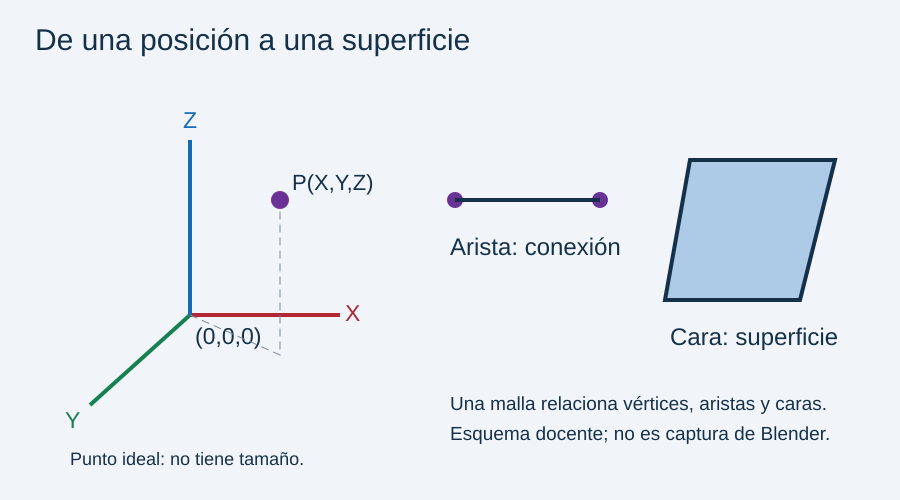

# 1.1.2 — Origen, ejes, coordenadas y guardado de archivos

**Presupuesto:** tres sesiones de 20 minutos, incluidos lectura selectiva, práctica, elección de un ejercicio y comprobación. Blender 4.5 LTS, mapa Blender e interfaz English.

## Lectura breve de la primera sesión

Una posición se escribe (X, Y, Z): tres distancias con signo respecto al origen global (0,0,0). X se muestra rojo, Y verde y Z azul en el gizmo. Un punto matemático no tiene volumen. Un vértice es un punto de una malla; por sí solo no produce una superficie renderizable. El Cursor 3D es un marcador para insertar objetos y definir operaciones, no una pieza del modelo. El origen del objeto es su referencia para transformaciones. Puede estar separado de sus vértices. Distinguir estos tres elementos evita creer que mover el cursor desplazó realmente la geometría.

Lee este párrafo y el procedimiento de hoy. Las demás secciones son una referencia para los siguientes días; no leas toda la lección antes de abrir Blender.

## Sesión 4 — Construcción guiada

Guarda una copia de tu escena. En Object Mode selecciona solamente Cube y elimínalo con X > Delete; conserva cámara y luz. Shift+S > Cursor to World Origin coloca el Cursor 3D en cero. Shift+A > Mesh > Plane añade un plano. Tab entra en Edit Mode; A selecciona sus cuatro vértices y M > At Center los fusiona en uno. Renombra el objeto Punto al volver a Object Mode y entra otra vez en Edit Mode. Activa selección de vértices con el botón correspondiente del encabezado. En N > Item escribe X=1, Y=2, Z=0 para el único vértice seleccionado. No cambies la Location del objeto.

## Sesión 5 — Comparación controlada

Con Punto sin rotación y con escala uno, sus coordenadas locales coinciden con las globales. Lee (1,2,0) en el panel del vértice. Duplica ese vértice con Shift+D; pulsa botón derecho para cancelar solamente el desplazamiento y escribe en N > Item X=-1, Y=2, Z=1. Son dos puntos sin aristas. Vuelve a seleccionar el primero para leer sus valores. Observa que mover el Cursor 3D mediante N > View > 3D Cursor no cambia ninguno de ellos. Restablece el cursor a cero. Una marca en la vista puede estar escondida detrás de otra desde un ángulo particular: cambia de vista antes de concluir que falta un punto.

## Sesión 6 — Transferencia y comprobación

Usa View > Viewpoint > Front, Right y Top; los equivalentes con teclado numérico son 1,3,7. Front muestra X y Z; Right muestra Y y Z; Top muestra X y Y. En cada vista identifica qué coordenada queda como profundidad y anótala. Duplica vértices hasta construir cinco posiciones: (0,0,0),(1,0,0),(1,1,0),(1,1,1),(-1,1,1). Ajusta N > Item para cada uno recién duplicado. No uses el ratón para estimar los números. Guarda semana01_puntos.blend y comprueba dos posiciones por sus campos numéricos.

## Ejemplo razonado

Ejemplo: los puntos A=(1,2,0) y B=(1,2,1) coinciden visualmente en Top, porque comparten X e Y; en Front están a distintas alturas. Ninguno está perdido. En Front, A y C=(1,-2,0) coinciden porque la profundidad Y no se distingue. Ver solamente una vista no prueba la igualdad de dos posiciones en el espacio. Para localizar un producto sobre una mesa después, necesitarás la altura Z y también sus distancias X e Y. En este ejercicio las unidades son todavía coordenadas abstractas; las unidades métricas se fijarán antes de modelar objetos medidos.

## Errores y recuperación

Si ves una cara, no fusionaste los cuatro vértices: A y M > At Center de nuevo. Si N muestra Location, estás en Object Mode, no leyendo el vértice. Si la coordenada global parece distinta, revisa que el objeto tenga Location cero, Rotation cero y Scale uno. Si el punto no aparece en un render, es el comportamiento esperado: falta superficie. No lo arregles aumentando luces. Si el cursor se movió accidentalmente, Shift+S > Cursor to World Origin lo recupera.

## Decisiones y conexión con el siguiente paso

La entrada numérica da precisión; la navegación da comprensión espacial. Usa ambas. El panel de un único vértice informa una posición; con varios seleccionados puede informar su centro, por eso selecciona uno para comprobar. Leer signos importa tanto como leer magnitudes: X=-1 y X=1 están a lados opuestos del origen. No mezcles el cero de la escena con el centro de un objeto arbitrario. En el siguiente módulo moverás objetos completos y verás por qué un eje local rotado deja de coincidir con el global.

## Evidencia verificable

- Un solo vértice seleccionado muestra la terna solicitada
- Cursor 3D vuelve a (0,0,0) sin mover Punto
- Explicar coincidencia de A y B en Top

Durante el tercer día elige una sola variante del archivo de ejercicios. El resultado se conserva en el archivo editable y se contrasta con estos criterios; una captura propia es apoyo, no sustituto de la escena.

[Explorar coordenadas y perspectiva](../../simulaciones/coordenadas-perspectiva.html). La simulación enseña proyecciones matemáticas; no sustituye Blender.

## Referencia técnica

[Manual Blender 4.5 LTS: Origen, ejes, coordenadas y guardado de archivos](https://docs.blender.org/manual/en/4.5/editors/3dview/3d_cursor.html). Las explicaciones y ejemplos del curso son propios. Los procedimientos fueron revisados documentalmente, pero no ejecutados en una instalación de Blender durante esta producción; corresponde comprobar interfaz y resultado al realizar la práctica.

