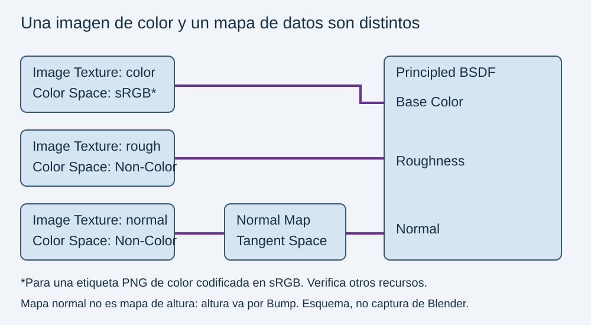

# 10.1.2 — Mapas y espacios de color

**Presupuesto:** tres sesiones de 20 minutos, incluidos lectura selectiva, práctica, elección de un ejercicio y comprobación. Blender 4.5 LTS, mapa Blender e interfaz English.

## Lectura breve de la primera sesión

Los mapas de color representan colores visibles. Los mapas de datos representan números que controlan propiedades del material. Una fotografía o etiqueta habitual se interpreta como sRGB; un mapa de Roughness, Height o Normal utiliza Non-Color. Esta diferencia evita aplicar a números una transformación destinada a color. Un mapa normal requiere un nodo Normal Map; no debe conectarse directamente a Base Color. Configurar el papel de cada archivo importa más que acumular muchas texturas. En esta lección usarás recursos propios incluidos y una comparación con valores conocidos.

Lee este párrafo y el procedimiento de hoy. Las demás secciones son una referencia para los siguientes días; no leas toda la lección antes de abrir Blender.

## Sesión 4 — Construcción guiada

Abre Etiqueta en Shading y selecciona Image Texture. Comprueba Color Space=sRGB y conexión a Base Color. Duplica el nodo como ejemplo desconectado: un mapa destinado a Roughness usaría Non-Color. No cambies LAOZ a Non-Color para hacerla más realista; su información es color visible. Localiza Roughness y Normal en Principled BSDF y explica qué tipo de entrada recibe cada una. Guarda semana10_mapas.blend. Mantén una sola variable de comparación y el entorno de Material Preview. No necesitas descargar paquetes PBR para aprender a leer estas conexiones.

## Sesión 5 — Comparación controlada

Abre el mapa propio del curso material/rugosidad-050.png, de 32×32 píxeles con RGB 128. En Shading añade Image Texture, Open ese archivo, Color Space Non-Color, y conecta Color a Roughness del material de un cubo de ensayo. Un gris uniforme produce un valor uniforme, no relieve. Su valor raw es 128/255=0.50196, aproximadamente 0.502. Compara con Roughness manual 0.502 desconectando el nodo y después con 0.2. Mantén el entorno de Material Preview idéntico para atribuir cambios a la propiedad. No crees esta imagen con un color flotante 0.5 y la guardes sin revisar el flujo: una conversión sRGB al exportar podría cambiar los bytes.

## Sesión 6 — Transferencia y comprobación

En una copia del material añade Normal Map sin imagen. Identifica entrada Color y salida Normal. Un mapa de tangente verificado usaría Image Texture Non-Color > Normal Map Color > Principled Normal. No uses LAOZ como normal. Un mapa Height usaría Image Texture Non-Color > Bump Height > Principled Normal, que practicarás en semana 11. Empaqueta imágenes usadas y guarda. Registra una tabla: etiqueta/color/sRGB; rugosidad/datos/Non-Color; normal/datos/Non-Color más Normal Map. Un nodo desconectado no cambia el material y no cuenta como efecto ejecutado.

## Ejemplo razonado

El recurso RGB 128 almacena aproximadamente 0.502 al leerlo como datos sin transformación. Si se interpreta como sRGB, la conversión típica a luz lineal lleva ese valor a cerca de 0.216. Por eso puede producir una rugosidad distinta de la que pretendías. sRGB describe cómo interpretar la imagen; View Transform, por ejemplo AgX, controla cómo presentar la escena iluminada en la salida. Son etapas diferentes. Esta práctica compara el mapa Non-Color con Roughness manual 0.502 y conserva la luz. La equivalencia es aproximada por cuantización de 8 bits, no un ensayo de laboratorio sobre respuesta física del material.

## Errores y recuperación

Si la superficie se vuelve azul, conectaste un mapa normal a Base Color. Si Roughness difiere de lo esperado, revisa Non-Color y canales. Si el material parece negro, comprueba entorno antes de culpar al mapa. Si falta la imagen, corrige Open y Pack Resources. Añadir Normal Map sin una entrada adecuada no demuestra detalle aplicado. Usa el archivo de rugosidad incluido en lugar de exportar una imagen flotante sin revisar su transformación de color.

## Decisiones y conexión con el siguiente paso

Una tabla de conexiones permite auditar un material sin adivinar por el color de sus nodos. Cada archivo exige saber función y licencia cuando es externo. Los recursos propios de la práctica evitan descargas. La comparación debe hacerse bajo iluminación constante para atribuir cambios correctamente. En el próximo módulo modificarás propiedades físicas y probarás Height con Bump. Esta distinción entre color y datos será la base para añadir detalles sin teñir accidentalmente una superficie o deformar su respuesta. Guarda el estado simple antes de agregar nuevas capas al material.

## Evidencia verificable

- Etiqueta interpretada como sRGB
- Mapa propio Non-Color conectado a Roughness
- Tabla de color y datos con rutas correctas

Durante el tercer día elige una sola variante del archivo de ejercicios. El resultado se conserva en el archivo editable y se contrasta con estos criterios; una captura propia es apoyo, no sustituto de la escena.

## Referencia técnica

[Manual Blender 4.5 LTS: Mapas y espacios de color](https://docs.blender.org/manual/en/4.5/render/color_management.html). Las explicaciones y ejemplos del curso son propios. Los procedimientos fueron revisados documentalmente, pero no ejecutados en una instalación de Blender durante esta producción; corresponde comprobar interfaz y resultado al realizar la práctica.

