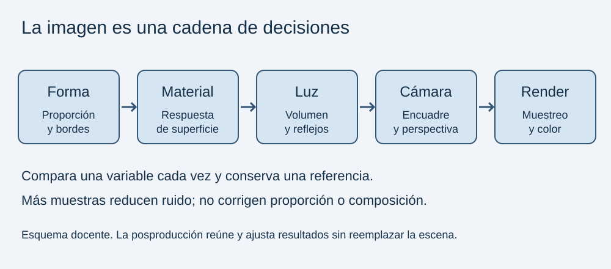

# 14.1.1 — Dirección, tamaño y dureza

Blender 4.5 LTS. Días 1, 2, 3: tres sesiones de veinte minutos. Lee concepto y pasos 1–2 en la primera; practica pasos 3–4 en la segunda; completa paso 5 y una variante del ejercicio en la tercera. Los cálculos largos de render son tiempo de máquina aparte.

## Concepto

Una luz pequeña produce una transición de sombra más definida que una fuente grande observada desde el mismo punto. La dureza depende del tamaño aparente, no solo del nombre de la luz. La dirección permite leer el volumen y debe distinguirse de la exposición general.

## Caso resuelto

Caso resuelto: un producto de 20 cm descansa sobre un plano. Con cámara y potencia constantes, una fuente Area de 10 cm produce un borde más definido que la misma fuente de 50 cm desde la misma distancia. No se concluye que 50 cm sea siempre mejor: se decide por la referencia. Después se agrega relleno con menor contribución y se compara su presencia/ausencia. Si el volumen pierde lectura, se reduce el relleno; si existe un hueco bajo el objeto, primero se corrige su posición. El contacto real y la sombra deben concordar.

## Procedimiento en Blender

1. Abre el producto simple y guarda una copia sem14_luz.blend; usa una base opaca y un material gris para observar sombras sin reflejos complejos.
2. En Object Mode añade Add > Light > Area y sitúala a un lado y por encima del producto. Orienta su dirección hacia él; verifica la posición en vista lateral y frontal.
3. En Light Properties conserva la potencia durante esta comparación. Realiza una prueba con Size pequeño y otra con Size mayor, sin mover cámara ni producto.
4. Usa una vista renderizada o un render pequeño y compara el borde de la sombra en la misma zona; registra tamaño y distancia de la fuente.
5. Mueve la fuente al lado opuesto conservando su tamaño y observa que cambia la dirección de la sombra. Recupera la variante que mejor revela la forma.

## Qué debe observarse

Dos comparaciones aisladas: cambio de tamaño para dureza y cambio de posición para dirección. La sombra debe apoyar el producto en la base, sin convertir el fondo en una mancha negra.

## Error, diagnóstico y corrección

Si al cambiar tamaño también cambiaste potencia, posición o exposición, la comparación no aísla una causa. Recupera la primera copia y modifica una sola variable; evalúa el borde de la sombra, no únicamente su oscuridad.

## Prueba de comprensión

¿Qué variable modificarías para suavizar el borde sin cambiar la dirección de la sombra?

**Respuesta razonada:** Aumentaría el tamaño aparente de la fuente respecto del objeto, por ejemplo aumentando Size con posición fija. No cambiaría de lado la luz; ese movimiento altera la dirección.

[Simulación de luz y rugosidad](../../simulaciones/luz-rugosidad.html): es un modelo conceptual, no un render PBR; reemplaza una observación guiada, no añade una tarea.

## Evidencia y referencia

Conserva una comparación que muestre «Pruebas controladas de iluminación». Comprueba el cambio descrito, sin exigir un valor universal que dependa del producto o el equipo. [Manual de Blender 4.5](https://docs.blender.org/manual/en/4.5/render/lights/light_object.html). [Fuentes del tema](../../REFERENCIAS.md).
