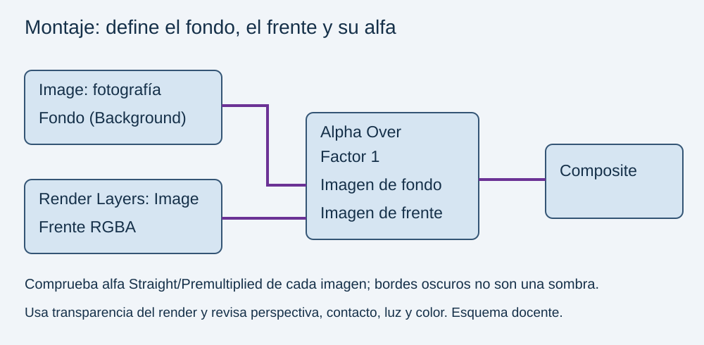

# 18.1.1 — Pases, máscaras y transparencia

Blender 4.5 LTS. Días 1, 2, 3: tres sesiones de veinte minutos. Lee concepto y pasos 1–2 en la primera; practica pasos 3–4 en la segunda; completa paso 5 y una variante del ejercicio en la tercera. Los cálculos largos de render son tiempo de máquina aparte.

## Concepto

Los pases separan contribuciones del render y las máscaras permiten actuar en una zona. Para comenzar basta comprender imagen y alfa. Una composición recuperable conserva sus fuentes; modificar destructivamente la única imagen elimina la posibilidad de revisar decisiones anteriores.

## Caso resuelto

Caso resuelto: se usa la fotografía propia de una mesa como fondo opaco y Render Layers con Film Transparent como producto frontal. Alpha Over tiene Fac = 1: primera entrada Image para el fondo, segunda Image —inferior— para el producto. La salida va a Composite; Viewer permite inspeccionar esa misma salida. Si ambas imágenes se invierten, la fotografía tapa el producto. Se restaura el orden sin alterar materiales. El modo de alfa del archivo debe interpretarse correctamente; el compositor normaliza normalmente a premultiplicado. Convert Premultiplied queda desactivado salvo una rama convertida explícitamente a Straight. El halo se comprueba contra claro y oscuro.

## Procedimiento en Blender

1. En Compositing activa Use Nodes y localiza Render Layers y Composite. Añade un Viewer si necesitas inspeccionar la imagen durante el trabajo.
2. En Render Properties > Film activa Transparent y renderiza el producto de prueba. En Compositing añade Input > Image para cargar una fotografía propia de una mesa; conserva la proporción y resolución de esa foto en Output Properties.
3. Añade Color > Mix > Alpha Over, deja Fac en 1 y conecta Image de la fotografía a la primera entrada Image; conecta Image de Render Layers a la segunda entrada Image, la inferior. Conecta la salida Image de Alpha Over a Image de Composite y a Viewer.
4. Comprueba que Render Layers tenga alfa transparente. Si importas un PNG, configura Alpha Mode según cómo esté almacenado el archivo. El compositor trabaja normalmente con alfa premultiplicado: deja Convert Premultiplied desactivado salvo que una rama haya sido convertida explícitamente a Straight. No lo actives únicamente porque el PNG original sea Straight. Revisa halos sobre fondo claro y oscuro.
5. Guarda la escena con nodos organizados y nombres que describan render, fondo y mezcla. Comprueba una exportación de prueba fuera del editor.

## Qué debe observarse

Composición con dos fuentes identificables y un producto transparente correctamente situado sobre el fondo. El fondo no sustituye el render por un error de orden.

## Error, diagnóstico y corrección

Si la fotografía tapa el producto, revisa el orden de entradas y el alfa del render. Si aparecen halos, comprueba la interpretación del alfa de la imagen antes de pintar el borde.

## Prueba de comprensión

¿Qué señal indica que el orden de las imágenes en Alpha Over puede ser incorrecto?

**Respuesta razonada:** Que el fondo opaco cubra el producto aunque este exista y tenga alfa válido. Revisaría las entradas y su orden antes de cambiar materiales.

## Evidencia y referencia

Conserva una comparación que muestre «Composición por capas recuperable». Comprueba el cambio descrito, sin exigir un valor universal que dependa del producto o el equipo. [Manual de Blender 4.5](https://docs.blender.org/manual/en/4.5/compositing/types/color/mix/alpha_over.html). [Fuentes del tema](../../REFERENCIAS.md).
