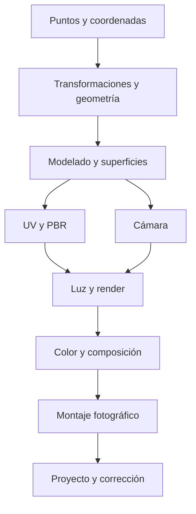

# Plan curricular: Diseño 3D del punto a la imagen hiperrealista

Código: D3DH-001. Herramienta confirmada: Blender gratuito. Versión didáctica: Blender 4.5 LTS, elegida por estabilidad; no se presenta como la versión más reciente. [Fuente oficial](https://www.blender.org/releases/4-5/).

El usuario confirmó **20 minutos diarios**. Se propone un calendario de **26 semanas**, con 182 sesiones y **3640 minutos = 60 h 40 min** de aprendizaje activo. Las 26 semanas son una decisión curricular para este alcance, no una duración indicada por el usuario. Cada semana tiene dos subtemas de 60 minutos y una evaluación/corrección de 20 minutos: 140 minutos. No se acumulan actividades fuera de ese presupuesto. El tiempo de render desatendido se programa aparte según el equipo y no cuenta como aprendizaje activo.

Se asume provisionalmente un enfoque de productos y pequeñas escenas, por el interés previo en diseño de producto; el usuario aún no eligió objeto final ni equipo. El resultado es una primera producción físicamente plausible con un render de estudio y un montaje en fotografía. La calidad profesional exige iteraciones posteriores. Se propone una lámpara de sobremesa sencilla u otro objeto manejable, con fotografía propia de una mesa como fondo. No se incluyen CAD de fabricación, animación, personajes, simulaciones complejas ni escenas extensas.

## Prerrequisitos y diagnóstico integrado

Manejo básico de archivos, ratón y teclado. No se exige dominio previo de geometría o software 3D. El diagnóstico del módulo 0 se integra en los primeros 5 minutos del día 1 de la semana 1 y queda contabilizado dentro de sus 20 minutos: abrir/guardar archivo, reconocer vistas y distinguir forma, material y luz. No es una semana ni un módulo presupuestario adicional. La preparación e instalación activa se integra en las sesiones de la semana 1: si el equipo requiere más tiempo de instalación, se sustituye práctica inicial y se registra el avance. Las descargas desatendidas se calendarizan aparte.

## Objetivos generales

1. Ubicar puntos y transformar geometría usando medidas verificables.
2. Modelar un producto sencillo con superficies limpias, UV y materiales plausibles.
3. Construir cámara e iluminación que comuniquen forma y material.
4. Ajustar render y composición para conservar detalle y controlar artefactos.
5. Integrar el producto en fotografía con perspectiva, escala, contacto y luz coherentes, y explicar las decisiones.

## Rutas y estructura de las sesiones

El estudiante elige una variante de práctica: básica guiada con plantillas; intermedia con menos pasos y medidas parciales; avanzada con decisiones abiertas dentro de un objeto sencillo. Las tres rutas comparten tiempo y rúbrica: no se hacen tres tareas. Para este principiante la básica es el punto de partida. Cambiar de ruta exige evidencia, no preferencia por mayor complejidad.

Días 1 y 4: 6 minutos de lectura/demostración, 12 de práctica y 2 de registro. Días 2 y 5: 3 de recuperación, 14 de práctica y 3 de comprobación. Días 3 y 6: 3 de preguntas, 12 de ejercicio elegido y 5 de corrección. Día 7: 3 de recuperación, 10 de evaluación práctica, 5 de corrección y 2 de registro. En total semanal: 12 minutos de explicación, 15 de recuperación/preguntas, 86 de práctica/evaluación y 27 de comprobación, corrección y registro =140. Las preguntas, soluciones y rutas son alternativas y referencias disponibles; no lectura adicional obligatoria.

## Mapa conceptual



## Estructura modular

### Módulo 1: Puntos y orientación en el espacio

**Semana 1:** 7 sesiones de 20 minutos =140 minutos. **Objetivo medible:** Ubicar 8 de 10 puntos correctamente y recuperar el archivo de trabajo.

**Tema 1.1:** Puntos y orientación en el espacio.

- **1.1.1: Diagnóstico, preparación de Blender e interfaz.** Mixto, sin código; días 1, 2, 3; 60 minutos. Evidencia: avance verificable de «Recorrido de puntos y carpeta organizada».
- **1.1.2: Origen, ejes, coordenadas y guardado de archivos.** Mixto, sin código; días 4, 5, 6; 60 minutos. Evidencia: avance verificable de «Recorrido de puntos y carpeta organizada».

**Ejercicio:** construir o corregir «Recorrido de puntos y carpeta organizada», eligiendo una variante de ruta. **Evaluación:** día 7, aplicar «Ubicar 8 de 10 puntos correctamente y recuperar el archivo de trabajo» a una variación del ejercicio. La solución comentada y corrección se realizan dentro de sus 20 minutos.

### Módulo 2: Transformaciones y medidas

**Semana 2:** 7 sesiones de 20 minutos =140 minutos. **Objetivo medible:** Colocar tres objetos según coordenadas y medidas con error máximo del 2 %.

**Tema 2.1:** Transformaciones y medidas.

- **2.1.1: Traslación y coordenadas globales/locales.** Mixto, sin código; días 1, 2, 3; 60 minutos. Evidencia: avance verificable de «Composición de tres volúmenes medidos».
- **2.1.2: Rotación, escala y pivote.** Mixto, sin código; días 4, 5, 6; 60 minutos. Evidencia: avance verificable de «Composición de tres volúmenes medidos».

**Ejercicio:** construir o corregir «Composición de tres volúmenes medidos», eligiendo una variante de ruta. **Evaluación:** día 7, aplicar «Colocar tres objetos según coordenadas y medidas con error máximo del 2 %» a una variación del ejercicio. La solución comentada y corrección se realizan dentro de sus 20 minutos.

### Módulo 3: De vértices a volúmenes

**Semana 3:** 7 sesiones de 20 minutos =140 minutos. **Objetivo medible:** Construir una malla simple y corregir normales o huecos en dos ejemplos.

**Tema 3.1:** De vértices a volúmenes.

- **3.1.1: Vértices, aristas, caras y normales.** Mixto, sin código; días 1, 2, 3; 60 minutos. Evidencia: avance verificable de «Caja cerrada e inspección de normales».
- **3.1.2: Primitivas, selección y malla cerrada.** Mixto, sin código; días 4, 5, 6; 60 minutos. Evidencia: avance verificable de «Caja cerrada e inspección de normales».

**Ejercicio:** construir o corregir «Caja cerrada e inspección de normales», eligiendo una variante de ruta. **Evaluación:** día 7, aplicar «Construir una malla simple y corregir normales o huecos en dos ejemplos» a una variación del ejercicio. La solución comentada y corrección se realizan dentro de sus 20 minutos.

### Módulo 4: Referencias y proporción

**Semana 4:** 7 sesiones de 20 minutos =140 minutos. **Objetivo medible:** Crear un bloqueo que respete tres dimensiones con error máximo del 5 %.

**Tema 4.1:** Referencias y proporción.

- **4.1.1: Lectura de fotografías y medidas.** Mixto, sin código; días 1, 2, 3; 60 minutos. Evidencia: avance verificable de «Bloqueo de producto con ficha de medidas».
- **4.1.2: Vistas ortográficas y bloqueo.** Mixto, sin código; días 4, 5, 6; 60 minutos. Evidencia: avance verificable de «Bloqueo de producto con ficha de medidas».

**Ejercicio:** construir o corregir «Bloqueo de producto con ficha de medidas», eligiendo una variante de ruta. **Evaluación:** día 7, aplicar «Crear un bloqueo que respete tres dimensiones con error máximo del 5 %» a una variación del ejercicio. La solución comentada y corrección se realizan dentro de sus 20 minutos.

### Módulo 5: Construcción de piezas

**Semana 5:** 7 sesiones de 20 minutos =140 minutos. **Objetivo medible:** Construir dos componentes separados y modificar una medida sin rehacer la escena.

**Tema 5.1:** Construcción de piezas.

- **5.1.1: Extrusión, inserción y cortes.** Mixto, sin código; días 1, 2, 3; 60 minutos. Evidencia: avance verificable de «Producto con base y tapa».
- **5.1.2: Componentes y organización editable.** Mixto, sin código; días 4, 5, 6; 60 minutos. Evidencia: avance verificable de «Producto con base y tapa».

**Ejercicio:** construir o corregir «Producto con base y tapa», eligiendo una variante de ruta. **Evaluación:** día 7, aplicar «Construir dos componentes separados y modificar una medida sin rehacer la escena» a una variación del ejercicio. La solución comentada y corrección se realizan dentro de sus 20 minutos.

### Módulo 6: Operaciones de modelado

**Semana 6:** 7 sesiones de 20 minutos =140 minutos. **Objetivo medible:** Aplicar espesor coherente y corregir un artefacto de construcción.

**Tema 6.1:** Operaciones de modelado.

- **6.1.1: Simetría y espesor.** Mixto, sin código; días 1, 2, 3; 60 minutos. Evidencia: avance verificable de «Pieza simétrica con abertura».
- **6.1.2: Booleanas y diagnóstico de artefactos.** Mixto, sin código; días 4, 5, 6; 60 minutos. Evidencia: avance verificable de «Pieza simétrica con abertura».

**Ejercicio:** construir o corregir «Pieza simétrica con abertura», eligiendo una variante de ruta. **Evaluación:** día 7, aplicar «Aplicar espesor coherente y corregir un artefacto de construcción» a una variación del ejercicio. La solución comentada y corrección se realizan dentro de sus 20 minutos.

### Módulo 7: Bordes y sombreado

**Semana 7:** 7 sesiones de 20 minutos =140 minutos. **Objetivo medible:** Eliminar dos discontinuidades visibles y justificar el tamaño del bisel.

**Tema 7.1:** Bordes y sombreado.

- **7.1.1: Biseles y lectura de bordes.** Mixto, sin código; días 1, 2, 3; 60 minutos. Evidencia: avance verificable de «Comparación de bordes antes y después».
- **7.1.2: Normales y sombreado suave.** Mixto, sin código; días 4, 5, 6; 60 minutos. Evidencia: avance verificable de «Comparación de bordes antes y después».

**Ejercicio:** construir o corregir «Comparación de bordes antes y después», eligiendo una variante de ruta. **Evaluación:** día 7, aplicar «Eliminar dos discontinuidades visibles y justificar el tamaño del bisel» a una variación del ejercicio. La solución comentada y corrección se realizan dentro de sus 20 minutos.

### Módulo 8: Curvas y superficies

**Semana 8:** 7 sesiones de 20 minutos =140 minutos. **Objetivo medible:** Crear una transición curva sin pinzamientos visibles en dos vistas.

**Tema 8.1:** Curvas y superficies.

- **8.1.1: Curvas y perfiles de producto.** Mixto, sin código; días 1, 2, 3; 60 minutos. Evidencia: avance verificable de «Asa o perfil redondeado».
- **8.1.2: Subdivisión y control de forma.** Mixto, sin código; días 4, 5, 6; 60 minutos. Evidencia: avance verificable de «Asa o perfil redondeado».

**Ejercicio:** construir o corregir «Asa o perfil redondeado», eligiendo una variante de ruta. **Evaluación:** día 7, aplicar «Crear una transición curva sin pinzamientos visibles en dos vistas» a una variación del ejercicio. La solución comentada y corrección se realizan dentro de sus 20 minutos.

### Módulo 9: Coordenadas UV

**Semana 9:** 7 sesiones de 20 minutos =140 minutos. **Objetivo medible:** Desplegar una pieza manteniendo una cuadrícula sin deformaciones visibles en su zona principal.

**Tema 9.1:** Coordenadas UV.

- **9.1.1: Costuras y desplegado.** Mixto, sin código; días 1, 2, 3; 60 minutos. Evidencia: avance verificable de «UV con cuadrícula de comprobación».
- **9.1.2: Distorsión y densidad de textura.** Mixto, sin código; días 4, 5, 6; 60 minutos. Evidencia: avance verificable de «UV con cuadrícula de comprobación».

**Ejercicio:** construir o corregir «UV con cuadrícula de comprobación», eligiendo una variante de ruta. **Evaluación:** día 7, aplicar «Desplegar una pieza manteniendo una cuadrícula sin deformaciones visibles en su zona principal» a una variación del ejercicio. La solución comentada y corrección se realizan dentro de sus 20 minutos.

### Módulo 10: Texturas y etiquetas

**Semana 10:** 7 sesiones de 20 minutos =140 minutos. **Objetivo medible:** Colocar una etiqueta medida y configurar correctamente un mapa de color y uno de datos.

**Tema 10.1:** Texturas y etiquetas.

- **10.1.1: Escala, orientación y etiqueta.** Mixto, sin código; días 1, 2, 3; 60 minutos. Evidencia: avance verificable de «Producto etiquetado con referencias de tamaño».
- **10.1.2: Mapas y espacios de color.** Mixto, sin código; días 4, 5, 6; 60 minutos. Evidencia: avance verificable de «Producto etiquetado con referencias de tamaño».

**Ejercicio:** construir o corregir «Producto etiquetado con referencias de tamaño», eligiendo una variante de ruta. **Evaluación:** día 7, aplicar «Colocar una etiqueta medida y configurar correctamente un mapa de color y uno de datos» a una variación del ejercicio. La solución comentada y corrección se realizan dentro de sus 20 minutos.

### Módulo 11: Materiales PBR

**Semana 11:** 7 sesiones de 20 minutos =140 minutos. **Objetivo medible:** Diferenciar metal y plástico bajo iluminación constante y explicar sus propiedades.

**Tema 11.1:** Materiales PBR.

- **11.1.1: Color base, metal y rugosidad.** Mixto, sin código; días 1, 2, 3; 60 minutos. Evidencia: avance verificable de «Comparativa de dos materiales».
- **11.1.2: Relieve, normal y respuesta a la luz.** Mixto, sin código; días 4, 5, 6; 60 minutos. Evidencia: avance verificable de «Comparativa de dos materiales».

**Ejercicio:** construir o corregir «Comparativa de dos materiales», eligiendo una variante de ruta. **Evaluación:** día 7, aplicar «Diferenciar metal y plástico bajo iluminación constante y explicar sus propiedades» a una variación del ejercicio. La solución comentada y corrección se realizan dentro de sus 20 minutos.

### Módulo 12: Imperfecciones y realismo

**Semana 12:** 7 sesiones de 20 minutos =140 minutos. **Objetivo medible:** Añadir dos detalles plausibles sin ocultar la forma del producto.

**Tema 12.1:** Imperfecciones y realismo.

- **12.1.1: Microtextura a escala.** Mixto, sin código; días 1, 2, 3; 60 minutos. Evidencia: avance verificable de «Comparación de superficie nueva y usada».
- **12.1.2: Desgaste e imperfecciones justificadas.** Mixto, sin código; días 4, 5, 6; 60 minutos. Evidencia: avance verificable de «Comparación de superficie nueva y usada».

**Ejercicio:** construir o corregir «Comparación de superficie nueva y usada», eligiendo una variante de ruta. **Evaluación:** día 7, aplicar «Añadir dos detalles plausibles sin ocultar la forma del producto» a una variación del ejercicio. La solución comentada y corrección se realizan dentro de sus 20 minutos.

### Módulo 13: Cámara y composición

**Semana 13:** 7 sesiones de 20 minutos =140 minutos. **Objetivo medible:** Crear dos encuadres legibles y explicar sus diferencias de perspectiva.

**Tema 13.1:** Cámara y composición.

- **13.1.1: Perspectiva, focal y posición.** Mixto, sin código; días 1, 2, 3; 60 minutos. Evidencia: avance verificable de «Vista de catálogo y vista contextual».
- **13.1.2: Encuadre y profundidad de campo.** Mixto, sin código; días 4, 5, 6; 60 minutos. Evidencia: avance verificable de «Vista de catálogo y vista contextual».

**Ejercicio:** construir o corregir «Vista de catálogo y vista contextual», eligiendo una variante de ruta. **Evaluación:** día 7, aplicar «Crear dos encuadres legibles y explicar sus diferencias de perspectiva» a una variación del ejercicio. La solución comentada y corrección se realizan dentro de sus 20 minutos.

### Módulo 14: Luz y sombras

**Semana 14:** 7 sesiones de 20 minutos =140 minutos. **Objetivo medible:** Predecir y verificar cambios de sombra al mover o ampliar una luz.

**Tema 14.1:** Luz y sombras.

- **14.1.1: Dirección, tamaño y dureza.** Mixto, sin código; días 1, 2, 3; 60 minutos. Evidencia: avance verificable de «Pruebas controladas de iluminación».
- **14.1.2: Luz principal, relleno y contacto.** Mixto, sin código; días 4, 5, 6; 60 minutos. Evidencia: avance verificable de «Pruebas controladas de iluminación».

**Ejercicio:** construir o corregir «Pruebas controladas de iluminación», eligiendo una variante de ruta. **Evaluación:** día 7, aplicar «Predecir y verificar cambios de sombra al mover o ampliar una luz» a una variación del ejercicio. La solución comentada y corrección se realizan dentro de sus 20 minutos.

### Módulo 15: Estudio de producto

**Semana 15:** 7 sesiones de 20 minutos =140 minutos. **Objetivo medible:** Construir un estudio simple con reflejos que revelen la forma y sin distracciones.

**Tema 15.1:** Estudio de producto.

- **15.1.1: Fondo continuo y separación.** Mixto, sin código; días 1, 2, 3; 60 minutos. Evidencia: avance verificable de «Escena de catálogo preparada».
- **15.1.2: Entorno y control de reflejos.** Mixto, sin código; días 4, 5, 6; 60 minutos. Evidencia: avance verificable de «Escena de catálogo preparada».

**Ejercicio:** construir o corregir «Escena de catálogo preparada», eligiendo una variante de ruta. **Evaluación:** día 7, aplicar «Construir un estudio simple con reflejos que revelen la forma y sin distracciones» a una variación del ejercicio. La solución comentada y corrección se realizan dentro de sus 20 minutos.

### Módulo 16: Render y presupuesto de calidad

**Semana 16:** 7 sesiones de 20 minutos =140 minutos. **Objetivo medible:** Comparar dos ajustes y elegir uno que conserve detalle dentro del equipo disponible.

**Tema 16.1:** Render y presupuesto de calidad.

- **16.1.1: Muestreo, ruido y reducción de ruido.** Mixto, sin código; días 1, 2, 3; 60 minutos. Evidencia: avance verificable de «Recorte comparativo de calidad y tiempo».
- **16.1.2: Resolución, formatos y transparencia.** Mixto, sin código; días 4, 5, 6; 60 minutos. Evidencia: avance verificable de «Recorte comparativo de calidad y tiempo».

**Ejercicio:** construir o corregir «Recorte comparativo de calidad y tiempo», eligiendo una variante de ruta. **Evaluación:** día 7, aplicar «Comparar dos ajustes y elegir uno que conserve detalle dentro del equipo disponible» a una variación del ejercicio. La solución comentada y corrección se realizan dentro de sus 20 minutos.

### Módulo 17: Color y exposición

**Semana 17:** 7 sesiones de 20 minutos =140 minutos. **Objetivo medible:** Corregir una imagen preservando detalle de altas luces y sombras.

**Tema 17.1:** Color y exposición.

- **17.1.1: Transformación de visualización y exposición.** Mixto, sin código; días 1, 2, 3; 60 minutos. Evidencia: avance verificable de «Antes y después con ajustes documentados».
- **17.1.2: Corrección de color y contraste.** Mixto, sin código; días 4, 5, 6; 60 minutos. Evidencia: avance verificable de «Antes y después con ajustes documentados».

**Ejercicio:** construir o corregir «Antes y después con ajustes documentados», eligiendo una variante de ruta. **Evaluación:** día 7, aplicar «Corregir una imagen preservando detalle de altas luces y sombras» a una variación del ejercicio. La solución comentada y corrección se realizan dentro de sus 20 minutos.

### Módulo 18: Composición y capas

**Semana 18:** 7 sesiones de 20 minutos =140 minutos. **Objetivo medible:** Combinar render y fondo sin bordes de máscara visibles a tamaño de entrega.

**Tema 18.1:** Composición y capas.

- **18.1.1: Pases, máscaras y transparencia.** Mixto, sin código; días 1, 2, 3; 60 minutos. Evidencia: avance verificable de «Composición por capas recuperable».
- **18.1.2: Composición no destructiva y exportación.** Mixto, sin código; días 4, 5, 6; 60 minutos. Evidencia: avance verificable de «Composición por capas recuperable».

**Ejercicio:** construir o corregir «Composición por capas recuperable», eligiendo una variante de ruta. **Evaluación:** día 7, aplicar «Combinar render y fondo sin bordes de máscara visibles a tamaño de entrega» a una variación del ejercicio. La solución comentada y corrección se realizan dentro de sus 20 minutos.

### Módulo 19: Perspectiva del montaje fotográfico

**Semana 19:** 7 sesiones de 20 minutos =140 minutos. **Objetivo medible:** Integrar un producto con perspectiva y escala justificadas por dos referencias de la fotografía.

**Tema 19.1:** Perspectiva del montaje fotográfico.

- **19.1.1: Elección de fondo, horizonte y fugas.** Mixto, sin código; días 1, 2, 3; 60 minutos. Evidencia: avance verificable de «Montaje inicial sobre una mesa».
- **19.1.2: Coincidencia de cámara, escala y apoyo.** Mixto, sin código; días 4, 5, 6; 60 minutos. Evidencia: avance verificable de «Montaje inicial sobre una mesa».

**Ejercicio:** construir o corregir «Montaje inicial sobre una mesa», eligiendo una variante de ruta. **Evaluación:** día 7, aplicar «Integrar un producto con perspectiva y escala justificadas por dos referencias de la fotografía» a una variación del ejercicio. La solución comentada y corrección se realizan dentro de sus 20 minutos.

### Módulo 20: Sombras y oclusión del montaje

**Semana 20:** 7 sesiones de 20 minutos =140 minutos. **Objetivo medible:** Corregir apoyo y oclusión para que el producto no flote ni atraviese el fondo.

**Tema 20.1:** Sombras y oclusión del montaje.

- **20.1.1: Coincidencia de luz y sombra de contacto.** Mixto, sin código; días 1, 2, 3; 60 minutos. Evidencia: avance verificable de «Montaje con sombra y oclusión verificadas».
- **20.1.2: Oclusión y continuidad de bordes.** Mixto, sin código; días 4, 5, 6; 60 minutos. Evidencia: avance verificable de «Montaje con sombra y oclusión verificadas».

**Ejercicio:** construir o corregir «Montaje con sombra y oclusión verificadas», eligiendo una variante de ruta. **Evaluación:** día 7, aplicar «Corregir apoyo y oclusión para que el producto no flote ni atraviese el fondo» a una variación del ejercicio. La solución comentada y corrección se realizan dentro de sus 20 minutos.

### Módulo 21: Continuidad del montaje

**Semana 21:** 7 sesiones de 20 minutos =140 minutos. **Objetivo medible:** Corregir tres pistas que delaten la integración y explicar cada ajuste.

**Tema 21.1:** Continuidad del montaje.

- **21.1.1: Reflejos y continuidad tonal.** Mixto, sin código; días 1, 2, 3; 60 minutos. Evidencia: avance verificable de «Montaje revisado con recortes de control».
- **21.1.2: Nitidez, grano y revisión por zonas.** Mixto, sin código; días 4, 5, 6; 60 minutos. Evidencia: avance verificable de «Montaje revisado con recortes de control».

**Ejercicio:** construir o corregir «Montaje revisado con recortes de control», eligiendo una variante de ruta. **Evaluación:** día 7, aplicar «Corregir tres pistas que delaten la integración y explicar cada ajuste» a una variación del ejercicio. La solución comentada y corrección se realizan dentro de sus 20 minutos.

### Módulo 22: Proyecto: alcance y referencias

**Semana 22:** 7 sesiones de 20 minutos =140 minutos. **Objetivo medible:** Definir un producto sencillo y dos imágenes finales con alcance realizable.

**Tema 22.1:** Proyecto: alcance y referencias.

- **22.1.1: Especificación y referencias propias.** Mixto, sin código; días 1, 2, 3; 60 minutos. Evidencia: avance verificable de «Ficha y referencias del proyecto».
- **22.1.2: Plan de escena y lista de criterios.** Mixto, sin código; días 4, 5, 6; 60 minutos. Evidencia: avance verificable de «Ficha y referencias del proyecto».

**Ejercicio:** construir o corregir «Ficha y referencias del proyecto», eligiendo una variante de ruta. **Evaluación:** día 7, aplicar «Definir un producto sencillo y dos imágenes finales con alcance realizable» a una variación del ejercicio. La solución comentada y corrección se realizan dentro de sus 20 minutos.

### Módulo 23: Proyecto: modelo definitivo

**Semana 23:** 7 sesiones de 20 minutos =140 minutos. **Objetivo medible:** Cerrar un modelo sin defectos visibles en las vistas previstas y con dimensiones documentadas.

**Tema 23.1:** Proyecto: modelo definitivo.

- **23.1.1: Dimensiones, componentes y superficies.** Mixto, sin código; días 1, 2, 3; 60 minutos. Evidencia: avance verificable de «Modelo final y vistas de inspección».
- **23.1.2: UV y control de geometría.** Mixto, sin código; días 4, 5, 6; 60 minutos. Evidencia: avance verificable de «Modelo final y vistas de inspección».

**Ejercicio:** construir o corregir «Modelo final y vistas de inspección», eligiendo una variante de ruta. **Evaluación:** día 7, aplicar «Cerrar un modelo sin defectos visibles en las vistas previstas y con dimensiones documentadas» a una variación del ejercicio. La solución comentada y corrección se realizan dentro de sus 20 minutos.

### Módulo 24: Proyecto: materiales y cámara

**Semana 24:** 7 sesiones de 20 minutos =140 minutos. **Objetivo medible:** Preparar materiales y encuadre coherentes con las referencias del producto.

**Tema 24.1:** Proyecto: materiales y cámara.

- **24.1.1: Materiales finales y etiqueta.** Mixto, sin código; días 1, 2, 3; 60 minutos. Evidencia: avance verificable de «Escena final y prueba de baja resolución».
- **24.1.2: Cámara, estudio y prueba de iluminación.** Mixto, sin código; días 4, 5, 6; 60 minutos. Evidencia: avance verificable de «Escena final y prueba de baja resolución».

**Ejercicio:** construir o corregir «Escena final y prueba de baja resolución», eligiendo una variante de ruta. **Evaluación:** día 7, aplicar «Preparar materiales y encuadre coherentes con las referencias del producto» a una variación del ejercicio. La solución comentada y corrección se realizan dentro de sus 20 minutos.

### Módulo 25: Proyecto: imagen de estudio

**Semana 25:** 7 sesiones de 20 minutos =140 minutos. **Objetivo medible:** Entregar una imagen de estudio legible y corregir artefactos detectados.

**Tema 25.1:** Proyecto: imagen de estudio.

- **25.1.1: Prueba de calidad y correcciones.** Mixto, sin código; días 1, 2, 3; 60 minutos. Evidencia: avance verificable de «Imagen de catálogo y ajustes de render».
- **25.1.2: Render de catálogo y exportación.** Mixto, sin código; días 4, 5, 6; 60 minutos. Evidencia: avance verificable de «Imagen de catálogo y ajustes de render».

**Ejercicio:** construir o corregir «Imagen de catálogo y ajustes de render», eligiendo una variante de ruta. **Evaluación:** día 7, aplicar «Entregar una imagen de estudio legible y corregir artefactos detectados» a una variación del ejercicio. La solución comentada y corrección se realizan dentro de sus 20 minutos.

### Módulo 26: Proyecto: imagen contextual y entrega

**Semana 26:** 7 sesiones de 20 minutos =140 minutos. **Objetivo medible:** Entregar una imagen contextual coherente y justificar cinco decisiones del proceso.

**Tema 26.1:** Proyecto: imagen contextual y entrega.

- **26.1.1: Montaje final en fotografía.** Mixto, sin código; días 1, 2, 3; 60 minutos. Evidencia: avance verificable de «Montaje, escena editable y bitácora final».
- **26.1.2: Evaluación, corrección y presentación.** Mixto, sin código; días 4, 5, 6; 60 minutos. Evidencia: avance verificable de «Montaje, escena editable y bitácora final».

**Ejercicio:** construir o corregir «Montaje, escena editable y bitácora final», eligiendo una variante de ruta. **Evaluación:** día 7, aplicar «Entregar una imagen contextual coherente y justificar cinco decisiones del proceso» a una variación del ejercicio. La solución comentada y corrección se realizan dentro de sus 20 minutos.

## Proyecto y evaluación

Se reutiliza desde semana 4 un objeto sencillo para evitar empezar de cero en el proyecto final. Entregables: escena editable organizada, recursos con procedencia, ficha de dimensiones, imagen de estudio, montaje contextual y bitácora de decisiones. No se requiere comprar imágenes ni herramientas. Se usarán fotografías propias o recursos con condiciones de uso verificadas.

Rúbrica final: forma/proporción25 %, UV/materiales20 %, cámara/luz/render20 %, integración fotográfica25 %, organización/explicación10 %. Cada criterio: 0 sin evidencia,1defectos graves,2 funcional con problemas visibles,3 coherente con defectos menores,4consistente y justificado. Avance recomendado70 % y resolución de bloqueos conceptuales; las revisiones ordinarias están en el presupuesto. Si un bloqueo persiste se adapta el calendario, sin añadir silenciosamente tareas.

## Recursos, riesgos y mantenimiento

Blender 4.5 LTS y equipo a verificar con escena pequeña. Antes de fijar calidad final se prueba render en baja resolución; para poca capacidad se reducen resolución y complejidad, manteniendo criterios visuales. Ayudas previstas: glosario, guía de estudiante/instructor, simulaciones de coordenadas y cámara/luz, gráficos y archivos de ejemplo.

Cuellos de botella: navegación y coordenadas; conectividad de malla; UV; lectura de reflejos; coincidencia de cámara. Mitigación: retomar un único producto, comparar antes/después y separar causas de errores por geometría/material/luz/composición. Interfaces y motores se revisan al cambiar versión; los principios geométricos permanecen.

No hay un documento institucional fuente aportado; la petición del usuario fija los extremos conceptuales. No se activa auditoría de cobertura de un documento inexistente.

## Matriz de trazabilidad

|Semana|Competencia/evidencia|Evaluación|Minutos|
|---|---|---|---:|
|1|Recorrido de puntos y carpeta organizada|Variación práctica y corrección|140|
|2|Composición de tres volúmenes medidos|Variación práctica y corrección|140|
|3|Caja cerrada e inspección de normales|Variación práctica y corrección|140|
|4|Bloqueo de producto con ficha de medidas|Variación práctica y corrección|140|
|5|Producto con base y tapa|Variación práctica y corrección|140|
|6|Pieza simétrica con abertura|Variación práctica y corrección|140|
|7|Comparación de bordes antes y después|Variación práctica y corrección|140|
|8|Asa o perfil redondeado|Variación práctica y corrección|140|
|9|UV con cuadrícula de comprobación|Variación práctica y corrección|140|
|10|Producto etiquetado con referencias de tamaño|Variación práctica y corrección|140|
|11|Comparativa de dos materiales|Variación práctica y corrección|140|
|12|Comparación de superficie nueva y usada|Variación práctica y corrección|140|
|13|Vista de catálogo y vista contextual|Variación práctica y corrección|140|
|14|Pruebas controladas de iluminación|Variación práctica y corrección|140|
|15|Escena de catálogo preparada|Variación práctica y corrección|140|
|16|Recorte comparativo de calidad y tiempo|Variación práctica y corrección|140|
|17|Antes y después con ajustes documentados|Variación práctica y corrección|140|
|18|Composición por capas recuperable|Variación práctica y corrección|140|
|19|Montaje inicial sobre una mesa|Variación práctica y corrección|140|
|20|Montaje con sombra y oclusión verificadas|Variación práctica y corrección|140|
|21|Montaje revisado con recortes de control|Variación práctica y corrección|140|
|22|Ficha y referencias del proyecto|Variación práctica y corrección|140|
|23|Modelo final y vistas de inspección|Variación práctica y corrección|140|
|24|Escena final y prueba de baja resolución|Variación práctica y corrección|140|
|25|Imagen de catálogo y ajustes de render|Variación práctica y corrección|140|
|26|Montaje, escena editable y bitácora final|Variación práctica y corrección|140|
|Total|26 módulos,52 subtemas|26 evaluaciones|3640|

## ARBOL CURRICULAR (JSON)

```json
[
  {
    "modulo_id": 1,
    "titulo": "Puntos y orientación en el espacio",
    "semana": 1,
    "minutos_dia": 20,
    "minutos": 140,
    "objetivo": "Ubicar 8 de 10 puntos correctamente y recuperar el archivo de trabajo",
    "evidencia": "Recorrido de puntos y carpeta organizada",
    "prerrequisitos": [
      "Manejo básico de archivos y ratón; coordenadas se enseñan aquí"
    ],
    "temas": [
      {
        "tema_id": "1.1",
        "titulo": "Puntos y orientación en el espacio",
        "subtemas": [
          {
            "subtema_id": "1.1.1",
            "titulo": "Diagnóstico, preparación de Blender e interfaz",
            "dias": [
              1,
              2,
              3
            ],
            "minutos": 60,
            "tipo": "Mixto",
            "requiere_codigo": false
          },
          {
            "subtema_id": "1.1.2",
            "titulo": "Origen, ejes, coordenadas y guardado de archivos",
            "dias": [
              4,
              5,
              6
            ],
            "minutos": 60,
            "tipo": "Mixto",
            "requiere_codigo": false
          }
        ]
      }
    ],
    "evaluacion": {
      "dia": 7,
      "minutos": 20,
      "criterio": "Ubicar 8 de 10 puntos correctamente y recuperar el archivo de trabajo"
    }
  },
  {
    "modulo_id": 2,
    "titulo": "Transformaciones y medidas",
    "semana": 2,
    "minutos_dia": 20,
    "minutos": 140,
    "objetivo": "Colocar tres objetos según coordenadas y medidas con error máximo del 2 %",
    "evidencia": "Composición de tres volúmenes medidos",
    "prerrequisitos": [
      "1.1.2"
    ],
    "temas": [
      {
        "tema_id": "2.1",
        "titulo": "Transformaciones y medidas",
        "subtemas": [
          {
            "subtema_id": "2.1.1",
            "titulo": "Traslación y coordenadas globales/locales",
            "dias": [
              1,
              2,
              3
            ],
            "minutos": 60,
            "tipo": "Mixto",
            "requiere_codigo": false
          },
          {
            "subtema_id": "2.1.2",
            "titulo": "Rotación, escala y pivote",
            "dias": [
              4,
              5,
              6
            ],
            "minutos": 60,
            "tipo": "Mixto",
            "requiere_codigo": false
          }
        ]
      }
    ],
    "evaluacion": {
      "dia": 7,
      "minutos": 20,
      "criterio": "Colocar tres objetos según coordenadas y medidas con error máximo del 2 %"
    }
  },
  {
    "modulo_id": 3,
    "titulo": "De vértices a volúmenes",
    "semana": 3,
    "minutos_dia": 20,
    "minutos": 140,
    "objetivo": "Construir una malla simple y corregir normales o huecos en dos ejemplos",
    "evidencia": "Caja cerrada e inspección de normales",
    "prerrequisitos": [
      "2.1.2"
    ],
    "temas": [
      {
        "tema_id": "3.1",
        "titulo": "De vértices a volúmenes",
        "subtemas": [
          {
            "subtema_id": "3.1.1",
            "titulo": "Vértices, aristas, caras y normales",
            "dias": [
              1,
              2,
              3
            ],
            "minutos": 60,
            "tipo": "Mixto",
            "requiere_codigo": false
          },
          {
            "subtema_id": "3.1.2",
            "titulo": "Primitivas, selección y malla cerrada",
            "dias": [
              4,
              5,
              6
            ],
            "minutos": 60,
            "tipo": "Mixto",
            "requiere_codigo": false
          }
        ]
      }
    ],
    "evaluacion": {
      "dia": 7,
      "minutos": 20,
      "criterio": "Construir una malla simple y corregir normales o huecos en dos ejemplos"
    }
  },
  {
    "modulo_id": 4,
    "titulo": "Referencias y proporción",
    "semana": 4,
    "minutos_dia": 20,
    "minutos": 140,
    "objetivo": "Crear un bloqueo que respete tres dimensiones con error máximo del 5 %",
    "evidencia": "Bloqueo de producto con ficha de medidas",
    "prerrequisitos": [
      "3.1.2"
    ],
    "temas": [
      {
        "tema_id": "4.1",
        "titulo": "Referencias y proporción",
        "subtemas": [
          {
            "subtema_id": "4.1.1",
            "titulo": "Lectura de fotografías y medidas",
            "dias": [
              1,
              2,
              3
            ],
            "minutos": 60,
            "tipo": "Mixto",
            "requiere_codigo": false
          },
          {
            "subtema_id": "4.1.2",
            "titulo": "Vistas ortográficas y bloqueo",
            "dias": [
              4,
              5,
              6
            ],
            "minutos": 60,
            "tipo": "Mixto",
            "requiere_codigo": false
          }
        ]
      }
    ],
    "evaluacion": {
      "dia": 7,
      "minutos": 20,
      "criterio": "Crear un bloqueo que respete tres dimensiones con error máximo del 5 %"
    }
  },
  {
    "modulo_id": 5,
    "titulo": "Construcción de piezas",
    "semana": 5,
    "minutos_dia": 20,
    "minutos": 140,
    "objetivo": "Construir dos componentes separados y modificar una medida sin rehacer la escena",
    "evidencia": "Producto con base y tapa",
    "prerrequisitos": [
      "4.1.2"
    ],
    "temas": [
      {
        "tema_id": "5.1",
        "titulo": "Construcción de piezas",
        "subtemas": [
          {
            "subtema_id": "5.1.1",
            "titulo": "Extrusión, inserción y cortes",
            "dias": [
              1,
              2,
              3
            ],
            "minutos": 60,
            "tipo": "Mixto",
            "requiere_codigo": false
          },
          {
            "subtema_id": "5.1.2",
            "titulo": "Componentes y organización editable",
            "dias": [
              4,
              5,
              6
            ],
            "minutos": 60,
            "tipo": "Mixto",
            "requiere_codigo": false
          }
        ]
      }
    ],
    "evaluacion": {
      "dia": 7,
      "minutos": 20,
      "criterio": "Construir dos componentes separados y modificar una medida sin rehacer la escena"
    }
  },
  {
    "modulo_id": 6,
    "titulo": "Operaciones de modelado",
    "semana": 6,
    "minutos_dia": 20,
    "minutos": 140,
    "objetivo": "Aplicar espesor coherente y corregir un artefacto de construcción",
    "evidencia": "Pieza simétrica con abertura",
    "prerrequisitos": [
      "5.1.2"
    ],
    "temas": [
      {
        "tema_id": "6.1",
        "titulo": "Operaciones de modelado",
        "subtemas": [
          {
            "subtema_id": "6.1.1",
            "titulo": "Simetría y espesor",
            "dias": [
              1,
              2,
              3
            ],
            "minutos": 60,
            "tipo": "Mixto",
            "requiere_codigo": false
          },
          {
            "subtema_id": "6.1.2",
            "titulo": "Booleanas y diagnóstico de artefactos",
            "dias": [
              4,
              5,
              6
            ],
            "minutos": 60,
            "tipo": "Mixto",
            "requiere_codigo": false
          }
        ]
      }
    ],
    "evaluacion": {
      "dia": 7,
      "minutos": 20,
      "criterio": "Aplicar espesor coherente y corregir un artefacto de construcción"
    }
  },
  {
    "modulo_id": 7,
    "titulo": "Bordes y sombreado",
    "semana": 7,
    "minutos_dia": 20,
    "minutos": 140,
    "objetivo": "Eliminar dos discontinuidades visibles y justificar el tamaño del bisel",
    "evidencia": "Comparación de bordes antes y después",
    "prerrequisitos": [
      "6.1.2"
    ],
    "temas": [
      {
        "tema_id": "7.1",
        "titulo": "Bordes y sombreado",
        "subtemas": [
          {
            "subtema_id": "7.1.1",
            "titulo": "Biseles y lectura de bordes",
            "dias": [
              1,
              2,
              3
            ],
            "minutos": 60,
            "tipo": "Mixto",
            "requiere_codigo": false
          },
          {
            "subtema_id": "7.1.2",
            "titulo": "Normales y sombreado suave",
            "dias": [
              4,
              5,
              6
            ],
            "minutos": 60,
            "tipo": "Mixto",
            "requiere_codigo": false
          }
        ]
      }
    ],
    "evaluacion": {
      "dia": 7,
      "minutos": 20,
      "criterio": "Eliminar dos discontinuidades visibles y justificar el tamaño del bisel"
    }
  },
  {
    "modulo_id": 8,
    "titulo": "Curvas y superficies",
    "semana": 8,
    "minutos_dia": 20,
    "minutos": 140,
    "objetivo": "Crear una transición curva sin pinzamientos visibles en dos vistas",
    "evidencia": "Asa o perfil redondeado",
    "prerrequisitos": [
      "7.1.2"
    ],
    "temas": [
      {
        "tema_id": "8.1",
        "titulo": "Curvas y superficies",
        "subtemas": [
          {
            "subtema_id": "8.1.1",
            "titulo": "Curvas y perfiles de producto",
            "dias": [
              1,
              2,
              3
            ],
            "minutos": 60,
            "tipo": "Mixto",
            "requiere_codigo": false
          },
          {
            "subtema_id": "8.1.2",
            "titulo": "Subdivisión y control de forma",
            "dias": [
              4,
              5,
              6
            ],
            "minutos": 60,
            "tipo": "Mixto",
            "requiere_codigo": false
          }
        ]
      }
    ],
    "evaluacion": {
      "dia": 7,
      "minutos": 20,
      "criterio": "Crear una transición curva sin pinzamientos visibles en dos vistas"
    }
  },
  {
    "modulo_id": 9,
    "titulo": "Coordenadas UV",
    "semana": 9,
    "minutos_dia": 20,
    "minutos": 140,
    "objetivo": "Desplegar una pieza manteniendo una cuadrícula sin deformaciones visibles en su zona principal",
    "evidencia": "UV con cuadrícula de comprobación",
    "prerrequisitos": [
      "8.1.2"
    ],
    "temas": [
      {
        "tema_id": "9.1",
        "titulo": "Coordenadas UV",
        "subtemas": [
          {
            "subtema_id": "9.1.1",
            "titulo": "Costuras y desplegado",
            "dias": [
              1,
              2,
              3
            ],
            "minutos": 60,
            "tipo": "Mixto",
            "requiere_codigo": false
          },
          {
            "subtema_id": "9.1.2",
            "titulo": "Distorsión y densidad de textura",
            "dias": [
              4,
              5,
              6
            ],
            "minutos": 60,
            "tipo": "Mixto",
            "requiere_codigo": false
          }
        ]
      }
    ],
    "evaluacion": {
      "dia": 7,
      "minutos": 20,
      "criterio": "Desplegar una pieza manteniendo una cuadrícula sin deformaciones visibles en su zona principal"
    }
  },
  {
    "modulo_id": 10,
    "titulo": "Texturas y etiquetas",
    "semana": 10,
    "minutos_dia": 20,
    "minutos": 140,
    "objetivo": "Colocar una etiqueta medida y configurar correctamente un mapa de color y uno de datos",
    "evidencia": "Producto etiquetado con referencias de tamaño",
    "prerrequisitos": [
      "9.1.2"
    ],
    "temas": [
      {
        "tema_id": "10.1",
        "titulo": "Texturas y etiquetas",
        "subtemas": [
          {
            "subtema_id": "10.1.1",
            "titulo": "Escala, orientación y etiqueta",
            "dias": [
              1,
              2,
              3
            ],
            "minutos": 60,
            "tipo": "Mixto",
            "requiere_codigo": false
          },
          {
            "subtema_id": "10.1.2",
            "titulo": "Mapas y espacios de color",
            "dias": [
              4,
              5,
              6
            ],
            "minutos": 60,
            "tipo": "Mixto",
            "requiere_codigo": false
          }
        ]
      }
    ],
    "evaluacion": {
      "dia": 7,
      "minutos": 20,
      "criterio": "Colocar una etiqueta medida y configurar correctamente un mapa de color y uno de datos"
    }
  },
  {
    "modulo_id": 11,
    "titulo": "Materiales PBR",
    "semana": 11,
    "minutos_dia": 20,
    "minutos": 140,
    "objetivo": "Diferenciar metal y plástico bajo iluminación constante y explicar sus propiedades",
    "evidencia": "Comparativa de dos materiales",
    "prerrequisitos": [
      "10.1.2"
    ],
    "temas": [
      {
        "tema_id": "11.1",
        "titulo": "Materiales PBR",
        "subtemas": [
          {
            "subtema_id": "11.1.1",
            "titulo": "Color base, metal y rugosidad",
            "dias": [
              1,
              2,
              3
            ],
            "minutos": 60,
            "tipo": "Mixto",
            "requiere_codigo": false
          },
          {
            "subtema_id": "11.1.2",
            "titulo": "Relieve, normal y respuesta a la luz",
            "dias": [
              4,
              5,
              6
            ],
            "minutos": 60,
            "tipo": "Mixto",
            "requiere_codigo": false
          }
        ]
      }
    ],
    "evaluacion": {
      "dia": 7,
      "minutos": 20,
      "criterio": "Diferenciar metal y plástico bajo iluminación constante y explicar sus propiedades"
    }
  },
  {
    "modulo_id": 12,
    "titulo": "Imperfecciones y realismo",
    "semana": 12,
    "minutos_dia": 20,
    "minutos": 140,
    "objetivo": "Añadir dos detalles plausibles sin ocultar la forma del producto",
    "evidencia": "Comparación de superficie nueva y usada",
    "prerrequisitos": [
      "11.1.2"
    ],
    "temas": [
      {
        "tema_id": "12.1",
        "titulo": "Imperfecciones y realismo",
        "subtemas": [
          {
            "subtema_id": "12.1.1",
            "titulo": "Microtextura a escala",
            "dias": [
              1,
              2,
              3
            ],
            "minutos": 60,
            "tipo": "Mixto",
            "requiere_codigo": false
          },
          {
            "subtema_id": "12.1.2",
            "titulo": "Desgaste e imperfecciones justificadas",
            "dias": [
              4,
              5,
              6
            ],
            "minutos": 60,
            "tipo": "Mixto",
            "requiere_codigo": false
          }
        ]
      }
    ],
    "evaluacion": {
      "dia": 7,
      "minutos": 20,
      "criterio": "Añadir dos detalles plausibles sin ocultar la forma del producto"
    }
  },
  {
    "modulo_id": 13,
    "titulo": "Cámara y composición",
    "semana": 13,
    "minutos_dia": 20,
    "minutos": 140,
    "objetivo": "Crear dos encuadres legibles y explicar sus diferencias de perspectiva",
    "evidencia": "Vista de catálogo y vista contextual",
    "prerrequisitos": [
      "12.1.2"
    ],
    "temas": [
      {
        "tema_id": "13.1",
        "titulo": "Cámara y composición",
        "subtemas": [
          {
            "subtema_id": "13.1.1",
            "titulo": "Perspectiva, focal y posición",
            "dias": [
              1,
              2,
              3
            ],
            "minutos": 60,
            "tipo": "Mixto",
            "requiere_codigo": false
          },
          {
            "subtema_id": "13.1.2",
            "titulo": "Encuadre y profundidad de campo",
            "dias": [
              4,
              5,
              6
            ],
            "minutos": 60,
            "tipo": "Mixto",
            "requiere_codigo": false
          }
        ]
      }
    ],
    "evaluacion": {
      "dia": 7,
      "minutos": 20,
      "criterio": "Crear dos encuadres legibles y explicar sus diferencias de perspectiva"
    }
  },
  {
    "modulo_id": 14,
    "titulo": "Luz y sombras",
    "semana": 14,
    "minutos_dia": 20,
    "minutos": 140,
    "objetivo": "Predecir y verificar cambios de sombra al mover o ampliar una luz",
    "evidencia": "Pruebas controladas de iluminación",
    "prerrequisitos": [
      "13.1.2"
    ],
    "temas": [
      {
        "tema_id": "14.1",
        "titulo": "Luz y sombras",
        "subtemas": [
          {
            "subtema_id": "14.1.1",
            "titulo": "Dirección, tamaño y dureza",
            "dias": [
              1,
              2,
              3
            ],
            "minutos": 60,
            "tipo": "Mixto",
            "requiere_codigo": false
          },
          {
            "subtema_id": "14.1.2",
            "titulo": "Luz principal, relleno y contacto",
            "dias": [
              4,
              5,
              6
            ],
            "minutos": 60,
            "tipo": "Mixto",
            "requiere_codigo": false
          }
        ]
      }
    ],
    "evaluacion": {
      "dia": 7,
      "minutos": 20,
      "criterio": "Predecir y verificar cambios de sombra al mover o ampliar una luz"
    }
  },
  {
    "modulo_id": 15,
    "titulo": "Estudio de producto",
    "semana": 15,
    "minutos_dia": 20,
    "minutos": 140,
    "objetivo": "Construir un estudio simple con reflejos que revelen la forma y sin distracciones",
    "evidencia": "Escena de catálogo preparada",
    "prerrequisitos": [
      "14.1.2"
    ],
    "temas": [
      {
        "tema_id": "15.1",
        "titulo": "Estudio de producto",
        "subtemas": [
          {
            "subtema_id": "15.1.1",
            "titulo": "Fondo continuo y separación",
            "dias": [
              1,
              2,
              3
            ],
            "minutos": 60,
            "tipo": "Mixto",
            "requiere_codigo": false
          },
          {
            "subtema_id": "15.1.2",
            "titulo": "Entorno y control de reflejos",
            "dias": [
              4,
              5,
              6
            ],
            "minutos": 60,
            "tipo": "Mixto",
            "requiere_codigo": false
          }
        ]
      }
    ],
    "evaluacion": {
      "dia": 7,
      "minutos": 20,
      "criterio": "Construir un estudio simple con reflejos que revelen la forma y sin distracciones"
    }
  },
  {
    "modulo_id": 16,
    "titulo": "Render y presupuesto de calidad",
    "semana": 16,
    "minutos_dia": 20,
    "minutos": 140,
    "objetivo": "Comparar dos ajustes y elegir uno que conserve detalle dentro del equipo disponible",
    "evidencia": "Recorte comparativo de calidad y tiempo",
    "prerrequisitos": [
      "15.1.2"
    ],
    "temas": [
      {
        "tema_id": "16.1",
        "titulo": "Render y presupuesto de calidad",
        "subtemas": [
          {
            "subtema_id": "16.1.1",
            "titulo": "Muestreo, ruido y reducción de ruido",
            "dias": [
              1,
              2,
              3
            ],
            "minutos": 60,
            "tipo": "Mixto",
            "requiere_codigo": false
          },
          {
            "subtema_id": "16.1.2",
            "titulo": "Resolución, formatos y transparencia",
            "dias": [
              4,
              5,
              6
            ],
            "minutos": 60,
            "tipo": "Mixto",
            "requiere_codigo": false
          }
        ]
      }
    ],
    "evaluacion": {
      "dia": 7,
      "minutos": 20,
      "criterio": "Comparar dos ajustes y elegir uno que conserve detalle dentro del equipo disponible"
    }
  },
  {
    "modulo_id": 17,
    "titulo": "Color y exposición",
    "semana": 17,
    "minutos_dia": 20,
    "minutos": 140,
    "objetivo": "Corregir una imagen preservando detalle de altas luces y sombras",
    "evidencia": "Antes y después con ajustes documentados",
    "prerrequisitos": [
      "16.1.2"
    ],
    "temas": [
      {
        "tema_id": "17.1",
        "titulo": "Color y exposición",
        "subtemas": [
          {
            "subtema_id": "17.1.1",
            "titulo": "Transformación de visualización y exposición",
            "dias": [
              1,
              2,
              3
            ],
            "minutos": 60,
            "tipo": "Mixto",
            "requiere_codigo": false
          },
          {
            "subtema_id": "17.1.2",
            "titulo": "Corrección de color y contraste",
            "dias": [
              4,
              5,
              6
            ],
            "minutos": 60,
            "tipo": "Mixto",
            "requiere_codigo": false
          }
        ]
      }
    ],
    "evaluacion": {
      "dia": 7,
      "minutos": 20,
      "criterio": "Corregir una imagen preservando detalle de altas luces y sombras"
    }
  },
  {
    "modulo_id": 18,
    "titulo": "Composición y capas",
    "semana": 18,
    "minutos_dia": 20,
    "minutos": 140,
    "objetivo": "Combinar render y fondo sin bordes de máscara visibles a tamaño de entrega",
    "evidencia": "Composición por capas recuperable",
    "prerrequisitos": [
      "17.1.2"
    ],
    "temas": [
      {
        "tema_id": "18.1",
        "titulo": "Composición y capas",
        "subtemas": [
          {
            "subtema_id": "18.1.1",
            "titulo": "Pases, máscaras y transparencia",
            "dias": [
              1,
              2,
              3
            ],
            "minutos": 60,
            "tipo": "Mixto",
            "requiere_codigo": false
          },
          {
            "subtema_id": "18.1.2",
            "titulo": "Composición no destructiva y exportación",
            "dias": [
              4,
              5,
              6
            ],
            "minutos": 60,
            "tipo": "Mixto",
            "requiere_codigo": false
          }
        ]
      }
    ],
    "evaluacion": {
      "dia": 7,
      "minutos": 20,
      "criterio": "Combinar render y fondo sin bordes de máscara visibles a tamaño de entrega"
    }
  },
  {
    "modulo_id": 19,
    "titulo": "Perspectiva del montaje fotográfico",
    "semana": 19,
    "minutos_dia": 20,
    "minutos": 140,
    "objetivo": "Integrar un producto con perspectiva y escala justificadas por dos referencias de la fotografía",
    "evidencia": "Montaje inicial sobre una mesa",
    "prerrequisitos": [
      "18.1.2"
    ],
    "temas": [
      {
        "tema_id": "19.1",
        "titulo": "Perspectiva del montaje fotográfico",
        "subtemas": [
          {
            "subtema_id": "19.1.1",
            "titulo": "Elección de fondo, horizonte y fugas",
            "dias": [
              1,
              2,
              3
            ],
            "minutos": 60,
            "tipo": "Mixto",
            "requiere_codigo": false
          },
          {
            "subtema_id": "19.1.2",
            "titulo": "Coincidencia de cámara, escala y apoyo",
            "dias": [
              4,
              5,
              6
            ],
            "minutos": 60,
            "tipo": "Mixto",
            "requiere_codigo": false
          }
        ]
      }
    ],
    "evaluacion": {
      "dia": 7,
      "minutos": 20,
      "criterio": "Integrar un producto con perspectiva y escala justificadas por dos referencias de la fotografía"
    }
  },
  {
    "modulo_id": 20,
    "titulo": "Sombras y oclusión del montaje",
    "semana": 20,
    "minutos_dia": 20,
    "minutos": 140,
    "objetivo": "Corregir apoyo y oclusión para que el producto no flote ni atraviese el fondo",
    "evidencia": "Montaje con sombra y oclusión verificadas",
    "prerrequisitos": [
      "19.1.2"
    ],
    "temas": [
      {
        "tema_id": "20.1",
        "titulo": "Sombras y oclusión del montaje",
        "subtemas": [
          {
            "subtema_id": "20.1.1",
            "titulo": "Coincidencia de luz y sombra de contacto",
            "dias": [
              1,
              2,
              3
            ],
            "minutos": 60,
            "tipo": "Mixto",
            "requiere_codigo": false
          },
          {
            "subtema_id": "20.1.2",
            "titulo": "Oclusión y continuidad de bordes",
            "dias": [
              4,
              5,
              6
            ],
            "minutos": 60,
            "tipo": "Mixto",
            "requiere_codigo": false
          }
        ]
      }
    ],
    "evaluacion": {
      "dia": 7,
      "minutos": 20,
      "criterio": "Corregir apoyo y oclusión para que el producto no flote ni atraviese el fondo"
    }
  },
  {
    "modulo_id": 21,
    "titulo": "Continuidad del montaje",
    "semana": 21,
    "minutos_dia": 20,
    "minutos": 140,
    "objetivo": "Corregir tres pistas que delaten la integración y explicar cada ajuste",
    "evidencia": "Montaje revisado con recortes de control",
    "prerrequisitos": [
      "20.1.2"
    ],
    "temas": [
      {
        "tema_id": "21.1",
        "titulo": "Continuidad del montaje",
        "subtemas": [
          {
            "subtema_id": "21.1.1",
            "titulo": "Reflejos y continuidad tonal",
            "dias": [
              1,
              2,
              3
            ],
            "minutos": 60,
            "tipo": "Mixto",
            "requiere_codigo": false
          },
          {
            "subtema_id": "21.1.2",
            "titulo": "Nitidez, grano y revisión por zonas",
            "dias": [
              4,
              5,
              6
            ],
            "minutos": 60,
            "tipo": "Mixto",
            "requiere_codigo": false
          }
        ]
      }
    ],
    "evaluacion": {
      "dia": 7,
      "minutos": 20,
      "criterio": "Corregir tres pistas que delaten la integración y explicar cada ajuste"
    }
  },
  {
    "modulo_id": 22,
    "titulo": "Proyecto: alcance y referencias",
    "semana": 22,
    "minutos_dia": 20,
    "minutos": 140,
    "objetivo": "Definir un producto sencillo y dos imágenes finales con alcance realizable",
    "evidencia": "Ficha y referencias del proyecto",
    "prerrequisitos": [
      "21.1.2"
    ],
    "temas": [
      {
        "tema_id": "22.1",
        "titulo": "Proyecto: alcance y referencias",
        "subtemas": [
          {
            "subtema_id": "22.1.1",
            "titulo": "Especificación y referencias propias",
            "dias": [
              1,
              2,
              3
            ],
            "minutos": 60,
            "tipo": "Mixto",
            "requiere_codigo": false
          },
          {
            "subtema_id": "22.1.2",
            "titulo": "Plan de escena y lista de criterios",
            "dias": [
              4,
              5,
              6
            ],
            "minutos": 60,
            "tipo": "Mixto",
            "requiere_codigo": false
          }
        ]
      }
    ],
    "evaluacion": {
      "dia": 7,
      "minutos": 20,
      "criterio": "Definir un producto sencillo y dos imágenes finales con alcance realizable"
    }
  },
  {
    "modulo_id": 23,
    "titulo": "Proyecto: modelo definitivo",
    "semana": 23,
    "minutos_dia": 20,
    "minutos": 140,
    "objetivo": "Cerrar un modelo sin defectos visibles en las vistas previstas y con dimensiones documentadas",
    "evidencia": "Modelo final y vistas de inspección",
    "prerrequisitos": [
      "22.1.2"
    ],
    "temas": [
      {
        "tema_id": "23.1",
        "titulo": "Proyecto: modelo definitivo",
        "subtemas": [
          {
            "subtema_id": "23.1.1",
            "titulo": "Dimensiones, componentes y superficies",
            "dias": [
              1,
              2,
              3
            ],
            "minutos": 60,
            "tipo": "Mixto",
            "requiere_codigo": false
          },
          {
            "subtema_id": "23.1.2",
            "titulo": "UV y control de geometría",
            "dias": [
              4,
              5,
              6
            ],
            "minutos": 60,
            "tipo": "Mixto",
            "requiere_codigo": false
          }
        ]
      }
    ],
    "evaluacion": {
      "dia": 7,
      "minutos": 20,
      "criterio": "Cerrar un modelo sin defectos visibles en las vistas previstas y con dimensiones documentadas"
    }
  },
  {
    "modulo_id": 24,
    "titulo": "Proyecto: materiales y cámara",
    "semana": 24,
    "minutos_dia": 20,
    "minutos": 140,
    "objetivo": "Preparar materiales y encuadre coherentes con las referencias del producto",
    "evidencia": "Escena final y prueba de baja resolución",
    "prerrequisitos": [
      "23.1.2"
    ],
    "temas": [
      {
        "tema_id": "24.1",
        "titulo": "Proyecto: materiales y cámara",
        "subtemas": [
          {
            "subtema_id": "24.1.1",
            "titulo": "Materiales finales y etiqueta",
            "dias": [
              1,
              2,
              3
            ],
            "minutos": 60,
            "tipo": "Mixto",
            "requiere_codigo": false
          },
          {
            "subtema_id": "24.1.2",
            "titulo": "Cámara, estudio y prueba de iluminación",
            "dias": [
              4,
              5,
              6
            ],
            "minutos": 60,
            "tipo": "Mixto",
            "requiere_codigo": false
          }
        ]
      }
    ],
    "evaluacion": {
      "dia": 7,
      "minutos": 20,
      "criterio": "Preparar materiales y encuadre coherentes con las referencias del producto"
    }
  },
  {
    "modulo_id": 25,
    "titulo": "Proyecto: imagen de estudio",
    "semana": 25,
    "minutos_dia": 20,
    "minutos": 140,
    "objetivo": "Entregar una imagen de estudio legible y corregir artefactos detectados",
    "evidencia": "Imagen de catálogo y ajustes de render",
    "prerrequisitos": [
      "24.1.2"
    ],
    "temas": [
      {
        "tema_id": "25.1",
        "titulo": "Proyecto: imagen de estudio",
        "subtemas": [
          {
            "subtema_id": "25.1.1",
            "titulo": "Prueba de calidad y correcciones",
            "dias": [
              1,
              2,
              3
            ],
            "minutos": 60,
            "tipo": "Mixto",
            "requiere_codigo": false
          },
          {
            "subtema_id": "25.1.2",
            "titulo": "Render de catálogo y exportación",
            "dias": [
              4,
              5,
              6
            ],
            "minutos": 60,
            "tipo": "Mixto",
            "requiere_codigo": false
          }
        ]
      }
    ],
    "evaluacion": {
      "dia": 7,
      "minutos": 20,
      "criterio": "Entregar una imagen de estudio legible y corregir artefactos detectados"
    }
  },
  {
    "modulo_id": 26,
    "titulo": "Proyecto: imagen contextual y entrega",
    "semana": 26,
    "minutos_dia": 20,
    "minutos": 140,
    "objetivo": "Entregar una imagen contextual coherente y justificar cinco decisiones del proceso",
    "evidencia": "Montaje, escena editable y bitácora final",
    "prerrequisitos": [
      "25.1.2"
    ],
    "temas": [
      {
        "tema_id": "26.1",
        "titulo": "Proyecto: imagen contextual y entrega",
        "subtemas": [
          {
            "subtema_id": "26.1.1",
            "titulo": "Montaje final en fotografía",
            "dias": [
              1,
              2,
              3
            ],
            "minutos": 60,
            "tipo": "Mixto",
            "requiere_codigo": false
          },
          {
            "subtema_id": "26.1.2",
            "titulo": "Evaluación, corrección y presentación",
            "dias": [
              4,
              5,
              6
            ],
            "minutos": 60,
            "tipo": "Mixto",
            "requiere_codigo": false
          }
        ]
      }
    ],
    "evaluacion": {
      "dia": 7,
      "minutos": 20,
      "criterio": "Entregar una imagen contextual coherente y justificar cinco decisiones del proceso"
    }
  }
]
```
